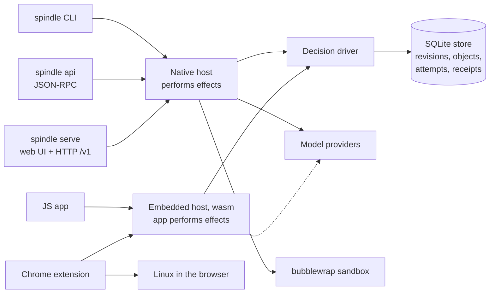

# Spindle

A durable coding agent. Every step of a session is a committed revision of the
conversation, the workspace files and the app state together, so a run that is killed
resumes where it stopped, a model request is never sent twice by accident, and rewinding
restores all three at once.

Spindle runs as a native command (`spindle`), as a browser host for phones and desktops
(`spindle serve`), behind a JSON-RPC or HTTP API for your own programs, as a WebAssembly
package inside a JavaScript app, and as a Chrome extension that needs no server at all.

> **Status:** experimental, single-operator software. Read [SECURITY.md](SECURITY.md)
> before giving it real work.

## Why it is different

- **Reserve, then send; record, then use.** Each model request, command and tool call is
  reserved in the store before it is performed and its result recorded before the agent
  acts on it. After a crash Spindle adopts recorded results and *reports* requests whose
  outcome is unknown instead of guessing; `retry` resends one only when you ask.
- **One revision holds everything.** Conversation, a content-addressed workspace tree and
  JSON app state commit in one SQLite transaction. Rewind goes back to any eligible
  revision; a call made again after a rewind gets a fresh id.
- **The store decides, hosts act.** A portable decision driver (no network, no clocks,
  builds for wasm) tells a host what the turn needs next. The native host, the embedded
  package and the Chrome extension all run the same driver.
- **Sessions move.** Export a session to a single-file bundle and continue it in another
  host: terminal to browser and back.

## Quick start

Requires Rust 1.89 or newer, a C compiler, and on Linux `bubblewrap` for sandboxed
commands.

```sh
git clone https://github.com/SiliconState/Spindle.git
cd Spindle/spindle
cargo build --release --locked -p spindle-store --features cli --bin spindle

./target/release/spindle providers
./target/release/spindle login deepseek
./target/release/spindle --dir ../demo new --provider deepseek --isolation required \
  "Create a small command-line calculator with tests"
./target/release/spindle --dir ../demo status
./target/release/spindle --dir ../demo files
```

Interrupted? `spindle --dir ../demo continue`. Browser UI:
`spindle --dir ../host serve --port 8790`, then pair with the key in
`../host/pairing.key`. Full walkthrough: [docs/getting-started.md](docs/getting-started.md).

## Architecture



More diagrams and the full picture: [docs/architecture.md](docs/architecture.md).

## Documentation

| Start here | Reference | Components |
| --- | --- | --- |
| [Getting started](docs/getting-started.md) | [CLI](docs/cli.md) | [Store](docs/store.md) |
| [Concepts](docs/concepts.md) | [API (v1)](docs/API.md) | [Driver and session](docs/driver.md) |
| [Architecture](docs/architecture.md) | [Clients](docs/clients.md) | [Tools and execution](docs/tools.md) |
| [Security](SECURITY.md) | [Testing](docs/testing.md) | [Browser host](docs/host.md) |
| | | [Embedded package](docs/embedded.md) |
| | | [Chrome extension](docs/chrome.md) |
| | | [Browser Linux](docs/browser-linux.md) |
| | | [Engine crates](docs/engine.md) |

All of it is indexed in [docs/README.md](docs/README.md).

## Repository layout

| Path | Contents |
| --- | --- |
| [`spindle/store`](spindle/store) | `spindle-store`: the store, decision driver, native session, API, CLI and browser host |
| [`spindle/store/ui`](spindle/store/ui) | The web UI, embedded into the binary (no frontend build step) |
| [`spindle/embed`](spindle/embed) | `spindle-embed`: the WebAssembly package with Node and browser storage |
| [`spindle/clients`](spindle/clients) | Dependency-free Node.js and Python clients |
| [`spindle/chrome`](spindle/chrome) | Spindle for Chrome and the Linuxes it runs commands in |
| [`spindle/src`](spindle/src) | `spindle-reference`: an in-memory reference model of the store's rules |
| [`dext-engine`](dext-engine) | Engine crates: model and turn types, transcripts, provider catalog and wire formats, the strict runner |
| [`docs`](docs) | Documentation |

## Development

```sh
cd spindle
cargo fmt --all -- --check
cargo clippy --locked --workspace --all-targets --all-features -- -D warnings
cargo test --locked --workspace --all-features
```

The engine crates have the same three commands in `dext-engine/`. Tests use scripted
loopback providers, so none of them needs an account. See [docs/testing.md](docs/testing.md)
for every suite and the CI workflow.

## License

[MIT](LICENSE), copyright SiliconState. Vendored v86 files under
`spindle/chrome/wasm-linux/v86/` keep their BSD 2-Clause license. The patches under
`spindle/chrome/wasm-linux/` (`kernel/`, `python/`, `rust/patches/`) change those
projects' own sources and fall under their licenses (GPL-2.0 for the Linux kernel, the PSF
license for CPython, MIT or Apache-2.0 for Rust's standard library and `libc`).
Dependencies keep their own licenses.
