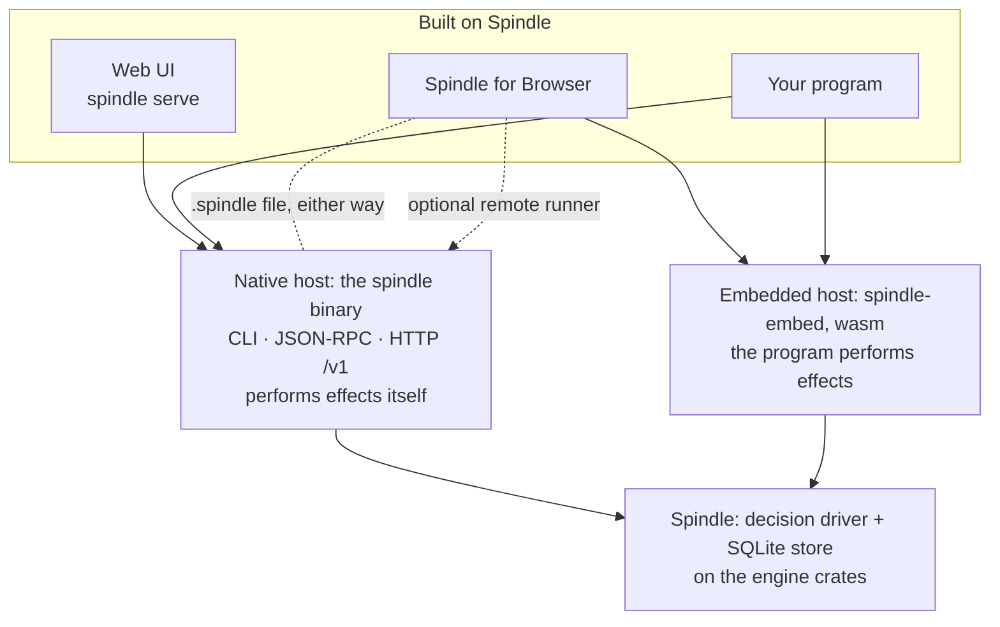

# Spindle

**An agent that lives wherever you work.**

Spindle is a durable, embeddable agent engine. Every step of a session is a committed
revision of the conversation, the workspace files and the app state together, so a run that
is killed resumes where it stopped, a model request is never sent twice by accident, and
going back restores all three at once. The same core, with the same rules and the same
session format, runs as a native binary or compiled to WebAssembly inside another program,
which is what lets it live in a terminal, on a server, inside your app or in a browser.

Website: [siliconstate.github.io/Spindle](https://siliconstate.github.io/Spindle/).

> **Status:** experimental, single-operator software. Read [SECURITY.md](SECURITY.md)
> before giving it real work.

## The core

Spindle's core is two layers of this repository:

- **The engine crates** ([`dext-engine/`](dext-engine)): model and turn types, transcripts,
  the provider catalog and its request formats, and the strict command runner.
- **Spindle** ([`spindle/store`](spindle/store)): the SQLite store that commits every step,
  and the decision driver that says what a turn needs next, with no network and no clock.

Something has to carry out what the driver asks for (send a model request, run a command,
answer an app's tool). That is the host, and there are two:

| Host | What it is | Who performs effects | Where commands run | Read |
| --- | --- | --- | --- | --- |
| **Native** | The `spindle` binary: a CLI (`new`, `say`, `continue`, `rewind`), JSON-RPC over stdio (`spindle api`) and the `/v1` HTTP API, with Node.js and Python clients | The binary itself | A bubblewrap sandbox on Linux; elsewhere, or without bubblewrap, on the host itself, and Spindle says so (`--isolation required` refuses instead) | [Getting started](docs/getting-started.md), [CLI](docs/cli.md), [API](docs/API.md) |
| **Embedded** | `spindle-embed`: the same store and driver compiled to WebAssembly, in Node or a browser worker | The program around it: it sends the model requests and runs the commands | A runner the program provides, or a `spindle serve` host as a remote runner | [Embedded package](docs/embedded.md) |

## Why it is durable

- **Reserve, then send; record, then use.** Each model request, command and tool call is
  reserved in the store before it is performed and its result recorded before the agent
  acts on it. After a crash Spindle adopts recorded results and *reports* requests whose
  outcome is unknown instead of guessing; `retry` resends one only when you ask.
- **One revision holds everything.** Conversation, a content-addressed workspace tree and
  JSON app state commit in one SQLite transaction. Rewind goes back to any eligible
  revision; a call made again after a rewind gets a fresh id.
- **The store decides, hosts act.** Because the driver only decides, the same rules hold in
  both hosts, down to a WebAssembly worker inside a browser.

## Built on Spindle

These use the core; none of them is part of it.

| | What it is | Built on | Read |
| --- | --- | --- | --- |
| **Spindle for Browser** | The first product: an extension for Chrome and Edge. Threads keep going with the panel closed, read and act on your tabs once you allow it, and run commands in a Linux inside the browser | `spindle-embed` | [Spindle for Browser](docs/chrome.md), [its page](https://siliconstate.github.io/Spindle/browser/) |
| **The web UI** | `spindle serve` (Unix): a phone-friendly UI over a directory of threads, on loopback, each device paired once and reached from elsewhere through your own authenticating HTTPS proxy | The native binary | [Web UI host](docs/host.md) |
| **Examples** | A Node script; a browser page with its worker, behind a local relay that keeps the key out of the page; client examples in Node.js and Python | `spindle-embed`, the API clients | [Embedded package](docs/embedded.md), [Clients](docs/clients.md) |

## How the parts fit



**What every use of the core shares**

- **The store and its rules.** A session's SQLite store holds revisions, content-addressed
  objects, attempts and receipts. Wherever it runs, a request is reserved before it leaves
  and its result recorded before the agent uses it.
- **The session format.** A session exported from one host continues in another, history and
  unknown outcomes included: `spindle export-session` and `import-session` natively,
  **Move to a file** and **Import a .spindle thread** in Spindle for Browser.
- **How providers are spoken to.** The provider catalog format (`providers.json`) and the
  request formats come from the engine crates, so a provider entry means the same thing
  everywhere.

**What differs**

- **Who performs effects.** The native binary sends model requests and runs commands itself.
  With `spindle-embed`, the program around it does; Spindle for Browser is such a program.
- **Where commands run.** A bubblewrap sandbox or the host itself, a runner the program
  supplies, or in Spindle for Browser a Linux inside the browser (v86, plus a faster wasm
  Linux when built from source).
- **Tools.** Only Spindle for Browser has page tools for reading and acting on tabs.
  Only the native binary mounts your Rust toolchain read-only for commands
  (`--toolchain`). Both hosts support a dollar budget (`max_usd`), the same
  [spend ledger](spindle/store/src/spend.rs), and child tasks with queued reports;
  their accounting and restart limits are in [docs/embedded.md](docs/embedded.md).
- **Keys and sign-in.** The native binary uses Dext's sign-in flows and credential store and
  reads a key when it sends a request. Spindle for Browser takes keys or a ChatGPT sign-in
  (not a Claude subscription sign-in) and seals them in the extension's storage. A session
  never holds a key, so a `.spindle` file carries none.

**What is not connected**

- There is no Spindle cloud or service. Requests go to the model provider you chose, not
  through anything of Spindle's.
- Spindle for Browser does not need the native binary, and the native binary does not need
  the browser. Their sessions never share storage: they meet only through a `.spindle` file
  you move, or when you connect a `spindle serve` host to the extension as a place to run commands.
- Copies do not sync. Moving a session seals the copy it left; copying it (`--keep`) leaves
  two, of which you continue one.

More diagrams: [docs/architecture.md](docs/architecture.md).

## Quick start

**Spindle, from source.** Requires Rust 1.89 or newer, a C compiler, and on Linux `bubblewrap`
for sandboxed commands.

```sh
git clone https://github.com/SiliconState/Spindle.git
cd Spindle/spindle
cargo build --release --locked -p spindle-store --features cli --bin spindle

./target/release/spindle providers
./target/release/spindle login deepseek
./target/release/spindle --dir ../demo new --provider deepseek --isolation required \
  "Create a small command-line calculator with tests"
./target/release/spindle --dir ../demo status
./target/release/spindle --dir ../demo files
```

Interrupted? `spindle --dir ../demo continue`. The web UI:
`spindle --dir ../host serve --port 8790`, then pair with the key in `../host/pairing.key`
(a phone reaches it through a reverse proxy,
[docs/host.md](docs/host.md#remote-access-through-a-reverse-proxy)). Full walkthrough:
[docs/getting-started.md](docs/getting-started.md).

**Spindle for Browser 0.1.4.** Download `spindle-browser-0.1.4.zip` from the
[latest release](https://github.com/SiliconState/Spindle/releases/latest), unzip it, and load
the folder with **Load unpacked** in `chrome://extensions` or `edge://extensions`
([docs/chrome.md](docs/chrome.md#install-a-release)). Its single-box composer,
grouped threads, compact steps and task cards share the web UI's design. Workspace
pages run scripts automatically only when the browser enforces containment;
otherwise they are static until you allow that version. Settings > Storage can
return free database pages without deleting history. The native phone UI follows
the same layout, adapted to the smaller screen. Sources:
[`panel.mjs`](spindle/chrome/panel.mjs), [`page.mjs`](spindle/chrome/page.mjs) and
[`app.js`](spindle/store/ui/app.js).

## Documentation

| Start here | Reference | Components |
| --- | --- | --- |
| [Getting started](docs/getting-started.md) | [CLI](docs/cli.md) | [Store](docs/store.md) |
| [Concepts](docs/concepts.md) | [API (v1)](docs/API.md) | [Driver and session](docs/driver.md) |
| [Architecture](docs/architecture.md) | [Clients](docs/clients.md) | [Tools and execution](docs/tools.md) |
| [Security](SECURITY.md) | [Testing](docs/testing.md) | [Web UI host](docs/host.md) |
| | | [Embedded package](docs/embedded.md) |
| | | [Spindle for Browser](docs/chrome.md) |
| | | [Browser Linux](docs/browser-linux.md) |
| | | [Engine crates](docs/engine.md) |

All of it is indexed in [docs/README.md](docs/README.md).

## Repository layout

| Path | Part | What it is |
| --- | --- | --- |
| [`dext-engine`](dext-engine) | Core | The engine crates Spindle builds on: model and turn types (`core`), transcripts (`transcript`), the provider catalog and request formats (`provider`), and the strict command runner (`native`) |
| [`spindle/store`](spindle/store) | Core, native host | `spindle-store`: the SQLite store and its rules, the decision driver, the native session that performs effects, and the `spindle` binary with its CLI, JSON-RPC API, `/v1` HTTP API and `spindle serve` |
| [`spindle/embed`](spindle/embed) | Embedded host | `spindle-embed`: the same core compiled to WebAssembly, storing sessions in files under Node or in OPFS in a browser worker; the program around it performs the effects. Its `examples/` are small programs built on it |
| [`spindle/clients`](spindle/clients) | Clients | Dependency-free clients: Node.js and Python for the JSON-RPC and HTTP APIs, and the JavaScript side of `spindle-embed` (its runners, OPFS storage and app tools) |
| [`spindle/src`](spindle/src) | Core, reference | `spindle-reference`: an in-memory reference model of the store's rules |
| [`spindle/chrome`](spindle/chrome) | Built on Spindle | Spindle for Browser, on `spindle-embed`: the side panel, the offscreen engine worker that keeps threads going, the page tools, the sealed key vault, and the Linuxes commands run in (`linux/`, v86 with Alpine; `wasm-linux/`, the optional faster wasm Linux) |
| [`spindle/store/ui`](spindle/store/ui) | Built on Spindle | The web UI that `spindle serve` hosts, built into the binary (no frontend build step) |
| [`docs`](docs) | | Documentation, written from the code |
| [`site`](site) | | The website, published with GitHub Pages |

## Development

```sh
cd spindle
cargo fmt --all -- --check
cargo clippy --locked --workspace --all-targets --all-features -- -D warnings
cargo test --locked --workspace --all-features
```

The engine crates have the same three commands in `dext-engine/`. Tests use scripted
loopback providers, so none of them needs an account. See [docs/testing.md](docs/testing.md)
for every suite and the CI workflow.

## License

[MIT](LICENSE), copyright SiliconState. Vendored v86 files under
`spindle/chrome/wasm-linux/v86/` keep their BSD 2-Clause license. The patches under
`spindle/chrome/wasm-linux/` (`kernel/`, `python/`, `rust/patches/`) change those
projects' own sources and fall under their licenses (GPL-2.0 for the Linux kernel, the PSF
license for CPython, MIT or Apache-2.0 for Rust's standard library and `libc`).
Dependencies keep their own licenses.
