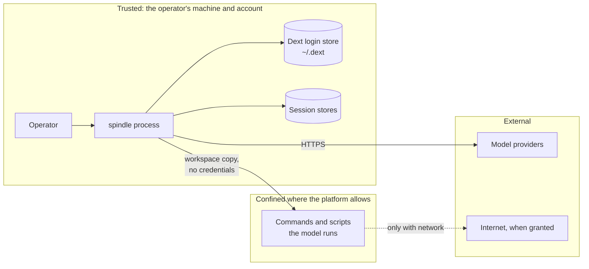
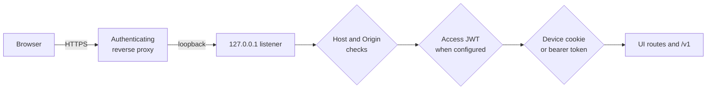

# Security

Spindle is experimental, single-operator software. It is not a multi-tenant service, an
exactly-once remote execution system or a certified backup system. Run it only with
accounts, code and tools you are authorized to use. This page describes what the code
protects, how, and where its protection ends.

## Reporting a vulnerability

Use GitHub's private vulnerability reporting for this repository if it is enabled.
Otherwise open an issue that names the affected component without exploit details,
credentials, user data or session archives, and ask for a private channel before sharing
anything sensitive. Do not attach session databases or logs.

## Trust model

The operator, the `spindle` process, its configuration and the user account it runs as
are trusted. Model output, and every command or script a model writes, is untrusted and
runs confined where the platform supports it. Providers receive what the session sends
them.

## Data at rest

- Session stores keep prompts, model requests and replies, files, app state, tool results
  and usage **unencrypted** in the session directory. The browser host also keeps
  `host.sqlite`, uploads and a trash directory; native migrations keep a backup of the
  previous store. Schema 19-to-20 embedded migration is in place without a backup;
  store compaction removes free pages, not history. Deleting a session is not secure erasure.
- Do not put secrets or personal data into a session unless you accept that they are
  retained there and sent to the provider.
- Session directories, the host directory, `pairing.key`, API tokens and the Dext state
  directory should be private to the operator's account. On Unix, the store directory is
  created with mode `0700`, and a store directory that is a symbolic link or grants any
  permission to group or others is refused.

## Credentials

- Native hosts read provider credentials from the Dext login store (`~/.dext`, or
  `$DEXT_HOME`) or the provider's environment variable **for each fresh send**. They are
  never written into a session store, `session.json`, a bundle or a receipt.
- `spindle login` reads a key from a prompt or from stdin when no key is given on the
  command line; prefer that over arguments, which shell history may keep.
- The provider catalog contains public endpoints and public OAuth client identifiers.
  Those identifiers are not secrets.
- The embedded package asks the app for credentials when it needs them and never stores
  them. Spindle for Browser keeps provider keys and sign-ins sealed in the extension's own
  storage (see below) and sends each only to its provider.

## Command execution

Commands (`bash`, background jobs, `run_code` scripts) run over a private copy of the
workspace. Their changes return as a new workspace tree only through a receipt; a
background job's changes never return.

| Isolation | Linux | macOS, Windows |
| --- | --- | --- |
| `required` | bubblewrap sandbox; refuses the command if it is unavailable | refuses: namespace isolation needs Linux |
| `auto` (default) | sandbox where available, otherwise runs on the host and says so | runs on the host and says so |
| `off` | runs on the host | runs on the host |

- **The sandbox helper is pinned.** The Linux runner uses `/usr/bin/bwrap`, pinned to the
  SHA-256 of its bytes when the runner is first opened, and is used only after a trivial
  probe run succeeds on the host.
- **Grants are explicit.** Commands get no network unless the session's `network`
  setting is on, and the host Rust toolchain only with `toolchain` (read-only, with host
  directories named by `--source` mounted read-only beside it).
- **Host execution is not confinement.** A command run on the host can read and modify
  the user's files and reach the network. Rewind cannot undo effects outside the
  workspace, nor anything done with network access.
- **Cleanup.** With a delegated cgroup v2 subtree the Linux runner can prove a command's
  processes are gone and apply resource limits; without one, cleanup relies on process
  groups and is weaker against descendants that escape them. Windows runs commands in a
  job object that ends with the run.
- Code-mode scripts receive call descriptors and results, never the host's code policy,
  provider credentials or authority to choose an executable. HTTP grants are checked by
  the host: no user-info in URLs, exact scheme, host and port, a path prefix on a segment
  boundary, and redirects followed only inside the same grant.

See [docs/tools.md](docs/tools.md) for the full execution model.

## Recovery semantics

- Every effect is reserved before it is performed and recorded before it is used. An
  attempt without a record after a crash, a stop during streaming, or a dropped
  connection is an **unknown outcome**: the provider may have processed and billed it.
- `continue` never resends an unknown outcome unless the session's `resend_unknown`
  setting consents to it; `retry` sends it once more, explicitly. With consent, a dropped
  or unknown send is retried automatically up to three times, waiting 1, 2 and 4 seconds,
  and only when a rewind target exists. Each resend may be billed.
- A provider refusal (an HTTP error) is a known outcome; its retries are bounded and
  honor `Retry-After`.
- Effect ids are stable for a call across crashes and fresh after a rewind, but they are
  not globally unique across sessions. An app that runs side effects for app tool calls
  must deduplicate by **session identity plus call id**. Spindle does not make a third-party
  API idempotent.
- Dollar budgets on both hosts use the same [ledger](spindle/store/src/spend.rs)
  and refuse a request before it is sent when its worst case would not fit. They
  depend on catalog prices and conservative estimates, not exact provider billing.
  Embedded task-tree accounting covers hosts open together; after a restart, earlier
  child spend counts in its own store only ([embedded.md](docs/embedded.md#settings-and-limits)).
- The store relies on SQLite and the filesystem honoring flushes, and on one cooperating
  owner per session. Owner epochs fence store writes, not processes or remote receivers.
  There is no anti-rollback protection: restoring an old but consistent copy of a store
  silently drops later work.

## Browser host (`spindle serve`)

- The listener binds loopback only. A request's `Host` must be `localhost`,
  `127.0.0.1` or the configured public origin's host, and state-changing browser
  requests must be same-origin.
- **Pairing.** The pairing key in the host directory only pairs screens. Pairing exchanges
  it for a random per-device token in an `HttpOnly; SameSite=Strict` cookie (`Secure` when
  the request came through the configured HTTPS origin). `host.sqlite` stores only each
  token's SHA-256, so one screen can be revoked without re-pairing the others.
- **API tokens.** `spindle token new NAME` mints a named bearer token for `/v1`;
  tokens can be listed and revoked. Prefer `token new NAME --runner` for a remote
  command runner: only `GET /v1`, `/v1/runner`, `/v1/run` and that token's run status
  and stop routes are reachable. Session, transcript and phone `/api` access are
  refused, including when it is supplied as a cookie
  ([`serve/v1.rs`](spindle/store/src/serve/v1.rs)).
- **Deadlines.** A request head must arrive within 10 seconds overall. Once
  authorized, its body has 10 seconds, or 2 minutes for uploads and `/v1/run`;
  trickled bytes do not extend those deadlines
  ([`serve/http.rs`](spindle/store/src/serve/http.rs)).
- **Remote access** must go through an authenticated HTTPS reverse proxy with
  `--origin https://HOST`. With `--access-team` and `--access-aud`, the host itself
  verifies the Cloudflare Access token on every request that arrived through the public
  origin: an RS256 JWT signed by one of the team's current keys, issued by the team, for
  that application's audience, and unexpired. A stolen device cookie alone does not pass.
- **Previews** use random, read-only grants expiring after 30 minutes, held only
  in memory. Scripts default off (`scripts: false`); true grants every page, a
  path only that page. A GitHub grant also permits scripts, even if `scripts` is
  false or omitted, and adds only API connections and avatar images. Every response
  has `Connection-Allowlist` for its token prefix (plus those GitHub origins),
  empty without a live token, and
  `X-DNS-Prefetch-Control: off`. Meta refreshes and resource hints are removed.
  Where the browser enforces the allowlist, all other connections, including WebRTC,
  are blocked. `GET /api/preview/check` detects this; a `contained` grant checks
  again before running its page. Elsewhere **Run scripts** allows one page version
  on that device, and can disclose what the page shows: CSP alone is not an offline
  guarantee. Sandboxes never grant `allow-same-origin`, host cookies, storage or
  API access; forms submit nowhere. Features `preview_scripts` and
  `preview_contained` advertise the controls. See
  [`preview.rs`](spindle/store/src/serve/preview.rs) and [host.md](docs/host.md#previews).
- The host is a trusted single-operator API, not tenant-scoped authorization. Exposing the
  loopback port, a proxy misconfiguration, or a compromised process of the same user
  defeats these checks.

See [docs/host.md](docs/host.md).

## Self-edit and upgrades

- A model can edit Spindle's own source in a self-edit thread, but installing a build is
  the operator's decision. `spindle upgrade` requires a candidate to report its version
  and pass its own `doctor` on copies of the given sessions (child tasks included) before
  it is installed, and keeps the replaced binary for `rollback`. None of this proves the
  code benign: review it.
- A new binary migrates older stores when it opens them. Rolling back the binary does not
  roll back a migrated store; keep the migration backup until you are sure.

## Spindle for Browser

- Threads, credentials and files stay in the extension's storage. Requests go to the
  chosen provider, to sites a thread's network or scripts are granted, and to a relay or
  Spindle host only if the user configures one.
- API keys, browser sign-ins and the connected host's runner token are sealed at
  rest with AES-GCM, bound to their separate record ids (the host uses `:host`,
  not a provider id). The host URL is readable, never its token. By default the
  sealing key is a non-extractable key in the same profile: this
  keeps credentials out of the profile's files as text, but a copy of the whole profile
  carries that key too. A passphrase (Settings, Providers) wraps the sealing key with a key
  derived by PBKDF2-SHA-256 (600,000 rounds), so a copy of the profile made afterwards is
  useless without it; the keys are then unlocked once per engine start and held only in
  the engine's memory. Setting or changing it re-seals everything under a fresh key, but
  Chrome may keep earlier copies of the records (and of the device key) in its storage
  files until it compacts them, so replace keys at their provider if a copy made before
  could matter. A forgotten passphrase cannot be recovered; the only way on is deleting
  every saved credential. Code running in the extension while it is unlocked, or with the
  user's account on an unlocked machine, is outside this protection.
- Browser sign-in uses the authorization-code flow with PKCE and a random `state`. The
  panel catches the code and hands it to the engine; only the engine exchanges it and holds
  the tokens, and the panel never sees a token. Keys a former build kept as text are sealed
  when the engine starts, but Chrome may keep the old text in its storage files until it
  compacts them.
- Commands run in a Linux inside the extension, as an unprivileged user in per-command
  namespaces, without access to the computer's files or to Spindle's keys.
- A thread's network is off by default. When on and no relay is set, requests go through
  a gateway in the extension that refuses loopback, private and link-local addresses and
  local names, and refuses redirects whose target Chrome hides. A public name that
  resolves into a private network is not detected, because Chrome resolves names. With a
  relay set, commands reach whatever addresses the relay allows.
- Page tools act in the user's real browser tabs with the user's sign-ins. A browser action
  already dispatched cannot be undone by Stop. Closing Chrome's debugging bar on a tab keeps
  Spindle from acting on it until page actions are turned off and on; a click or typing whose
  target is covered by something else is refused rather than landing on it; actions on one tab
  run one at a time.
- A saved key or sign-in is bound to the provider address it was saved for: importing a
  provider list that points that provider (or its token endpoint) elsewhere does not send the
  credential there.
- Previews of workspace pages cannot navigate their frame away. The service worker
  sets an empty `Connection-Allowlist` for offline previews; scripts run without a
  choice only when that protection is detected. Otherwise static previews remove
  scripts and frames until the user allows that version. Choices bind the page,
  scripts and named data files, checked against workspace digests; changes ask again.
  Meta refreshes and resource hints, including those inside templates, are removed,
  DNS prefetch is off, and markup that cannot be safely reparsed is shown as text.
  **Load from the web** allows scripts and HTTPS connections under a separate
  allowlist. Allowed uncontained scripts can disclose page data despite CSP.
  Sources: [`page.mjs`](spindle/chrome/page.mjs),
  [`preview.js`](spindle/chrome/preview.js), [`background.js`](spindle/chrome/background.js).
- A move durably commits its bundle before sealing and removes redundant OPFS
  stores only after reading the saved bytes back. Storage > Free checks older
  moved bundles whole before deleting sealed stores. Reset backups are temporary,
  removed once the reset or recovery finishes. Strict IndexedDB commits and synced,
  checked store replacements reduce crash windows; they are not secure erasure or
  protection against an old profile copy ([chrome.md](docs/chrome.md#storage-controls)).

See [docs/chrome.md](docs/chrome.md) and [docs/browser-linux.md](docs/browser-linux.md).
