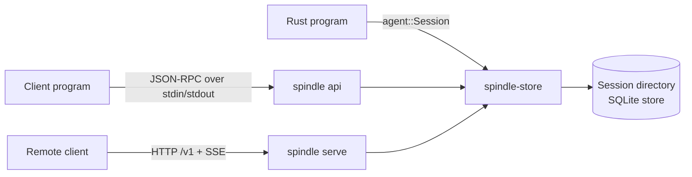
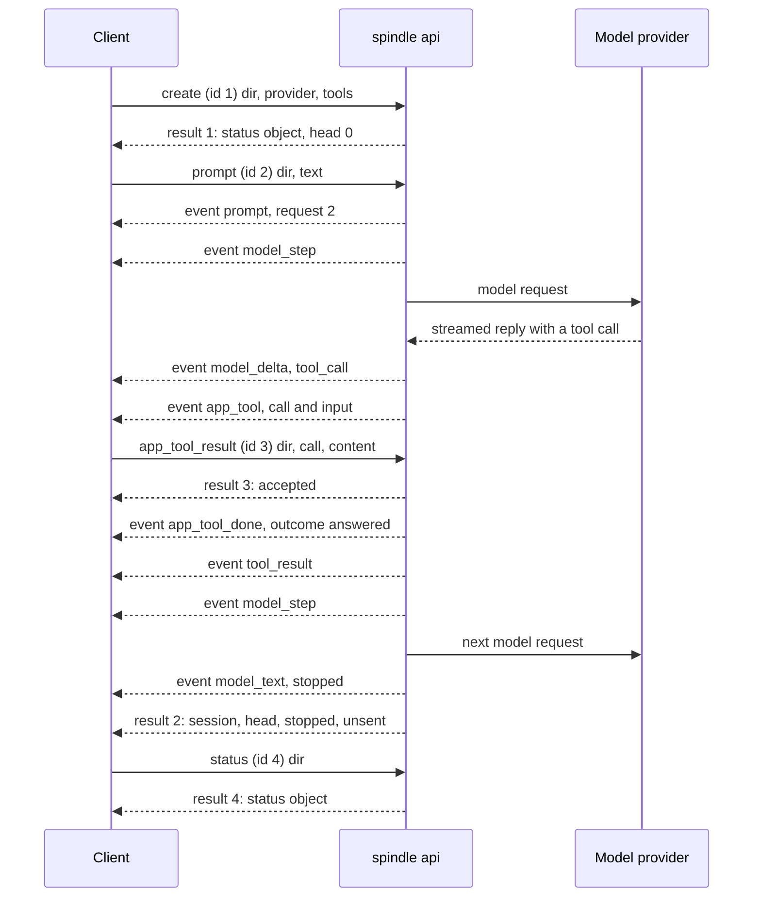

# Spindle API reference (version 1)

Spindle's public API lets a program drive durable agent sessions without linking
against Spindle: create a session, send prompts, watch the turn as a stream of
events, answer calls of tools the program supplies, read the committed conversation,
workspace and app state at any revision, and find out what a crashed owner left
unfinished. The same contract is served over three transports: JSON-RPC 2.0 over
stdio (`spindle api`), HTTP under `/v1` of `spindle serve`, and the Rust `agent`
module. This page is the reference for all of them; it is derived from
[`api.rs`](../spindle/store/src/api.rs), [`protocol.rs`](../spindle/store/src/protocol.rs),
[`api/stdio.rs`](../spindle/store/src/api/stdio.rs) and
[`serve/v1.rs`](../spindle/store/src/serve/v1.rs), and checked by
[`tests/api.rs`](../spindle/store/tests/api.rs) and the recorded protocol frames in
[`tests/fixtures/protocol/`](../spindle/store/tests/fixtures/protocol/).

For what sessions, revisions, turns and receipts are, see [concepts.md](concepts.md).
For the ready-made Python and JavaScript clients, see [clients.md](clients.md).

## Contents

- [Overview](#overview)
- [The stdio protocol](#the-stdio-protocol)
- [Methods](#methods)
- [Events](#events)
- [Data types](#data-types)
- [HTTP API](#http-api)
- [Errors](#errors)
- [Rust surface](#rust-surface)

## Overview

### Transports

| Transport | Started by | Sessions named by | Framing | Source |
| --- | --- | --- | --- | --- |
| stdio | `spindle api` (a child process of the client) | directory path (`dir`) | JSON-RPC 2.0, one JSON object per line on stdin and stdout | [`api/stdio.rs`](../spindle/store/src/api/stdio.rs) |
| HTTP | `spindle serve` (a long-running host) | session id | `/v1/...` routes, JSON bodies, Server-Sent Events | [`serve/v1.rs`](../spindle/store/src/serve/v1.rs) |
| Rust | linking `spindle-store` with feature `agent` | directory path | function calls and an `Observer` callback | [`agent.rs`](../spindle/store/src/agent.rs) |

The embedded package (`spindle-embed`, wasm) answers the same JSON-RPC protocol
in-process, through the same [`protocol.rs`](../spindle/store/src/protocol.rs), with
`transport: "embedded"` and its own feature list; its differences are in
[embedded.md](embedded.md).



All transports share the stable JSON forms defined in
[`api.rs`](../spindle/store/src/api.rs) and [`protocol.rs`](../spindle/store/src/protocol.rs):
events, messages, settings, status, rewind targets, recovery reports and usage. Read
methods (`history`, `files`, `read`, `state`, `usage`, `recover`, `tasks`) read the
session's committed state through a read-only view and take no owner lock, so they
answer while a turn runs in this or another process.

### Versioning and feature detection

`API_VERSION` is `1` ([`api.rs`](../spindle/store/src/api.rs); `api_version` in the
stdio `info` result and in `GET /v1`). Within a version, changes are additive only:
new fields, event types, methods, routes and feature names. A security fix is an
exception: since `preview_scripts`, a preview grant without `scripts` shows pages
without their scripts. A page policy alone cannot close script-driven WebRTC leaks;
`preview_contained` adds browser-enforced connection limits. Other changes a client
could notice require a new version.

A client compares `api_version` for equality and then tests `features` for anything
added within the version. Clients should ignore fields and event types they do not
know.

Parameters are checked strictly: an unknown stdio parameter is refused with
`bad_request` ("unknown parameter" and its name), and so is an HTTP command field
that does not apply to its kind. A client that sends a newer option to an older host gets an
error rather than having the option silently dropped.

| stdio `info.features` | HTTP `GET /v1` `features` |
| --- | --- |
| `events`, `expected_head`, `steering`, `attachments`, `import`, `revisions`, `export`, `doctor`, `usage`, `display`, `steer_now`, `app_tools`, `state`, `recover`, `tasks`, `session_transfer`, `capabilities` | `commands`, `receipts`, `expected_head`, `events`, `steering`, `attachments`, `revisions`, `archive`, `targets`, `providers`, `bearer_tokens`, `usage`, `preview`, `preview_github`, `models`, `self_edit`, `display`, `steer_now`, `app_tools`, `state`, `recover`, `tasks`, `runner`, `run_stop`, `runner_tokens`, `preview_scripts`, `preview_contained` |

### Session addressing

- **stdio** names a session by its directory, `dir`. A relative path is resolved
  against the `spindle api` process's current directory; the existing part of the
  path is canonicalized, so one directory has one name however it is spelled. Paths
  with `.` or `..` in the part that does not exist yet are refused. The resolved
  absolute path is the `session` field of results and events. A task is a session of
  its own; every method reads it by its directory (the `task` field of `task_start`
  and `task_wait`, or `dir` in `tasks`).
- **HTTP** names a session by its id (1 to 80 letters, digits, `-` or `_`), assigned
  by the host when a `new` command is admitted and returned as the receipt's
  `session`. Session directories stay private to the host.

### Revisions and `expected_head`

Every committed step is a revision; `head` is the newest. Revision `0` is the empty
state before the first turn (no conversation, no workspace). Read methods take an
optional `revision` (the head when omitted); a revision that was asked for and is
not committed is `not_found`.

Methods that move the head accept `expected_head`. The operation runs only if the
head is still that revision; otherwise it is refused with `head_moved` and the
current head, before anything runs. Over stdio the check is made once the session's
worker holds the owner lock, so nothing can move the head between the check and the
operation.

### HTTP authentication

Every `/v1` route, including `GET /v1`, needs a credential:

- `Authorization: Bearer TOKEN`, where `TOKEN` is a paired device's token or a named
  API token minted with `spindle --dir HOST token new NAME` (also `token list` and
  `token revoke NAME`; at most 16 named tokens). The host's pairing key is never
  accepted as a token. `token new NAME --runner` mints a restricted token: only
  `GET /v1`, `/v1/runner`, `/v1/run` and a named run's status and stop routes are
  reachable. Other `/v1` routes and the phone UI's `/api` refuse it with `403
  forbidden`, even as a cookie. Token names are 1–40 letters, digits, `-`, `_` or
  `.`, and cannot start with `-`; `token list` marks restricted tokens `(runner)`.
- Or a paired browser's cookie. A cookie-authenticated `POST` must also carry an
  `Origin` header equal to the host's origin and `X-Spindle: 1`; otherwise it is
  refused with `403 forbidden`. Bearer requests need neither.

A revoked device or token also loses its open event streams (checked at each
heartbeat). Pairing, token storage and public-origin checks are described in
[host.md](host.md).

## The stdio protocol

`spindle api` speaks JSON-RPC 2.0 over NDJSON: each request is one JSON object on one
line of stdin, and every frame the process writes is one JSON object on one line of
stdout. Nothing else is written to stdout: on Unix, the process keeps private copies
of its original stdin and stdout and points file descriptor 1 at stderr and 0 at
`/dev/null`, so no child process can write into or read from the protocol stream.

### Framing

| Rule | Behavior |
| --- | --- |
| Request | `{"jsonrpc": "2.0", "id": ID, "method": NAME, "params": {...}}`. `params` is an object or omitted. |
| `id` | A string, a number or null. A request without `id` is a notification and is never answered. |
| Batches | Not supported: an array is refused with `invalid_request`. |
| Line length | At most 64 MiB per request line; a longer line is answered with `invalid_request` (id null) and reading resumes after it. |
| Blank lines | Skipped. |
| Response | `{"jsonrpc": "2.0", "id": ID, "result": ...}` or `{"jsonrpc": "2.0", "id": ID, "error": {"code", "message", "data": {"code", ...}}}`. |
| Event | `{"jsonrpc": "2.0", "method": "event", "params": {"session": DIR, "request": ID or null, "event": {...}}}` |
| Prompt text | At most 4 MiB. |

### Concurrency and lifecycle

One `spindle api` process manages any number of sessions. Each open session has a
worker thread that owns its `Session` (and so the store's owner lock) and runs that
session's jobs in order. The thread reading stdin never waits for a worker, so
`stop`, `steer`, `app_tool_result` and reads are answered while a turn runs.
Responses can therefore arrive out of order; match them by `id`.

- A session is opened lazily by the first method that needs it (`open`, `status`,
  turn methods, `targets`, `settings` changes, `state_set`, `export`,
  `export_session`, `doctor`) and stays open until `close`, an `export_session` that
  moves it, or end of input.
- A turn-like method (`prompt`, `continue`, `retry`, `rewind`, `task_start`) is
  answered when its operation ends. Only one runs per session at a time; another is
  refused with `busy`.
- Methods that need an idle session (`targets`, `export`, `export_session`, `doctor`,
  a `settings` change, `close`, and `state_set` with `expected_head`) are refused with
  `busy` while a turn runs.
- After every turn-like operation the worker reopens the session, as each CLI command
  does, so a stopped or failed step is reconciled under a new owner epoch.
- At end of input, running turns are asked to stop, every worker lets go of its
  session, and the process waits up to 10 seconds for them before it exits. A turn cut
  off this way resumes with `continue` like any interrupted run.

### Example exchange



The same exchange as frames, one per line (abbreviated; `...` marks elided values):

```text
{"jsonrpc":"2.0","id":1,"method":"create","params":{"dir":"work","provider":"local","tools":[{"name":"lookup","description":"Looks notes up.","input_schema":{"type":"object","properties":{"q":{"type":"string"}}}}]}}
{"jsonrpc":"2.0","id":1,"result":{"session":"/data/work","head":0,"phase":"empty","busy":false,"settings":{"provider":"local", "...": "..."},"imported":null}}
{"jsonrpc":"2.0","id":2,"method":"prompt","params":{"dir":"work","text":"find my notes"}}
{"jsonrpc":"2.0","method":"event","params":{"session":"/data/work","request":2,"event":{"type":"prompt","text":"find my notes"}}}
{"jsonrpc":"2.0","method":"event","params":{"session":"/data/work","request":2,"event":{"type":"app_tool","call":"...","tool_use_id":"call_1","name":"lookup","input":{"q":"notes"},"again":false,"rerun":"no","timeout_s":600}}}
{"jsonrpc":"2.0","id":3,"method":"app_tool_result","params":{"dir":"work","call":"...","content":"Found 1 note."}}
{"jsonrpc":"2.0","id":3,"result":{"session":"/data/work","call":"...","accepted":true}}
{"jsonrpc":"2.0","method":"event","params":{"session":"/data/work","request":2,"event":{"type":"app_tool_done","call":"...","outcome":"answered"}}}
{"jsonrpc":"2.0","id":2,"result":{"session":"/data/work","head":4,"stopped":{"type":"stopped","reason":"done","complete":true,"...":"..."},"rewound":null,"unsent":[]}}
```

## Methods

These are the stdio methods, as dispatched by `Server::call` in
[`api/stdio.rs`](../spindle/store/src/api/stdio.rs). The HTTP column names the
equivalent route or command kind (see [HTTP API](#http-api)).

| Method | Kind | Session must be | HTTP equivalent |
| --- | --- | --- | --- |
| [`info`](#info) | process | none | `GET /v1` |
| [`capabilities`](#capabilities) | process | none | none |
| [`providers`](#providers) | process | none | `GET /v1/providers` |
| [`list`](#list) | process | none | `GET /v1/sessions` |
| [`create`](#create) | lifecycle | absent | command `new` |
| [`open`](#open) | lifecycle | existing | none |
| [`close`](#close) | lifecycle | idle | none |
| [`status`](#status) | read | existing (opens it) | `GET /v1/sessions/:id` |
| [`prompt`](#prompt) | turn | idle | command `say` |
| [`continue`](#continue) | turn | idle | command `continue` |
| [`retry`](#retry) | turn | idle | command `retry` |
| [`rewind`](#rewind) | turn | idle | command `rewind` |
| [`task_start`](#task_start) | turn | idle | command `task_start` |
| [`stop`](#stop) | control | running here | command `stop` |
| [`steer`](#steer) | control | running a prompt, continue or retry here | `POST /v1/sessions/:id/steer` |
| [`app_tool_result`](#app_tool_result) | control | open here, call waiting | `POST /v1/sessions/:id/app_tool_result` |
| [`state`](#state) | read | existing | `GET /v1/sessions/:id/state` |
| [`state_set`](#state_set) | write | existing | command `state`, or `POST /v1/sessions/:id/state` while running |
| [`history`](#history) | read | existing | `GET /v1/sessions/:id/messages` |
| [`files`](#files) | read | existing | `GET /v1/sessions/:id/files` |
| [`read`](#read) | read | existing | `GET /v1/sessions/:id/file` |
| [`targets`](#targets) | read | idle | `GET /v1/sessions/:id/targets` |
| [`usage`](#usage) | read | existing | `GET /v1/sessions/:id/usage` |
| [`recover`](#recover) | read | existing | `GET /v1/sessions/:id/recovery` |
| [`settings`](#settings) | read or write | existing (idle to change) | command `settings`; read in `GET /v1/sessions/:id` |
| [`doctor`](#doctor) | maintenance | idle | none |
| [`export`](#export) | maintenance | idle | `GET /v1/sessions/:id/archive` (as a tar) |
| [`export_session`](#export_session) | maintenance | idle | none |
| [`import_session`](#import_session) | lifecycle | absent | none |
| [`task_wait`](#task_wait) | tasks | existing | `POST /v1/sessions/:id/tasks/:task/wait` |
| [`task_stop`](#task_stop) | tasks | existing | `POST /v1/sessions/:id/tasks/:task/stop` |
| [`tasks`](#tasks) | tasks | existing | `GET /v1/sessions/:id/tasks` |

Any other method name is refused with `method_not_found` (`-32601`).

"Existing" means `session.json` is in the directory; otherwise the call fails with
`not_found`. "Running here" and "open here" mean the session is open in this
`spindle api` process; otherwise the call fails with `not_running` (`this session is
not open in this process`).

### Turn result

Turn-like methods (`prompt`, `continue`, `retry`, `rewind`, `task_start`) are answered
when their operation ends, with:

| Field | Type | Meaning |
| --- | --- | --- |
| `session` | string | The session directory. |
| `head` | integer | The head after the operation. |
| `stopped` | object or null | The last [`stopped`](#events) event of the operation. |
| `rewound` | object or null | The last [`rewound`](#events) event of the operation. |
| `unsent` | array of strings | Steering messages that were queued and never given to the model. |

If the operation fails, the error's `data` carries `head` and `unsent` as well. A
failure after `stop` was requested has code `-32006` (`stopped`). When the session's
`max_usd` budget refuses the next model request, nothing is sent. Native stdio
reports `-32007` (`budget`); the embedded backend currently reports the turn failure
as `failed`. The request stays prepared, and `continue` sends it once the budget
allows it. Two budget refusals stay `failed`, because their message says what else to do:
a budget on a model the catalog has no price for (raising the budget would not help), and
a refusal inside a task that `task_start` runs, reported as the task being unable to go
on. A panic is reported as `internal` with a note that committed state is intact.

### `info`

API version, transport features and this build. Answered immediately.

| Param | Type | Notes |
| --- | --- | --- |
| none | | Any parameter is refused. |

Result: `{api_version, transport: "stdio", features, version, schema, engine, build}`.
`schema` and `engine` identify the store schema and turn engine; `build` is a
fingerprint of the running binary.

### `capabilities`

Params: none. Returns what this host can run, not the settings of a session:
`{host, builtin_tools, runners, sandbox, network, toolchain, sources, self_edit,
budget, tasks, compaction}`. Native answers `host: "native"`, `builtin_tools:
["all", "files", "none"]`, `runners: ["sandbox"]`, the current sandbox availability,
true for the five boolean capabilities after it, `tasks: ["wait", "queue"]` and
`compaction: ["model", "digest"]`. Source:
[`api/stdio.rs`](../spindle/store/src/api/stdio.rs).

The embedded package also exposes `capabilities` and `fit(dir, runner?)` under
feature `capabilities`. Its result has `host: "embedded"`, no `sandbox` field,
`builtin_tools: ["files", "none"]`, `runners: ["app"]` (also `"remote"` when
connected), budgets and both task modes, but no toolchain, host sources or self-edit.
`fit` returns `{changes, notes, refused}` without changing anything: `changes` is
one settings patch, `notes` are `{setting, from, to, why}`, and `refused` names
settings no patch can support. Its proposed runner defaults to `app`. An embedded
import includes the same `fit`; see [embedded.md](embedded.md#moving-sessions).

### `providers`

Providers in the provider catalog and whether each can be used. Checking readiness may
run credential commands, so a helper thread answers it.

Params: none.

Result: an array of [provider entries](#provider-entry).

### `list`

Sessions open in this process.

Params: none.

Result: `{sessions: [{session, busy, running}]}`. `running` names the turn-like
operation in progress (`prompt`, `continue`, `retry`, `rewind` or `task`) or is null.
Embedded entries also carry boolean `background`: a task is still running beside
the session. Embedded status instead reports `background` as a count.

### `create`

Creates a session in a new directory and opens it. The worker checks the provider's
credentials and reads any import before the session is created.

| Param | Type | Required | Notes |
| --- | --- | --- | --- |
| `dir` | string | yes | Must not already hold a session (`conflict`). |
| `provider` | string | yes | A provider id from the catalog. |
| `model` | string | no | Defaults to the provider's default model. |
| `files` | array | no | Initial workspace files ([file params](#file-params)). |
| `import` | string | no | A host directory whose files become the initial workspace. Files in `files` replace imported files of the same path. |
| other [settings](#settings-input) | | no | `network`, `toolchain`, `sources`, `isolation`, `effort`, `compaction`, `max_usd`, `tools`, `builtin_tools`, `instructions`, `resend_unknown`, `tasks`. |

Result: the [status object](#status-object) plus `imported`: null, or `{files,
skipped}` when `import` was given.

Errors: `bad_request` (missing `provider`, invalid settings or files, a provider
that cannot be used, an app tool definition that is refused), `conflict` (a session
is already there), `failed` (the session could not be created).

### `open`

Opens an existing session in this process.

| Param | Type | Required |
| --- | --- | --- |
| `dir` | string | yes |

Result: the [status object](#status-object). Errors: `not_found` (`no session in
DIR; create one first`), `busy` (the session is closing).

### `close`

Lets go of a session this process holds. Calls queued before it are still answered.

| Param | Type | Required |
| --- | --- | --- |
| `dir` | string | yes |

Result: `{session, closed: true}`, or `{session, closed: false}` if the session was
not open here. Errors: `busy` while a turn runs (`stop it first`) or while the
session is already closing.

### `status`

Where the session stands. Opens the session in this process if needed. While idle the
worker answers with its store reconciliation; while a turn runs the answer is built
from committed state alone.

| Param | Type | Required |
| --- | --- | --- |
| `dir` | string | yes |

Result: the [status object](#status-object).

### `prompt`

Starts a turn with a new prompt and answers when the turn ends.

| Param | Type | Required | Notes |
| --- | --- | --- | --- |
| `dir` | string | yes | |
| `text` | string | yes | 1 byte to 4 MiB, not blank. |
| `files` | array | no | [File params](#file-params) added to the workspace first; a path already there is replaced. |
| `state` | object | no | A JSON merge patch (at most 1 MiB) applied to the app state in the same commit as the prompt's first step. |
| `expected_head` | integer | no | See [`expected_head`](#revisions-and-expected_head). |

Result: the [turn result](#turn-result). Events: `prompt`, then the turn's events,
ending with `stopped`.

### `continue`

Resumes an interrupted or stopped turn: adopts recorded replies and results without
sending them again, asks the app again for unanswered app tool calls, records a tool
interrupted mid-run as not completed, and gives a turn stopped at its step limit a
fresh step budget (`extended`). A model request whose outcome is unknown is sent
again only when the session has `resend_unknown`; otherwise `continue` fails and
says to run `retry`. When the turn has already stopped for another reason, it emits
`nothing_to_continue`.

| Param | Type | Required | Notes |
| --- | --- | --- | --- |
| `dir` | string | yes | |
| `until` | string | no | Only `"unknown"`: run known work only, and fail with `stopped at unknown outcome ...` at an unknown outcome even when the session has `resend_unknown`. |
| `expected_head` | integer | no | |

Result: the [turn result](#turn-result).

### `retry`

Sends again an interrupted model request whose outcome is unknown, from the point
before it (it may be billed twice). When the session's first request is the one in
question there is nothing to rewind to: the old store is kept aside as
`store.abandoned-N` and a fresh store restarts the same prompt over the same files
(event `retrying_first`). `stop` and `steer` reach the restarted turn.

| Param | Type | Required |
| --- | --- | --- |
| `dir` | string | yes |
| `expected_head` | integer | no |

Result: the [turn result](#turn-result). Events include `retrying` or
`retrying_first`.

### `rewind`

Goes back to a rewind target, restoring its conversation, workspace and app state as
a new revision. The rewind re-checks its target in full.

| Param | Type | Required | Notes |
| --- | --- | --- | --- |
| `dir` | string | yes | |
| `revision` | integer | yes | A target from [`targets`](#targets) (`revision is required (see targets)`). |
| `expected_head` | integer | no | |

Result: the [turn result](#turn-result) with `rewound` set. Events: `rewound`, and
`app_calls_rewound` when app tool calls were taken back (what they did inside the
session is undone; anything they did elsewhere is the app's to undo).

### `task_start`

Starts or finds a task: a session of its own under the session's `tasks/`
directory, working on a copy of the session's files. The same `task` id finds the
same task again; a later start under the same id with different input fails.

| Param | Type | Required | Notes |
| --- | --- | --- | --- |
| `dir` | string | yes | The parent session. |
| `task` | string | yes | 1 to 80 letters, digits, `-`, `_` or `.`. |
| `prompt` | string | yes | 1 to 65536 bytes, not blank. |
| `model` | string | no | A model name (at most 256 bytes); must be allowed by the session's `tasks.models`. |
| `effort` | string | no | An [effort level](#settings-input). |
| `files` | string | no | `"keep"` or `"discard"`. |
| `settings` | object | no | May narrow `model`, `effort` and `max_usd` only. |
| `report` | string | no | `"wait"` (default) runs the task to the end of its turn; `"queue"` starts it in the background and returns at once. |
| `expected_head` | integer | no | |

Result: the [turn result](#turn-result) plus, for `report: "wait"`,
`{task, answer, failed, state: "finished"}` (`task` is the task's directory), or for
`report: "queue"`, `{task, queued: true}`. A `wait` task that stops before answering
fails with `task stopped before answering`. Native `stop` on the parent stops its
tasks too. The embedded package supports both modes; stopping a finished parent
turn that only waits for tasks ends that wait as complete and leaves them running.

A queued task retains a report: its answer, or `[task KEY: stopped]` when it ends
without one, with a reason when its provider failed, a send is unknown or its worker
crashed. That reason is retained as `{content, failed: true}` in `answer`. The
parent reads it at its next request boundary or `continue`, rather than remaining
blocked. Starting the same stopped task id again resumes it and reports its next
end; a finished child is not rerun. Rewind abandons children created after the
target and makes reports delivered after it readable again. Source:
[`turn.rs`](../spindle/store/src/turn.rs),
[`agent/tasks.rs`](../spindle/store/src/agent/tasks.rs) and
[`embedded/host.rs`](../spindle/store/src/embedded/host.rs).

### `stop`

Asks the running turn-like operation to stop, and stops the session's tasks.

| Param | Type | Required |
| --- | --- | --- |
| `dir` | string | yes |

Result: `{session, stopping: true}`. The running operation's own request is then
answered (often with error `stopped`, `-32006`). Errors: `not_running` when nothing
runs or the session is not open here.

### `steer`

Queues a message for the running turn; the model reads it at the next step boundary
(event `steered`). With `now`, the reply being written is cut so waiting messages are
read first (`reply_cut`, or `reply_not_cut` when there is no earlier point to prepare
the request from); `now` alone asks this of messages already waiting.

| Param | Type | Required | Notes |
| --- | --- | --- | --- |
| `dir` | string | yes | |
| `text` | string | unless `now` | 1 to 65536 bytes, not blank. |
| `now` | boolean | no | |

Result: `{session, queued}` (messages now waiting). Errors: `not_running` (no
`prompt`, `continue` or `retry` running here, or `now` alone with nothing waiting),
`busy` (32 messages already waiting), `bad_request`. Messages the turn never read
come back in the turn result's `unsent`.

### `app_tool_result`

Answers an app tool call announced by an [`app_tool`](#app-tool-calls) event. See
[App tool answer](#app-tool-answer) for the answer fields.

| Param | Type | Required | Notes |
| --- | --- | --- | --- |
| `dir` | string | yes | |
| `call` | string | yes | The event's `call`. |
| `content` | string | one of `content`, `error`, `unknown` | Text for the model (at most 4 MiB). |
| `error` | string | | Text for the model; marks the call failed. |
| `failed` | boolean | no | With `content`. |
| `unknown` | boolean | | `true`: the app cannot tell whether the call ran (it was asked `again`, or the app began acting and lost track of it); `content` says what it knows, and the model reads it as the reason. |
| `files` | object | no | Workspace changes kept with the result. |
| `state` | object | no | A JSON merge patch to the app state, committed in the same step as the result. |
| `details` | any | no | Private data (at most 1 MiB) for the app's own UI; never sent to the model. |

Result: `{session, call, accepted: true}`. Errors: `bad_request` (missing `call` or
a malformed answer), `conflict` (`that app tool call is not waiting for an answer`:
already answered, stopped, timed out or unknown), `not_running` (session not open
here).

### `state`

The app state committed as of a revision.

| Param | Type | Required |
| --- | --- | --- |
| `dir` | string | yes |
| `revision` | integer | no |

Result: `{head, revision, state}`. Errors: `not_found` (no session, or the revision
is not committed).

### `state_set`

Applies a JSON merge patch to the app state.

| Param | Type | Required | Notes |
| --- | --- | --- | --- |
| `dir` | string | yes | |
| `patch` | object | yes | A JSON merge patch of at most 1 MiB. |
| `expected_head` | integer | no | Only when no turn runs (`busy` otherwise). |

Result: between turns, the change is a step of its own: `{session, revision}` (its
event `state` names this request). While a `prompt`, `continue` or `retry` runs, the
change waits for the turn's next step boundary: `{session, queued}`. Changes sent too
late for the turn's last step are committed after it, each as a step of its own, or
refused with a `state_refused` event.

Errors: `bad_request`, `busy` (32 changes already waiting, `expected_head` while
a turn runs, or a `rewind` or `task_start` running), `head_moved`, `conflict` (the
state cannot be kept now; before the first turn there is no step to keep it with, so
it goes with the first prompt's `state`).

### `history`

The conversation committed at a revision.

| Param | Type | Required | Notes |
| --- | --- | --- | --- |
| `dir` | string | yes | |
| `revision` | integer | no | |
| `from` | integer | no | Return messages from this index on. |

Result: `{head, revision, messages, total, app_details}`: `messages` in
[message form](#messages), `total` counting all messages, and `app_details` the
private `details` of app tool answers as `[{call, effect, details}]`. `show` results
carry `display`, steering messages carry `steer`, and task reports carry
`report: {task, state}` (see [Messages](#messages)).

### `files`

The workspace committed at a revision.

| Param | Type | Required | Notes |
| --- | --- | --- | --- |
| `dir` | string | yes | |
| `revision` | integer | no | |
| `from` | integer | no | Accepted and ignored. |

Result: a [workspace listing](#workspace-listing).

### `read`

One workspace file's bytes at a revision.

| Param | Type | Required |
| --- | --- | --- |
| `dir` | string | yes |
| `path` | string | yes |
| `revision` | integer | no |

Result: `{path, size, encoding, content}`: `encoding` is `"utf8"` with the text, or
`"base64"` with standard padded base64 for bytes that are not UTF-8. Errors:
`not_found` (`no file PATH in the workspace at that revision`).

### `targets`

Points the session can rewind to.

| Param | Type | Required |
| --- | --- | --- |
| `dir` | string | yes |

Result: `{targets: [{revision, kind, last}]}` ([rewind target](#rewind-target)).
Refused with `busy` while a turn runs, and fails (`failed`) while a step is
unresolved (`continue` first).

### `usage`

The session's model spend.

| Param | Type | Required |
| --- | --- | --- |
| `dir` | string | yes |

Result: the [usage form](#usage-form). Both hosts use
[`spend.rs`](../spindle/store/src/spend.rs) for retained pricing and worst-case
budget checks. The embedded package counts during a turn only with `max_usd`
(and emits `cost`); without a cap, this method counts when asked. Embedded calls
are undated and the report excludes child tasks; its open task tree still shares
spend for budget checks. See [embedded.md](embedded.md#settings-and-limits).

### `recover`

What the session's owner left unfinished and what is safe to do about it, read
without the owner lock. A host that has just started uses `wake.work` to decide
whether to resume a session by itself.

| Param | Type | Required |
| --- | --- | --- |
| `dir` | string | yes |

Result: the [recovery report](#recovery-report).

### `settings`

Reads or changes the session's settings. With only `dir`, returns the stored settings
(answered at once, also while a turn runs). With any setting, the change is applied
by the worker: a new provider's credentials are checked, and the session must be
idle.

| Param | Type | Required |
| --- | --- | --- |
| `dir` | string | yes |
| any [setting](#settings-input) | | no |

`provider` re-resolves the route (with `model`, or the provider's default); `model`
alone picks another model of the current provider.

Result: the [settings form](#settings-form) after the change. Errors: `bad_request`
(invalid value, unknown parameter), `busy` (a turn runs), `conflict` (the change
cannot be saved).

### `doctor`

Checks the session and its host, repairing only what is safe to repair. The worker
lets go of the store while the check runs.

| Param | Type | Required |
| --- | --- | --- |
| `dir` | string | yes |

Result: `{ok, findings: [{check, ok, warning, detail}]}`; `ok` is true when every
finding is.

### `export`

Writes the head's workspace and app state to a host directory, in separate places:
`TARGET/workspace/...` and `TARGET/state.json`.

| Param | Type | Required | Notes |
| --- | --- | --- | --- |
| `dir` | string | yes | |
| `target` | string | yes | Absent or empty. |

Result: `{target, files}` (`files` is the count written).

### `export_session`

Writes the whole session (its store and every task's) to a bundle file. Unless
`keep`, the session moves: this copy is sealed and refuses all work, and this process
closes it; it continues only where the bundle is imported.

| Param | Type | Required | Notes |
| --- | --- | --- | --- |
| `dir` | string | yes | |
| `target` | string | yes | A file path that must not exist. |
| `keep` | boolean | no | Default false. |

Result: `{target, size, head, identity, files, moved, warnings}`. A running
background task refuses the export. Moves are checked record by record before
sealing; copies (`keep`) are checked as far as bundle facts require, and import
always checks every record. Schema 20 packs workspace objects; schema 19 bundles
are accepted and migrated in place. A native host never writes metadata into the
sealed source or into a store owned by the package. See [store.md](store.md).

Embedded storage additionally offers `compact {dir}` (`compactSession(dir)`):
`{session, before, after, stores}` gives byte sizes and store count after returning
free pages of the session and its tasks. A synced, fully checked compacted copy
replaces each closed store; running turns or background tasks refuse it. Memory
storage returns zeros. `checkBundle(bytes)` checks a bundle whole without writing,
returning `{head, identity, files}`; `exportSession(..., {keep: true, whole: true})`
requests full checking for a backup copy too. These are embedded methods, not
native stdio or HTTP routes; see [embedded.md](embedded.md#giving-space-back).

### `import_session`

Writes a session bundle as a new session directory and opens it. The session keeps
its identity: it is the same session, moved.

| Param | Type | Required | Notes |
| --- | --- | --- | --- |
| `dir` | string | yes | Absent or empty (`conflict` if a session is there). |
| `source` | string | yes | The bundle file. |

Result: the [status object](#status-object) plus `imported: {session, head,
identity, files}`.

### `task_wait`

Waits for a task to finish, up to a timeout. Answered by a helper thread.

| Param | Type | Required | Notes |
| --- | --- | --- | --- |
| `dir` | string | yes | The parent session. |
| `task` | string | yes | The app's task id, or the task's directory name. |
| `timeout_s` | integer | no | 0 to 86400; default 600. |

Result: `{task, state, answer, pending}`: `task` is the task's directory, `state` its
run state (`running`, `finished`, `stopped`, `abandoned`), `answer` `{content,
failed}` or null, and `pending` whether it is still running. Errors: `not_found` (no
such task). Embedded `task_wait` returns immediately with the same entry shape
as its `tasks` list; `timeout_s` is accepted but ignored. Follow work and events
to wait.

### `task_stop`

Native hosts request cancellation of a running task; `stopping` is not an
acknowledgement that its worker has terminated. The embedded host stops its local
background child where it is.

| Param | Type | Required |
| --- | --- | --- |
| `dir` | string | yes |
| `task` | string | yes |

Result: `{task, stopping}`: `task` is the task's registry key (`app:` and the id for
a task the app started), `stopping` whether a running task was stopped.

### `tasks`

The tasks a session started.

| Param | Type | Required |
| --- | --- | --- |
| `dir` | string | yes |

Result: `{tasks: [{task, dir, status}]}`: `task` is the task directory's name, `dir`
its path, and `status` its [head state](#head-state) (or null).

The embedded result is `{tasks: [{task, state, queued, answer, pending, delivered,
prompt}]}`: `task` is a `dir#key` label, `answer` is `{content, failed}` or null,
`pending` means its host still runs here, `delivered` is boolean, and `prompt` is
the first nonblank prompt line, trimmed to 80 characters. Sources:
[`embedded/backend.rs`](../spindle/store/src/embedded/backend.rs) and
[`embedded/host.rs`](../spindle/store/src/embedded/host.rs).

## Events

Every observable step of a session is an event: a JSON object whose `type` is the
event's name in snake_case and whose other fields keep the event's field names
(`Event::to_json` in [`protocol.rs`](../spindle/store/src/protocol.rs), with the
variants documented in [`driver_types.rs`](../spindle/store/src/driver_types.rs)).
The TypeScript union `SpindleEvent` in
[`embedded.d.mts`](../spindle/clients/js/embedded.d.mts) types the same forms, except
`pack_view` and the HTTP-only events.

- **stdio** sends each as an `event` notification:
  `{"session": DIR, "request": ID, "event": {...}}`. `request` is the id of the
  request whose operation caused the event (a turn-like method, or a `state_set`
  between turns), and null otherwise.
- **HTTP** sends each as an SSE frame `event: event` on
  `GET /v1/sessions/:id/events` (see [Event stream](#event-stream)).

Events arrive in order. Live output and text deltas are previews; the committed
history is what `history` returns.

### Turn events

| `type` | Fields | Meaning |
| --- | --- | --- |
| `prompt` | `text` | A prompt was committed and starts the next turn. |
| `compacted` | `before`, `after` | Older history was compacted; sizes are checkpoint bytes. |
| `model_step` | `provider`, `model`, `step` | A model request is about to be sent. |
| `model_delta` | `text` | A streamed text preview delta. |
| `model_text_withdrawn` | none | The provider withdrew the text preview it streamed. |
| `model_text` | `text` | The recorded model text of a step; empty text ends streamed text. |
| `usage` | `input`, `output` | Token usage of a recorded model response. |
| `cost` | `usd`, `turn`, `total`, `billing` | What a recorded call (or a script's nested calls, or a compaction summary) cost at its record-time price, the turn so far and the session in total; `billing` is `priced`, `subscription`, `unpriced` or `mixed`. |
| `response_reused` | none | A recorded model response was adopted without sending. |
| `provider_retry` | `status`, `seconds`, `attempt`, `compacting` | The provider refused a request before generating anything (HTTP `status`); it is sent again after `seconds`, after compacting the history when `compacting`. |
| `tool_call` | `id`, `name`, `input` | A tool call is shown before it runs. |
| `tool_skipped` | none | The repeat guard skipped a tool call. |
| `tool_refused` | `reason` | A tool call was refused before it ran. |
| `tool_reused` | none | A recorded tool result was adopted without running. |
| `tool_interrupted` | none | A tool call interrupted by a stop was recorded as not completed. |
| `unisolated` | `reason` | Commands in this session run directly on the host, without isolation; sent once, before the first such command. |
| `output` | `stream`, `data` | A chunk of live process output: `stream` is `stdout` or `stderr`, `data` is standard base64. |
| `output_end` | none | Live output for the current call has ended. |
| `display` | `display` | The cards a `show` call put in the chat (`[{path, kind, title, size, revision}]`), sent just before its `tool_result`. Not sent over HTTP, which puts them on the `tool_result` (see below). |
| `tool_result` | `content`, `failed` | The recorded result of a tool call. Over HTTP, a `show` result also carries `display`. |
| `nested` | `label` | A nested call made by a running script, or a task's progress note. |
| `steered` | `text` | A message sent while the turn ran was given to the model. |
| `reply_cut` | none | The reply being written was cut so a message sent with `now` is read first; the request is prepared again with it (the cut reply may still be billed). |
| `reply_not_cut` | none | A `now` message could not cut the reply (no earlier point to prepare the request from); it is read once the reply ends. |
| `pack_view` | `pack`, `title`, `markdown` | A session pack showed a view. |
| `settings_applied` | `text` | Settings the model queued with its `settings` tool were applied, or refused, as the turn ended; `text` says which. |
| `stopped` | `reason`, `steps`, `revision`, `files`, `complete` | The turn stopped: `reason` is a sentence (`done`, `cancelled`, ...), `steps` the steps taken, `revision` the head, `files` the workspace file count, `complete` whether it finished. |

### Recovery and history events

| `type` | Fields | Meaning |
| --- | --- | --- |
| `rewound` | `target`, `revision`, `kind`, `abandoned` | A rewind completed: `target` is the revision restored, `revision` the new head, `kind` `settled` or `before_model`, `abandoned` the requests abandoned by rewinds (as in `status.abandoned`). |
| `app_calls_rewound` | `calls` | App tool calls (their `call` ids) whose answers a rewind took back. |
| `retrying` | `target`, `head` | A retry starts from an earlier point. |
| `retrying_first` | `path` | The first request is retried in a fresh store; the old store is kept at `path`. |
| `nothing_to_continue` | none | The turn had already stopped (other than at its step limit), so `continue` had nothing to do. |
| `extended` | `steps` | `continue` after the step limit granted a fresh step budget. |

### App state events

| `type` | Fields | Meaning |
| --- | --- | --- |
| `state` | `revision`, `changed` | The app state changed at `revision`; `changed` lists the top-level keys that differ. |
| `state_refused` | `reason` | A state change sent while the turn ran could not be kept. |

### Task events

| `type` | Fields | Meaning |
| --- | --- | --- |
| `task` | `task`, `event` | An event of a task's own session, wrapped: `event` is that event's JSON form. |
| `task_reported` | `task`, `name`, `text` | A background task's retained answer or stopped report was committed; `name` is the short task name used by task events. |
| `task_started` | `task`, `result` | HTTP only: a `task_start` command's result. |

### App tool calls

`app_tool` and `app_tool_done` come from the transport that waits for the answer,
not from the session's event list; both transports send them with the same fields.
`app_tool_details` is a session event.

| `type` | Fields | Meaning |
| --- | --- | --- |
| `app_tool` | `call`, `tool_use_id`, `name`, `input`, `again`, `rerun`, `timeout_s` | The session waits for the app to answer this call (see [App tool call](#app-tool-call)). |
| `app_tool_done` | `call`, `outcome` | The wait ended: `outcome` is `answered`, `failed`, `unknown`, `no_answer` or `stopped`. |
| `app_tool_details` | `call`, `details` | The private `details` an answer carried, recorded with its result. |

### Command events (HTTP only)

| `type` | Fields | Meaning |
| --- | --- | --- |
| `command_done` | `request_id`, `state`, `error`, `receipt_saved`, `unsent`, `code` | A command's worker ended: `state` is `completed` or `failed`; `unsent` holds steering messages it could not send. `code` is `budget` when the session's budget refused the next model request (nothing was sent). |

## Data types

### Status object

The result of stdio `status`, `open`, `create` and `import_session`: the
session's own report merged with its [head state](#head-state).

| Field | Type | Meaning |
| --- | --- | --- |
| `session` | string | The session directory. |
| `provider`, `model` | string | The route in use. |
| `head` | integer | The current revision. |
| `epoch` | integer or null | Owner epoch; null before the first turn and while a turn runs. |
| `prompts` | integer | Prompts in the current history. |
| `state` | string | A human-readable phase (`no turns yet`, `running a prompt`, ...). |
| `files` | integer | Workspace file count. |
| `unresolved` | integer or null | Steps with an unknown outcome; null while a turn runs. |
| `abandoned` | integer or null | Requests abandoned by rewinds; null while a turn runs. |
| `rejected` | integer or null | Requests the provider refused before generating anything; null while a turn runs. |
| `isolation`, `effort` | string | From the settings. |
| `phase`, `stop`, `stop_text`, `complete`, `accepts_prompt`, `recorded`, `rejection`, `wake` | | See [head state](#head-state). While a turn runs, `wake` is `{work: "running", why: null}`. |
| `activity` | string | `stopping`, `waiting_app`, `model`, `tools` or `running` during a turn; `blocked`, `resumable` or `idle` between turns. `wake.why` explains a block. Both hosts report these codes. |
| `background` | integer | Embedded only: how many background tasks run. Its activity is `waiting_tasks` while a finished turn waits for their reports, or `background` between turns while tasks still run. |
| `busy` | boolean | A turn-like operation runs in this process. |
| `running` | string or null | Its name. |
| `settings` | object | The [settings form](#settings-form). |

### Head state

Where a session's committed head stands, read without its owner lock (`head_state`
in [`api.rs`](../spindle/store/src/api.rs), `head_on` in
[`reads.rs`](../spindle/store/src/reads.rs)). Used in the status object, the HTTP
session object and each `tasks` entry.

| Field | Type | Meaning |
| --- | --- | --- |
| `head` | integer | Current revision. |
| `phase` | string | `empty` before the first turn, or a [phase](#phases-and-stop-codes). |
| `stop` | string or null | A [stop code](#phases-and-stop-codes) once stopped. |
| `stop_text` | string or null | The stop as a sentence. |
| `complete` | boolean | The turn finished. |
| `accepts_prompt` | boolean | A new prompt can start a turn (before the first turn, or after a finished one). |
| `prompts` | integer | Prompts in the history. |
| `files` | integer | Workspace file count. |
| `recorded` | boolean | For a waiting model step: its reply is already recorded (`continue` adopts it without sending). |
| `rejection` | object or null | For a waiting model step: the provider's refusal, `{status, detail}`. |
| `wake` | object | `{work, why}` from the [recovery report](#recovery-report). |

### Phases and stop codes

| Phase | Meaning |
| --- | --- |
| `empty` | No turn yet (revision 0). |
| `model_wait` | A model request is pending. |
| `tools_wait` | Tool calls are pending. |
| `ready`, `preparing`, `after_tools`, `final_review` | Between steps. |
| `stopped` | The turn stopped; `stop` says why. |

| Stop code | `stop_text` |
| --- | --- |
| `complete` | done |
| `step_limit` | stopped: step limit reached |
| `budget` | stopped: budget reached (defined by the engine; Spindle refuses over-budget requests with the `budget` error instead, so it does not occur) |
| `tool_policy` | stopped by tool policy |
| `content_filter` | stopped by the provider's content filter |
| `recovery_budget` | stopped: too many incomplete responses |
| `cancelled` | cancelled |

### Settings input

Settings accepted by stdio `create` and `settings`, and (where marked) by the HTTP
`new` and `settings` commands. Validation is in `apply_settings`
([`api/stdio.rs`](../spindle/store/src/api/stdio.rs)) and `apply_json`
([`agent/app_tools.rs`](../spindle/store/src/agent/app_tools.rs)).

| Setting | Type | Default | HTTP | Meaning |
| --- | --- | --- | --- | --- |
| `provider` | string | required at create | yes | Provider profile id from the catalog. Its credentials are checked. |
| `model` | string | the provider's default | yes | Model id sent in requests. |
| `network` | boolean | `false` | yes | Commands get internet access. |
| `toolchain` | boolean | `false` | yes | Commands get the host Rust toolchain (HTTP refuses it on a host without one). |
| `sources` | array of strings | `[]` | no | Host directories mounted read-only beside the workspace in toolchain runs; two that would mount at the same name are refused. |
| `isolation` | string | `auto` | no | `auto` (sandbox when the host supports it, otherwise run directly and say so), `required` (refuse to run commands without the sandbox), `off` (never sandbox). Sessions created over HTTP always use `required`. |
| `effort` | string | `default` | yes | `default`, `off`, `low`, `medium`, `high`, `xhigh` or `max`; must be valid for the provider and model. |
| `compaction` | string | `model` | yes | `model` (the session's model summarizes older history; a deterministic digest stands in if that request fails) or `digest` (deterministic digest, no extra request). |
| `max_usd` | number or null | null | yes | Dollar budget; a model request whose worst case would take the spend past it is not sent. `null` removes it. |
| `tools` | array | `[]` | yes | [App tool declarations](#app-tool-declaration). |
| `builtin_tools` | string | `all` | yes | Which of Spindle's own tools are offered: `all`, `files` (`read_file`, `write_file`, `edit_file`) or `none`. |
| `instructions` | string or null | null | yes | Added to the system prompt; at most 32 KiB. `null` or `""` clears it. |
| `resend_unknown` | boolean | `false` | yes | Send again, by itself, a model request whose outcome a crash left unknown (it may be billed twice). |
| `tasks` | boolean or object | `false` | yes | Let the model start tasks: `true` (default policy) or a [task policy](#task-policy). |

Over HTTP, `tools`, `builtin_tools`, `instructions`, `resend_unknown` and `tasks`
change only between turns; other `settings` fields sent during a run are queued until
the turn ends (`pending_settings` in the session object).

### Settings form

`settings_json` in [`protocol.rs`](../spindle/store/src/protocol.rs): `{provider,
model, network, toolchain, sources, isolation, effort, compaction, max_usd,
self_edit, tools, builtin_tools, instructions, resend_unknown, tasks}`. `tools` holds
the full declarations (with defaults filled in), `tasks` is `false` or the task
policy object, and `self_edit` is true for a host thread whose workspace is
Spindle's own source. An embedded session also has `runner`.

### Task policy

| Field | Type | Default | Range |
| --- | --- | --- | --- |
| `max_depth` | integer | 2 | 1 to 16 |
| `max_running` | integer | 4 | 1 to 16 |
| `models` | array of strings | `[]` (any model) | at most 64 names |

Unknown fields are refused.

### App tool declaration

A tool the app supplies (`AppTool` in
[`agent/app_tools.rs`](../spindle/store/src/agent/app_tools.rs)). The model sees app
tools after Spindle's own, in the order given. At most 64 per session, with unique
names.

| Field | Type | Default | Rules |
| --- | --- | --- | --- |
| `name` | string | required | 1 to 64 ASCII letters, digits, `_` or `-`; not a Spindle tool name (`bash`, `run_code`, `read_output`, `read_file`, `write_file`, `edit_file`, `start_job`, `read_job`, `stop_job`, `show`, `settings`, `spindle_source`, `spindle_install`), not reserved (`task`, `tasks`, `http`, `state`, `dext-model-v1`), and not starting with `spindle_` or `dext`. |
| `description` | string | required | 1 to 4096 bytes. |
| `input_schema` | object | `{"type": "object", "properties": {}}` | A JSON Schema with `"type": "object"`, at most 64 KiB. |
| `rerun` | `"safe"`, `"no"` or boolean | `"no"` | Whether running a call twice is harmless. Spindle only passes it on, in the `app_tool` event; clients use it to answer `again` calls. |
| `timeout_s` | integer | 600 | 1 to 86400: how long a call waits for the answer. |
| `max_output` | integer | 65536 | 1 to 1048576: answer text bytes shown to the model; the full output stays in its artifact. |

Unknown fields are refused.

### App tool call

The `app_tool` event. A call is reserved in the store before the app is asked, and
recorded with the app's answer, so files the answer writes are rewound with its step.

| Field | Type | Meaning |
| --- | --- | --- |
| `call` | string | The call's id: the same for as long as the call exists, across crashes and restarts, and new for a call a rewound conversation makes again. Answers name it. Treat it as opaque; an app that keeps its own record of calls by this id never runs one twice. |
| `tool_use_id` | string | The model's id for the call. |
| `name` | string | The tool. |
| `input` | any | The model's input. |
| `again` | boolean | An earlier owner reserved this call and stopped before an answer was recorded: the app may already have run it. |
| `rerun` | string | The declaration's `rerun`, `"safe"` or `"no"`. |
| `timeout_s` | integer | How long the answer is waited for. |

Calls run one at a time. The wait ends when:

- the app answers (`app_tool_done` `answered` or `failed`; `unknown` for an
  `unknown` answer, which the model reads as "could not confirm whether this call
  ran");
- `timeout_s` passes (`no_answer`): the model reads `No answer from the app within N
  s; the call may still have run.`;
- the run is stopped (`stopped`): nothing is recorded, and the next `continue` asks
  again with `again: true`.

A recovery report lists an unanswered call as kind `app_tool` with `next: "answer"`.
Over HTTP, a waiting call is also in the session object (`app_tool`, `app_tools`), so
a client that connects late can answer it.

### App tool answer

`AppAnswer::from_json` in [`agent/app_tools.rs`](../spindle/store/src/agent/app_tools.rs);
the same object is the stdio `app_tool_result` params (without `dir` and `call`) and
the HTTP `app_tool_result` body (with `call`).

| Field | Type | Meaning |
| --- | --- | --- |
| `content` | string | The result text (at most 4 MiB; longer is refused, not cut). |
| `error` | string | The result text of a failed call. Exactly one of `content` and `error`, unless `unknown`. |
| `failed` | boolean | With `content`: the call failed. |
| `unknown` | boolean | `true`: the app cannot tell whether a call asked `again` ran; `content` may add what it does know. |
| `files` | object | `{write: {PATH: text}, write_base64: {PATH: base64}, executable: [PATH], delete: [PATH]}`. `executable` may only name files the answer writes; a path written twice is refused. |
| `state` | object | A JSON merge patch committed with the result. A patch that cannot be kept (over the 1 MiB the state may hold) is dropped and the result recorded without it. |
| `details` | any | Private data for the app's own UI, at most 1 MiB: retained with the result, sent as `app_tool_details`, returned in `history.app_details`, and never passed to the model. |

Unknown fields are refused.

### Recovery report

`recovery` in [`api.rs`](../spindle/store/src/api.rs): `{head, phase, crashes, items,
wake}`. A session without a store yet reports `{head: 0, phase: "empty", crashes: 0,
items: [], wake: {work: "none", why: null}}`.

| Field | Meaning |
| --- | --- |
| `head` | Committed head. |
| `phase` | Head phase, or `empty`. |
| `crashes` | Owners that stopped without closing at this step since the head last moved. |
| `items` | One item per open effect, admitted input or stop. |
| `wake` | `{work, why}` and, when a provider asked for a delay, `retry_after` (seconds). |

`wake.work`:

| Value | Meaning |
| --- | --- |
| `none` | Nothing to do. |
| `ready` | `continue` does known work only: nothing that was sent before is sent again, except a request the provider refused, and an unknown model request in a session that chose `resend_unknown`. `why` says which applies. |
| `blocked` | A person must decide; `why` says what: a request that may have been billed, the step limit, a stop that needs a rewind, a task waiting on its own session, or a crash loop. |
| `running` | Only in `status` and the HTTP session object: the session's owner is running it now. |

After 5 owners stop without closing at the same step (`CRASH_LOOP`), a waiting
session is `blocked`; hosts stop resuming it by themselves, and a person's `continue`
still runs it.

Each item is `{kind, id?, effect?, name?, outcome, next, why}`; `why` is a sentence.

| `kind` | `outcome` values | `next` | Extra fields |
| --- | --- | --- | --- |
| `model` | `not_sent`, `recorded`, `refused`, `unknown` | `continue`, or `retry` for an unknown request without `resend_unknown` (or with nothing to rewind to) | `retry_after` |
| `tool` | `not_run`, `recorded`, `interrupted` | `continue` | `effect`, `name` |
| `app_tool` | `unanswered` | `answer` | `id` is the call id; `effect`, `name` |
| `task` | `unanswered`, `running`, `recorded`, `blocked` | `continue` or `settle` | `task` (its directory), `unknown`, `queued` |
| `job` | `known`, `unknown`, `lost` | `none` | A background job is never restarted automatically. |
| `prompt` | `known` | `prompt` | A prompt was admitted but not committed; resubmit it. |
| `steer`, `transition` | `known` | `continue` | An admitted steering message or local transition. |
| `queued` | `admitted` | `continue` | `count`: prompts or messages admitted and never started. |
| `stop` | a stop code | `continue` (step limit) or `rewind` | |
| `truncated` | `blocked` | `inspect` | More than 256 admitted inputs. |

An item whose `next` is not `none` and whose `outcome` is `unknown` (or that has
`unknown: true`) means `continue` may resend an unknown request; clients that resume
by themselves wait for a person in that case.

### Usage form

`usage_json` in [`api.rs`](../spindle/store/src/api.rs). A tally is `{calls, input,
output, cache_read, cache_create, usd, priced, subscription, unpriced, refused,
unknown}`: billed `calls` with their token buckets and the cost of those priced;
`priced`, `subscription` and `unpriced` split the calls by billing; `refused`
(not billed) and `unknown` (sent with an unknown outcome, may have been billed) count
requests beside them.

| Field | Meaning |
| --- | --- |
| tally fields | Session totals (tasks included). |
| `parent`, `nested`, `compaction`, `tasks` | Tallies by what made the call: the turn's own requests, scripts' nested calls, compaction summaries, and the session's tasks. |
| `turns` | Per turn, in start order (including turns a rewind left behind): a tally plus `turn`, `revision`, `prompt`, `abandoned`, `parent`, `nested`, `compaction`. |
| `models` | Per model: a tally plus `provider`, `model`. |

The HTTP session object's `usage` is the totals tally alone. Embedded `usage`
returns its own totals plus `turns` and `models`, without the native report's child
task aggregation.

### Messages

`message_json` in [`protocol.rs`](../spindle/store/src/protocol.rs): `{role,
content}` with content blocks:

| Block `type` | Fields |
| --- | --- |
| `text` | `text`; steering also has `steer` (the user's words without model guidance); a task report has `report: {task, state}` (`task` its short name, `state` `finished`, `failed` or `stopped`). |
| `thinking` | `text` (signatures are left out). |
| `redacted_thinking` | none. |
| `reasoning` | none (provider-specific reasoning items are opaque). |
| `tool_use` | `id`, `name`, `input`. |
| `tool_result` | `tool_use_id`, `content`, `is_error`, `exit_code`, `duration_ms`; on a successful `show` result also `display` (its cards). |
| `image` | `path`, `media_type`, `width`, `height`, `sha256`. |
| `image_artifact` | `digest`, `size`, `width`, `height`. |
| `partial` | `text`. |

Opaque blocks keep their place, so block positions match the stored transcript.

### Workspace listing

`files_on` in [`reads.rs`](../spindle/store/src/reads.rs): `{head, revision, files:
[{path, size, digest, executable}], links: [{path, target}], directories: [PATH]}`.
Revision 0 has none.

### Rewind target

`{revision, kind}` plus, over stdio, `last` (the last message text or tool call,
flattened for display). `kind` is `settled` (a completed turn with no pending
effects) or `before_model` (an idle mid-turn point whose next action is a model
request; the re-run request is a fresh effect). Over HTTP, targets are listed newest
first among the newest steps. A rewind re-checks its target in full.

### Provider entry

`providers_json` in [`api.rs`](../spindle/store/src/api.rs): `{id, ready, contract,
model, error}`: a ready provider has its request `contract` and default `model`; one
that cannot be used has `ready: false` and `error`.

### File params

`files_param` in [`protocol.rs`](../spindle/store/src/protocol.rs), for `create` and
`prompt`: `[{path, text | base64, executable?}]`. `path` is a relative workspace path
without empty, `.` or `..` parts; exactly one of `text` and `base64` (standard,
padded) is given; `executable` defaults to false.

## HTTP API

The `/v1` routes of `spindle serve` are a thin layer over the host's own handlers
([`serve/v1.rs`](../spindle/store/src/serve/v1.rs)). They differ from stdio in three
ways: state-changing work is submitted as [commands](#commands-and-receipts) with
client-chosen request ids and durable receipts; events come from a per-session
[event stream](#event-stream); and sessions are named by id. The host's `/api/...`
routes (cookie-only, with their own error envelope) are not part of this contract.

The host accepts `GET` and `POST`. Request bodies are JSON (an upload's body is raw
bytes). Successful responses are JSON except `file` (raw bytes), `archive` (tar) and
`events` (SSE). Errors use the [v1 envelope](#http-errors).

### Discovery

`GET /v1` returns `{api: "spindle", api_version, features, version, build, schema,
engine, auth, limits}`. `auth` is `bearer` or `cookie`, as this request authenticated.

| `limits` field | Value |
| --- | --- |
| `body_bytes` | 65536: most request bodies. |
| `app_body_bytes` | 8 MiB: `POST /v1/commands`, `app_tool_result` and `state` bodies. |
| `prompt_bytes` | 16384: `text` of `new` and `say`. |
| `steer_bytes` | 16384. |
| `queued_steers` | 32. |
| `upload_bytes` | 8 MiB per upload. |
| `uploads_per_day` | 64 MiB of uploads a session keeps waiting to be attached. |
| `attachments` | 32 per message. |
| `sessions` | 64 sessions per host. |
| `running` | 4 sessions running at once. |
| `receipts` | 8192 receipts kept. |
| `receipt_days` | 7. |
| `events_retained` | 1024 events in a session's stream window. |
| `event_bytes` | 524288 bytes in that window. |

`POST /v1/run` takes bodies up to 64 MiB plus 64 KiB. Limits not reported in
`limits`: 48 connections at once; the request head (at most 16 KiB) must arrive
within 10 seconds overall. After authorization, the body has its own 10-second
deadline, or 2 minutes for an upload or `/v1/run`. Each individual read and write
has at most 10 seconds. See [`serve/http.rs`](../spindle/store/src/serve/http.rs).

### Routes

Auth: **T** means a bearer token or a paired cookie; for `POST` with a cookie, the
`Origin` and `X-Spindle: 1` headers are also required (see
[HTTP authentication](#http-authentication)). Most known routes called with the
other method answer `405 method_not_allowed`; the `usage`, `runner`, `run`,
`recovery` and `tasks` routes answer `404 not_found` instead, as does an unknown
route.

| Method | Path | Auth | Answers | Corresponds to |
| --- | --- | --- | --- | --- |
| `GET` | `/v1` | T | Discovery. | `info` |
| `GET` | `/v1/sessions` | T | `{sessions: [{id, name, status}]}`; `status.state` is a code: `running`, `stopping`, `empty`, `done`, `stopped`, `reply_saved`, `needs_attention`, `missing` or `unreadable`. | `list` |
| `GET` | `/v1/providers` | T | `{providers: [provider entry]}`. | `providers` |
| `GET` | `/v1/models` | T | `{providers: [{id, name, signed_in, subscription, models, default_model}]}`: each model `{id, label, efforts, default_effort, image, context, price}`. | none |
| `GET` | `/v1/usage?tz=MINUTES` | T | Spend across the host's sessions; `tz` (minutes east of UTC, up to 1080 either way) sets what "today" counts. | none |
| `POST` | `/v1/commands` | T | Admits a command: `202` and its receipt, or `200` and the existing receipt. | turn and admin methods |
| `GET` | `/v1/receipts/:request_id` | T | The receipt, or `404` if not admitted or expired. | none |
| `GET` | `/v1/sessions/:id` | T | The [session object](#session-object). | `status` |
| `GET` | `/v1/sessions/:id/events` | T | [SSE stream](#event-stream). | stdio `event` notifications |
| `GET` | `/v1/sessions/:id/messages?revision=` | T | `{head, revision, messages, total, app_details}`. | `history` (no `from`) |
| `GET` | `/v1/sessions/:id/files?revision=` | T | [Workspace listing](#workspace-listing). | `files` |
| `GET` | `/v1/sessions/:id/file?path=&revision=` | T | The file's bytes, `application/octet-stream`. | `read` |
| `GET` | `/v1/sessions/:id/archive?revision=` | T | A tar of `workspace/...` and `state.json` at the revision (the head by default). | `export` |
| `GET` | `/v1/sessions/:id/targets` | T | `{targets: [{revision, kind}]}`; empty while a command runs. | `targets` |
| `GET` | `/v1/sessions/:id/state?revision=` | T | `{head, revision, state}`. | `state` |
| `POST` | `/v1/sessions/:id/state` | T | Body `{patch}`: queues a change for the running turn, `202 {queued}`. `409 not_running` when no turn runs (send a `state` command), `429 rate_limited` with 32 waiting. | `state_set` while running |
| `GET` | `/v1/sessions/:id/usage` | T | [Usage form](#usage-form). | `usage` |
| `GET` | `/v1/sessions/:id/recovery` | T | [Recovery report](#recovery-report). | `recover` |
| `GET` | `/v1/sessions/:id/tasks` | T | `{tasks: [{task, status}]}` (no host paths). | `tasks` |
| `GET` | `/v1/sessions/:id/tasks/:task/messages?revision=` | T | A task's messages; `:task` is the 20-hex-digit task directory name. | `history` on the task |
| `POST` | `/v1/sessions/:id/tasks/:task/wait` | T | JSON body `{timeout_s}` (0 to 86400, default 600; send `{}` for the default): `{task, state, answer, pending}` with `task` as given. | `task_wait` |
| `POST` | `/v1/sessions/:id/tasks/:task/stop` | T | `{task, stopping}`. | `task_stop` |
| `POST` | `/v1/sessions/:id/steer` | T | Body `{text, now}`: `202 {queued}`. `409 not_running`, `409 nothing_waiting` (`now` alone), `429 rate_limited`. | `steer` |
| `POST` | `/v1/sessions/:id/app_tool_result` | T | Body: `call` plus an [answer](#app-tool-answer): `200 {accepted: true}`; `409 conflict` when the call is not waiting. | `app_tool_result` |
| `POST` | `/v1/sessions/:id/upload` | T | Raw body (1 byte to 8 MiB): `{digest, size}`, for a later `say`'s `attachments`. Uploads older than a day are cleared. | none |
| `POST` | `/v1/sessions/:id/preview` | T | Body `{revision, network?, scripts?, contained?}`: `network` is `none` or `github`; `scripts` is false, true or one page's workspace path; `contained` is boolean. Result `{token, url, revision, expires_in, network, scripts, contained}`. Scripts default off unless `network: "github"`; `preview_scripts` and `preview_contained` advertise the new fields. See [Static-site previews](#static-site-previews). | none |
| `GET` | `/v1/runner` | T | `{helper, isolated, implementation}`: this host's sandbox for remote runs; `503 unavailable` without one. | none |
| `POST` | `/v1/run` | T | Runs one command for an embedded session over a workspace sent with it: body `{command, timeout_s, network, files: [{path, base64, executable}], links, directories, run?}`, result `{output, success, writes, deletes, links, directories, failure, helper}`. See [embedded.md](embedded.md). | none |
| `GET` | `/v1/run/ID` | T | `{run, state}` for the starting token only; feature `run_stop`. | none |
| `POST` | `/v1/run/ID/stop` | T | Stops that token's named run; `{run, state}`. | none |

Feature `run_stop` lets a client name a run with `run`: 1–128 letters, digits,
`-`, `_` or `.`. Reusing a retained name under the same token is `409 conflict`.
`GET /v1/run/ID` returns `{run, state}`: `running`, `stopping`, `stopped` or
`finished`; `POST /v1/run/ID/stop` requests its stop and returns the same form.
Only the starting token can see or stop it (another token gets `404`). Up to 256
named runs may be active (`503 busy` beyond); the newest 1024 ended runs are kept
for 10 minutes. At most 1024 early stops are retained. A stop that overtakes the
run's upload returns `404`, but is kept for a minute when that table has room:
a run with that id and token starts stopped within that interval.
Stopping does not undo effects already performed; the original run request still
answers, with `success: false` if stopped. See
[`serve/v1.rs`](../spindle/store/src/serve/v1.rs).

### Static-site previews

`GET /api/preview/TOKEN/PATH` serves one revision as a static site. Grants last
30 minutes, are read-only, live only in host memory, and are revoked on restart or
thread deletion; at most 32 are outstanding. For ordinary grants (`network: "none"`),
`scripts: false` (also omission) serves pages without scripts or the storage shim,
with `sandbox` and `script-src 'none'`. A path permits scripts on that page only;
true permits every page. A GitHub grant also permits scripts (on its named page,
or all pages when no page is named, even with `scripts: false`), plus GitHub API
connections and avatar images.

Every preview response carries `Connection-Allowlist` naming only its token's
prefix, plus those two GitHub origins for a GitHub grant; without a live token the
list is empty. Browsers that enforce it prevent other connections from the page,
its frames and workers, including WebRTC and navigation-related connections that
CSP cannot prevent. `GET /api/preview/check`, without a token, posts
`{spindleContained: true}` to its parent when that protection is available and
false otherwise. `contained: true` adds a guard to each HTML page: it runs only
where that check succeeds, and other file types do not run scripts under that
grant. This is feature `preview_contained`.

`Connection-Allowlist` is enforced in Chrome 152 and later; the runtime check,
not the version number, decides whether scripts may run automatically. Older or
other browsers can still show static pages.

All HTML previews lose meta refreshes, resource hints (`preconnect`,
`dns-prefetch`, `prefetch`, `prerender`, `preload`, `modulepreload`) and their own
DNS-prefetch switches; responses carry `X-DNS-Prefetch-Control: off`. A scripted
page has `sandbox allow-scripts allow-forms allow-modals`, never
`allow-same-origin`; forms submit nowhere. CSP allows only the token prefix by
default, but is not a guarantee against all outgoing connections in a browser
without containment. The phone viewer's **Run scripts** choice is per device and
page version; see [host.md](host.md#previews) and
[`serve/preview.rs`](../spindle/store/src/serve/preview.rs).

### Session object

`GET /v1/sessions/:id` and the event stream's `snapshot`: the [head
state](#head-state) plus:

| Field | Meaning |
| --- | --- |
| `id`, `name` | The session. |
| `busy` | A command's worker runs (then `wake` is `{work: "running"}`). |
| `stopping` | A stop was requested for the running command. |
| `activity` | The stable activity code described in [Status object](#status-object). |
| `since` | When the running command was admitted (ms since the Unix epoch), or null. |
| `settings` | The [settings form](#settings-form). |
| `usage` | The totals tally. |
| `pending_settings` | Settings changes waiting for the turn to end, or null. |
| `app_tool` | The first app tool call waiting for an answer (its `app_tool` event), or null. |
| `app_tools` | Every waiting call. |
| `self_edit` | Self-edit state of a thread holding Spindle's source (see [host.md](host.md)), or null. |

Before a new session's store exists, `phase` is `starting` (while its command runs)
or `missing`.

### Commands and receipts

`POST /v1/commands` takes `{request_id, kind, ...fields}`. `request_id` is chosen by
the client: 1 to 80 letters, digits, `-` or `_`. The command's identity is a digest
of the body with keys sorted, so key order does not matter.

- A new `request_id` is checked and admitted: `202` with its receipt.
- The same `request_id` with the same body returns its receipt (`200`), whatever the
  session did since. This makes a retry after a lost response safe.
- The same `request_id` with a different body is refused: `409 request_id_reused`.
- A refusal below `500` means nothing was admitted. A `500` from this route means
  the outcome is unknown (usually code `outcome_unknown`): send the same
  `request_id` again to learn it.

A receipt is `{request_id, session, kind, state, error, admitted_at}`. `state` is
`running`, `completed`, `failed` or `interrupted` (the host restarted while it ran;
it is never re-dispatched). `admitted_at` is ms since the Unix epoch. Receipts are
kept 7 days, up to 8192.

For kinds that act on the head (`say`, `continue`, `retry`, `rewind`, `settings`,
`state`, `task_start`), `expected_head` is checked before admission; a stale one is
refused with `409 head_moved` and the current `head`. Without it, the head read at
admission is used.

| `kind` | Fields besides `request_id` and `kind` | Effect |
| --- | --- | --- |
| `new` | `text` (required), `provider` (required), `name`, `model`, `network`, `toolchain`, `effort`, `compaction`, `max_usd`, `tools`, `builtin_tools`, `instructions`, `resend_unknown`, `tasks`, `state` | Creates a session (isolation `required`) and runs `text` as its first prompt. `name` defaults to the first non-blank line of `text` (60 characters). The receipt's `session` is the new id. |
| `say` | `session`, `text`, `attachments`, `state`, `expected_head` | A prompt. `attachments` is `[{path, digest}]` of earlier uploads. |
| `continue` | `session`, `until`, `expected_head` | As stdio `continue`; `until` may only be `"unknown"`. |
| `retry` | `session`, `expected_head` | As stdio `retry`. |
| `rewind` | `session`, `revision`, `expected_head` | As stdio `rewind`. |
| `stop` | `session` | Stops the running command and the session's tasks. `409 not_running` when none runs. |
| `state` | `session`, `patch`, `expected_head` | A state change as a step of its own, between turns. |
| `settings` | `session`, `provider`, `model`, `network`, `toolchain`, `effort`, `compaction`, `max_usd`, `tools`, `builtin_tools`, `instructions`, `resend_unknown`, `tasks`, `expected_head` | Changes settings; queued while a turn runs (app settings are refused then). |
| `task_start` | `session`, `task`, `prompt`, `settings`, `model`, `effort`, `files`, `report`, `expected_head` | As stdio `task_start`; the result arrives as a `task_started` event. |
| `rename` | `session`, `name` | Renames the session (control characters removed, cut to 80 characters, not blank). |
| `delete` | `session` | Deletes the session; its event streams end with `deleted`. |

`state` (a merge patch of at most 1 MiB) goes only with `new` and `say`;
`attachments` only with `say`. Turn-like kinds run in a worker after admission and
report through the event stream (`command_done`) and their receipt. At most 4
sessions run at once (`409 busy` beyond that); a session already running refuses
another command with `409 busy`, except `stop` and a `settings` change, which is
queued.

### Event stream

`GET /v1/sessions/:id/events` is a Server-Sent Events stream of the session's events.

| Frame | Meaning |
| --- | --- |
| `id: BOOT:SEQ` `event: snapshot` `data: {...}` | The [session object](#session-object), labelled with the stream position read before it was built. Sent when a stream starts without a usable cursor. |
| `id: BOOT:SEQ` `event: event` `data: {...}` | One [event](#events). |
| `event: deleted` `data: {}` | The session was deleted (or its create failed); the stream ends after the events still due. |
| `event: failure` `data: {error, code}` | The snapshot could not be built; the stream ends. |
| `: heartbeat` | A comment every 10 seconds. |

Events are numbered from 1 in each host process (`BOOT` names the process). A client
that reconnects with `Last-Event-ID: BOOT:SEQ` (or `?after=BOOT:SEQ`) resumes right
after that event while the window (1024 events, 512 KiB) still holds the next one.
A cursor from another host process, or one that fell out of the window, starts over
with a snapshot. The host ends each stream after 5 minutes; clients reconnect with
their last id.

## Errors

### JSON-RPC errors

An error is `{"code": NUMBER, "message": TEXT, "data": {"code": NAME, ...}}`.
`data.code` is a stable name shared with the HTTP API; `message` is human-readable.

| `code` | `data.code` | When |
| --- | --- | --- |
| -32700 | `parse_error` | The line is not JSON (answered with id null). |
| -32600 | `invalid_request` | Not an object, a batch, a bad `id`, `jsonrpc` not `"2.0"`, `method` not a string, or a line over 64 MiB. |
| -32601 | `method_not_found` | No such method. |
| -32602 | `bad_request` | `params` not an object, an unknown or ill-typed parameter, an invalid value. |
| -32603 | `internal` | The call panicked; committed state is intact. |
| -32000 | `failed` | The operation failed (provider error, store error, refused by the session). |
| -32001 | `busy` | A turn runs, the session is closing, or a queue is full. |
| -32002 | `not_running` | Nothing runs to stop or steer, or the session is not open in this process. |
| -32003 | `head_moved` | `expected_head` is stale; `data.head` is the current head (turn methods). |
| -32004 | `not_found` | No session in `dir`, no such file, revision or task. |
| -32005 | `conflict` | A session is already there, an app tool call is not waiting, settings or state cannot be saved now. |
| -32006 | `stopped` | A turn-like operation failed because `stop` took effect. |
| -32007 | `budget` | The session's budget refused the next model request; nothing was sent, and `continue` sends it once the budget allows. |

Errors of turn-like methods also carry `data.head` and `data.unsent`.

### HTTP errors

Every `/v1` error is `{"error": MESSAGE, "code": NAME}` plus extra fields (`head`
with `head_moved`).

| Status | `code` | When |
| --- | --- | --- |
| 400 | `bad_request` | Malformed body, invalid field, field not applicable to the command kind, bad `revision` query. |
| 401 | `unauthorized` | Missing, malformed, unknown or revoked credential; the pairing key. |
| 403 | `forbidden` | A cookie-authenticated `POST` without the same-origin headers. |
| 404 | `not_found` | No such session, route, revision, file, task or receipt. |
| 405 | `method_not_allowed` | Wrong method for a known route (most of them; see [Routes](#routes)). |
| 409 | `busy` | The session runs a command, or 4 sessions already run. |
| 409 | `head_moved` | `expected_head` is stale; `head` is the current head. |
| 409 | `request_id_reused` | The request id was admitted with a different body. |
| 409 | `not_running` | `stop`, `steer` or a state change with nothing running. |
| 409 | `nothing_waiting` | `steer` with `now` alone and no message waiting. |
| 409 | `conflict` | Any other refusal (an app tool call not waiting, limits reached, ...). |
| 429 | `rate_limited` | 32 messages or state changes already waiting. |
| 500 | `outcome_unknown` | From `POST /v1/commands`: the command may or may not have been admitted; resend the same `request_id`. |
| 500 | `internal` | Any other server failure. |
| 503 | `unavailable` | The remote runner has no sandbox on this host. |

## Rust surface

The third transport is the `agent` module of `spindle-store` (feature `agent`), with
`spindle_store::API_VERSION` and the JSON-form helpers in `spindle_store::api`. The
stdio methods are thin wrappers over it:

| stdio method | Rust |
| --- | --- |
| `create`, `open` | `Session::create(dir, settings, files, observer)`, `Session::open(dir, observer)` |
| `prompt` | `Session::state_with_next_prompt`, then `Session::prompt_with_files` |
| `continue` | `Session::resume`, `Session::resume_until_unknown` |
| `retry`, `rewind` | `Session::retry` (consumes the session), `Session::rewind` |
| `stop`, `steer` | `Session::interrupt_handle`, `Session::steering_handle`, `Session::hurry_handle` |
| `state_set` | `Session::set_state` between turns, `Session::state_handle` while one runs |
| `settings` | `Settings::resolve`, `Session::set_settings` |
| `status`, `targets` | `Session::status`, `Session::targets` |
| `task_start` | `Session::start_task` |
| `export`, `export_session`, `import_session` | `Session::export`, `Session::export_session`, `agent::import_session` |
| `history`, `files`, `read`, `state`, `usage`, `recover` | `api::messages_at`, `api::files_at`, `api::read_at`, `api::state_at`, `api::usage_json`, `api::recovery` |

Events reach an `Observer` (`event(Event)`, called once per event, in order); the JSON
form of each is `Event::to_json`. App tool calls reach the `AppTools` returned by
`Observer::app_tools`, whose `call(&AppCall, interrupt)` returns an `AppAnswer`.
`api::stdio::serve` runs the stdio protocol over any reader and writer. See
[driver.md](driver.md) and [store.md](store.md) for the layers beneath.
