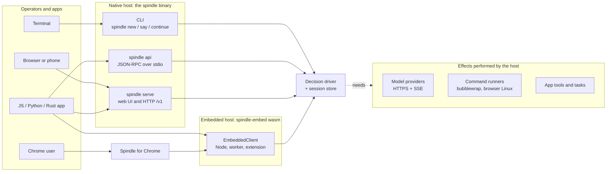
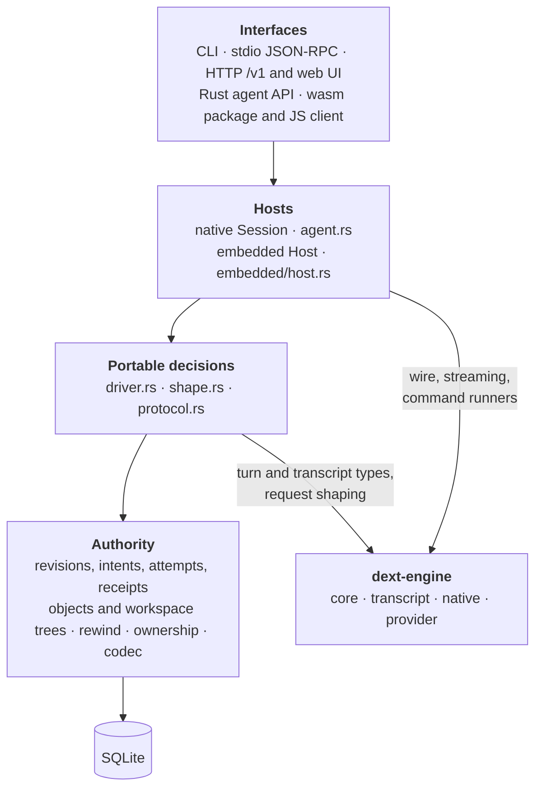
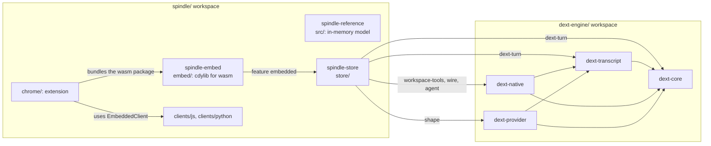
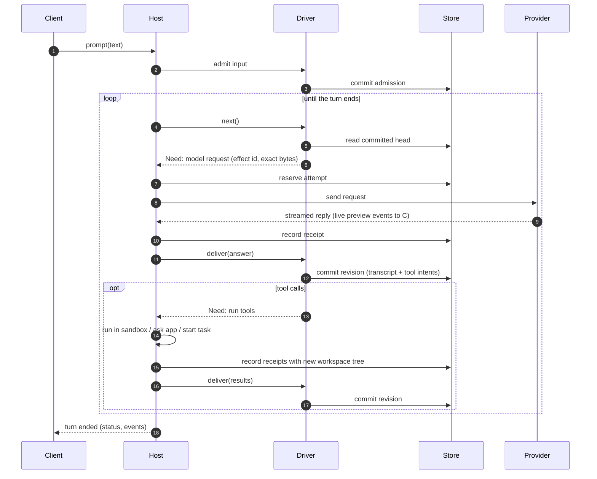
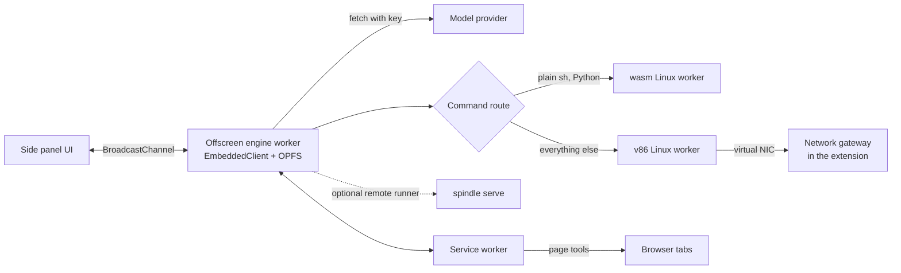
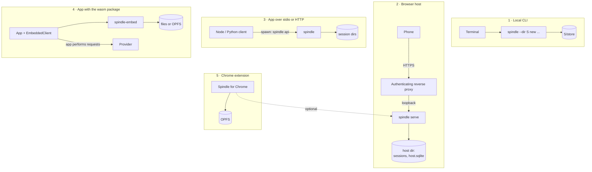

# Architecture

Spindle is a durable coding agent built around one rule: **the store decides, hosts act.**
A SQLite store holds every committed revision of a session (conversation, workspace files
and app state together). A portable decision driver reads the committed head and says
what the turn needs next; a host performs that need (a model request, a command, an app
tool call, a wait) and hands the answer back. Because every effect is reserved in the
store before it is performed and its result is recorded before it is used, a crash at
any point leaves a state the next process can resume without sending work twice or
guessing what happened.

The same store and driver run in three kinds of host: the native `spindle` binary (CLI,
stdio API and browser host), the embedded package (WebAssembly inside a JavaScript app),
and Spindle for Chrome (the embedded package inside a browser extension).

- [System context](#system-context)
- [Layers](#layers)
- [Crates and packages](#crates-and-packages)
- [A turn end to end](#a-turn-end-to-end)
- [Hosts](#hosts)
- [Deployment shapes](#deployment-shapes)
- [On disk](#on-disk)
- [Invariants](#invariants)
- [Source map](#source-map)

## System context



Every interface reaches the same core. The native host and the embedded host differ only
in *who performs effects*: the native host performs them itself (HTTP with credentials
from the local login store, commands in a sandbox), while the embedded host hands each
one to the app as a unit of `work` and resumes when the app answers.

## Layers



| Layer | Responsibility | Never does |
| --- | --- | --- |
| **Authority** ([store.md](store.md)) | Commits revisions atomically; holds content-addressed objects, workspace trees, effect reservations and receipts; fences owners; computes rewind targets. | Network, clocks, or process execution except through a runner the host passes in. |
| **Decisions** ([driver.md](driver.md)) | Reads the committed head and returns the next *need*; applies the host's answer as a committed transition; shapes provider requests as pure bytes. | Sending, waiting, reading credentials. |
| **Hosts** ([driver.md](driver.md), [embedded.md](embedded.md)) | Perform needs: send model requests and stream replies, run commands, call app tools, run child tasks, wait out backoffs, deliver queued input. | Decide what a turn does next. |
| **Interfaces** ([API.md](API.md), [cli.md](cli.md), [host.md](host.md), [clients.md](clients.md)) | Transport the public API (version 1) and present sessions. | Hold authority of their own. |
| **Engine** ([engine.md](engine.md)) | Model/turn types, transcript codecs, provider catalog and wire formats, strict runner and stream parsers. | Store session state. |

The decision layer builds without native code: the `driver` feature of `spindle-store`
excludes `dext-native`, the provider catalog, `reqwest` and Tokio, and the `embedded`
feature compiles for `wasm32-unknown-unknown`. CI checks both dependency graphs.

## Crates and packages



`spindle-store` is one crate whose Cargo features select how much of Spindle is built:

| Feature | Adds | Portable to wasm32 |
| --- | --- | --- |
| *(none)* | Store, objects, workspace trees, transitions, rewind | yes |
| `dext-turn` | Turn records over `dext-core` / `dext-transcript` | yes |
| `driver` | The decision driver | yes |
| `workspace-tools` | In-process file tools and output paging (no sandbox) | yes |
| `shape` | Request shaping from the provider catalog | yes |
| `embedded` | The embedded host (sessions whose I/O the app performs) | yes |
| `dext-strict-workspace` | The strict sandbox runner for commands | no |
| `dext-provider` | Native provider HTTP | no |
| `agent` | The native `Session` (Tokio, reqwest) | no |
| `cli` | The `spindle` binary, `serve`, Cloudflare Access verification | no |
| `dext-image`, `dext-native-image` | Image receipts and the pinned image worker (not enabled by `agent` or `cli`) | partly |

The crates in `dext-engine/` keep their `dext-*` names because they come from the Dext
coding agent; this repository carries the four Spindle needs as a self-contained source
tree with its own lockfile.

## A turn end to end



The important boundaries:

1. **Reserve before send.** An attempt row exists before any byte leaves the host. A
   restart that finds a reservation without a receipt knows the outcome is *unknown*.
2. **Record before use.** A reply or tool result is stored as a receipt before the
   driver adopts it. A restart that finds a receipt adopts it without repeating the work.
3. **Commit whole revisions.** Conversation, workspace tree and app state advance
   together in one transaction, so rewind restores all three at once.

Recovery rules (Continue, Retry, unknown outcomes, consent to resend) are in
[driver.md](driver.md) and [concepts.md](concepts.md#unknown-outcomes).

## Hosts

### Native host

The `spindle` binary ([`cli.rs`](../spindle/store/src/cli.rs)) runs the native
`Session` ([`agent.rs`](../spindle/store/src/agent.rs)) over the driver. It performs
effects itself:

- **Model requests** over HTTPS with credentials read from the Dext login store
  (`~/.dext`, or `DEXT_HOME`) for each fresh send; credentials are never written into a
  session.
- **Commands** in the strict runner (bubblewrap on Linux where available; see
  [tools.md](tools.md) for isolation modes and platform differences).
- **Background jobs, code mode, tasks and app tools** under the same reserve/record
  discipline.

It is exposed four ways: the CLI, `spindle api` (JSON-RPC over stdio, one worker
thread per open session), `spindle serve` (a loopback HTTP host with a mobile web UI
and the `/v1` API, see [host.md](host.md)), and the Rust `agent` module for embedding
in a Rust program.

### Embedded host

[`embedded/host.rs`](../spindle/store/src/embedded/host.rs) runs the same turn loop
"inside out": where the native session would block on I/O it parks the need and returns
`work` for the app. The [`spindle-embed`](../spindle/embed) crate builds it for wasm with
storage for Node (files through a VFS with fsync and lock files) and browsers (OPFS behind
Web Locks). `EmbeddedClient` ([`clients/js/embedded.mjs`](../spindle/clients/js/embedded.mjs))
speaks the same JSON-RPC protocol as `spindle api`, so an app can switch between the two.
See [embedded.md](embedded.md).

### Spindle for Chrome

A side-panel extension whose threads are embedded-package sessions stored in OPFS,
running in an offscreen document's worker so they continue while the panel is closed.
Commands run in a Linux inside the browser: an emulated x86 Alpine (v86) and, for plain
shell and Python, a Linux kernel compiled to WebAssembly, chosen per command. A native
Spindle host is optional (for a faster sandbox with network or to move threads). See
[chrome.md](chrome.md) and [browser-linux.md](browser-linux.md).



## Deployment shapes



| Shape | Who sends model requests | Where commands run | Storage |
| --- | --- | --- | --- |
| Local CLI | `spindle` | bubblewrap sandbox (or host, per isolation mode) | session directory |
| Browser host | `spindle serve` | bubblewrap sandbox | host directory of sessions |
| App over stdio/HTTP | `spindle` | bubblewrap sandbox (HTTP always; stdio sessions follow their isolation mode) | session directories |
| App with wasm package | the app | the app's runner, a remote `spindle serve`, or none | Node files, OPFS, or memory |
| Chrome extension | the extension | browser Linux, or a remote host | OPFS |

A session moves between hosts: a Node session directory is a native session directory,
and any session can be exported to a single-file bundle and imported elsewhere
([store.md](store.md), [embedded.md](embedded.md)).

## On disk

A session is a directory. The authoritative state is its store; everything else is a
mirror or an index that can be rebuilt or is bounded metadata.

```text
SESSION/
  store/
    authority.sqlite      revisions, objects, intents, attempts, receipts, metadata
    owner.lock            held by the process that owns the session
  session.json            settings mirror (provider, model, tools, isolation, ...)
  usage.json              priced spend per call, rebuilt from durable records if lost
  tasks/KEY/              child task sessions, each a full session (store, task.json);
                          KEY is a hash of the task call's effect id
```

`spindle serve` keeps a host directory with many sessions plus `host.sqlite` (paired
devices, API tokens) and `pairing.key`. Details: [store.md](store.md#session-directory),
[host.md](host.md).

## Invariants

These hold for every host and are enforced by the store and driver, not by convention:

| Invariant | Mechanism |
| --- | --- |
| A model request is sent at most once without explicit consent. | Attempts are reserved before dispatch; a reservation without a receipt is an unknown outcome that Continue never resends. Retry sends it once more; the `resend_unknown` setting allows up to three automatic resends. |
| A recorded result is never recomputed. | Receipts are stored before adoption and adopted by attempt identity after a restart. |
| Conversation, files and app state move together. | One revision commits the transcript continuation, the workspace tree digest and the app state; rewind selects a whole earlier revision. |
| Effect identities come from the conversation. | Tool-call and app-call ids are derived from the committed history, so the same call keeps its id across crashes and a rewound call gets a new one. |
| Only one process drives a session. | An owner lock plus owner epochs fence stale writers; read-only views take no lock. |
| The store is clock-free and deterministic. | Stored values are pure functions of their bytes ([`codec.rs`](../spindle/store/src/codec.rs)); waits and timers belong to hosts. |
| Credentials never enter a session. | Hosts read credentials per send; bundles and stores carry none. |

What these do **not** cover: a remote request cannot be unsent, a charge cannot be
refunded, and a command that ran without isolation (or with network) may have external
effects a rewind cannot undo. See [SECURITY.md](../SECURITY.md).

## Source map

| Path | Purpose |
| --- | --- |
| [`spindle/src`](../spindle/src) | Dependency-free, in-memory reference model of the authority rules |
| [`spindle/store/src/lib.rs`](../spindle/store/src/lib.rs) | Store lifecycle, schema, validation, epochs, metadata |
| [`spindle/store/src/transition.rs`](../spindle/store/src/transition.rs) | Atomic admission consumption and revision publication |
| [`spindle/store/src/broker.rs`](../spindle/store/src/broker.rs), [`completion.rs`](../spindle/store/src/completion.rs) | Reservation before dispatch, receipt ingestion |
| [`spindle/store/src/workspace.rs`](../spindle/store/src/workspace.rs), [`artifact.rs`](../spindle/store/src/artifact.rs) | Workspace trees and content-addressed objects |
| [`spindle/store/src/rewind.rs`](../spindle/store/src/rewind.rs) | Rewind targets and rewind |
| [`spindle/store/src/bundle.rs`](../spindle/store/src/bundle.rs) | Session bundles for moving sessions |
| [`spindle/store/src/driver.rs`](../spindle/store/src/driver.rs) | The portable turn driver |
| [`spindle/store/src/shape.rs`](../spindle/store/src/shape.rs) | Pure request shaping |
| [`spindle/store/src/agent.rs`](../spindle/store/src/agent.rs), [`agent/`](../spindle/store/src/agent) | Native session, tools, tasks, spend, remote runner |
| [`spindle/store/src/code_mode.rs`](../spindle/store/src/code_mode.rs) | Code mode child-effect journal |
| [`spindle/store/src/embedded/`](../spindle/store/src/embedded) | Embedded host and its storage |
| [`spindle/store/src/api.rs`](../spindle/store/src/api.rs), [`protocol.rs`](../spindle/store/src/protocol.rs), [`api/stdio.rs`](../spindle/store/src/api/stdio.rs) | Public API forms, JSON-RPC protocol, stdio transport |
| [`spindle/store/src/serve/`](../spindle/store/src/serve) | Browser host: HTTP, pairing, Access, previews, self-edit |
| [`spindle/store/ui/`](../spindle/store/ui) | Web UI assets embedded in the binary |
| [`spindle/embed/`](../spindle/embed) | wasm package with Node and browser storage |
| [`spindle/clients/`](../spindle/clients) | Node.js and Python clients |
| [`spindle/chrome/`](../spindle/chrome) | Spindle for Chrome and its browser Linuxes |
| [`dext-engine/`](../dext-engine) | Engine crates: core, transcript, native, provider |
