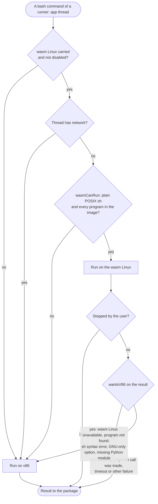
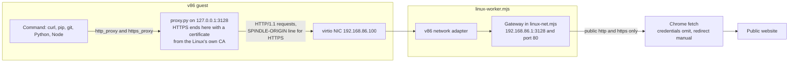
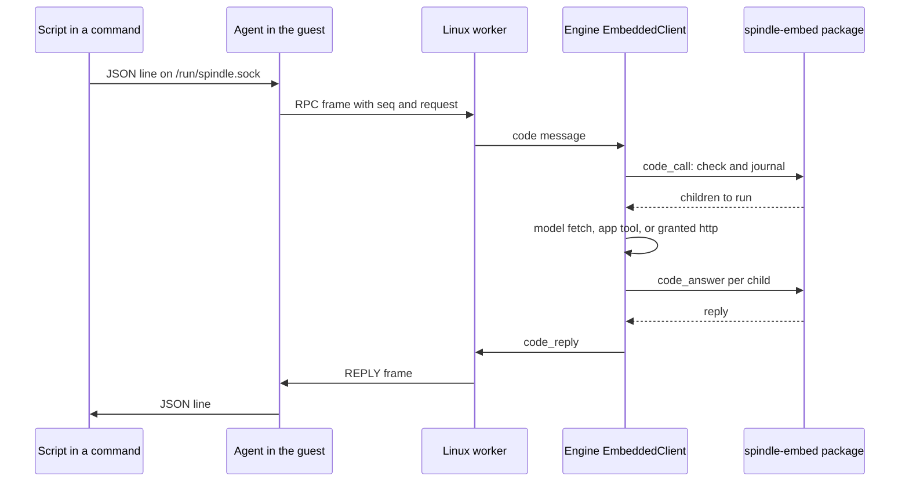

# Browser Linux

Spindle for Browser runs a thread's `bash` commands in a Linux that runs inside the extension
(see [chrome.md](chrome.md)). The extension can carry two of them. The **v86 Linux** is 32-bit
Alpine Linux emulated by v86, with bash, Python, Node, git and network access through Chrome. The
optional **wasm Linux** is the Linux kernel compiled to WebAssembly and run without an emulator,
with busybox `sh` and Python and no network. For each command the engine decides which Linux
runs it, and it reruns a command on v86 when the wasm Linux turns out to lack something. Every
command runs as an unprivileged user in namespaces of its own, over a copy of its thread's
workspace that is synced through a 9p share. A command whose thread has network reaches the web
through a gateway in the extension that makes requests with Chrome's `fetch`, or through a WISP
relay the user runs. Scripts in either Linux can ask Spindle for model calls, tool calls and HTTP
requests through the `spindle` command and its Python and Node modules. Each of these calls is
journaled by the embedded package, as native code mode journals its calls.

## Contents

- [The two Linuxes](#the-two-linuxes)
- [Routing a command](#routing-a-command)
- [Running a command](#running-a-command)
- [Per-command isolation](#per-command-isolation)
- [Workspace sync](#workspace-sync)
- [Network](#network)
- [The code bridge](#the-code-bridge)
- [Boot, resume and idle](#boot-resume-and-idle)
- [Runner identity](#runner-identity)
- [Building the images](#building-the-images)
- [Tests](#tests)

## The two Linuxes

| | v86 Linux | wasm Linux |
| --- | --- | --- |
| What it is | Alpine Linux, 32-bit x86, run by the v86 emulator (compiled to wasm) | Linux for the `wasm` architecture (`arch/wasm`), compiled to WebAssembly; one kernel instance per task, each in a worker, all on one shared memory |
| Sources | [`chrome/linux/`](../spindle/chrome/linux/), [`linux-worker.mjs`](../spindle/chrome/linux-worker.mjs), [`linux-net.mjs`](../spindle/chrome/linux-net.mjs), [`linux-frames.mjs`](../spindle/chrome/linux-frames.mjs) | [`chrome/wasm-linux/`](../spindle/chrome/wasm-linux/), [`wasm-linux-worker.mjs`](../spindle/chrome/wasm-linux-worker.mjs) |
| Shell and programs | bash, coreutils, findutils, grep, sed, gawk, diffutils, patch, tar, gzip, xz, Python 3 with pip, Node with npm, git, curl, openssl, jq, ripgrep, file, less | busybox (with hush as `sh`), Python 3.13 (no `ssl` or `ctypes`, and no loadable C extensions: there is no `dlopen`) |
| Network | Through Chrome or a relay, for threads with network on | None |
| Agent | [`guest/agent.py`](../spindle/chrome/linux/guest/agent.py) with the static [`spindle-sandbox`](../spindle/chrome/linux/command/src/sandbox.rs) | [`guest/src/agent.rs`](../spindle/chrome/wasm-linux/guest/src/agent.rs) (`spindle-agent`, agent and sandbox in one program) |
| Agent channel | Serial line `/dev/ttyS0`; payloads over 16 KiB go as files on the share | Virtio console `/dev/hvc1` (`hvc0` is the kernel's) |
| Start | First start boots and saves the machine state to OPFS; later starts resume it | Boots every time; nothing is saved |
| Concurrency | Up to 4 commands, one per thread, one with network | Up to 4 commands, one per thread, each pinned to two CPUs of its own (9 CPUs in all) |
| Carried | Always (`chrome/build.sh` refuses to build without it) | Only when built with `SPINDLE_WASM_LINUX` |

Both Linuxes use the same workspace code ([`linux-workspace.mjs`](../spindle/chrome/linux-workspace.mjs))
over a v86 9p filesystem, and both agents speak the same frame protocol and the same code-bridge
protocol. The `spindle` command is built from the same source for both.

Commands reach the Linuxes through the runner that [`linux-runner.mjs`](../spindle/chrome/linux-runner.mjs)
returns (`linuxRunner`). The engine connects it to its `EmbeddedClient` as the runner for
`runner: 'app'` threads (see [embedded.md](embedded.md) and [clients.md](clients.md)).

### Measured speed

The wasm Linux runs at the machine's own speed with no emulator in between, which is why
routing sends it every command it can run. [`linux_bench.mjs`](../spindle/chrome/tests/linux_bench.mjs)
runs the same commands on both Linuxes through `linuxRunner` with a forced route, in headless
Chrome 153, and keeps the median of five runs:

| Workload | v86 Linux | wasm Linux | Faster by |
| --- | ---: | ---: | ---: |
| Shell: `true`, a file write and read, a directory listing piped to `wc`, a sort pipeline, 30 program starts, 200 files, an `awk` loop | | | 2.2x to 8.6x |
| `python3 -c pass` | 418 ms | 102 ms | 4.1x |
| Python importing `json`, `re`, `collections`, `datetime`, `pathlib`, `subprocess` | 1,299 ms | 171 ms | 7.6x |
| Python summing 3 million squares | 8,353 ms | 326 ms | 25.6x |
| Python writing 200 files | 894 ms | 300 ms | 3.0x |
| First command after install (v86 boots and saves its state once) | 21 s | 0.54 s | about 39x |

v86 resumes its saved state on later starts, so the last row is a one-time cost. What the wasm
Linux cannot run (bash, Node, git, the network, C extensions) stays on v86.

## Routing a command

`linuxRunner().run` decides where each command runs. The user has no switch for it.

1. If the extension carries the wasm Linux (its `wasm-linux/identity` and `wasm-linux/fs.json`
   load), the thread has no network, and `wasmCanRun(command, programs)` accepts the command, it
   runs on the wasm Linux. `programs` is the set of names in the image's `bin`, `sbin`,
   `usr/bin`, `usr/sbin` and `usr/local/bin`, read from `fs.json`.
2. Otherwise it runs on v86.
3. After a wasm run, `wantsV86(result)` decides whether to run the command again on v86. A
   command the user stopped is never rerun.



### What the wasm Linux accepts

[`linux-route.mjs`](../spindle/chrome/linux-route.mjs) tokenizes the command cautiously. It
sends the command to v86 if any of the following holds:

- the command does not tokenize, for example because a quote is left open;
- it uses bash-only syntax: `[[ ]]`, `(( ))`, process substitution, `<<<`, `&>`, `|&`, `${!x}`,
  arrays (`a=(...)`, `${a[i]}`), `${x^}` and `${x,}`, brace expansion, `$'...'` and `$"..."`, or
  words such as `function`, `select`, `coproc`, `shopt`, `declare`, `typeset`, `mapfile`,
  `source`, `let`, `pushd`;
- it uses a tilde prefix, which hush does not expand;
- a command name is not a hush builtin and not one of `programs`, including commands inside
  `$( )`, backticks and unquoted heredoc bodies;
- a command name is built at run time (from an expansion), or the command uses `eval`;
- a wrapped command is unknown. `env`, `nice`, `nohup`, `time`, `exec`, `stdbuf`, `timeout`,
  `xargs`, `find -exec`/`-execdir`/`-ok`, `busybox APPLET`, `command`, and `sh -c SCRIPT`
  (also `ash`, `hush`, `dash`) are looked through to the command they run.

### When a wasm result is run again on v86

`wantsV86` returns false when the run succeeded or a script in it made a Spindle call
(`called`). That call is journaled and may have been billed, so the command's result stands.
It also returns false for any other runner failure, such as a timeout or a stop. It returns true
when:

| Result | Example |
| --- | --- |
| `unavailable` | the wasm Linux could not start, the command never reached its agent, or the wasm worker failed |
| exit 127 with "not found" or "applet not found", or `can't execute '...': No such file or directory` | a program the image lacks |
| exit 126 with "Permission denied" or "Exec format error" | a binary it cannot run |
| `sh: ... syntax error` | syntax hush does not take |
| `unrecognized option`, `invalid option`, or a BusyBox usage text | `grep -P`, `find -printf` |
| `date: invalid date` | `date -d yesterday` |
| `ModuleNotFoundError: No module named` | a module only v86's Python has, or one pip would install there |
| Python `subprocess` raising `FileNotFoundError` | a program Python tried to start |

A rerun is safe because each command works on a copy of its thread's workspace, and that copy
counts only when its result is returned to the package (see [Workspace sync](#workspace-sync)).

### When the wasm Linux is disabled

- The wasm worker reports `unavailable` when the browser does not let a worker share a
  `WebAssembly.Memory` with workers it starts and block on it (`sharesMemory`), or when the
  kernel or image cannot be fetched. Commands then go to v86.
- After 3 failures in a row (boots or worker errors), the runner stops sending commands to it
  (`WASM_FAILURES`).
- `linuxRunner({ route: 'v86' | 'wasm' })` forces every command to one Linux with no fallback.
  Tests and benchmarks use it; the extension uses `'auto'`.

## Running a command

The engine's runner posts `{type: 'run', id, session, command, timeoutS, network, files, links,
directories}` to the chosen worker. `files` lists the workspace (path, size, executable flag,
object digest); the worker asks for the bytes of files its share does not already hold with
`need`, and the runner reads them through the package (`runnerFile`). Each worker queues
commands and starts one when its thread has no other command running, at most 4 at a time and,
on v86, only one whose thread has network.

The runner and each worker exchange these messages:

| Direction | Message | Meaning |
| --- | --- | --- |
| runner to worker | `run` | A command, as above |
| runner to worker | `files` | The bytes a `need` asked for, or an error |
| runner to worker | `stop` | Stop a command (one still queued ends at once) |
| runner to worker | `code_reply` | The answer to a script's Spindle call |
| runner to worker | `forget` | A thread is gone; its kept workspace copy goes |
| runner to worker | `start` | Start or resume the Linux ahead of a command (`warm`) |
| runner to v86 worker | `relay` | The relay URL, or null for Chrome |
| worker to runner | `ran` | A command's result |
| worker to runner | `status` | The Linux's state and a detail |
| worker to runner | `need` | Objects of the workspace the share lacks |
| worker to runner | `code` | A script's Spindle call |

Each agent takes commands as frames, which are lines of the form `STX KIND ID BASE64`:

| Direction | Frame | Payload |
| --- | --- | --- |
| browser to agent | `RUN id` | JSON `{command, timeout_s, dir}`; on v86 also `network` (`'chrome'`, `'relay'` or null) and `now` (the browser's clock) |
| browser to agent | `STOP id`, `PING n` | — |
| browser to agent | `REPLY id` | JSON `{seq, reply}`: the answer to a script's Spindle call |
| agent to browser | `READY n` | `READY 0` when the agent starts; `READY n` answers `PING n` |
| agent to browser | `OUT id` | Output bytes (stdout and stderr together) |
| agent to browser | `RPC id` | JSON `{seq, request}`: a script's Spindle call |
| agent to browser | `END id` | JSON `{code, timed_out, stopped}`; the wasm agent adds `lingering` |

On v86, a payload over 16 KiB goes as a file in root's `/runs` on the 9p share, and its frame's
kind ends with `+` and names the file, because a much larger burst into the serial line wedges
it. The wasm Linux's console takes any size.

A command's result is its output, `success` (exit code 0), and what it changed in the workspace.
The browser keeps at most 4 MiB of output and appends `[output cut at 4 MiB]` beyond that. The
agent enforces the command's timeout (`timeout_s`). If no `END` arrives within the timeout plus a
grace period (20 s on v86, 10 s on the wasm Linux), the machine counts as stuck and is
restarted. A stop sends `STOP`; the agent then kills the command's PID-namespace init, which
ends every process the command started. A stopped or timed-out command's workspace copy is
dropped.

On v86, the agent sets the guest clock from `now` whenever it is more than a second off, because
a resumed machine wakes with the time it was saved at. The wasm kernel reads the browser's clock
directly (`get_now_nsec` in [`imports.mjs`](../spindle/chrome/wasm-linux/imports.mjs)).

## Per-command isolation

Each agent runs as root and starts a sandbox helper per command: on v86, `spindle-sandbox
WORKDIR SOCKET NETWORK COMMAND`
([`sandbox.rs`](../spindle/chrome/linux/command/src/sandbox.rs)), started with `posix_spawn`
because forking the Python agent costs far more in the emulator; on the wasm Linux, `spindle-agent
sandbox CPUS WORKDIR SOCKET COMMAND`. The helper:

| | v86 | wasm Linux |
| --- | --- | --- |
| Namespaces | mount, PID, IPC; network for threads without network | mount, PID, IPC, UTS, network |
| Network namespace | Without network: a fresh namespace with only loopback up, prepared while the agent is idle. With network: the Linux's own network | Always a fresh one with only loopback (the wasm Linux has no network card) |
| Mounts | the command's workspace copy bind-mounted at `/workspace`; fresh tmpfs at `/tmp`, `/var/tmp`, `/dev/shm` and the `spindle` user's home; its own `/proc`; a new `devpts` instance; its own Spindle socket at `/run/spindle.sock` | the same (tmpfs is ramfs on this no-MMU kernel) |
| User | `spindle` (uid and gid 1000), supplementary groups dropped | the same |
| Shell | `/bin/bash --noprofile --norc -o pipefail -c COMMAND` in `/workspace`, in a session of its own | `/bin/sh -c 'set -o pipefail; COMMAND'` in `/workspace`, pinned to two CPUs |
| Environment | `HOME` (the `spindle` user's home), `LANG=C.UTF-8`, `TERM=dumb`, `USER`, `LOGNAME`, `PATH`; plus the proxy variables for network through Chrome | the same, without proxy variables |

Only the workspace carries over from one command to the next. The command's first process in its
PID namespace reaps orphans; when the agent kills it, every process left in the namespace dies
with it. The parent-death signal is set, so if the helper is killed, the command goes too.

On the wasm Linux a task takes a signal only when it calls the kernel, so a program that computes
without system calls cannot be killed. The agent then reports `lingering: true` in `END`, and the
runner retires that machine: it takes no new commands, a fresh machine boots for them, and the
old one ends when its own commands finish or after 3 s. Commands it cuts off run again once on
the fresh machine, unless they made a Spindle call, were stopped, or had run past their own
timeout. CPU 0 keeps the agent, every sandbox helper and init, and the device interrupts
(`irqaffinity=0`; the others are `nohz_full`), and each command's shell is pinned to two other
CPUs, so a runaway holds only its own command's CPUs.

## Workspace sync

Both Linuxes keep a thread's workspace on their 9p share between commands
([`linux-workspace.mjs`](../spindle/chrome/linux-workspace.mjs), class `Workspaces`):

1. **Plan.** For the next command, files of the thread's kept copy whose digest, size, mode,
   owner and link count still match the package's file list are reused: by the same path first,
   then any kept file with the same content (a move or copy). The guest has not written to these
   files since they were kept. All other objects are asked for (`need`).
2. **Build.** A fresh directory `/runs/N` (root's `/runs` is mode 0700) is made for the command
   and owned by uid 1000. Reused files are moved into it by relinking their inodes, so nothing is
   copied and nothing the guest cached goes stale. New files are created from the bytes the
   engine sent. Symlinks and empty directories are created as listed. The kept copy's leftovers
   are removed.
3. **Run.** The agent bind-mounts `/runs/N` at `/workspace`. The share wraps v86's `Write` and
   `ChangeSize`, so every inode the guest writes to is recorded.
4. **Collect.** After the command, the copy is walked. Files that were placed and never written
   are unchanged and are not read back. Changed files are read, at most 4 at a time, and hashed
   with Spindle's object digest (`objectDigest`, as in `store/src/artifact.rs`). The result is
   `{writes, deletes, links, directories}`, the same shape a native runner reports. Sockets and
   pipes are ignored. The walk fails, and the copy is dropped, past a native runner's limits:
   64 MiB per file, 2 GiB in all, 50,000 entries.
5. **Keep.** The copy becomes the thread's kept copy. The share keeps at most 8 threads and
   256 MiB, and evicts the least recently used. Deleting a thread (`forget`) removes its copy.

A command's copy counts only when the package accepts its result. A copy dropped after a stop or
timeout, or a result that is not taken, leaves nothing stale, because the next plan reuses a kept
file only when its digest matches what the package lists.

## Network

A thread's network is off until the user turns it on (the thread's model menu; see
[chrome.md](chrome.md#settings)). Network commands always run on v86. The v86 worker runs one
command with network at a time, and its network card passes traffic only while that command runs
(`allowed()` in `wireNetwork`). When the command ends, its connections are cut. A command without
network is in a network namespace with only loopback, so it cannot reach even the Linux's own
proxy.

Inside the guest, [`sysinit`](../spindle/chrome/linux/guest/sysinit) gives `eth0` the address
`192.168.86.100/24` with `192.168.86.1` (the extension) as router and DNS server. The v86 card
uses 65520-byte frames. [`linux-net.mjs`](../spindle/chrome/linux-net.mjs) wraps v86's TCP
connections (`steady`) so that each segment fits the window the guest last offered and is resent
if not acknowledged.

### Through Chrome

With no relay set, a command with network reaches HTTP and HTTPS sites, and Chrome makes every
request:



1. **Environment.** For a command with network through Chrome, the agent sets `http_proxy`,
   `https_proxy` (and upper-case forms) to `http://127.0.0.1:3128`, `no_proxy` for loopback,
   `NODE_USE_ENV_PROXY=1` (so Node's own `fetch` uses the proxy), `NODE_EXTRA_CA_CERTS`,
   `SSL_CERT_FILE`, `REQUESTS_CA_BUNDLE` and `PIP_CERT`.
2. **The Linux's own CA.** At the first boot, `sysinit` generates a P-256 certificate authority
   (`CN=Spindle browser Linux`) and a site key in `/etc/spindle`. The keys are created under
   `umask 077`, so only root can read them (commands run as uid 1000). The CA certificate is
   appended to the system bundle, so commands trust it. The CA is made completely or not at all.
3. **The proxy** ([`proxy.py`](../spindle/chrome/linux/guest/proxy.py), root, restarted by init if
   it stops) passes plain-HTTP requests to the gateway at `192.168.86.1:3128` as they came. For
   `CONNECT host:port`, it answers `200`, ends TLS itself with a certificate for that host signed
   by the Linux's CA (made on demand, valid 397 days, cached in `/run/spindle-certs`), sends
   `SPINDLE-ORIGIN https://host:port`, and then forwards the decrypted HTTP/1.1 requests. If the
   gateway refuses the connection, because no command with network is running, the proxy answers
   `403` and says the thread has no network.
4. **The gateway** (`serve` in `linux-net.mjs`) accepts connections to `192.168.86.1:3128`, or to
   port 80 of any address (plain HTTP, site taken from `Host`), and only while a command with
   network runs. It parses HTTP/1.1 (heads up to 64 KiB, bodies up to 64 MiB, chunked or not,
   `Expect: 100-continue`), drops hop-by-hop headers, and calls `fetch` with `credentials:
   'omit'`, `cache: 'no-store'`, `redirect: 'manual'` and `referrerPolicy: 'no-referrer'`. It
   streams the response back, pausing while more than 1 MiB waits for the guest.
5. **Refused addresses.** `local(hostname)` refuses, with `403`, names without a dot; names ending
   in `localhost`, `local`, `internal`, `lan`, `localdomain` or `home.arpa`; IPv4 `0/8`, `10/8`,
   `127/8`, `169.254/16`, `172.16/12`, `192.168/16`, `100.64/10` and `224/4` and above; and IPv6
   `::`-prefixed, `fc00::/7`, `fe80::/10` and `ff00::/8` addresses. Chrome resolves names, so a
   public name that resolves into a private network is not caught.
6. **Redirects** are never followed by the gateway. If Chrome hides a redirect's target
   (`opaqueredirect`), the gateway answers `502` and asks for the final address. If the target
   is visible (a non-browser `fetch`), it is passed to the client only when it is a public http(s)
   address.

The gateway works only for clients that use a proxy from the environment, or that speak plain
HTTP to port 80. Other ports and protocols are not reachable through Chrome. Requests carry no
cookies.

### Through a relay

When the user sets a relay (`wisp://HOST` or `wisps://HOST`, Settings, Commands), the v86 card is
wired to that WISP server instead of the gateway. Every TCP connection of a command with network
goes to the relay as it is, with the guest's own TLS, so any protocol works. Connections to the
guest's own subnet (`192.168.86.*`) are refused, and a connection whose unread data exceeds 64 MiB
is cut. Name lookups use DNS-over-HTTPS while a command with network runs; at other times they
get answers that lead nowhere. The agent sets no proxy variables for such a command. Changing
the relay restarts the v86 machine once no command is running.

### Sites scripts may call

`spindle http URL` does not use the network card. It is a Spindle call (see
[The code bridge](#the-code-bridge)) that the engine sends with `fetch` for sites the user listed
under Settings, Commands. It therefore works whatever the thread's network setting. The package
checks each request against the grants (address prefix and methods), and the request carries no
cookies and follows no redirect.

## The code bridge

Scripts in either Linux can ask Spindle for calls, as native `run_code` scripts do (see
[tools.md](tools.md)).



- **Socket.** The agent makes a Unix socket for each command under root's `/run/spindle-calls`
  and bind-mounts it at `/run/spindle.sock` in the command's namespace, so a command can reach
  only its own socket. Requests and replies are one JSON line each (`{"method", "input"}`).
- **Ordering.** The agent relays one call at a time per command. Calls from several processes
  wait their turn. It numbers the children (`model`, `tool`, `http`; each call in a `batch`
  counts) in the order they go, as native code mode numbers them.
- **Journaling.** The engine passes each request to `EmbeddedClient.code`. The package checks and
  journals it (`code_call`) before anything runs. The engine runs the children (a model request
  with the user's key, an app tool such as a page tool, or an HTTP request a grant allows) and
  records each answer (`code_answer`). A call that was cut off is never sent again by itself, and
  its error ends with `[may_have_run]`. When the command ends, its abort signal stops further
  calls, and children that never ran stay uncertain in the journal.
- **Limits per command** (`LIMITS` in [`store/src/embedded/code.rs`](../spindle/store/src/embedded/code.rs)):
  128 calls, 32 of them model calls, and up to 4 children of a `batch` at once. `spindle limits`
  prints them.
- **Agent bounds.** At most 64 connections per command. A request line may be up to 64 MiB on
  v86 and 16 MiB on the wasm Linux. A script that leaves too many replies unread is disconnected.

The interfaces:

| From | Calls |
| --- | --- |
| bash and any program: `spindle` ([`main.rs`](../spindle/chrome/linux/command/src/main.rs), a static Rust binary) | `spindle model [--provider P] [--model M] [--system S] [--max-tokens N] [--effort E] [--image FILE]... PROMPT` (prints the text; `-` reads the prompt from stdin); `spindle tool NAME [JSON]`; `spindle search [QUERY]`; `spindle describe NAME`; `spindle limits`; `spindle http [-X METHOD] [-H 'NAME: VALUE']... [-d BODY \| --json JSON] URL` (prints the body, fails on HTTP 400 and up); `spindle call METHOD [JSON]` (the raw reply) |
| Python: `import spindle` ([`spindle.py`](../spindle/chrome/linux/guest/spindle.py), both Linuxes) | `model(prompt, **options)`, `models(prompts)`, `tool(name, args)`, `tools.search`/`describe`/`call`, `batch(calls)`, `limits()`, `http(url, **options)`, `image(path)`; failures raise `SpindleError` with `may_have_run` |
| Node: `require('spindle')` or `import ... from 'spindle'` ([`spindle.js`](../spindle/chrome/linux/guest/spindle.js), v86 only) | The same functions, synchronous, each running `spindle call METHOD -`; installed at `/node_modules/spindle` so ES module imports and `node file.ts` find it |

Being a static binary, `spindle` makes a call cost only the round trip, with no interpreter
start. The Python module talks to the socket directly.

## Boot, resume and idle

The engine starts the Linuxes ahead of need (`warm`): when a thread whose commands run in the
browser is created or opened, or switched to run there. A Linux worker that has run nothing for
10 minutes is terminated (`IDLE_MS`), which gives its memory back.

**v86** ([`linux-worker.mjs`](../spindle/chrome/linux-worker.mjs)):

- **First start.** v86 boots the kernel and initramfs from the 9p root (512 MiB of memory). Once
  the agent reports `READY 0` (within 180 s), the worker saves the machine state to OPFS as
  `linux/state-IDENTITY-net1` and removes states of other images. The agent waits for the proxy
  to listen and prepares a spare network namespace before it reports ready, so a resumed machine
  has both at once.
- **Later starts** resume that state and ping the agent (up to 16 tries, 2 s each). If the agent
  never answers, the state is deleted and the next start boots afresh.
- **Recovery.** A `READY 0` from a running machine means the agent restarted, so the machine is
  restarted. A command with no `END` past its grace period also restarts the machine, and every
  command on it fails with "the browser Linux stopped answering".

**wasm Linux** ([`wasm-linux/runner.mjs`](../spindle/chrome/wasm-linux/runner.mjs), `WasmLinux`):

- **Boot.** `bootMachine` ([`machine.mjs`](../spindle/chrome/wasm-linux/machine.mjs)) compiles
  `vmlinux.wasm` and reserves a shared memory of up to 4 GiB, halving the maximum until the host
  can reserve it. It builds a device tree (CPUs, memory, command line, virtio devices) and boots
  the kernel. The kernel runs on 9 CPUs with `console=hvc0 root=root rootfstype=9p ...
  irqaffinity=0 nohz_full=1-8`. Its devices are two virtio consoles, the 9p root share, and a
  virtio entropy source fed from `crypto.getRandomValues`. Every kernel task (a CPU, kernel
  thread, process or thread) runs in a worker of its own ([`task.mjs`](../spindle/chrome/wasm-linux/task.mjs)),
  and 8 workers are kept started ahead. `/sbin/init` mounts `/proc`, `/dev` and `/run` and
  `exec`s `spindle-agent`. The boot fails after 60 s without `READY 0`.
- **Heartbeat.** While commands run, the runner pings the agent every 2 s. After 20 s without a
  word from the agent, the machine is ended; commands it cuts off run again once on the next
  machine, under the rules in [Per-command isolation](#per-command-isolation).
- **Programs.** A program is a wasm module built for `wasm32-unknown-linux-musl` with a shared
  memory of its own. Threads share that memory; a cloned process gets a copy. There is no `fork`,
  so programs start others with `posix_spawn` ([`user.mjs`](../spindle/chrome/wasm-linux/user.mjs)).

The panel shows each Linux's state (Settings, Commands):

| State | v86 | wasm Linux |
| --- | --- | --- |
| `not started` | not started yet | not started yet (only when the extension carries it) |
| `booting` | first start | starting |
| `saving`, `resuming` | saving its first start; resuming the saved state | — |
| `ready` | running | running |
| `stopped` | resting after 10 idle minutes | resting |
| `ended` | — | a machine ended; the next command starts another |
| `failed` | failed to start | failed to start; the next command tries again |
| `unavailable` | — | not usable in this browser, or disabled after repeated failures; commands go to v86 |

## Runner identity

`linuxRunner().identity()` gives the runner's sandbox identity, a 64-hex-digit digest. The
embedded client binds it with `setAppRunner`, so the package records runs as sandboxed.

- The v86 identity (`linux/identity`) is the SHA-256 of `fs.json` (which names every file by
  digest), `libv86.mjs`, `v86.wasm` and both BIOS images.
- The wasm identity (`wasm-linux/identity`) is the SHA-256 of `fs.json`, `vmlinux.wasm`, and the
  runtime that boots it (the `wasm-linux/*.mjs` files and the vendored v86 files).
- When both are carried, the runner's identity is the SHA-256 of
  `spindle-browser-linux-v1\0V86\0WASM`. Otherwise it is the v86 identity.

## Building the images

Neither build needs root. Downloads are pinned by version, commit or checksum, except Alpine's
packages, which come from the branch's current index and are checked against its signing keys.
Run the builds from the `spindle/` directory, then build the extension with them (see
[chrome.md](chrome.md#build-and-load)):

```sh
chrome/linux/build.sh                                  # v86 Linux into chrome/linux/dist
SPINDLE_WASM_LINUX=chrome/wasm-linux/dist chrome/build.sh /path/to/wasm-bindgen
```

### v86 Linux

[`chrome/linux/build.sh [OUT_DIR]`](../spindle/chrome/linux/build.sh) (default `chrome/linux/dist`)
needs curl, npm, python3, user namespaces (`unshare -r`; Ubuntu 23.10 and later restrict them
through AppArmor until `sudo sysctl -w kernel.apparmor_restrict_unprivileged_userns=0`), and Rust
with the `i686-unknown-linux-musl` target. It:

1. Fetches the v86 npm package at a pinned version, checks its SHA-256, and checks that it was
   built from the pinned v86 commit. It also fetches the SeaBIOS and VGA BIOS images and v86's
   `fs2json.py` and `copy-to-sha256.py` from that commit, each checked by SHA-256.
2. Fetches the Alpine x86 minirootfs and `apk-tools-static` at pinned versions with checksums,
   then installs the packages listed in [The two Linuxes](#the-two-linuxes) and `linux-virt` with
   `apk.static --usermode`. Packages come from the branch's current index and are checked against
   the signing keys in the minirootfs; `manifest.txt` records the versions installed.
3. Builds [`command/`](../spindle/chrome/linux/command/) (`spindle` and `spindle-sandbox`) as static
   i686 musl binaries, with build paths remapped out of them.
4. Installs the guest files: [`inittab`](../spindle/chrome/linux/guest/inittab) (`sysinit`, then
   `agent.py` and `proxy.py`, each restarted if it stops), `sysinit`,
   [`openssl.cnf`](../spindle/chrome/linux/guest/openssl.cnf), the user `spindle` (uid 1000), and
   the Python and Node modules.
5. Makes an initramfs that loads the virtio and 9p modules, inside the image with
   `unshare -r chroot`, with device numbers left out so the result is reproducible.
6. Gives every file the build wrote a fixed time, writes a sorted tar, and converts it with v86's
   tools into `fs.json` (the index) and `flat/` (files named by SHA-256, fetched as the guest
   opens them).

Output: `fs.json`, `flat/`, `libv86.mjs`, `v86.wasm`, `seabios.bin`, `vgabios.bin`,
`LICENSE-v86`, `manifest.txt` and `identity`.

### wasm Linux

The wasm Linux is built in stages, each a script in [`chrome/wasm-linux/`](../spindle/chrome/wasm-linux/)
whose header documents its arguments. With `W` as a build directory:

```sh
chrome/wasm-linux/build-kernel.sh   $W/kernel
chrome/wasm-linux/build-toolchain.sh $W/toolchain
chrome/wasm-linux/build-userland.sh $W/toolchain $W/userland
chrome/wasm-linux/build-rust.sh     $W/toolchain $W/rust
chrome/wasm-linux/build-python.sh   $W/toolchain $W/python
chrome/wasm-linux/build-image.sh    $W/kernel/vmlinux.wasm $W/userland $W/rust $W/python   # into chrome/wasm-linux/dist
```

| Script | Builds | Notes |
| --- | --- | --- |
| [`build-kernel.sh`](../spindle/chrome/wasm-linux/build-kernel.sh) | `vmlinux.wasm` | The `arch/wasm` Linux port at a pinned commit, plus Spindle's patches ([`kernel/`](../spindle/chrome/wasm-linux/kernel/): context tracking for `NO_HZ_FULL`, an `rcu_barrier` fix for offloaded CPUs, a netfs remote-size fix), configured with its defconfig plus [`spindle.config`](../spindle/chrome/wasm-linux/spindle.config) (9p over virtio, namespaces, System V IPC, `NO_HZ_FULL`). The build stops if the kernel drops any of these options. Needs clang, an LLD `wasm-ld` (LLVM's or rustup's) and `wasm2wat`; builds m4, bison and flex if missing. |
| [`build-toolchain.sh`](../spindle/chrome/wasm-linux/build-toolchain.sh) | clang, LLD, and a `wasm32-unknown-linux-musl` sysroot | From source at pinned commits: an LLVM with a wasm Linux target, a musl port, the kernel's userspace headers, and compiler-rt builtins. Programs are built with atomics, bulk memory and LLVM-lowered setjmp/longjmp. Fetches ninja if missing. |
| [`build-userland.sh`](../spindle/chrome/wasm-linux/build-userland.sh) | busybox | A busybox 1.37 port for machines without an MMU, static, with hush as `sh`. |
| [`build-rust.sh`](../spindle/chrome/wasm-linux/build-rust.sh) | Rust for `wasm32-spindle-linux-musl` | A pinned nightly from rustup, checked by its rustc commit, with `core`, `std` and `libc` patched ([`rust/patches/`](../spindle/chrome/wasm-linux/rust/patches/)) for this ABI: 32-bit `long`, asm-generic syscall numbers, spawning by `posix_spawn` only. Adds the target spec [`rust/wasm32-spindle-linux-musl.json`](../spindle/chrome/wasm-linux/rust/wasm32-spindle-linux-musl.json), a stub libunwind (programs abort on panic), and `bin/cargo-wasm-linux`. |
| [`build-python.sh`](../spindle/chrome/wasm-linux/build-python.sh) | CPython 3.13 | Cross-compiled with zlib, bzip2 and SQLite (release tarballs pinned by SHA-256), all C modules linked into one program (there is no `dlopen`), `subprocess` patched to use `posix_spawn` ([`python/subprocess-spawn.patch`](../spindle/chrome/wasm-linux/python/subprocess-spawn.patch)), pymalloc, no `ctypes`, `ssl`, `readline` or `curses`. |
| [`build-image.sh`](../spindle/chrome/wasm-linux/build-image.sh) | `dist/`: `vmlinux.wasm`, `fs.json`, `flat/`, `identity` | Builds [`guest/`](../spindle/chrome/wasm-linux/guest/) (`spindle-agent`, allowed up to 1 GiB of memory, and `spindle` from `chrome/linux/command`) with `cargo-wasm-linux`, adds `init`, `passwd`, `group`, `spindle.py` (precompiled), sets owners, modes and a fixed time, and converts the tree with v86's tools (same pinned commit as the v86 build). |

`chrome/build.sh` copies the runtime (`console`, `devicetree`, `entropy`, `imports`, `machine`,
`ninep`, `runner`, `task`, `user`, `virtio` `.mjs`), the vendored `v86/` directory, and the
image into the extension's `wasm-linux/` folder.

**Licenses.** Per the build scripts' headers: the kernel and busybox are GPL-2.0, and the source
offer for each binary is the pinned commit in its build script. The LLVM toolchain is Apache-2.0
with LLVM exceptions, musl is MIT, and Python is under the PSF license.
[`wasm-linux/v86/`](../spindle/chrome/wasm-linux/v86/) vendors four of v86's files unchanged
(`lib/9p.js`, `lib/filesystem.js`, `lib/marshall.js`, `src/browser/filestorage.js`) under v86's
BSD 2-Clause license ([`LICENSE`](../spindle/chrome/wasm-linux/v86/LICENSE)); its
[`README.md`](../spindle/chrome/wasm-linux/v86/README.md) records the commit. The other files under
`v86/src/` are Spindle's own stand-ins for the emulator modules those four import.
[`ninep.mjs`](../spindle/chrome/wasm-linux/ninep.mjs) drives v86's 9p server over the wasm machine's
virtio transport ([`virtio.mjs`](../spindle/chrome/wasm-linux/virtio.mjs), split rings), mounted with
`cache=loose,msize=262144,ignoreqv`. Because of that, both Linuxes share `linux-workspace.mjs`.

## Tests

The tests are in [`spindle/chrome/tests/`](../spindle/chrome/tests/). Each prints its usage, and
most print timings. The Node tests need no browser and no provider, and all but `linux_route.mjs`
need a built image or its parts. See also
[chrome.md](chrome.md#tests) and [testing.md](testing.md).

| Test | Usage | Checks |
| --- | --- | --- |
| [`linux_node.mjs`](../spindle/chrome/tests/linux_node.mjs) | `node chrome/tests/linux_node.mjs LINUX_DIST` | The v86 Linux in Node: commands with bash, Python and Node over a 9p workspace, writes coming back, timeouts, commands side by side in their own namespaces, the workspace kept between commands, the code bridge from all three interfaces, resuming with the browser's clock, and the network: none without it; HTTP and HTTPS through the gateway from curl, Python, Node, pip and git; never a local address; a test WISP relay. The network checks need the internet. |
| [`linux_route.mjs`](../spindle/chrome/tests/linux_route.mjs) | `node chrome/tests/linux_route.mjs` | `wasmCanRun` and `wantsV86`. |
| [`wasm_linux_runner.mjs`](../spindle/chrome/tests/wasm_linux_runner.mjs) | `VMLINUX_WASM USERLAND_ROOT GUEST_BIN [CPUS]` | `WasmLinux` as a runner: workspaces, exit statuses, threads side by side, Spindle calls, timeouts, Stop, isolation, and a runaway loop that only a restart ends. |
| [`wasm_linux_python.mjs`](../spindle/chrome/tests/wasm_linux_python.mjs) | `[DIST]` | Python from the built image: C modules, threads, files, `subprocess` via `posix_spawn`, asyncio, Unix sockets, the `spindle` module. |
| [`wasm_linux_rust.mjs`](../spindle/chrome/tests/wasm_linux_rust.mjs) | `VMLINUX_WASM STD_CHECK LAYOUT_C LAYOUT_RUST [CPUS]` | Rust `std` on the target, and C and Rust struct layouts agreeing ([`wasm-linux/tests/`](../spindle/chrome/wasm-linux/tests/)). |
| [`wasm_linux_shares.mjs`](../spindle/chrome/tests/wasm_linux_shares.mjs) | `VMLINUX_WASM USERLAND_ROOT [CPUS]` | A 9p root and a second share at `/workspace`; the entropy device. |
| [`wasm_linux_busybox.mjs`](../spindle/chrome/tests/wasm_linux_busybox.mjs) | `VMLINUX_WASM USERLAND_ROOT [CPUS]` | busybox `sh` from an initramfs on the console. |
| [`wasm_linux_userland.mjs`](../spindle/chrome/tests/wasm_linux_userland.mjs) | `VMLINUX_WASM HELLO_WASM [CPUS]` | A C program as `/init`: `posix_spawn` of itself, a thread. |
| [`wasm_linux_node.mjs`](../spindle/chrome/tests/wasm_linux_node.mjs) | `VMLINUX_WASM [CPUS]` | The kernel boots on Spindle's runtime and ends as a kernel without init ends. |
| [`linux_bench.mjs`](../spindle/chrome/tests/linux_bench.mjs) | `SPINDLE_BROWSER=... node chrome/tests/linux_bench.mjs DIST [RUNS]` | Times the same commands on both Linuxes in real Chrome through `linuxRunner` with a forced route. It writes a page into `DIST`, so use a test build made with `SPINDLE_WASM_LINUX`. |

`extension_real.mjs` ([chrome.md](chrome.md#tests)) also runs bash, Spindle calls and a granted
site through the panel and, in `--scripted` mode with the wasm Linux built in, a plain `sh`
command on the wasm Linux.
