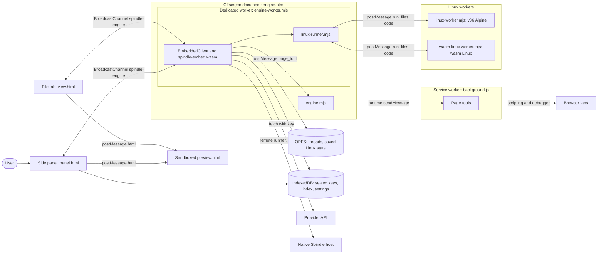
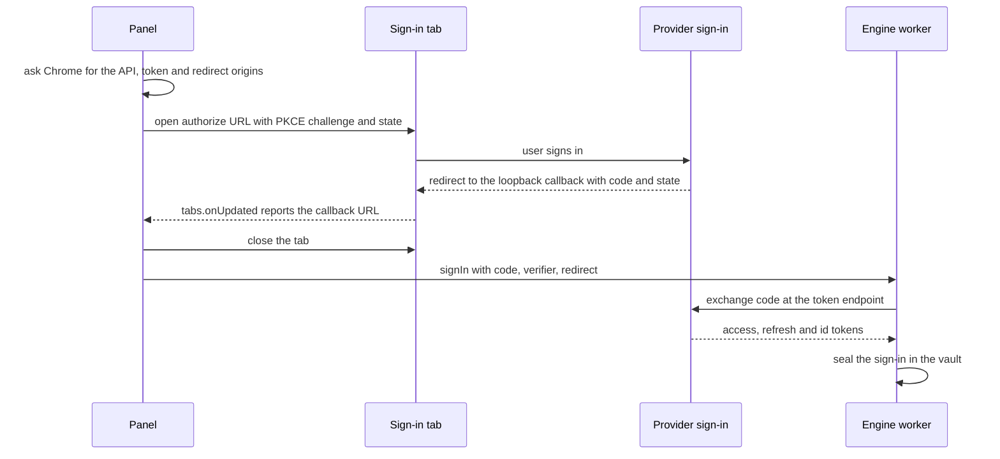

# Spindle for Chrome

Spindle for Chrome is a Manifest V3 side-panel extension that runs Spindle threads inside the
browser. Each thread is a session of Spindle's embedded package ([`spindle-embed`](../spindle/embed/),
see [embedded.md](embedded.md)) stored in the extension's origin private file system (OPFS).
The threads run in a worker of an offscreen document, so they keep going while the panel is
closed. Model requests go from that worker straight to the provider with a key or sign-in kept
sealed in the extension's IndexedDB. Threads can read and act on browser tabs through page tools,
run `bash` in a Linux that runs inside the extension (see [browser-linux.md](browser-linux.md)),
and move to and from a native Spindle host as `.spindle` files. The extension works on its own;
connecting a native host is optional and only adds a second place where commands can run.

## Contents

- [Components and Chrome contexts](#components-and-chrome-contexts)
- [Message paths](#message-paths)
- [Threads and storage](#threads-and-storage)
- [Providers, keys and requests](#providers-keys-and-requests)
- [Page tools](#page-tools)
- [Files in and out](#files-in-and-out)
- [Settings](#settings)
- [Moving threads to and from a native host](#moving-threads-to-and-from-a-native-host)
- [Permissions](#permissions)
- [Build and load](#build-and-load)
- [Tests](#tests)

## Components and Chrome contexts

All sources are in [`spindle/chrome/`](../spindle/chrome/). [`chrome/build.sh`](../spindle/chrome/build.sh)
also copies in the JS client ([`embedded.mjs`](../spindle/clients/js/embedded.mjs),
[`opfs.mjs`](../spindle/clients/js/opfs.mjs), [`common.mjs`](../spindle/clients/js/common.mjs)) and the
native UI's `store/ui/text.js` and `store/ui/theme.js`, so the panel uses the same Markdown parser
and theme switch as the native UI.

| File | Runs in | Role |
| --- | --- | --- |
| [`manifest.json`](../spindle/chrome/manifest.json) | — | MV3 manifest: side panel, module service worker, permissions, the sandboxed `preview.html`, content security policies. Requires Chrome 116 or later. |
| [`background.js`](../spindle/chrome/background.js) | Service worker | Opens the side panel from the toolbar button. Does the page tools' work (only it can reach tabs). Keeps the page switches consistent with Chrome's site access. |
| [`engine.html`](../spindle/chrome/engine.html), [`engine.mjs`](../spindle/chrome/engine.mjs) | Offscreen document (one per profile, reason `WORKERS`) | Starts the engine worker and relays its page-tool calls to the service worker (a worker has no `chrome.runtime`). |
| [`engine-worker.mjs`](../spindle/chrome/engine-worker.mjs) | Dedicated worker of the offscreen document | The engine. Holds an `EmbeddedClient` over the OPFS pool, the thread index, every thread's turns and the command runners; opens the provider's sealed credential for each request. |
| [`linux-runner.mjs`](../spindle/chrome/linux-runner.mjs), [`linux-route.mjs`](../spindle/chrome/linux-route.mjs) | Engine worker | The `app` command runner: picks a Linux for each command and talks to the Linux workers. |
| [`linux-worker.mjs`](../spindle/chrome/linux-worker.mjs), [`wasm-linux-worker.mjs`](../spindle/chrome/wasm-linux-worker.mjs) | Nested workers started by the engine | The two browser Linuxes. See [browser-linux.md](browser-linux.md). |
| [`panel.html`](../spindle/chrome/panel.html), [`panel.mjs`](../spindle/chrome/panel.mjs), [`panel.css`](../spindle/chrome/panel.css) | Side panel (also opens in a tab) | The UI. It holds no session: it sends requests to the engine and renders the events the engine broadcasts. |
| [`steps.mjs`](../spindle/chrome/steps.mjs) | Panel | Pure functions that label tool steps in plain words with the right tense, name the page and element a browser step acted on, find failed steps that a later step redid, and pick out scratch files. |
| [`markdown.mjs`](../spindle/chrome/markdown.mjs) | Panel, file tab | Renders `text.js` Markdown blocks as DOM nodes. |
| [`view.html`](../spindle/chrome/view.html), [`view.mjs`](../spindle/chrome/view.mjs) | Extension page in a tab | Shows one workspace file in a tab of its own. |
| [`preview.html`](../spindle/chrome/preview.html), [`preview.js`](../spindle/chrome/preview.js) | Sandboxed extension page (iframe) | Renders a web page a thread made. It has its own origin and no extension APIs. |
| [`page.mjs`](../spindle/chrome/page.mjs) | Panel, file tab | Workspace file helpers: file type and display kind, inlining a page's workspace resources for the preview, safe download names, `saveFile`. |
| [`page-tools.mjs`](../spindle/chrome/page-tools.mjs) | Panel, engine, service worker | Page tool definitions, the host permission patterns they need, and the `pageSwitches` rule. |
| [`shared.mjs`](../spindle/chrome/shared.mjs) | Panel, engine, file tab, service worker | The `BroadcastChannel` name, the extension's IndexedDB helpers, `accessFor`, and `startEngine`. |
| [`vault.mjs`](../spindle/chrome/vault.mjs) | Engine | Credentials at rest: sealing, opening, the passphrase lock (see [Keys at rest](#keys-at-rest)). |
| [`signin.mjs`](../spindle/chrome/signin.mjs) | Panel (the tab), engine (the tokens) | Browser sign-in: which providers have one, the PKCE tab flow, the code exchange and refreshes. |
| [`zip.mjs`](../spindle/chrome/zip.mjs) | Panel | Writes an uncompressed (stored) `.zip` of a workspace. |
| [`build.sh`](../spindle/chrome/build.sh) | — | Assembles the loadable extension folder. |



## Message paths

### Panel and engine

The panel, the file tab and the engine talk over one `BroadcastChannel` named `spindle-engine`
(`CHANNEL` in [`shared.mjs`](../spindle/chrome/shared.mjs)). Only pages of the extension's own
origin can join it.

| Direction | Message | Meaning |
| --- | --- | --- |
| page to engine | `{to: 'engine', from, id, op, args}` | A request. `from` is the sender's random id, `id` its request number. |
| engine to page | `{to, id, ok, result}` or `{to, id, ok: false, error: {kind, message}}` | The reply to one request. |
| engine to all | `{type: 'event', thread, event}` | A session event of a thread, as the embedded package emits it. |
| engine to all | `{type: 'thread', thread}`, `{type: 'removed', id}`, `{type: 'turn_end', thread, unsent}` | Thread index changes and turn ends. |
| engine to all | `{type: 'linux', state, detail, wasm}` | Browser Linux states (see [browser-linux.md](browser-linux.md#boot-resume-and-idle)). |
| engine to all | `{type: 'host' \| 'sites' \| 'relay', ...}` | Settings changes, so every open panel updates. |
| engine to all | `{type: 'ready', broken}` | The engine finished starting (or could not). |

The panel opens the engine itself: when its first `hello` request times out it calls
`startEngine`, which creates the offscreen document unless one exists. **Restart engine**
(Settings, About) closes the offscreen document, and the panel then starts it again.

The engine's operations (`ops` in [`engine-worker.mjs`](../spindle/chrome/engine-worker.mjs)) are:

| Operation | Does |
| --- | --- |
| `hello` | Returns a snapshot: package info, catalog, thread index, running threads, Linux and host state, sites, standing instructions, relay, and the vault's state (its mode, whether it is locked, each provider's credential kind and signed-in account). |
| `create` | Creates a thread (optionally with another thread's workspace, `from`) and starts its first turn. |
| `send` | Starts a turn, or steers the running one (text only; a message with files is refused while a turn runs). |
| `stop`, `retry`, `resume` | Stop a turn; resend a request that was cut off; continue where Spindle knows it stopped. |
| `open` | A thread's status and history (optionally from a message index). Also warms the browser Linux for threads whose commands run there. |
| `rewindTo` | Takes the thread back to just before one of the user's messages, searching the last 8192 rewind targets, and returns that message and its attachments. |
| `earlier` | The history before a compaction summary. |
| `restart` | Starts an unfinished turn over, optionally with other settings, or hands its message back. |
| `settings`, `efforts`, `rename` | Change a thread's settings; list a model's efforts; rename. |
| `export`, `bundle`, `import` | Move or copy a thread to a `.spindle` file; fetch a moved thread's file again; import one. |
| `files`, `turnFiles`, `read` | List the workspace; list it together with the files as the last turn found them; read one file's bytes. |
| `remove` | Deletes a thread, its OPFS files, its kept bundles and what the Linuxes kept of its workspace. |
| `host`, `sites`, `relay`, `standing`, `catalog` | Global settings (see [Settings](#settings)). |
| `saveKey`, `forget`, `signIn` | Seal a provider's API key; remove its key or sign-in; exchange a sign-in the panel caught for tokens and seal them (see [Providers, keys and requests](#providers-keys-and-requests)). |
| `unlock`, `lock`, `protect`, `unprotect` | The passphrase lock: unlock, lock now, set or change the passphrase, remove it (see [Keys at rest](#keys-at-rest)). |
| `warm` | Starts or resumes the browser Linux ahead of a command. |

Thread ids are 16 hex digits; the engine rejects any other. Short operations on one thread run
one after another (`operate` keeps a queue per thread), and `stop` skips that queue. Operations
without a thread share one queue. Changing the catalog is refused while any operation is pending
or any thread is running.

### Page tool calls

A page tool call goes from the engine worker to the offscreen document with `postMessage`
(`page_tool`), then to the service worker with `chrome.runtime.sendMessage`. The service worker
accepts tool calls only from `engine.html` of its own extension and from no tab. Answers come
back the same way (`page_tool_answer`). A turn that ends or is stopped sends `page_tool_cancel`
for its outstanding calls. The panel sends `{type: 'pages'}` to the service worker when the page
switches change, and the service worker then detaches the debugger from every tab if page actions
are off.

### Linux workers

The engine's command runner talks to the two Linux workers with `postMessage` messages (`run`,
`files`, `stop`, `code_reply`, `relay`, `forget`, `start`; and back `ran`, `status`, `need`,
`code`). [browser-linux.md](browser-linux.md) describes them.

## Threads and storage

### Sessions in OPFS

The engine creates its client with `storage: 'opfs'` and a pool opened by `openOpfsPool`
([`opfs.mjs`](../spindle/clients/js/opfs.mjs)): a set of OPFS files opened up front with
synchronous access handles, because SQLite needs synchronous file calls. A pool belongs to one
worker at a time, and each session takes the Web Lock `spindle:<dir>` before it touches its
files. Thread `ID` lives in the session directory `/threads/ID`.

A session is open only while something uses it. `within` counts users of a thread, and `rest`
closes the session once no turn is running and no operation is using it, because an open session
holds wasm memory that is never given back. Before work that may add files, `headroom` adds 32
slots to the pool when fewer than 16 are free.

### IndexedDB

[`shared.mjs`](../spindle/chrome/shared.mjs) opens the IndexedDB database `spindle` with four
object stores:

| Store | Key | Holds |
| --- | --- | --- |
| `keys` | provider id | The provider's credential, sealed by the vault (see [Keys at rest](#keys-at-rest)): `{version, kind, iv, data}`, where `kind` is `key` or `signin`. |
| `threads` | thread id | The thread index: `title`, `provider`, `model`, `effort`, `runner`, `network`, `created`, `updated`, `state`, `note`, `summaries`. |
| `bundles` | thread id, or `prior:ID:TIME:UUID` | The `.spindle` file a moved thread went into; private backups made before a first turn is reset (the newest two per thread are kept). |
| `kv` | name | `catalog`, `host`, `sites`, `relay`, `standing`, `pages`, `vault` (the vault key, or its wrapped form), and `reset:ID` markers. |

A thread's `state` is one of `idle`, `running`, `stopped`, `failed`, `interrupted` or `moved`.
A moved thread stays moved even if a turn ends after the move.

### Engine start and recovery

When the engine worker starts, it loads the wasm module, creates the client from the saved
catalog (or the built-ins if that catalog is refused), reconnects a saved host in the background,
loads the site grants and relay, and then repairs what an earlier stop left behind:

- a `reset:ID` marker means a first-turn reset was interrupted, so the saved backup bundle is
  imported back;
- a thread the index still calls `running` becomes `interrupted` ("Chrome stopped while it ran");
- a thread whose store lock file starts with `spindle-moved: ` is marked `moved` (a move sealed
  before the index was updated);
- directories under `/threads` that no index entry names are removed.

### Before each turn

`freshen` brings a thread up to date before `send` and `restart` turns. If it cannot, the turn
goes on unchanged:

- the browser Linux guide in the thread's instructions is replaced with the current wording;
- the user's standing instructions are placed between `[The user's standing instructions]`
  markers;
- if the thread offers page tools, it gets the current page tool definitions;
- threads made by older builds switch from `digest` to `model` compaction, so a summary the
  thread's own model writes replaces the shorter digest.

## Providers, keys and requests

**Catalog.** Providers come from the embedded package's built-in catalog, or from a
`providers.json` the user imports (Settings, Providers, Provider list). The engine checks an
imported catalog by constructing a package instance with it before anything changes, and stores
it under `kv/catalog`. If a saved catalog is later refused, the engine falls back to the
built-ins and reports why.

**Keys.** The panel hands a key to the engine (`saveKey`), which seals it into the `keys` store
under the provider id; only the engine reads or writes credentials
([`vault.mjs`](../spindle/chrome/vault.mjs)). The panel learns only which providers have one and
of which kind. For every fresh model request the package asks the engine's `credentials`
callback, which opens the provider's record (refreshing a sign-in first when it is about to
expire). The embedded client fills the key into the header templates (`auth`) the package derives
from the catalog; the package never sees it. A provider marked `requires_api_key: false` needs
none, and a missing or locked credential refuses the request before anything is reserved or sent.
Each credential records the origin it was saved for (a sign-in also its token endpoint's): if a
provider list imported later points that provider elsewhere, the request is refused with a
message to save the key or sign in again, and nothing goes to the new address (a credential
saved before origins were recorded is bound to the origin in use the first time it is used).
Credentials are not part of any session, so an exported `.spindle` file carries none;
`extension_real.mjs` checks that no bundle contains the key.

**Browser sign-in.** A provider whose catalog entry has a standard OAuth flow (authorization code
with PKCE, `protocol` `generic`, a plain `http://localhost` or `http://127.0.0.1` redirect) shows
**Sign in** instead of a key field; ChatGPT is the built-in one
([`signin.mjs`](../spindle/chrome/signin.mjs)).



1. In the click, the panel asks Chrome for the provider's API origin, its token endpoint's
   origin and the redirect's loopback origin. The last lets Chrome report the redirect's address
   to the extension; nothing needs to listen there. While the keys are locked, sign-in is
   refused before anything starts (a code is good for one exchange, and its tokens could not
   be kept).
2. It opens a blank tab, starts watching it, and only then sends it to the provider's
   authorize URL with a fresh PKCE challenge (S256) and `state`, so a provider that redirects
   at once cannot get there before the watch. For ChatGPT it also sends the sign-in page's own options for coding agents
   (`codex_cli_simplified_flow`, `id_token_add_organizations`, `originator=spindle`).
3. When that tab navigates to the registered redirect, the panel checks `state`, takes the
   `code` and closes the tab. A closed tab, an `error` answer or ten minutes without one ends
   the attempt.
4. The engine exchanges the code with the verifier at the token endpoint and seals the result
   (`kind: "signin"`: access token, refresh token, expiry, and the account's e-mail from the ID
   token for the panel to show). The panel never holds a token.
5. Before each request, a sign-in with five minutes or less left is refreshed first (the
   refresh token may rotate; both are sealed again). Refreshes run one at a time per provider,
   outside the vault's queue, and one that finds the record changed meanwhile (signed out or
   in again) keeps nothing. While the token is still good, a token endpoint that is down or
   rate-limited fails nothing: the request uses the token it has. When the endpoint refuses
   the refresh token (HTTP 400, 401 or 403), or the token expires with none, the sign-in is
   marked ended: the request fails with a message to sign in again, the row says **sign-in
   ended**, and nothing more is sent until the user signs in again.

The ChatGPT backend also needs the account the token belongs to (`chatgpt-account-id`). The
package marks that header's place with a second slot, `{account}`, and names the token claim it
comes from (`claims` in the `authorize` work); the client reads the claim from the token itself.
Signing in again replaces the record; **Sign out** removes it. Anthropic's built-in entry takes an
API key here; its subscription sign-in is not offered.

### Keys at rest

Every record in the `keys` store is sealed with AES-GCM (256-bit, a fresh 96-bit IV per write),
with the provider id as additional authenticated data, so no credential is written as text and
no record can be moved to another provider. The vault key that seals them is one of two kinds:

| Mode | Vault key | Protects against | Unlock |
| --- | --- | --- | --- |
| Device (default) | A non-extractable WebCrypto key stored in the extension's IndexedDB | Credentials appearing as text in profile files, backups or scans for key patterns | None |
| Passphrase | The vault key wrapped with AES-KW under a key derived from the passphrase (PBKDF2-SHA-256, 600,000 rounds, random salt) | A copy of the whole Chrome profile: without the passphrase it holds nothing usable | Once per engine start (Settings, Providers); the key then lives only in the engine's memory |

In device mode the vault key sits in the same profile as the records, so whoever copies the whole
profile copies both; the passphrase closes that gap for what is written from then on. A
passphrase needs at least 8 characters (normalized to Unicode NFC) and is typed twice when set
or changed. Setting, changing or removing it re-seals every record under a fresh vault key in
the same IndexedDB transaction that replaces the vault key, so an interruption leaves the old
vault or the new one, never a mix, and neither the device key nor an earlier passphrase opens
what is kept from then on. Locked, a send asks for the passphrase and nothing reaches the
provider; a wrong passphrase is refused by the key unwrap itself. A forgotten passphrase cannot
be recovered: **Forgot it** (after a confirmation) deletes every saved key and sign-in and starts
a new device vault, leaving threads as they are. Opening a record costs one AES-GCM decryption,
so requests are no slower; the vault's state for the panel is read without waiting behind a
token refresh, and every vault change is announced to every open panel.

Chrome may keep earlier copies of records in its storage files until it compacts them: keys
saved by builds that kept them as text, and records sealed under the device key before a
passphrase was set. Replace such a key at its provider if that matters.

**Where requests go.** The engine worker sends model requests with `fetch`, directly to the
provider's endpoint from the catalog. No server or relay is involved. Chrome allows that only
for origins the extension holds a host permission for. Saving a key asks Chrome for the
provider's origin (`accessFor`: the origin of the catalog's `base_url`), and sending a message
asks again if access is missing. When Chrome refuses a request, the engine's `reach` wrapper
names the origin and explains how to allow it.

A native Spindle host connected under Settings, Commands is used only as a remote command
runner (`remoteRunner` in [`embedded.mjs`](../spindle/clients/js/embedded.mjs), which calls the
host's `/v1/runner` and `/v1/run` with an API token). Model requests never go through it. See
[host.md](host.md) for the host side.

## Page tools

Page tools let a thread see and use the user's tabs. The engine registers every tool in
`PAGE_TOOLS` ([`page-tools.mjs`](../spindle/chrome/page-tools.mjs)) as an app tool with a 30 s
timeout, and the service worker does the work. Two switches, kept as `kv/pages` = `{reading,
acting}`, gate them, together with Chrome's host access to `https://*/*` and `http://*/*`
(`PAGE_ACCESS`):

- **Page reading** is on only when the user turned it on and Chrome grants site access.
- **Page actions** is on only when page reading is on as well.

Turning either switch on asks Chrome for site access. Site access granted for something else
(for example a thread's network) turns no switch on. If the user takes site access back, in
Spindle or in Chrome's settings, both switches go off and the service worker detaches from
every tab. A new install starts with both switches off.

| Tool | Needs | Does |
| --- | --- | --- |
| `list_tabs` | reading | Lists tabs (id, title, address) and marks the one the user is looking at. |
| `read_page` | reading (`scroll` also needs actions) | Address, title, selected text and visible text of a tab (default 20,000 characters, at most 100,000). With `scroll: N` (1 to 30) it scrolls down and collects each new line once, for feeds that load as they scroll. |
| `page_elements` | reading | An indented outline of headings, links, buttons, fields, lists, tables and text, each actionable part with a ref such as `kqm12`. |
| `page_html` | reading | The page's or one part's HTML, without `<script>` unless asked (default 50,000 characters, at most 200,000). |
| `screenshot` | reading, plus the `<all_urls>` grant (visible tab) or actions (any tab) | A JPEG of a tab saved to `screenshots/` in the workspace. |
| `navigate` | actions (reading for `/workspace/NAME`) | Go to an http(s) address, back, forward or reload, in a tab or a new tab; or open a workspace file in a tab for the user. |
| `click`, `type`, `press` | actions | Input through Chrome's debugger, so pages receive it as real input. |
| `select`, `scroll` | actions | Choose `<select>` options, or scroll a part into view or the page, from Spindle's script in the page. |
| `wait_for` | actions | Wait up to 25 s for text or a CSS selector to appear or disappear. |
| `dialog` | actions | Accept or dismiss an alert, confirm or prompt dialog. |
| `close_tab` | actions | Close a tab showing a web page. |
| `network` | actions | Record a tab's requests (`start`), list them (`read`, at most 500 kept), read a response body by id, and `stop`. |

How the tools run ([`background.js`](../spindle/chrome/background.js)):

- **Reading** runs a function in the tab's top frame with `chrome.scripting.executeScript`, in
  Spindle's isolated world (`inPage`). Refs live in that world and carry a random mark for each
  page, so a ref from one page never names an element of another. Only `http:` and `https:` tabs
  are reachable.
- **Acting** attaches `chrome.debugger` (protocol 1.3) to the tab on demand and detaches after
  20 s without use (or when network recording stops). Chrome shows its debugging bar while
  attached. If the user closes that bar, Spindle does not act on that tab again until the user
  turns page actions off and on (the veto is kept in Chrome's session storage, so a resting
  service worker does not forget it; closing the tab drops it).
- **One action at a time per tab.** `click`, `type`, `select`, `press`, `scroll` and in-place
  `navigate` on one tab run one after another, so two threads never interleave focus and input
  on the same page. `dialog` is not queued: answering a dialog is what lets a waiting action on.
- **Covered targets.** `click` and `type` aim at the target's center; if another element lies
  over that point (other than a `<label>` of the target), nothing is clicked or typed and the
  tool says what covers it.
- **Dialogs.** A tab with an open JavaScript dialog refuses other tools until `dialog` answers
  it, and actions report a dialog when one opens.
- **Deadlines.** Each call into a page or the debugger has 20 s, a whole tool 28 s in the
  service worker, and the engine waits 35 s before it cancels the call. Stopping a turn, a
  deadline passing, or page actions being turned off cancel the remaining steps of a call. A
  request already handed to Chrome cannot be undone.
- **Reruns.** Reading tools and `screenshot` are declared `rerun: 'safe'`; the other acting
  tools are `rerun: 'no'`, so Spindle never repeats a click by itself (see [tools.md](tools.md)).
- **Workspace files.** `navigate` to `/workspace/NAME` (or `file:///workspace/NAME`) is rewritten
  by the engine into `view.html?thread=ID&path=NAME` in a new tab.
- **Screenshots.** The visible tab is captured with `chrome.tabs.captureVisibleTab` once the user
  has granted `<all_urls>` (the camera button asks for it); any other tab uses
  `Page.captureScreenshot` through the debugger when page actions are on. The tool returns the
  image as a workspace write. The model does not see it directly, but a script in the browser
  Linux can pass it to a vision model with `spindle model --image FILE`.

## Files in and out

**In.** The **+** button, dropping files on the panel, and the camera button (a PNG of the
visible tab) attach files to the next message. Each file may be at most 25 MiB and all of them
together at most 60 MiB. Names are flattened (no folders from outside), so each lands at the top
of the workspace. The message gets a trailing line `[Attached, in the workspace: NAME (N bytes),
...]`. Going back to a message (`rewindTo`) or starting its turn over (`restart`) reads those
files back from the workspace so they can be sent again.

**Out.** The panel shows what a turn's file tools wrote as cards under the step that wrote it, and
lists the whole workspace once, by folder, just above the last turn's final answer (at the end
when the turn ended without one), marking files as new or edited (`turnFiles` compares digests
with the workspace before the turn), whether a file tool or a command made them. Scratch files (`isScratch`:
`.txt`, `.py`, `.pyc`, `.log`, `.tmp`, and anything under `test/`, `tests/`, `__pycache__/` or
`.cache/`) are hidden until shown. The workspace also has a page of its own in the panel, and
`view.html` shows one file in a tab.

How a file is shown depends on `kindOf` in [`page.mjs`](../spindle/chrome/page.mjs):

| Kind | Shown as |
| --- | --- |
| page (`.html`, `.htm`) | A sandboxed `preview.html` iframe. `pageOf` inlines the page's relative scripts and stylesheets, inlines pictures and media (each at most 16 MiB) as `data:` URLs, and serves small data files (each at most 1 MiB, 8 MiB in all) to the page's `fetch` from memory: any of the workspace's while the page is shut off from the web, only those whose names the page mentions once it may load from the web. |
| picture | An ``. |
| Markdown | Rendered with the native UI's parser. |
| text and code | Plain text (the file tab shows the first 2 MiB). |
| anything else | Offered for download. |

A preview gets a Content Security Policy as its first element. By default it allows nothing
outside the page itself and `data:`/`blob:` URLs, and `form-action 'none'`. When the page refers
to sites, the panel and the file tab offer **Load from the web**, which switches to a policy that also allows
`https:` loads. Forms are never sent. The manifest's sandbox policy is the upper bound of both.
`preview.html` writes the first HTML its parent posts and ignores everything after it. Extension
pages allow frames from the extension only (`frame-src 'self'`), so a preview cannot navigate its
own frame to another site (with data in the address); its links do not leave the preview.

Downloads go through `chrome.downloads.download` (with a link click as fallback). `downloadName`
replaces separators and reserved characters, a leading dot (`.env` becomes `_env`) and Windows
device names (`con.txt` becomes `_con.txt`). **Download all** builds a `.zip` with `zip.mjs`.

**New thread with these files** starts a thread whose first message carries another thread's
current workspace (at most 256 MiB) and none of its conversation.

## Settings

Global settings (the gear button) are stored in IndexedDB and applied by the engine:

| Section | Setting | Stored as | Effect |
| --- | --- | --- | --- |
| Providers | key or sign-in per provider | `keys/ID` (sealed) | Used for that provider's requests. Each row shows the provider's name, host and state and, for a sign-in, its account. Saving a key asks Chrome for the provider's origin; signing in asks for its API, token and redirect origins. |
| Providers | Passphrase: set, unlock, lock now; change and remove under **Change or remove the passphrase** | `kv/vault` | See [Keys at rest](#keys-at-rest). |
| Providers | Provider list | `kv/catalog` | Import a `providers.json`, or use the built-ins. Refused while threads run. |
| Pages | Page reading, Page actions | `kv/pages` | See [Page tools](#page-tools). |
| Pages | Take back Chrome's access to sites | — | Removes `https://*/*`, `http://*/*` and `<all_urls>` and turns both switches off. |
| Commands | Relay | `kv/relay` | A WISP server address (`wisp://HOST` or `wisps://HOST`, nothing else accepted). Threads with network then reach any address through it. See [browser-linux.md](browser-linux.md#through-a-relay). |
| Commands | Sites scripts may call | `kv/sites` | Address prefixes that scripts' `spindle http` may reach: **Read it** allows `GET` and `HEAD`, **Read and change it** also `POST`, `PUT`, `PATCH`, `DELETE`. Adding one asks Chrome for that origin. The package checks each grant (`setHttpGrants`). |
| Commands | Your Spindle host | `kv/host` | A host address and API token (made on the host with `spindle --dir HOST token new chrome`). Kept only after the host answers. |
| Your instructions | standing instructions | `kv/standing` | Up to 8000 characters, added to new threads at once and to other threads before their next turn. |
| Appearance | Paper, Dark or System; Textured or Plain | `localStorage` (`theme.js`) | The panel's look. |
| About | Open in a tab, Restart engine | — | Opens `panel.html` in a tab (useful when Chrome cannot show a permission prompt in the side panel); closes and restarts the offscreen engine. |

Settings for one thread are in its model menu (the chip above the message box):

| Setting | Values | Notes |
| --- | --- | --- |
| Provider, Model, Effort | from the catalog | The efforts listed are those the model accepts (`efforts`). |
| Commands run in | This browser (`runner: 'app'`), Your host (`'remote'`), Nowhere (`'none'`) | `app` threads get the browser Linux guide in their instructions. |
| Network for commands | on or off | Off by default. For commands in this browser with no relay set, turning it on asks Chrome for site access; if Chrome declines, the network stays off. |

If a thread's last turn did not finish, changing these settings starts that turn over
(`restart`): the turn is taken back and its message is sent again.

## Moving threads to and from a native host

A thread moves as a `.spindle` session bundle (`exportSession` and `importSession` of the
embedded client). Native Spindle takes such a file with `spindle --dir DIR import-session FILE`
and produces one with `export-session FILE` (see [cli.md](cli.md)).

**To a file** (thread menu):

- **Move to a file** seals the thread in Chrome, leaving it only as a record. The engine first
  stores the file in `bundles/ID` and only then seals the session, so the thread is always in
  one or the other. The thread becomes `moved`, and its file can be saved again from the panel.
- **Export a copy** leaves the thread as it is.

In both cases the copy's settings are rewritten for a native host, while the thread in Chrome
keeps its own:

- page tools are removed (a native host cannot answer them);
- the browser Linux guide is removed from the instructions;
- a thread that had the file tools (`builtin_tools: 'files'`) gets `builtin_tools: 'all'` and
  `runner: 'none'`, that is, native Spindle's full tool set, including code mode's `run_code`,
  in the host's own sandbox.

**From a file** (**Import a .spindle thread** on the thread list): the session is imported into a
new thread, which gets the current page tools and the guide if its commands run in the browser.
`fitForChrome` changes what Chrome cannot do and records the changes in the thread's note:

| Native setting | In Chrome |
| --- | --- |
| `builtin_tools: 'all'` | `'files'` |
| a runner other than `app` or `remote` (with file tools) | `runner: 'app'`: commands run in the browser Linux |
| `network` | kept: websites through Chrome, or the relay |
| `toolchain` | off |
| `sources` (host folders) | removed |
| `max_usd` | removed (no spend ledger in Chrome) |

The embedded package checks the same settings and refuses anything it still cannot run. A thread
can also stay in Chrome and run its commands on a connected host (`runner: 'remote'`). Its turn
then waits for the host connection to settle before it starts.

## Permissions

| Permission | Used for |
| --- | --- |
| `sidePanel` | The panel (`side_panel.default_path`), opened by the toolbar button. |
| `offscreen` | The engine document (`chrome.offscreen.createDocument`, reason `WORKERS`). |
| `scripting` | Page reading: functions injected into tabs. |
| `debugger` | Page actions: input, screenshots of any tab, dialogs, network recording. Chrome does not offer it as an optional permission, so the extension declares it and the Page actions switch decides whether it is used. |
| `downloads` | Saving workspace files and `.zip`/`.spindle` files. |
| `unlimitedStorage` | OPFS sessions and the saved Linux state. |
| `storage` | Chrome's session storage, for tabs whose debugging bar the user closed. |
| `favicon` | Site icons on browser steps (`_favicon/`). |
| `activeTab` | Declared in the manifest. |
| optional `https://*/*`, `http://*/*` | Provider origins and your Spindle host's (asked one origin at a time), a browser sign-in's token endpoint and loopback redirect, page reading, a thread's network through Chrome, sites scripts may call. |
| optional `<all_urls>` | Picturing the visible tab (`captureVisibleTab`), asked by the camera button. |

Extension pages run under `script-src 'self' 'wasm-unsafe-eval'`, which is what loading the
package's wasm needs. The sandboxed `preview.html` has a separate policy (see
[Files in and out](#files-in-and-out)).

## Build and load

Build from the `spindle/` directory. The browser Linux must be built first
([browser-linux.md](browser-linux.md#building-the-images)). [`chrome/build.sh`](../spindle/chrome/build.sh)
refuses to run without it, and refuses a wasm-bindgen CLI whose version differs from the one
pinned in `embed/Cargo.toml`.

```sh
chrome/linux/build.sh                         # the v86 Linux, into chrome/linux/dist
chrome/build.sh /path/to/wasm-bindgen         # the extension, into chrome/dist
chrome/build.sh /path/to/wasm-bindgen OUT     # or into another folder
```

`chrome/build.sh [WASM_BINDGEN_CLI] [OUT_DIR]` builds `spindle-embed` for `wasm32-unknown-unknown`
(`cargo build --locked --release`), generates its web glue into `OUT/web`, and copies the
extension files, the JS client, the native UI's `text.js` and `theme.js`, the icons, and the
browser Linux (`OUT/linux`). Environment variables:

| Variable | Default | Meaning |
| --- | --- | --- |
| `SPINDLE_LINUX` | `chrome/linux/dist` | The v86 Linux to carry (must contain `identity`). |
| `SPINDLE_WASM_LINUX` | unset | The wasm Linux to carry (`build-image.sh` output). Without it, every command runs on v86. |

To load it:

1. Open `chrome://extensions` and turn on **Developer mode**.
2. Click **Load unpacked** and choose the built folder.
3. Click the extension's toolbar button to open the side panel.
4. In **Settings**, add a key for a provider and save it, or **Sign in** to a provider with a
   browser sign-in (ChatGPT). Chrome asks for access to that provider's site.

Threads live in the storage of the extension's origin (OPFS and IndexedDB), not in the build
folder, so rebuilding does not touch them.

## Tests

The tests are in [`spindle/chrome/tests/`](../spindle/chrome/tests/). The ones that drive Chrome
use [`cdp.mjs`](../spindle/chrome/tests/cdp.mjs): Chrome over the DevTools protocol on a pipe, with
the extension loaded through `Extensions.loadUnpacked` and clicks and typing sent as real input
events. Tests of the Linuxes themselves are listed in
[browser-linux.md](browser-linux.md#tests). See [testing.md](testing.md) for the project as a
whole.

| Test | Needs | Checks |
| --- | --- | --- |
| [`extension_real.mjs`](../spindle/chrome/tests/extension_real.mjs) | a build, `SPINDLE_BROWSER`; a key and `--provider`, or `--scripted`; optional `SPINDLE_BIN` | End to end through the panel in a fresh profile: page reading off and on, steering, a turn finishing with no panel open, Stop, Continue and Retry, Chrome killed mid-turn, moving to native Spindle and back (with `SPINDLE_BIN`), copies and deletes, no key in any bundle, bash in the browser Linux with Spindle calls, a granted site, TypeScript, attachments and downloads, browsing tools, a host sandbox (with `SPINDLE_BIN`), and (scripted) long threads, rewinds, compaction and the wasm Linux. |
| [`signin_vault.mjs`](../spindle/chrome/tests/signin_vault.mjs) | a build, `SPINDLE_BROWSER` | Against scripted OAuth and ChatGPT-style services (no account): Sign in through a tab whose loopback redirect is caught and closed, the PKCE exchange, the row naming the signed-in account, Settings fitting a side panel's width, a refresh before the first turn, the token and its account header on the request; keys and sign-ins sealed in IndexedDB and absent as text from the profile's files; a legacy text key sealed at engine start; a passphrase that locks, refuses a wrong passphrase, unlocks, relocks on engine restart, changes and comes off; a token endpoint that is down while the token is good, a refused refresh ending the sign-in, and **Forgot it** deleting the saved keys while threads stay. |
| [`review_browser.mjs`](../spindle/chrome/tests/review_browser.mjs) | a build, `SPINDLE_BROWSER` | In a disposable profile with no provider key: the workspace across several turns, one send while a permission prompt waits, the camera waiting for permission, Stop cancelling a page wait, an invalid restart sending nothing, recovery from an interrupted reset and from a sealed move, file cards. |
| [`review_regressions.mjs`](../spindle/chrome/tests/review_regressions.mjs) | Node only | Engine operation ordering, reset rollback, early Stop, page-step cancellation, gateway redirect and buffer bounds, IPv6 address checks, dotted CDP request ids. |
| [`panel_long_run.mjs`](../spindle/chrome/tests/panel_long_run.mjs) | a build, `SPINDLE_BROWSER` | One long scripted turn in each theme: step groups, labels, Stop, Latest, the workspace page, label contrast. |
| [`panel_steps.mjs`](../spindle/chrome/tests/panel_steps.mjs) | Node only | `steps.mjs` labels, tenses, retried failures, durations, scratch files. |

**Scripted or real provider.** `extension_real.mjs --scripted` serves a scripted provider from
the test itself, needs no account and costs nothing. With `--provider ID` (and `SPINDLE_KEY`,
optionally `--model` and `--catalog FILE`) it sends real, billed requests to the endpoint the
catalog names. Headless Chrome cannot click through permission prompts, so the test's copy of the
build grants the provider's origin and the test page in its manifest. Its work folder, whose
Chrome profile holds the key, is always removed; `SPINDLE_SHOTS=DIR` keeps screenshots.

```sh
node chrome/tests/review_regressions.mjs
SPINDLE_BROWSER=$(command -v google-chrome) node chrome/tests/review_browser.mjs chrome/dist
SPINDLE_BROWSER=$(command -v google-chrome) node chrome/tests/signin_vault.mjs chrome/dist
SPINDLE_BROWSER=$(command -v google-chrome) SPINDLE_BIN=target/release/spindle \
  node chrome/tests/extension_real.mjs chrome/dist --scripted
SPINDLE_BROWSER=$(command -v google-chrome) SPINDLE_KEY=... \
  node chrome/tests/extension_real.mjs chrome/dist --provider ID
```
