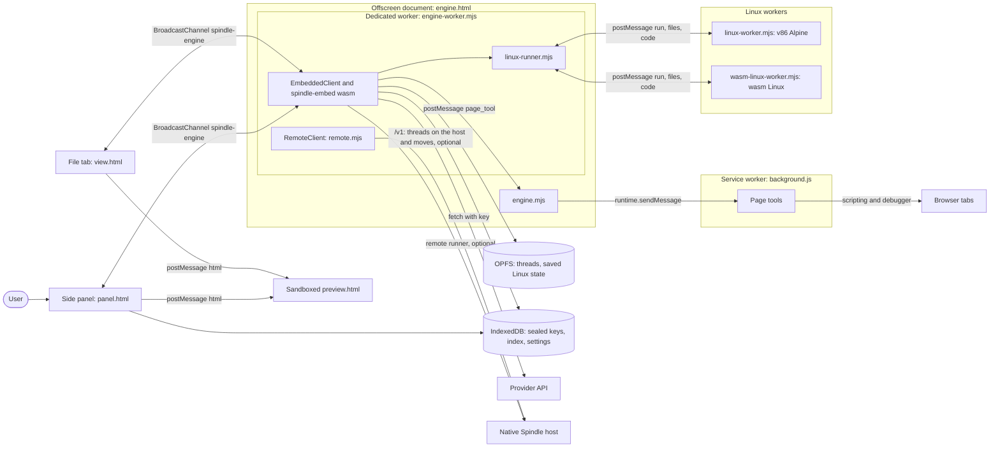
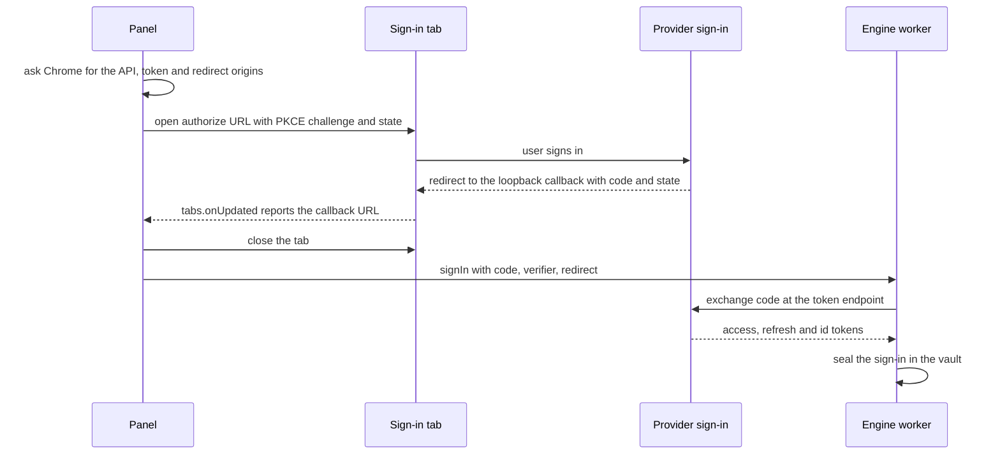

# Spindle for Browser

Spindle for Browser is a Manifest V3 side-panel extension that runs Spindle threads inside the
browser. Each thread is a session of Spindle's embedded package ([`spindle-embed`](../spindle/embed/),
see [embedded.md](embedded.md)) stored in the extension's origin private file system (OPFS).
The threads run in a worker of an offscreen document, so they keep going while the panel is
closed. Model requests go from that worker straight to the provider with a key or sign-in kept
sealed in the extension's IndexedDB. Threads can read and act on browser tabs through page tools,
run `bash` in a Linux that runs inside the extension (see [browser-linux.md](browser-linux.md)),
and move to and from a native Spindle host, as `.spindle` files or straight to a connected host.
The extension works on its own; connecting a native Spindle host is optional and adds a second
place where a thread's commands, or the whole thread, can run.
It is tested on Chrome, Edge and Brave (Chromium 116 or later, on desktop); this page uses Chrome's
names, which Edge shares. In Edge, Brave or Opera, the panel and the messages it shows say that
browser's name where they would say Chrome (`BROWSER` in
[`page-tools.mjs`](../spindle/chrome/page-tools.mjs)). The manifest's current version is **0.1.6**
([`manifest.json`](../spindle/chrome/manifest.json)); the release asset is
`spindle-browser-0.1.6.zip`.

## Contents

- [Components and Chrome contexts](#components-and-chrome-contexts)
- [Message paths](#message-paths)
- [Threads and storage](#threads-and-storage)
- [Providers, keys and requests](#providers-keys-and-requests)
- [Page tools](#page-tools)
- [Files in and out](#files-in-and-out)
- [Stopping a turn](#stopping-a-turn)
- [Settings](#settings)
- [Moving threads to and from a native host](#moving-threads-to-and-from-a-native-host)
- [Running a thread on your Spindle host](#running-a-thread-on-your-spindle-host)
- [Permissions](#permissions)
- [Install a release](#install-a-release)
- [Build and load](#build-and-load)
- [Tests](#tests)

## Components and Chrome contexts

All sources are in [`spindle/chrome/`](../spindle/chrome/). [`chrome/build.sh`](../spindle/chrome/build.sh)
also copies in the JS clients ([`embedded.mjs`](../spindle/clients/js/embedded.mjs),
[`opfs.mjs`](../spindle/clients/js/opfs.mjs), [`common.mjs`](../spindle/clients/js/common.mjs), and
[`remote.mjs`](../spindle/clients/js/remote.mjs) for a connected host's `/v1`) and the
native UI's `store/ui/text.js` and `store/ui/theme.js`, so the panel uses the same Markdown parser
and theme switch as the native UI.

| File | Runs in | Role |
| --- | --- | --- |
| [`manifest.json`](../spindle/chrome/manifest.json) | — | MV3 manifest: side panel, module service worker, permissions, the sandboxed `preview.html`, content security policies. Requires Chrome 116 or later. |
| [`background.js`](../spindle/chrome/background.js) | Service worker | Opens the side panel from the toolbar button. Serves `preview.html` with its `Connection-Allowlist`. Does the page tools' work (only it can reach tabs). Keeps the page switches consistent with Chrome's site access. |
| [`engine.html`](../spindle/chrome/engine.html), [`engine.mjs`](../spindle/chrome/engine.mjs) | Offscreen document (one per profile, reason `WORKERS`) | Starts the engine worker and relays its page-tool calls to the service worker (a worker has no `chrome.runtime`). |
| [`engine-worker.mjs`](../spindle/chrome/engine-worker.mjs) | Dedicated worker of the offscreen document | The engine. Holds an `EmbeddedClient` over the OPFS pool, the thread index, every thread's turns and the command runners; opens the provider's sealed credential for each request. Drives threads that live on a connected host through a `RemoteClient`. |
| [`linux-runner.mjs`](../spindle/chrome/linux-runner.mjs), [`linux-route.mjs`](../spindle/chrome/linux-route.mjs) | Engine worker | The `app` command runner: picks a Linux for each command and talks to the Linux workers. |
| [`linux-worker.mjs`](../spindle/chrome/linux-worker.mjs), [`wasm-linux-worker.mjs`](../spindle/chrome/wasm-linux-worker.mjs) | Nested workers started by the engine | The two browser Linuxes (the wasm Linux only in builds that carry it). See [browser-linux.md](browser-linux.md). |
| [`panel.html`](../spindle/chrome/panel.html), [`panel.mjs`](../spindle/chrome/panel.mjs), [`panel.css`](../spindle/chrome/panel.css) | Side panel (also opens in a tab) | The UI. It holds no session: it sends requests to the engine and renders the events the engine broadcasts. |
| [`steps.mjs`](../spindle/chrome/steps.mjs) | Panel, file tab | Pure functions that label tool steps in plain words with the right tense, name the page and element a browser step acted on, find failed steps that a later step redid, and pick out scratch files. |
| [`markdown.mjs`](../spindle/chrome/markdown.mjs) | Panel, file tab | Renders `text.js` Markdown blocks as DOM nodes. |
| [`view.html`](../spindle/chrome/view.html), [`view.mjs`](../spindle/chrome/view.mjs) | Extension page in a tab | Shows one workspace file in a tab of its own. |
| [`preview.html`](../spindle/chrome/preview.html), [`preview.js`](../spindle/chrome/preview.js) | Sandboxed extension page (iframe) | Renders a web page a thread made. It has its own origin and no extension APIs. |
| [`page.mjs`](../spindle/chrome/page.mjs) | Panel, file tab | Workspace file helpers: file type and display kind, inlining a page's workspace resources for the preview, safe download names, `saveFile`. |
| [`page-tools.mjs`](../spindle/chrome/page-tools.mjs) | Panel, engine, service worker | Page tool definitions, the host permission patterns they need, the `pageSwitches` rule, what Before acting asks about (`confirmMode`, `sends`, `actionText`), and the browser's name (`BROWSER`). |
| [`shared.mjs`](../spindle/chrome/shared.mjs) | Panel, engine, file tab, service worker | The `BroadcastChannel` name, the extension's IndexedDB helpers, the preview choices (`previewChoice`, `keepPreviewChoice`), `accessFor`, and `startEngine`. |
| [`vault.mjs`](../spindle/chrome/vault.mjs) | Engine | Credentials, the host's token and sites' secret headers at rest: sealing, opening, the passphrase lock (see [Keys at rest](#keys-at-rest)). |
| [`signin.mjs`](../spindle/chrome/signin.mjs) | Panel (the tab), engine (the tokens) | Browser sign-in: which providers have one, the PKCE tab flow, the code exchange and refreshes. Also the tab of a host's one-click Connect (`connectInTab`). |
| [`host-moves.mjs`](../spindle/chrome/host-moves.mjs) | Engine | Moving a thread to the connected host and back as a recorded move that finishes or rolls back by itself after any stop (see [Running a thread on your Spindle host](#running-a-thread-on-your-spindle-host)). |
| [`zip.mjs`](../spindle/chrome/zip.mjs) | Panel | Writes an uncompressed (stored) `.zip` of a workspace. |
| [`build.sh`](../spindle/chrome/build.sh) | — | Assembles the loadable extension folder. |



## Message paths

### Panel and engine

The panel, the file tab and the engine talk over one `BroadcastChannel` named `spindle-engine`
(`CHANNEL` in [`shared.mjs`](../spindle/chrome/shared.mjs)). Only pages of the extension's own
origin can join it.

| Direction | Message | Meaning |
| --- | --- | --- |
| page to engine | `{to: 'engine', from, id, op, args}` | A request. `from` is the sender's random id, `id` its request number. |
| engine to page | `{to, id, ok, result}` or `{to, id, ok: false, error: {kind, message}}` | The reply to one request. |
| engine to all | `{type: 'event', thread, event}` | A session event of a thread, as the embedded package emits it. |
| engine to all | `{type: 'thread', thread}`, `{type: 'removed', id}`, `{type: 'turn_end', thread, unsent}` | Thread index changes and turn ends (`unsent` is always empty: messages a turn did not read wait, held, as a `queued` message). |
| engine to all | `{type: 'queued', thread, queued}` | A message waiting for a turn's end, or held (`held` says why); its saved copy is `kv/queued:ID:NONCE`. |
| engine to all | `{type: 'approvals', approvals}` | The page actions waiting for the user's Allow or Deny (see [Before acting](#before-acting)). |
| engine to all | `{type: 'resync', thread}` | A thread on the host whose event stream opened again after a gap: panels draw it again. |
| engine to all | `{type: 'linux', state, detail, wasm}` | Browser Linux states (see [browser-linux.md](browser-linux.md#boot-resume-and-idle)). |
| engine to all | `{type: 'host' \| 'sites' \| 'relay', ...}` | Settings changes, so every open panel updates. |
| engine to all | `{type: 'vault', vault}` | The vault changed (a key saved or removed, a sign-in ended, locked or unlocked), so every open panel updates. |
| engine to all | `{type: 'ready', broken}` | The engine finished starting (or could not). |

The panel opens the engine itself: when its first `hello` request times out it calls
`startEngine`, which creates the offscreen document unless one exists. **Restart engine**
(Settings, About) closes the offscreen document, and the panel then starts it again.

The engine's operations (`ops` in [`engine-worker.mjs`](../spindle/chrome/engine-worker.mjs)) are:

| Operation | Does |
| --- | --- |
| `hello` | Returns a snapshot: package info, catalog, thread index, running threads, Linux and host state, sites, standing instructions, relay, the page actions waiting for an answer, and the vault's state (its mode, whether it is locked, each provider's credential kind and signed-in account). |
| `create` | Creates a thread (optionally with another thread's workspace, `from`) and starts its first turn. |
| `send` | Starts a turn or steers a running one with text. A message with files sent while a turn runs waits for that turn's end ("Goes when this turn ends"): the engine saves it (`kv/queued:ID:NONCE`) before the panel is told it waits, and one message at a time may wait. It is held, saying why ("Not sent (...)"), when the thread needs the user first or the turn before did not finish. A message sent to a thread whose last turn takes neither a new message nor a reply is refused at once ("The last turn did not finish (...): retry, continue or take it back first."), and the draft stays in the box. |
| `unqueue` | Takes back the message waiting for a turn's end (Take back) and removes its saved copy. |
| `stop`, `retry`, `resume` | Stop a turn; resend a request that was cut off; continue where Spindle knows it stopped. |
| `tasks`, `taskStop` | List child tasks and stop one, including while the parent only waits for reports. |
| `storage`, `compact`, `dropAside`, `freeSealed` | Per-thread disk use, return free database pages, remove set-aside first attempts, or remove a moved thread's sealed copy after checking its bundle. |
| `open` | A thread's status and history (optionally from a message index). For a thread whose commands run in the browser it also warms the wasm Linux (when the build carries it), and v86 only if the thread ran a command there in the last 24 hours. |
| `rewindTo` | Takes the thread back to just before one of the user's messages, searching the last 8192 rewind targets, and returns that message and its attachments. |
| `earlier` | The history before a compaction summary. |
| `restart` | Starts an unfinished turn over, optionally with other settings, or hands its message back. |
| `settings`, `efforts`, `rename` | Change a thread's settings; list a model's efforts; rename. |
| `export`, `bundle`, `import` | Move or copy a thread to a `.spindle` file; fetch a moved thread's file again; import one. |
| `files`, `turnFiles`, `read` | List the workspace; list it together with the files as the last turn found them; read one file's bytes. |
| `remove` | Deletes a thread, its OPFS files, its kept bundles, its preview choices, its waiting messages and what the Linuxes kept of its workspace, and ends its tasks' page actions and the questions they wait on. |
| `host`, `sites`, `relay`, `standing`, `catalog` | Global settings (see [Settings](#settings)). |
| `approve` | The user's Allow or Deny for a page action waiting for it (see [Before acting](#before-acting)). |
| `hostName`, `hostConnect` | This browser's name on the host (kept for the profile); trade the code a Connect tab caught for a browser token and connect with it. |
| `hostPreflight`, `toHost`, `backPreview`, `backHere` | Run on my host and Bring back to this browser (see [Running a thread on your Spindle host](#running-a-thread-on-your-spindle-host)). |
| `saveKey`, `forget`, `signIn` | Seal a provider's API key; remove its key or sign-in; exchange a sign-in the panel caught for tokens and seal them (see [Providers, keys and requests](#providers-keys-and-requests)). |
| `unlock`, `lock`, `protect`, `unprotect`, `resetVault` | The passphrase lock: unlock, lock now, set or change the passphrase, remove it; `resetVault` is **Forgot it**, which deletes every saved secret (the host's token too, so the host disconnects) and starts a new device vault (see [Keys at rest](#keys-at-rest)). |
| `warm` | Starts or resumes the browser Linux ahead of a command. |
| `spend` | A thread's spending limit and what it has spent. |
| `ping` | Answers that the engine runs (the file tab waits for it). |

For a thread that lives on the connected host, the thread operations go to the host's `/v1`
instead, and those only a thread here can do (`export`, `bundle`, `compact`, `dropAside`,
`freeSealed`, and `create` with its files) are refused until it is brought back.

Thread ids are 16 hex digits; the engine rejects any other. Short operations on one thread run
one after another (`operate` keeps a queue per thread); `stop` and `taskStop` skip that queue.
Operations without a thread share one queue, except `signIn`, `approve`, `hostConnect` and
`hello` (with `ping`), which each have their own, so a slow token endpoint, a waiting approval
or a slow host holds up nothing else, and a panel's `hello` never waits behind a host connect
or an unlock. Changing the catalog is refused while any operation is pending
or any thread is running.

### Page tool calls

A page tool call goes from the engine worker to the offscreen document with `postMessage`
(`page_tool`), then to the service worker with `chrome.runtime.sendMessage`. The service worker
accepts tool calls only from `engine.html` of its own extension and from no tab. Answers come
back the same way (`page_tool_answer`). A turn that ends or is stopped sends `page_tool_cancel`
for its outstanding calls. The panel sends `{type: 'pages'}` to the service worker when the page
switches change, and the service worker then detaches the debugger from every tab if page actions
are off.

### Linux workers

The engine's command runner talks to the two Linux workers with `postMessage` messages (`run`,
`files`, `stop`, `code_reply`, `relay`, `forget`, `start`; and back `ran`, `status`, `need`,
`code`). [browser-linux.md](browser-linux.md) describes them.

## Threads and storage

### Sessions in OPFS

The engine creates its client with `storage: 'opfs'` and a pool opened by `openOpfsPool`
([`opfs.mjs`](../spindle/clients/js/opfs.mjs)): a set of OPFS files opened up front with
synchronous access handles, because SQLite needs synchronous file calls. A pool belongs to one
worker at a time, and each session takes the Web Lock `spindle:<dir>` before it touches its
files. Thread `ID` lives in the session directory `/threads/ID`.

A session is open only while something uses it. `within` counts users of a thread;
`rest` closes it once no turn, task or operation is using it, releasing its in-memory
state. Before work that may add files, `headroom` adds 32
slots to the pool when fewer than 16 are free. After idle sessions close, a
30-second rest allows an engine instance grown past 64 MiB to renew: the client closes,
a fresh copy of the wasm glue instantiates the already compiled module, and the old
glue drops its references so that memory can return to the browser. No turn, task,
open session or request may be using it. OPFS sessions, vault, Linux workers, sites,
catalog and connected runner carry over. Sources:
[`engine-worker.mjs`](../spindle/chrome/engine-worker.mjs) and
[`glue-drop.js`](../spindle/chrome/glue-drop.js).

### IndexedDB

[`shared.mjs`](../spindle/chrome/shared.mjs) opens the IndexedDB database `spindle` with four
object stores:

| Store | Key | Holds |
| --- | --- | --- |
| `keys` | provider id, `:host`, or `:site:NAME` | A provider credential, the host's token, or a site's secret headers, sealed by the vault (see [Keys at rest](#keys-at-rest)); the host and site records are separate from provider entries. |
| `threads` | thread id | The thread index: title, provider, model, effort, runner, network, tasks, creation/update times, state, note, summaries and last v86 use; for a thread on the host, `home` (its address and session), a move under way (`moving`) and why the host cannot be reached now (`away`). |
| `bundles` | thread id, `prior:ID:TIME:UUID`, or `host-move:ID` | The `.spindle` file a moved thread went into; a temporary whole-checked backup while a first turn is reset, removed once reset or restoration finishes; the bytes a move to or from the host holds until it ends. |
| `kv` | name | `catalog`, `host`, `host-name`, `sites`, `site-secrets` (each site's secret header names), `relay`, `standing`, `pages`, `vault` (the vault key, or its wrapped form), `reset:ID` markers, `preview:ID:PATH` (what the user let one version of a page do in its preview: run its scripts, reach the web), `queued:ID:NONCE` (a message waiting for a turn's end, or held: its text and files, kept until a turn has taken it or the user takes it back), moves to or from the host (`host-move:ID`), and for threads on the host their turn commands and Stops saved until the host confirms them (`host-command:ID`, `host-stop:ID`) and page tool answers (`host-tool:...`). |

A thread's `state` is one of `idle`, `running`, `stopped`, `failed`, `interrupted` or `moved`.
A moved thread stays moved even if a turn ends after the move.

### Engine start and recovery

When the engine worker starts, it loads the wasm module, creates the client from the saved
catalog (or the built-ins if that catalog is refused), reconnects a saved host in the background,
loads the site grants and relay, seals any key an earlier build kept as text, and then repairs
what an earlier stop left behind:

- a `reset:ID` marker means a first-turn reset was interrupted, so the saved backup bundle is
  imported back, then the marker and backup are removed (markers are written and removed with
  strict commits, so one cannot return after a crash and undo later work); finished resets keep no
  backup, and startup removes unused reset backups and stale bundles from moves
  into a file that never sealed;
- a thread the index still calls `running` becomes `interrupted` ("Chrome stopped while it ran"),
  unless it lives on the host, where it may still run (the host says how it stands once it
  answers);
- a thread whose store lock file starts with `spindle-moved: ` is marked `moved` (a move sealed
  before the index was updated);
- directories under `/threads` that no index entry names are removed;
- a message that waited for a turn's end, or was held, comes back held ("Not sent (...)")
  with Take back, unless the turn that took it had already committed it (then it is not
  offered again); one whose thread is gone is removed;
- moves to or from the host go on from the step they recorded; those that need the host wait
  for it.

### Before each turn

`freshen` brings a thread up to date before `send` and `restart` turns. If it cannot, the turn
goes on unchanged:

- the browser Linux guide in the thread's instructions is replaced with the current wording;
- a style line comes before the standing instructions (which win over it): pages the thread
  makes follow the system's light or dark theme and offer a System/Light/Dark switch, and
  nothing it writes uses em dashes. New and imported threads get it at once;
- the user's standing instructions are placed between `[The user's standing instructions]`
  and `[End of the user's standing instructions]`;
- if the thread offers page tools, it gets the current page tool definitions;
- threads made by older builds switch from `digest` to `model` compaction, so a summary the
  thread's own model writes replaces the shorter digest.

## Providers, keys and requests

**Catalog.** Providers come from the embedded package's built-in catalog, or from a
`providers.json` the user imports (Settings, Providers, Provider list). The engine checks an
imported catalog by constructing a package instance with it before anything changes, and stores
it under `kv/catalog`. If a saved catalog is later refused, the engine falls back to the
built-ins and reports why.

**Keys.** The panel hands a key to the engine (`saveKey`), which seals it into the `keys` store
under the provider id; only the engine reads or writes credentials
([`vault.mjs`](../spindle/chrome/vault.mjs)). The panel learns only which providers have one, of
which kind, and for a sign-in its account and whether it ended; never a key or token. For
every fresh model request the package asks the engine's `credentials` callback, which opens
the provider's record (refreshing a sign-in first when it is about to
expire). The embedded client fills the key into the header templates (`auth`) the package derives
from the catalog; the package never sees it. A provider marked `requires_api_key: false` needs
none, and a missing or locked credential refuses the request before anything is reserved or sent.
Each credential records the origin it was saved for (a sign-in also its token endpoint's): if a
provider list imported later points that provider elsewhere, the request is refused with a
message to save the key or sign in again, and nothing goes to the new address (a credential
saved before origins were recorded is bound to the origin in use the first time it is used).
Credentials are not part of any session, so an exported `.spindle` file carries none;
`extension_real.mjs` checks that no bundle contains the key.

**Browser sign-in.** A provider whose catalog entry has a standard OAuth flow (authorization code
with PKCE, `protocol` `generic`, a plain `http://localhost` or `http://127.0.0.1` redirect) shows a
**Sign in to NAME** button instead of a key field; ChatGPT is the built-in one
([`signin.mjs`](../spindle/chrome/signin.mjs)).



1. In the click, the panel asks Chrome for the provider's API origin, its token endpoint's
   origin and the redirect's loopback origin. The last lets Chrome report the redirect's address
   to the extension; nothing needs to listen there. While the keys are locked, sign-in is
   refused before anything starts (a code is good for one exchange, and its tokens could not
   be kept).
2. It opens a blank tab, starts watching it, and only then sends it to the provider's
   authorize URL with a fresh PKCE challenge (S256) and `state`, so a provider that redirects
   at once cannot get there before the watch. For ChatGPT it also sends the sign-in page's own options for coding agents
   (`codex_cli_simplified_flow`, `id_token_add_organizations`, `originator=spindle`).
3. When that tab navigates to the registered redirect, the panel checks `state`, takes the
   `code` and closes the tab. A closed tab, an `error` answer or ten minutes without one ends
   the attempt.
4. The engine exchanges the code with the verifier at the token endpoint and seals the result
   (`kind: "signin"`: access token, refresh token, expiry, and the account's e-mail from the ID
   token for the panel to show). The panel never holds a token.
5. Before each request, a sign-in with five minutes or less left is refreshed first (the
   refresh token may rotate; both are sealed again). Refreshes run one at a time per provider,
   outside the vault's queue, and one that finds the record changed meanwhile (signed out or
   in again) keeps nothing. While the token is still good, a token endpoint that is down or
   rate-limited fails nothing: the request uses the token it has. When the endpoint refuses
   the refresh token (HTTP 400, 401 or 403), or the token expires with none, the sign-in is
   marked ended: the request fails with a message to sign in again, the row says **sign-in
   ended**, and nothing more is sent until the user signs in again.

The ChatGPT backend also needs the account the token belongs to (`chatgpt-account-id`). The
package marks that header's place with a second slot, `{account}`, and names the token claim it
comes from (`claims` in the `authorize` work); the client reads the claim from the token itself.
Signing in again replaces the record; **Sign out of NAME** removes it. Anthropic's built-in entry takes an
API key here; its subscription sign-in is not offered.

### Keys at rest

Every secret in the `keys` store, including the host token under `:host` and sites'
secret headers under `:site:NAME`, is sealed
with AES-GCM (256-bit, a fresh 96-bit IV per write), with its record id as additional
authenticated data, so a record cannot be moved to another provider or into the host
slot. The host's URL remains readable in `kv/host`, and a site's address and header names
in `kv/sites` and `kv/site-secrets`, but their secrets do not. The
vault key that seals them is one of two kinds:

| Mode | Vault key | Protects against | Unlock |
| --- | --- | --- | --- |
| Device (default) | A non-extractable WebCrypto key stored in the extension's IndexedDB | Credentials appearing as text in profile files, backups or scans for key patterns | None |
| Passphrase | The vault key wrapped with AES-KW under a key derived from the passphrase (PBKDF2-SHA-256, 600,000 rounds, random salt) | A copy of the whole Chrome profile: without the passphrase it holds nothing usable | Once per engine start (Settings, Providers, Passphrase); the key then lives only in the engine's memory |

In device mode the vault key sits in the same profile as the records, so whoever copies the whole
profile copies both; the passphrase closes that gap for what is written from then on. A
passphrase needs at least 8 characters (normalized to Unicode NFC) and is typed twice when set
or changed. Setting, changing or removing it re-seals every record under a fresh vault key in
the same IndexedDB transaction that replaces the vault key, so an interruption leaves the old
vault or the new one, never a mix, and neither the device key nor an earlier passphrase opens
what is kept from then on. Locked, a send asks for the passphrase and nothing reaches the
provider; a wrong passphrase is refused by the key unwrap itself. A forgotten passphrase cannot
be recovered: **Forgot it** (after a confirmation that says so) deletes every saved key and
sign-in, the host's token (so the host disconnects) and sites' secret headers, and starts a
new device vault, leaving threads as they are. Opening a record costs one AES-GCM decryption,
so requests are no slower; the vault's state for the panel is read without waiting behind a
token refresh, and every vault change is announced to every open panel.

Chrome may keep earlier copies of records in its storage files until it compacts them: keys
saved by builds that kept them as text, and records sealed under the device key before a
passphrase was set. Replace such a key at its provider if that matters.

**Where requests go.** The engine worker sends model requests with `fetch`, directly to the
provider's endpoint from the catalog. No server or relay is involved. Chrome allows that only
for origins the extension holds a host permission for. Saving a key asks Chrome for the
provider's origin (`accessFor`: the origin of the catalog's `base_url`), and sending a message
asks again if access is missing. When Chrome refuses a request, the engine's `reach` wrapper
names the origin and explains how to allow it.

A native Spindle host connected under Settings, Your Spindle host is the remote command
runner for threads here (`remoteRunner` in
[`embedded.mjs`](../spindle/clients/js/embedded.mjs)) and, when connected with a browser
token, can also take whole threads (see
[Running a thread on your Spindle host](#running-a-thread-on-your-spindle-host)). **Connect**
gets that browser token through the host's own page. A token pasted instead comes from
`spindle --dir HOST token new NAME --browser`, or, for commands only,
`spindle --dir HOST token new NAME --runner`: a runner token reaches `/v1`, `/v1/runner`,
`/v1/run` and the starting token's run status and stop, but no session or transcript, and
cannot move threads or run their model turns.
The token is sealed, locked, re-sealed and reset with the provider credentials;
older plaintext host tokens are migrated into the vault at engine start. Model
requests of threads in the browser never go through this host. See [host.md](host.md).

### Secret headers for sites

A site listed under Settings, Sites scripts may call can carry one secret header, such as
an API token as `Authorization: Bearer ...` or a key header such as `X-Api-Key`. Settings
takes a header name (`Authorization` when left empty) and its value. The engine
(`changeSites` in [`engine-worker.mjs`](../spindle/chrome/engine-worker.mjs)) checks it
before keeping anything:

- the name must be one a request can carry; names the browser or Spindle set themselves
  (`Host`, `Cookie`, `Origin`, `Referer`, `Proxy-*`, `Sec-*` and the like) are refused;
- the value is printable ASCII (spaces and tabs allowed), at most 8 KiB, and its secret part
  (after an auth scheme such as `Bearer`) has at least 8 characters, so it can be found in what comes back;
- the address must be `https://`, or one of this computer's own (`localhost`, `127.0.0.1`,
  `[::1]`, `*.localhost`);
- the keys must be unlocked: the header is sealed in the vault with the provider keys
  (`keys/:site:NAME`), and only its name is kept in `kv/site-secrets`.

Adding a listed address again updates it (with a new header, or keeping the one it has);
removing the site removes its header. The package only learns the header's name: the
site's grant names it as one the app adds (`{"app": true}`), and the embedded client asks
the engine for the value (`grantHeaders`) as each request a script makes under that grant
goes out, only for the address it was saved for. A script may not set that header itself,
its value is never journaled, and an echo of it in what comes back (headers, body or
errors; as is, JSON-escaped, percent-encoded or in base64) is replaced with `[redacted]`
before the script or the thread sees it. While the keys are locked such requests are
refused; after **Forgot it** the site shows its header as gone and refuses requests until it
is added again with one.

The header keeps the token from scripts, not its use: any script of a thread can make the
requests that site's address and access allow with it, and pass on what comes back. List
the narrowest address, choose **Read it** where reading is enough, and use a token with the
least scope. Redaction finds the forms a server commonly echoes a token in, not every
transformation of it.

## Page tools

Page tools let a thread see and use the user's tabs. The engine registers every tool in
`PAGE_TOOLS` ([`page-tools.mjs`](../spindle/chrome/page-tools.mjs)) as an app tool with a 30 s
timeout (an action [Before acting](#before-acting) may ask about gets 700 s, 100 s plus the ten
minutes it may wait for the user's answer, so the engine always answers before the package
gives up), and the service worker does the work. Two switches, kept with the
Before acting mode as `kv/pages` = `{reading, acting, confirm}`, gate them, together with
Chrome's host access to `https://*/*` and `http://*/*` (`PAGE_ACCESS`):

- **Read pages** (page reading) is on only when the user turned it on and Chrome grants site
  access.
- **Act on pages** (page actions) is on only when the user turned it on and page reading is on
  as well. Turning it on turns reading on too; turning reading off turns actions off.

Turning either switch on asks Chrome for site access. Site access granted for something else
(for example a thread's network) turns no switch on. If the user takes site access back, in
Spindle or in Chrome's settings, both switches go off and the service worker detaches from
every tab; the Before acting mode is kept. Settings, Pages draws the switches again when
Chrome's site access changes elsewhere, and writes a change over the saved record as it is
then. A new install starts with both switches off.

| Tool | Needs | Does |
| --- | --- | --- |
| `list_tabs` | reading | Lists tabs (id, title, address) and marks the one the user is looking at. |
| `read_page` | reading (`scroll` also needs actions) | Address, title, selected text and visible text of a tab (default 20,000 characters, at most 100,000). With `scroll: N` (1 to 30) it scrolls down and collects each new line once, for feeds that load as they scroll. |
| `page_elements` | reading | An indented outline of headings, links, buttons, fields, lists, tables and text, each actionable part with a ref such as `kqm12`. |
| `page_html` | reading | The page's or one part's HTML, without `<script>` unless asked and without password values (default 50,000 characters, at most 200,000). |
| `screenshot` | reading, plus the `<all_urls>` grant (visible tab) or actions (any tab) | A JPEG of a tab saved to `screenshots/` in the workspace. |
| `navigate` | actions (reading for `/workspace/NAME`) | Go to an http(s) address, back, forward or reload, in a tab or a new tab; or open a workspace file in a tab for the user. |
| `click`, `type`, `press` | actions | Input through Chrome's debugger, so pages receive it as real input. |
| `select`, `scroll` | actions | Choose `<select>` options, or scroll a part into view or the page, from Spindle's script in the page. |
| `wait_for` | actions | Wait for text or a CSS selector to appear or disappear (default 10 s, at most 25 s). |
| `dialog` | actions | Accept or dismiss an alert, confirm or prompt dialog. |
| `close_tab` | actions | Close a tab showing a web page. |
| `network` | actions | Record a tab's requests (`start`), list them (`read`, at most 500 kept), read a response body by id, and `stop`. |

How the tools run ([`background.js`](../spindle/chrome/background.js)):

- **Reading** runs a function in the tab's top frame with `chrome.scripting.executeScript`, in
  Spindle's isolated world (`inPage`). Refs live in that world and carry a random mark for each
  page, so a ref from one page never names an element of another. Only `http:` and `https:` tabs
  are reachable.
- **Acting** attaches `chrome.debugger` (protocol 1.3) to the tab on demand and detaches after
  20 s without use (or when network recording stops). While a JavaScript dialog Spindle saw
  there is open, it stays attached (up to 11 minutes), so an answer the user is asked about
  can still be given. Chrome shows its debugging bar while
  attached. If the user closes that bar, Spindle does not act on that tab again (no input,
  choosing, scrolling, moving or closing it) until the user turns page actions off and on;
  opening a new tab is not an action on that tab. The veto is kept in Chrome's session
  storage, one key per tab, so a service worker that rests does not forget it, and closing
  the bar, which ends every attachment at once, vetoes each of those tabs. Closing a tab
  drops its veto.
- **One action at a time per tab.** `click`, `type`, `select`, `press`, `scroll` and in-place
  `navigate` on one tab run one after another, so two threads never interleave focus and input
  on the same page. `dialog` is not queued: answering a dialog is what lets a waiting action on.
- **Covered targets.** `click` and `type` aim at the target's center; if another element lies
  over that point (other than a `<label>` of the target), nothing is clicked or typed and the
  tool says what covers it.
- **Dialogs.** A tab where Spindle's debugger saw a JavaScript dialog open refuses reading and
  acting tools until `dialog` answers it, and actions report a dialog when one opens.
- **Deadlines.** Each call into a page or the debugger has 20 s, a whole tool 28 s in the
  service worker, and the engine waits 35 s before it cancels the call. Stopping a turn, a
  deadline passing, or page actions being turned off cancel the remaining steps of a call. A
  request already handed to Chrome cannot be undone.
- **Cut-off actions.** A tool that fails once it has begun acting (its input reached the page,
  or Chrome was told to open, move or close a tab), or whose answer from Chrome is lost,
  answers `unknown` rather than failed: the model checks the page before repeating it, and a
  script makes no further calls. A tool declared `rerun: 'safe'` just fails.
- **Reruns.** Reading tools, `screenshot` and `wait_for` are declared `rerun: 'safe'`; the other
  acting tools are `rerun: 'no'`, so Spindle never repeats a click by itself (see [tools.md](tools.md)).
- **Workspace files.** `navigate` to `/workspace/NAME` (or `file:///workspace/NAME`) is rewritten
  by the engine into `view.html?thread=ID&path=NAME` in a new tab.
- **Screenshots.** The visible tab is captured with `chrome.tabs.captureVisibleTab` once the user
  has granted `<all_urls>` (**Capture this tab** under **+** asks for it); any other tab uses
  `Page.captureScreenshot` through the debugger when page actions are on. The tool returns the
  image as a workspace write in `screenshots/`, named by its capture time and tab (the
  panel shows it as "Screenshot" and the time it was taken). The model does not see it
  directly, but a script in the browser Linux can pass it to a vision model with
  `spindle model --image FILE`.

### Before acting

Settings, Pages, **Before acting** decides whether a thread asks the user before a page action
(`beforeActing` in [`engine-worker.mjs`](../spindle/chrome/engine-worker.mjs), `sends` in
[`page-tools.mjs`](../spindle/chrome/page-tools.mjs)):

| Mode | Asks before |
| --- | --- |
| **Full** (the default) | Nothing: it acts without asking, the whole task start to end. |
| **Auto** | An action that sends or submits: `press` of Enter or Return (with or without modifiers), `type` with `submit` (Enter after typing), `dialog` accepting a page's dialog, and a `click` on a submit control or on one whose label or accessible name holds a word such as Send, Submit, Post, Reply, Share, Buy, Pay, Order, Confirm, Delete, Remove or Transfer (`SENDING_WORDS`; a click whose target cannot be told counts as one that sends). |
| **Ask** | Every `click`, `type`, `press`, `select`, `navigate` (going back, forward or reloading too), `dialog` (accepting or dismissing) and `close_tab`. |

Reading tools, `scroll`, `wait_for`, `screenshot` and `network` never ask, and neither does
`navigate` opening a workspace file for the user. If the saved mode cannot be read, Spindle
asks (it never acts unasked on a choice it could not see).

The question names what the action lands on. `click`, `type` and `select` name their part and
its site; a `type` question shows up to 300 characters of the text. For `press`, `dialog`,
`close_tab` and an in-place `navigate` (back, forward, reload or go, not a new tab), the engine
first looks up the tab (`tab_of` in [`background.js`](../spindle/chrome/background.js): the
tab named, or the one the user is looking at then) and names it, as in "Press Enter in tab 4
(“Inbox”, mail.example)". The action is then pinned to that tab, whatever the user looks at
by the time they answer.

While an action waits, the panel shows it above that thread's message box as "Spindle asks
before it acts: ..." with **Deny** and **Allow**, and the thread's row in the list says "Asks
you: ...". The question area is a polite live region, and both buttons are described by the
question. The action waits up to ten minutes. **Allow** lets it go on. **Deny**, no answer
within ten minutes, or the turn being stopped or ending means the action is not done, and the
thread is told so: a known outcome (nothing happened), not an unknown one. A script's action
that waits for an answer is withdrawn when the command that asked ends: nothing is done (that
command was already told the outcome is unknown). The mode applies to threads on the
connected host too, whose page tools this browser answers.

## Files in and out

**In.** The **+** button, dropping files on the panel, and **Capture this tab** under
**+** (a PNG of the visible tab) attach files to the next message. Each file may be at most 25 MiB and all of them
together at most 60 MiB. Names are flattened (no folders from outside), so each lands at the top
of the workspace. The message gets a trailing line `[Attached, in the workspace: NAME (N bytes),
...]`. Sent while a turn runs, a message with files waits for that turn's end ("Goes when this
turn ends"). The engine saves it first, so if Chrome or the engine stops before a turn takes it,
it comes back held, with Take back. Going back to a message (`rewindTo`) or starting its turn
over (`restart`) reads those files back from the workspace so they can be sent again.

**Out.** The panel shows what a turn's file tools wrote as cards under the step that wrote it, and
lists the whole workspace once as a tree in a card folded until the user opens it, just above
the last turn's final answer (at the end when the turn ended without one), marking files as new
or edited (`turnFiles` compares digests
with the workspace before the turn), whether a file tool or a command made them. Scratch files (`isScratch`:
`.txt`, `.py`, `.pyc`, `.log`, `.tmp`, and anything under `test/`, `tests/`, `__pycache__/` or
`.cache/`) are hidden until shown. The workspace also has a page of its own in the panel, and
`view.html` shows one file in a tab. Folders start shut and draw their children only
when opened; a folder containing only a folder shares its row. Counts and change
marks reach enclosing folders; search lists matching files with their paths. Open
folders stay open through filtering, scratch toggles and turn redraws. See
`drawTree` in [`panel.mjs`](../spindle/chrome/panel.mjs) and `fileTree` in
[`store/ui/text.js`](../spindle/store/ui/text.js).

How a file is shown depends on `kindOf` in [`page.mjs`](../spindle/chrome/page.mjs):

| Kind | Shown as |
| --- | --- |
| page (`.html`, `.htm`) | A sandboxed `preview.html` iframe. `pageOf` inlines relative styles, scripts when permitted, pictures and media (each at most 16 MiB). Scripts receive only named small data files (each at most 1 MiB, 8 MiB in all), checked against workspace digests, for in-memory `fetch`. |
| picture | An ``. |
| Markdown | Rendered with the native UI's parser. |
| text and code | Plain text. The panel shows the first 60,000 characters and the file tab the first 2 MiB (Markdown too); download for the rest. |
| anything else | Offered for download (the workspace page shows it as text if it holds no NUL byte). |

A preview's first elements turn DNS prefetch off and set its CSP. The service worker
serves offline `preview.html` with `Connection-Allowlist: ()`; `preview.js` tells
its parent whether the browser enforces it. A contained preview runs scripts but
connects nowhere. Otherwise the page is static: scripts and frames are removed,
`script-src 'none'` applies and `<noscript>` fallbacks show. **Run them** explicitly
allows that version to run without containment; the UI
warns that it could send what it shows out. The choice covers the page, its own
scripts and named small data files, and any change asks again. **Load from the
web** lets that version run and load over HTTPS. The service worker sets
`Connection-Allowlist: ("https://*:*")` instead of the empty offline list; where
enforced, this permits HTTPS while WebRTC stays blocked. Forms are never submitted.
**Load from the web** is offered only for a page that seems to load from other sites. The
choice is kept per thread and file (`kv/preview:ID:PATH`) and removed with the thread;
**Stop them** and **Go offline** undo it.

`Connection-Allowlist` containment needs Chrome 152 or later and the service
worker's preview response; the runtime probe decides, not the version number.
Older browsers still display static previews. The service worker's static routing
requires Chrome 123 or later; without it, previews are treated as uncontained.

`page.mjs` removes meta refreshes, resource hints (`preconnect`, `dns-prefetch`,
`prefetch`, `prerender`, `preload`, `modulepreload`) and DNS-prefetch overrides,
including inside templates. Unsafe markup that changes on reparsing is shown as
text. External link targets and pings are removed where a non-contained page could
cause name lookups. CSP alone is not an offline guarantee for explicitly allowed
scripts. The manifest's sandbox policy is the upper bound. `preview.html` accepts
only its parent's first page, and refuses a contained-only page without protection;
extension pages' `frame-src 'self'` prevents frame navigation away. Sources:
[`page.mjs`](../spindle/chrome/page.mjs), [`preview.js`](../spindle/chrome/preview.js)
and [`background.js`](../spindle/chrome/background.js).

Downloads go through `chrome.downloads.download` (with a link click as fallback). `downloadName`
replaces separators and reserved characters, a leading dot (`.env` becomes `_env`) and Windows
device names (`con.txt` becomes `_con.txt`). **Download all** builds a `.zip` with `zip.mjs`.

**New thread with these files** (thread menu) returns to the thread list with "Starts with the
files of “TITLE” (not its conversation)" above the box. The next message sent starts a thread
with that thread's current workspace (at most 256 MiB) and its model, effort, command, network
and tasks settings, but none of its conversation.

## Stopping a turn

Stop (the button that replaces Send while a turn runs and the box is empty, with nothing
attached) ends the turn where it is, and cancels its page actions still under way or waiting
for an answer (`stop` in [`engine-worker.mjs`](../spindle/chrome/engine-worker.mjs)).
Stopping is a way to steer: the thread then says **Stopped part way**, and while it takes a
reply its box says "Reply to go on…" (otherwise "Reply…", and "Steer the running turn…" while
a turn runs).

- **A command stopped while it runs** is recorded as stopped by the user, with what it
  printed (in the browser Linux, what it changed in the workspace is dropped). It never runs
  again, not even on Continue.
- **A reply** goes on with the same turn: the model reads that the user stopped that step, then
  the reply ("skip that, use the cached copy"). If the stop cut off the model's own reply, the
  reply asks the model again with the message read first (the cut request may have been
  billed).
- **Text only.** A turn stopped part way takes a message without files: one sent with files is
  refused and stays in the box. A message with files that waited for the turn to end is not
  sent: it shows as "Not sent (...)", saying why, and Take back puts it in the box again.
- **Stopped before it began.** A turn stopped before its message was handed over (while it
  waits for the host to connect, say) leaves the thread as it was, and the message comes back
  held: "Not sent (you stopped its turn before it began): ...", with Take back. One whose turn
  failed before taking it says "its turn failed before taking it".
- **Unread messages.** Messages a turn ended before reading wait, held ("Not sent (the turn
  ended before reading it): ...", with Take back); with a message waiting for that turn's end,
  they go with it, before it. The same holds for threads on the host, and for a message the
  host refused for good. Held messages are kept on disk like other waiting messages.
- **Continue** lets the model decide what to do next. **Retry** asks it again from before the
  stopped step; when that step came from the thread's first request, which has nothing before
  it, Retry starts the turn over with its message sent again. **Take back** returns the message
  to the box.

A thread on the connected host stops the same way; see
[Running a thread on your Spindle host](#running-a-thread-on-your-spindle-host) for what its
Stop needs.

## Settings

Global settings are a full page, opened by the **Settings** button (sliders icon) at the top,
with a sticky heading and a way back. The model picker is a full page too. The composer is one
box: its status row holds what the thread is doing and for how long, the tasks still at work,
the action needed now and the model button; when a turn runs with the box empty and nothing
attached, Stop replaces Send. Step groups show kind icons and counts and open on demand. A
steering message is a bubble at the right, checked when read; a long one folds to three lines
until opened. Threads group into Running, Needs you, Today and Earlier, with search and
Undo delete. Settings and rendering live in
[`panel.mjs`](../spindle/chrome/panel.mjs),
[`panel.html`](../spindle/chrome/panel.html) and
[`panel.css`](../spindle/chrome/panel.css).

Tasks show as cards with their prompt, state and Stop while working; reports show
as the task's text, not as a user message. A count in the composer shows tasks still
at work. Stop while the parent only waits ends that wait, not the tasks; their
reports are read on Continue or the next turn. The model page can enable tasks.

Global settings are stored in IndexedDB and applied by the engine:

| Section | Setting | Stored as | Effect |
| --- | --- | --- | --- |
| Providers | key or sign-in per provider | `keys/ID` (sealed) | Used for that provider's requests. Each row shows the provider's name, host and state and, for a sign-in, its account. Saving a key asks Chrome for the provider's origin; signing in asks for its API, token and redirect origins. |
| Providers | Passphrase: set, unlock, lock now; change and remove under **Change or remove the passphrase** | `kv/vault` | See [Keys at rest](#keys-at-rest). |
| Providers | Provider list | `kv/catalog` | Import a `providers.json`, or use the built-ins. Refused while threads run. |
| Pages | Read pages, Act on pages | `kv/pages` | Page reading and page actions; see [Page tools](#page-tools). |
| Pages | Before acting: Full, Auto or Ask | `kv/pages` (`confirm`) | See [Before acting](#before-acting). |
| Pages | Remove Chrome's site access | — | Removes `https://*/*`, `http://*/*` and `<all_urls>` and turns both switches off; Before acting is kept. |
| Commands | none (state only) | — | Shows the browser Linux's state, the wasm Linux's (when the build carries one) and how commands reach the network. |
| Relay | Address | `kv/relay` | A WISP server address (`wisp://HOST` or `wisps://HOST`, nothing else accepted). Threads with network then reach any address through it. See [browser-linux.md](browser-linux.md#through-a-relay). |
| Sites scripts may call | Address prefixes, each with an optional secret header | `kv/sites`, `kv/site-secrets` (header names), `keys/:site:NAME` (sealed values) | Address prefixes that scripts' `spindle http` may reach: **Read it** allows `GET` and `HEAD`, **Read and change it** also `POST`, `PUT`, `PATCH`, `DELETE`. Adding one asks Chrome for that origin. The package checks each grant (`setHttpGrants`). See [Secret headers for sites](#secret-headers-for-sites). |
| Your Spindle host | Address; **Connect**, or **Or paste a token** | `kv/host` (URL, and this browser's name there after Connect), `keys/:host` (sealed token) | Connect opens the host's own page to approve this browser (see [Running a thread on your Spindle host](#running-a-thread-on-your-spindle-host)). A pasted token comes from `spindle --dir HOST token new NAME --browser` (threads and commands) or `--runner` (commands only). Kept after the host answers. |
| Your instructions | standing instructions | `kv/standing` | Up to 8000 characters, added to new threads at once and to other threads before their next turn. |
| Appearance | Paper, neutral Light, Dim or System (Light or Dim as the system is); Textured or Plain | `localStorage` (`spindle-theme`, `spindle-texture`; `theme.js`) | The panel's look; Paper and Textured are the defaults. Dim is the dark theme, a soft charcoal. |
| Storage | Thread sizes, Free, Free all, Remove first attempts, Linux snapshot | OPFS and `bundles` | See [Storage controls](#storage-controls). |
| About | The extension's version, the engine, build and Linux images, storage used; Open in a tab, Restart engine | — | **Open in a tab** opens `panel.html` in a tab (useful when Chrome cannot show a permission prompt in the side panel). **Restart engine** closes and restarts the offscreen engine, asking first while browser threads run. |

Settings for one thread, and the defaults for new threads, are in the model page (the model
button in the composer), which switches between **This thread** and **New threads**. The
defaults for new threads are kept in the panel's `localStorage` (`spindle-new`).

| Setting | Values | Notes |
| --- | --- | --- |
| Provider, Model, Effort | from the catalog | The efforts listed are those the model accepts (`efforts`). |
| Commands run in | Browser (`runner: 'app'`), Host (`'remote'`), None (`'none'`) | `app` threads get the browser Linux guide in their instructions. A thread that lives on the host runs its commands in the host's sandbox until it is brought back. Host can be chosen only while a Spindle host is connected. |
| Network for commands | on or off | Off by default, and unavailable when commands run nowhere. For commands in this browser with no relay set, saving it on asks Chrome for site access; if Chrome declines, a thread's network stays off (for new threads, Chrome asks again at send). |
| Tasks | on or off | Child sessions, including background work and queued reports. |
| Spend limit | US dollars, or empty for none | Per thread, tasks included. `max_usd` is enforced in the package; spend and the limit are also reachable from the header. |

For a stopped, failed or interrupted thread, saving this page starts the unfinished
turn over (`restart`), taking it back and sending its message again. Otherwise it
uses `settings`, which the package refuses while a turn runs; a spend limit alone may also
change between the steps of an unfinished turn. Background
tasks must end or be stopped before a restart.

### Storage controls

Settings, Storage lists threads largest first, including stores, logs, tasks,
set-aside first attempts and moved bundles (`storage` in
[`engine-worker.mjs`](../spindle/chrome/engine-worker.mjs)). **Free** calls
`compact`, which calls the embedded `compactSession`: a compacted copy of the store
is written, synced and checked whole against it, then renamed over it, so free
SQLite pages go back without changing history. No thread or background task
anywhere in the engine may be at work.
For an older moved thread with a sealed OPFS copy, Free calls `freeSealed`:
`checkBundle` checks the saved file before the redundant store is removed.

**Free all** performs those two operations where useful, one thread at a time;
it does not delete history, set-aside first attempts or the Linux snapshot.
**Remove first attempts** calls `dropAside`, deleting `store.abandoned-*` trees
left when a first request was retried fresh; their retained spend stays counted.
The Linux snapshot row counts OPFS `linux/`: **Remove** deletes those saved files,
so a future v86 start boots afresh instead of resuming them; it does not stop an
already running Linux. These are separate actions, not part of Free all. Source:
[`panel.mjs`](../spindle/chrome/panel.mjs).

## Moving threads to and from a native host

A thread moves as a `.spindle` session bundle (`exportSession` and `importSession` of the
embedded client). Native Spindle takes such a file with `spindle --dir DIR import-session FILE`
and produces one with `export-session FILE` (see [cli.md](cli.md)). To have a connected host
run a thread while this panel still drives it, without a file in between, see
[Running a thread on your Spindle host](#running-a-thread-on-your-spindle-host).

**To a file** (thread menu):

- **Move to a file** stores a copy in `bundles/ID` with a strict IndexedDB commit
  before sealing, then durably replaces it with the move's fully checked bundle.
  It reads the saved bytes back and compares them with that bundle before dropping
  sealed OPFS stores; only the moved fence stays. This leaves one session copy,
  the file, which **Save the file again** in the moved thread saves again. If cleanup
  is interrupted, Storage's **Free** checks the saved bundle whole before removing the
  sealed copy.
- **Export a copy** leaves the thread as it is.

In both cases the copy's settings are rewritten for a native host, while the thread in Chrome
keeps its own:

- page tools are removed (a native host cannot answer them);
- the browser Linux guide is removed from the instructions;
- a thread that had the file tools (`builtin_tools: 'files'`) gets `builtin_tools: 'all'` and
  `runner: 'none'`, that is, native Spindle's full tool set, including code mode's `run_code`,
  in the host's own sandbox.

**From a file** (**Import a .spindle thread** on the thread list): the session is imported into a
new thread, which gets the current page tools and the guide if its commands run in the browser.
The package's `fit` report supplies the changes Chrome needs; the engine applies
them and records them in the thread's note. When anything changed, the panel lists it
before anything runs and asks **Keep this thread here?**; declining removes that local
import, not the original file:

| Native setting | In Chrome |
| --- | --- |
| `builtin_tools: 'all'` | `'files'` |
| `runner: 'none'` with file tools | `runner: 'app'`: commands run in the browser Linux |
| `network` | kept: websites through Chrome, or the relay |
| `toolchain` | off |
| `sources` (host folders) | removed |
| `max_usd` | kept; the embedded package enforces it with the shared spend ledger |
| `self_edit` | refused: such a session runs only on its native host |

The embedded package checks the same settings and refuses anything it still cannot run. A thread
can also stay in Chrome and run its commands on a connected host (`runner: 'remote'`). Its turn
then waits for the host connection to settle before it starts.

## Running a thread on your Spindle host

A thread can live on the user's Spindle host (`spindle serve`, see [host.md](host.md)) while
this panel still shows and drives it: the host's model credentials, programs and sandbox run
it. The engine talks to the host's `/v1` with a `RemoteClient`
([`remote.mjs`](../spindle/clients/js/remote.mjs), see [clients.md](clients.md#remoteclient)
and [API.md](API.md#http-api)), and moves threads there and back with
[`host-moves.mjs`](../spindle/chrome/host-moves.mjs). This is not synchronization: a thread
is live in one place at a time.

**Connect.** In Settings, Your Spindle host, type the host's address and press **Connect**.
Chrome asks for access to the host's origin, and the host's `/connect` page opens in a tab,
naming this browser (for example "Chrome on Windows" with a short id kept for this profile, so
connecting again keeps its threads). If that tab is not paired with the host yet, the page asks
for the host's pairing key first. **Allow** there sends the tab to the host's `/connect/done`
with a one-time code; the panel catches that address, checks it answers this request (`state`),
and closes the tab. The engine then trades the code, with its PKCE verifier, for a browser
token (`POST /v1/connect/token`) and seals it like a key before connecting with it: connecting
again replaces this browser's earlier token on that host, so the new one is the only one that
works there. Only a 403 from the host decides what the token may reach (commands only, or
this browser's threads too); any other failure ends the connect, to be tried again. No token
passes through a URL. Deny, a closed tab, or ten minutes without an answer end the attempt.
While the keys are locked, Connect asks nothing of Chrome or the host: it says "Unlock
Spindle's keys first (Settings, Providers, Passphrase), then connect." and opens the
Passphrase section. A browser token runs commands in the host's sandbox, brings this
browser's threads there and back, and reads the host's providers and models; it sees none of
the host's other threads. The host's own Settings, Screens can revoke it. With a runner token
pasted instead (`token new NAME --runner`), the host only runs the commands of threads here
that choose Host, and Run on my host is not offered.

**Run on my host** (the thread's menu, when the host is connected with a browser token and
the thread is not running). The host must list `threads` among its features (`GET /v1`);
an older one is asked to be updated. If the thread's model is signed in on the host, the
thread runs on it; otherwise the user chooses one of the host's signed-in models. A task
still working in the background, or a message waiting for the thread, must end or be taken
back first. The move then goes as recorded steps, each committed before the next, which the
thread shows as it goes ("Moving to your host: sending it", then sealing and tidying the copy
here):

1. The thread's copy (its history and workspace as a bundle, its page tools kept, the browser
   Linux guide left out) is held here and sent with an `Idempotency-Key`. Sent again after a
   lost answer, the same key and bytes bring the same session, never a second one. A refusal
   that no repeat can change rolls the move back, and the thread stays here: a bundle the host
   cannot read or a model it cannot send to (`bad_bundle`, `no_credentials`, which the host
   finds only after looking the key up) on any attempt, and the other refusals (too large, a
   bad request, a conflict) on the first attempt only, since an earlier send may have been
   imported. A move resumed before the host connects has not been attempted yet. A host that
   does not answer is waited for.
2. Once the host holds it, the copy here is sealed and the thread's record says where it lives
   (`home`); then the sealed store and the held bytes go.

A move cut short by a crash, Chrome closing or an engine restart goes on from its last
recorded step when the engine starts again, or when the host answers. Until the host holds
the thread, this browser keeps its copy.

**On the host.** The panel drives the thread with the same controls: messages, steering,
Stop, Continue, Retry and going back to an earlier message (among the host's newest 48 rewind
targets, and not to before the first message). Its events come over the host's event stream
while it runs; the stream stays open up to five minutes after a panel last opened the thread,
and its state is checked every 15 seconds. Closing the panel, the engine or Chrome does not
stop a turn there: a restarted engine finds it running and follows it to its end. The page
tools it calls are answered by this browser while Chrome is open, by the same code as for a
thread here (Before acting included). Each answer is saved before it is sent, so a lost
answer is sent again rather than the action repeated, and an action cut off before its answer
was saved answers that its outcome is unknown. A turn's command (a message, Continue or
Retry) or a Stop is saved before it is sent and goes again under the same request ID until
the host confirms it. When the host cannot be reached, the thread says so ("Your host is out
of reach: ...") and loses nothing. Move to a file, Export a copy, New thread with these files, and
Storage's **Free** and **Remove first attempts** are for threads here only.

**Stop** on a hosted turn names the exact command it stops (`target_request`), so it can never
stop a later turn, even when it is delivered after the browser was offline or restarted. It
needs a host that lists `targeted_stop` among its features: an older host is asked to be
updated, and the Stop stays pending, with no less exact fallback. Until a pending Stop is
delivered, a new turn or a move back is refused. A saved Stop holds back only its own turn's
page tools (a later turn, started on the host's own screen say, still gets them), and a Stop
for a newer turn replaces an older saved one.

**Bring back to this browser** (the thread's menu, when it is not running) first says what
changes for the thread to run here, as an import does (see the table in
[Moving threads to and from a native host](#moving-threads-to-and-from-a-native-host)), and
asks to go on. The host is asked for the thread (`POST /v1/sessions/ID/export`), which seals
its copy and answers every later export with the same bytes. The engine allows up to 10
minutes for the answer (the host writes, checks and seals the bundle first), then 150 s plus
1 s per MiB for the download. `busy` on the first export means a turn or task runs there, and
the thread stays on the host; `busy` after an export that may have reached the host is waited
out (that export may still be sealing). The bytes are held here and imported in place of the
fenced copy; then the host's sealed copy is deleted. The thread works
here as soon as it is imported, even while that deletion waits for the host; moving it to the
host again is refused until the deletion is done.

## Permissions

| Permission | Used for |
| --- | --- |
| `sidePanel` | The panel (`side_panel.default_path`), opened by the toolbar button. |
| `offscreen` | The engine document (`chrome.offscreen.createDocument`, reason `WORKERS`). |
| `scripting` | Page reading, and the in-page parts of page actions (finding a ref's element, placing the caret, `select`, `scroll`, `wait_for`'s checks): functions injected into tabs. |
| `debugger` | Page actions: input, screenshots of any tab, dialogs, network recording. Chrome does not offer it as an optional permission, so the extension declares it and the **Act on pages** switch decides whether it is used. |
| `downloads` | Saving workspace files and `.zip`/`.spindle` files. |
| `unlimitedStorage` | OPFS sessions and the saved Linux state. |
| `storage` | Chrome's session storage, for tabs whose debugging bar the user closed. |
| `favicon` | Site icons on browser steps (`_favicon/`). |
| optional `https://*/*`, `http://*/*` | Provider origins and your Spindle host's (asked one origin at a time; the host's also lets the panel see its Connect tab come back), a browser sign-in's token endpoint and loopback redirect, page reading, a thread's network through Chrome, sites scripts may call. |
| optional `<all_urls>` | Picturing the visible tab (`captureVisibleTab`), asked by the camera button. |

Extension pages run under `script-src 'self' 'wasm-unsafe-eval'`, which is what loading the
package's wasm needs. The sandboxed `preview.html` has a separate policy (see
[Files in and out](#files-in-and-out)).

## Install a release

[`browser-release.yml`](../.github/workflows/browser-release.yml) publishes a build as
`spindle-browser-VERSION.zip` on the repository's
[releases](https://github.com/SiliconState/Spindle/releases) when a tag `browser-vVERSION` is
pushed (`VERSION` is `manifest.json`'s). It builds the extension from that commit with the v86
Linux (not the wasm Linux), checks that the build names no directory of the machine that made
it, runs `extension_real.mjs --scripted` and `review_browser.mjs` against the zip
unpacked, runs `engine_renew.mjs` against that build's web glue, verifies its
`build.json` names the version and clean sources, attests the zip's
provenance, and attaches it with its SHA-256. A tag that does not name the manifest's version
is refused; running the workflow by hand on an existing tag builds it again and replaces the
zip. The zip also holds the `LICENSE` and
[`THIRD-PARTY.md`](../spindle/chrome/THIRD-PARTY.md), which lists the other software it carries,
with licenses and sources.

1. Download `spindle-browser-VERSION.zip` (and `spindle-browser-VERSION.zip.sha256` to check
   it) and unzip it into a folder you will keep. To check version 0.1.6 first, run
   `sha256sum -c spindle-browser-0.1.6.zip.sha256`, or
   `gh attestation verify spindle-browser-0.1.6.zip -R SiliconState/Spindle`.
2. Load the folder as below (**Load unpacked**).
3. To update, unzip the next version over the same folder and click **Reload** on the
   extension's card. The browser derives an unpacked extension's id from its folder, and its
   threads and keys live under that id, so a different folder is a separate install.

## Build and load

Build from the `spindle/` directory. The browser Linux must be built first
([browser-linux.md](browser-linux.md#building-the-images)). [`chrome/build.sh`](../spindle/chrome/build.sh)
refuses to run without it, and refuses a wasm-bindgen CLI whose version differs from the one
pinned in `embed/Cargo.toml`. Before building anything it also checks the manifest against the
Chrome Web Store's limits, and stops when `name` is over 75 characters, `short_name` over 12
or `description` over 132. It also needs the `wasm32-unknown-unknown` Rust target and clang,
which compiles SQLite for it (`sqlite-wasm-rs`). Build paths are remapped (`/src`, `/cargo`), so
the wasm names no directory of the building machine. Without a path, `build.sh` uses
`wasm-bindgen` from `PATH`; install the pinned one with
`cargo install wasm-bindgen-cli --version VERSION --locked` (`VERSION` from
`embed/Cargo.toml`'s `wasm-bindgen = "=VERSION"`).

```sh
chrome/linux/build.sh                         # the v86 Linux, into chrome/linux/dist
chrome/build.sh /path/to/wasm-bindgen         # the extension, into chrome/dist
chrome/build.sh /path/to/wasm-bindgen OUT     # or into another folder
```

`chrome/build.sh [WASM_BINDGEN_CLI] [OUT_DIR]` builds `spindle-embed` for `wasm32-unknown-unknown`
(`cargo build --locked --release`), generates its web glue into `OUT/web`, and copies the
extension files, the JS clients (into `OUT/clients`), the native UI's `text.js` and
`theme.js`, the icons, `THIRD-PARTY.md`, the browser Linux (`OUT/linux`) and, with
`SPINDLE_WASM_LINUX`, the wasm Linux (`OUT/wasm-linux`). It writes `build.json`: the version,
the sources' commits (marked when they had changes), the tool versions, the wasm's digest and
each Linux image's identity, which Settings, About shows. Environment variables:

| Variable | Default | Meaning |
| --- | --- | --- |
| `SPINDLE_LINUX` | `chrome/linux/dist` | The v86 Linux to carry (must contain `identity`). |
| `SPINDLE_WASM_LINUX` | unset | The wasm Linux to carry (`build-image.sh` output). Without it, every command runs on v86. |

To load it:

1. Open `chrome://extensions` (in Edge, `edge://extensions`; in Brave, `brave://extensions`)
   and turn on **Developer mode**.
2. Click **Load unpacked** and choose the built folder.
3. Click the extension's toolbar button to open the side panel.
4. In **Settings**, add a key for a provider and save it, or **Sign in** to a provider with a
   browser sign-in (ChatGPT). Chrome asks for access to that provider's site.

Threads live in the storage of the extension's origin (OPFS and IndexedDB), not in the build
folder, so rebuilding does not touch them.

## Tests

The tests are in [`spindle/chrome/tests/`](../spindle/chrome/tests/). The ones that drive Chrome
use [`cdp.mjs`](../spindle/chrome/tests/cdp.mjs): Chrome over the DevTools protocol on a pipe, with
the extension loaded through `Extensions.loadUnpacked` and clicks and typing sent as real input
events. Its throwaway profiles use `--password-store=basic`, so Chrome never asks the desktop
keyring. Tests of the Linuxes themselves are listed in
[browser-linux.md](browser-linux.md#tests). See [testing.md](testing.md) for the project as a
whole.

| Test | Needs | Checks |
| --- | --- | --- |
| [`extension_real.mjs`](../spindle/chrome/tests/extension_real.mjs) | a build, `SPINDLE_BROWSER`; a key and `--provider`, or `--scripted`; optional `SPINDLE_BIN` | End to end through the panel in a fresh profile: page reading off and on, steering, a turn finishing with no panel open, Stop, Continue and Retry, Chrome killed mid-turn, moving to native Spindle and back (with `SPINDLE_BIN`), copies and deletes, no key in any bundle, bash in the browser Linux with Spindle calls, a granted site, a site's secret header (added to a script's request, redacted from what comes back, refused when the script sets it, never kept as text or in the thread, removed with the site), TypeScript, attachments and downloads, browsing tools, a host sandbox (with `SPINDLE_BIN`), and (scripted) Before acting (Ask asks and Deny does nothing; Auto asks only before Enter), a command stopped while it runs (kept as stopped with what it printed) and a reply going on after it, long threads, rewinds, compaction and, in a build with the wasm Linux, a plain `sh` command there. Scripted with `SPINDLE_BIN` (and a host whose sandbox works), it also runs a thread on a Spindle host: Connect through the host's page, Run on my host, turns there (steering, Stop, Retry, a page tool this browser answers), the engine restarted mid-turn, the host out of reach and back, a Stop made offline that survives restarts and cannot stop a later turn, Bring back, and a crash or reload at every step of both moves, leaving one live copy each time. `SPINDLE_ONLY=hosted` runs only that part; `SPINDLE_ONLY=browser` skips it. |
| [`signin_vault.mjs`](../spindle/chrome/tests/signin_vault.mjs) | a build, `SPINDLE_BROWSER` | Against scripted OAuth and ChatGPT-style services (no account): Sign in through a tab whose loopback redirect is caught and closed, the PKCE exchange, the row naming the signed-in account, Settings fitting a side panel's width, a refresh before the first turn, the token and its account header on the request; keys, sign-ins and a site's secret header sealed in IndexedDB and absent as text from the profile's files; a legacy text key sealed at engine start; a passphrase that locks, refuses a wrong passphrase and a secret header while locked, unlocks, relocks on engine restart, changes and comes off; a token endpoint that is down while the token is good, a refused refresh ending the sign-in, and **Forgot it** deleting the saved keys and secret headers while threads stay. |
| [`review_browser.mjs`](../spindle/chrome/tests/review_browser.mjs) | a build, `SPINDLE_BROWSER`; Node `node:sqlite` for the storage case | Permission/send ordering, camera permission, covered targets and unknown actions, reset rollback and backup cleanup, one copy per move, move and index updates sharing one strict IndexedDB transaction, Storage's Free, static and contained previews (templates, reparsing, WebRTC, resource hints and DNS netlog), version-scoped script/web choices, background task cards and stopped reports, and messages with files queued for the next turn. |
| [`review_regressions.mjs`](../spindle/chrome/tests/review_regressions.mjs) | Node only | Engine operation ordering, reset rollback, early Stop, a turn stopped part way taking a reply (text alone) and Retry after a stopped step, page-step cancellation, Before acting (Full, Auto, Ask; allowed, denied, ended), site secret headers (names, values, HTTPS only, named to the package without their values), the Dim theme (an old Dark shows Dim), the host `/v1` client (event stream parsing and resuming, commands sent again under their request ID, bundles in and out), Connect's PKCE and state, hosted turns and Stops surviving a lost answer or an engine restart, moves to the host and back cut at every step (one live copy each time), gateway redirect and buffer bounds, IPv6 address checks, dotted CDP request ids, the debugging-bar veto (for tabs vetoed at once, and for actions without the debugger), Before acting kept when site access is taken back, Return asked about as Enter, one action at a time per tab, cut-off actions answering unknown, a message with files waiting for the turn's end (kept on disk until its turn has taken it, restored at start, held, unless taken), a message stopped before its turn began coming back held, a message to a thread that takes none refused at once, the tab a question is about named and pinned, an unreadable Before acting asking, a script's question withdrawn when its command ends, icon buttons named Send asked about, moves rolled back after a lost first request and a refusal only a new key gets (never after a lost answer), a move back waiting on its own export, and a snapshot holding threads as they are when it answers. |
| [`panel_long_run.mjs`](../spindle/chrome/tests/panel_long_run.mjs) | a build, `SPINDLE_BROWSER` | One long scripted turn in each theme: step groups, labels, Stop, Latest, the workspace page, label contrast. |
| [`panel_steps.mjs`](../spindle/chrome/tests/panel_steps.mjs) | Node only | `steps.mjs` labels, tenses, retried failures, durations, a group's time on the clock (steps run at once counted once), scratch files. |
| [`panel_tree.mjs`](../spindle/chrome/tests/panel_tree.mjs) | a build, `SPINDLE_BROWSER` | Large workspace trees: closed folders draw no descendants, single-child folder chains, counts and change marks, open state across redraws, filtering and next/previous navigation; draw timing and Light/Dim screenshots. |
| [`engine_renew.mjs`](../spindle/chrome/tests/engine_renew.mjs) | build's `web/`, Node `--expose-gc` | Fresh wasm instance from one compiled module; old glue drops references, resident memory falls, fresh sessions work. |
| [`linux_warm.mjs`](../spindle/chrome/tests/linux_warm.mjs) | Node only | Stand-in workers: wasm-only warming leaves v86 unstarted, commands start the Linux they need, and `onRan` identifies it. |
| [`vault_host.mjs`](../spindle/chrome/tests/vault_host.mjs) | Node only | Host token sealed apart from provider keys, passphrase lock/unlock and re-sealing, reset removes it. |

**Scripted or real provider.** `extension_real.mjs --scripted` serves a scripted provider from
the test itself, needs no account and costs nothing. With `--provider ID` (and `SPINDLE_KEY`,
optionally `--model` and `--catalog FILE`) it sends real, billed requests to the endpoint the
catalog names. Headless Chrome cannot click through permission prompts, so the test's copy of the
build grants the provider's origin and the test page in its manifest. With `SPINDLE_BIN`, the
native leg uses that Spindle's own credentials for the provider (with `--scripted`, a home of
its own). Its work folder, whose
Chrome profile holds the key, is always removed; `SPINDLE_SHOTS=DIR` keeps screenshots.

```sh
node chrome/tests/review_regressions.mjs
SPINDLE_BROWSER=$(command -v google-chrome) node chrome/tests/review_browser.mjs chrome/dist
SPINDLE_BROWSER=$(command -v google-chrome) node chrome/tests/signin_vault.mjs chrome/dist
SPINDLE_BROWSER=$(command -v google-chrome) SPINDLE_BIN=target/release/spindle \
  node chrome/tests/extension_real.mjs chrome/dist --scripted
SPINDLE_BROWSER=$(command -v google-chrome) SPINDLE_KEY=... \
  node chrome/tests/extension_real.mjs chrome/dist --provider ID
```
