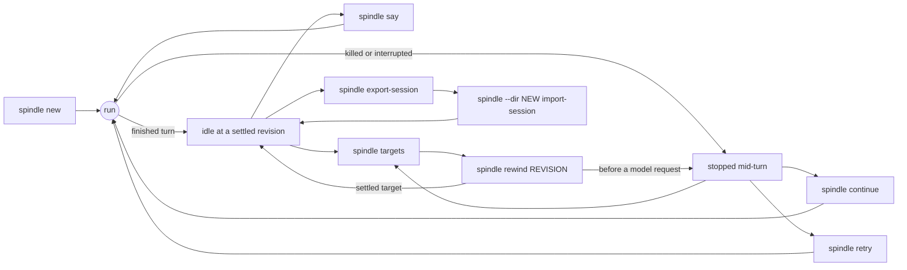

# The `spindle` command line

`spindle` is the command-line front end of the Spindle store. It runs a durable coding
session in a directory, sends prompts to a model, runs the model's tool calls in a
sandbox over a versioned workspace, and records every step as a committed revision, so a
run that is killed resumes with `spindle continue` and earlier points can be restored
with `spindle rewind`. The same binary also serves the browser host (`spindle serve`),
speaks JSON-RPC over stdio (`spindle api`), signs in to model providers through Dext's
credential store, and replaces itself safely (`spindle upgrade` / `spindle rollback`).
The ground truth for everything below is the parser in
[`cli.rs`](../spindle/store/src/cli.rs); terminal prompts for session packs live in
[`cli_ui.rs`](../spindle/store/src/cli_ui.rs) and binary replacement in
[`upgrade.rs`](../spindle/store/src/upgrade.rs).

- [Synopsis](#synopsis)
- [Global option and environment](#global-option-and-environment)
- [Argument parsing, output and exit status](#argument-parsing-output-and-exit-status)
- [Command overview](#command-overview)
- [Running a session](#running-a-session): `new`, `say`, `continue`, `retry`
- [Inspecting a session](#inspecting-a-session): `status`, `usage`, `log`, `targets`, `files`, `cat`
- [Rewinding](#rewinding): `rewind`
- [Moving work out](#moving-work-out): `export`, `export-session`, `import-session`
- [Checking and repairing](#checking-and-repairing): `doctor`
- [Providers and sign-in](#providers-and-sign-in): `providers`, `login`, `logout`, `auth`
- [Browser host and HTTP tokens](#browser-host-and-http-tokens): `serve`, `token`
- [JSON-RPC over stdio](#json-rpc-over-stdio): `api`
- [Code-mode inspection](#code-mode-inspection): `code-packs`, `code-receipts`
- [The binary itself](#the-binary-itself): `version`, `upgrade`, `rollback`
- [What a run prints](#what-a-run-prints)

## Synopsis

```text
spindle [--dir DIR] <command> [options] [arguments]
spindle help | --help | -h
```

The binary is built from the `spindle/` workspace with the `cli` feature of the
`spindle-store` crate (`cargo build --release -p spindle-store --features cli --bin spindle`).
See [getting-started.md](getting-started.md) for a first session.

## Global option and environment

`--dir DIR` is the only global option and must come **before** the command. Without it,
`DIR` is `$SPINDLE_DIR`, or `./.spindle` when that is unset.

| Command group | What `DIR` is |
| --- | --- |
| Session commands (`new`, `say`, `status`, `rewind`, `doctor`, ...) | One session directory. It holds the session's SQLite store under `DIR/store/` and its settings beside it; see [store.md](store.md). |
| `serve`, `token` | The browser host's directory, which holds many sessions; see [host.md](host.md#host-directory-layout). |
| `upgrade` | The default session to verify a candidate against, when no `--session` is given. |
| `import-session` | The destination; it must be absent or an empty directory. |

Environment variables the CLI reads:

| Variable | Read by | Effect |
| --- | --- | --- |
| `SPINDLE_DIR` | every command | Default for `--dir`. |
| `HOME`, `RUSTUP_HOME`, `CARGO_HOME` | `--toolchain`, `doctor` | Where the host Rust toolchain is looked for (defaults `~/.rustup` and `~/.cargo`). |
| `SPINDLE_CODE_POLICY` | code mode | Path of the code-mode policy file. When unset, `code-policy.json` in the parent of the binary's directory is used if it exists; when set, the file must exist. |
| `DEXT_SHELVES_DIR` | `code-packs` | Root searched for packs instead of `~/.dext/shelves`. |
| `DEXT_INPUT_USD_PER_MTOK`, `DEXT_OUTPUT_USD_PER_MTOK`, `DEXT_CACHE_READ_USD_PER_MTOK`, `DEXT_CACHE_CREATE_USD_PER_MTOK` | cost accounting | Price overrides (US dollars per million tokens) applied to the catalog price, as Dext applies them. Non-numeric or negative values are ignored. |
| `SPINDLE_SUPERVISED` | `serve` | `1` declares that an OS supervisor restarts the host; needed for restart, promotion and rollback from the browser ([host.md](host.md#operations)). |

Provider credentials are not environment variables of Spindle: they live in Dext's
credential store and are read for each fresh send, never saved in the session or
printed ([Providers and sign-in](#providers-and-sign-in)).

## Argument parsing, output and exit status

- After the command, options may appear in any order and anywhere among the
  arguments. Every word that is not a recognized option is positional. For `new` and
  `say` all positional words are joined with single spaces into the `PROMPT`, so
  quoting the prompt is optional.
- A command that takes no arguments (`status`, `log`, `doctor`, `version`, ...)
  refuses any extra word or option with `unexpected arguments` followed by the usage
  text. The exceptions: `providers` and `help` ignore anything after them, and `api` or
  `code-receipts` followed by anything is reported as an `unknown command`. Commands
  that take arguments ignore recognized options that do not apply to them (for
  example `--import` on `say`).
- `help`, `--help` and `-h` print the usage text to standard output and exit 0.
- Any error is printed to standard error as `spindle: MESSAGE` and the process exits
  with status 1. A missing command prints the usage text the same way.
- `doctor` exits 1 when any check fails (`some checks failed`).
- `login`, `logout` and `auth` exit with the status of Dext's auth handler: 0 on
  success, 2 for an unknown `auth` subcommand.
- `serve` runs until it is stopped. Under a supervisor it exits with status 75 to be
  restarted ([host.md](host.md#operations)).

Model text, tool calls and results go to standard output. Questions asked by session
packs go to standard error ([What a run prints](#what-a-run-prints)).

## Command overview

| Command | Purpose |
| --- | --- |
| `new` | Create a session in `DIR` and run its first prompt. |
| `say` | Send the next prompt, optionally changing settings. |
| `continue` | Resume an interrupted run. |
| `retry` | Re-run an interrupted model call from the point before it. |
| `status` | Where the session stands. |
| `usage` | Spend per turn and per model. |
| `log` | The conversation so far. |
| `targets` | Revisions that `rewind` accepts. |
| `rewind` | Go back to a target, restoring its workspace. |
| `files` | List the workspace at the head. |
| `cat` | Print one workspace file. |
| `export` | Write the head workspace and app state to a directory. |
| `export-session` | Move (or copy) the whole session into a bundle file. |
| `import-session` | Continue a bundled session in `DIR`. |
| `doctor` | Check a session and safely repair what can be repaired. |
| `providers` | Providers in Dext's catalog and whether each can send. |
| `login`, `logout`, `auth` | Dext's sign-in commands. |
| `serve` | The browser host on loopback. |
| `token` | Named bearer tokens for the host's `/v1` HTTP API. |
| `api` | JSON-RPC 2.0 over stdin/stdout. |
| `code-packs` | Offline pack discovery for code mode. |
| `code-receipts` | The nested effect journal of code mode. |
| `version` | This build's version, schema, engine and fingerprint. |
| `upgrade` | Build or take a candidate binary, verify it, install it. |
| `rollback` | Restore the binary that the last install replaced. |

How the session commands relate:



## Running a session

### `new`

```text
spindle [--dir DIR] new --provider ID [options] PROMPT
```

Creates a session in `DIR` and runs `PROMPT` as its first turn. `DIR` must not already
hold a session (`DIR/store` must not exist); use `say` or another `--dir` instead. The
provider and model are resolved, and the credentials checked, before anything is
created, so a provider that cannot send refuses the command with its reason.

| Option | Default | Meaning |
| --- | --- | --- |
| `--provider ID` | required | Provider from Dext's catalog (`spindle providers`). |
| `--model M` | provider default | Model to use. |
| `--import DIR` | none | Start the workspace from a host directory. `target` and `node_modules` directories, links, unsupported names and files over the per-file limit are skipped and counted; the import is refused past the workspace's file-count or total-size limit. |
| `--attach FILE[=PATH]` | none | Add a file to the workspace, at `PATH` or under its own file name. Repeatable. An existing file whose name contains `=` is attached under its own name. The executable bit is kept on Unix. An attachment replaces an imported file at the same path. |
| `--network` | off | Commands get internet access. What a networked command does outside the workspace cannot be rewound. |
| `--toolchain` | off | Commands get the host Rust toolchain read-only, with a build cache kept beside the session. |
| `--source DIR` | none | With `--toolchain`: mount a host directory read-only at `/NAME` beside the toolchain, where `NAME` is its directory name (for example path dependencies). Repeatable; two sources that would mount at the same name are refused, and so is `--source` for a thread without the toolchain. |
| `--isolation auto\|required\|off` | `auto` | `auto` runs commands in a bubblewrap sandbox where the host allows it and otherwise runs them directly on the host and says so; `required` refuses to run them unsandboxed; `off` never sandboxes (for hosts that isolate Spindle themselves). |
| `--effort LEVEL` | `default` | Reasoning effort: `default` (Spindle's per-provider default), `off`, `low`, `medium`, `high`, `xhigh`, `max`. The levels from `low` add 2K, 6K, 16K, 32K and 64K reasoning tokens on top of the answer cap. A level the model does not take is refused. |
| `--compaction model\|digest` | `model` | How older history is compacted: `model` asks the session's model for a summary (one extra request; the digest stands in if it fails); `digest` builds a deterministic digest with no extra request. |
| `--max-usd USD\|none` | `none` | Dollar budget for the thread. Accepts `5`, `0.50` or `$5`; `none`, `off` and `unlimited` clear it. A model request whose worst case would pass the budget is not sent; `continue` sends it once the budget is raised. |

Settings are explained in [concepts.md](concepts.md) and [driver.md](driver.md); the
sandbox in [tools.md](tools.md).

### `say`

```text
spindle [--dir DIR] say [options] PROMPT
```

Sends the next prompt to the session in `DIR`. It accepts the same options as `new`
except `--import`, plus `--no-network` and `--no-toolchain`. Settings change only
between turns: `say` works only when the last turn finished. If it stopped early,
rewind to a target first; if it is still in progress, run `continue`. The new settings
are saved before the prompt runs.

- Without `--provider`, the saved settings are kept and only the options given change.
  `--model M` alone switches the model on the current provider.
- With `--provider`, the provider and model change (`--model`, or the provider's
  default) and every other setting carries over unless given, except a task model list
  (`tasks.models`), which names the old provider's models and is cleared (and said so).
- After a provider or model switch, an effort the new model does not take returns to
  `default` unless `--effort` is given, and the command says so.
- `--source` replaces the whole list of mounted sources and needs the toolchain on (saved,
  or `--toolchain`). Sources stay saved while the toolchain is off and mount again when
  it is back.
- Attachments are read before anything changes, so a missing file changes nothing.

### `continue`

```text
spindle [--dir DIR] continue [--max-usd USD|none] [--until unknown]
```

Resumes an interrupted run from its committed head. A step whose response was already
recorded is reused, not sent again. If the last turn finished, it says
`Nothing to continue`. `--max-usd` sets the budget first (this is how a request held
back by the budget is sent). `--until unknown` resumes but stops with an error at the
first pending step whose earlier attempt has an unknown outcome, instead of resolving it.

### `retry`

```text
spindle [--dir DIR] retry [--max-usd USD|none]
```

Re-runs an interrupted model request from the point before it; the new request may be
billed again. When the interrupted request was the session's very first one, there is
no earlier point: the old store is kept aside (its path is printed) and the same prompt
restarts in a fresh store over the same files.

## Inspecting a session

| Command | Output |
| --- | --- |
| `status` | Session directory, provider and model, revision and owner epoch, prompts in the current history, state, workspace file count, isolation mode, reasoning level, token usage, cost, budget, and counts of uncertain (possibly billed), unresolved, refused and abandoned requests when there are any. |
| `usage [--json]` | A per-turn table (revision, cost, calls, input, cached, output tokens, prompt), a per-model table and a total line that splits parent, nested and compaction spend and counts subscription, unpriced and refused calls. `--json` prints the same report as JSON. |
| `log` | The conversation: prompts prefixed `> ` (messages sent while a turn ran are marked `(while running)`), model text, one line per tool call and the first lines of each result. |
| `targets` | One line per rewind target: its revision, its kind (`after a finished turn` or `before a model request`) and what came last. |
| `files` | Size and path of every file in the head workspace. |
| `cat PATH` | The raw bytes of one head workspace file, on standard output. |

## Rewinding

```text
spindle [--dir DIR] rewind REVISION
```

Goes back to one of the revisions listed by `targets` and restores its workspace. The
abandoned future stays recorded; requests it left in flight can never be adopted or
re-sent, and their count is printed. After a target taken after a finished turn, send
the next prompt with `say`; after a target taken before a model request, `continue`
re-runs that request. Rewind semantics are in [store.md](store.md) and
[driver.md](driver.md).

## Moving work out

| Command | Effect |
| --- | --- |
| `export DIR` | Writes the head workspace to `DIR/workspace/` and the session's app state to `DIR/state.json`. `DIR` must be absent or empty. |
| `export-session FILE [--keep]` | Writes the whole session (its store and every task's store, with their side files) to the bundle `FILE`, which must not exist. Without `--keep` the session **moves**: this copy is sealed and no longer opens, and work continues where the bundle is imported. With `--keep` both copies remain; continue only one of them. A running background task refuses the export. |
| `import-session FILE` | Imports a bundle into `DIR` (absent or empty) and prints its head and file count. |

## Checking and repairing

```text
spindle [--dir DIR] doctor
```

Checks a session and its host, and repairs only what is safe to repair: abandoned
sandbox scratch is reclaimed, a missing build cache is recreated, and stored files
that no revision, receipt or pending step references are collected. No step is changed;
unresolved steps are reported with the command that resolves them. Each finding prints
as `ok`, `warn` or `FAIL` with its check name: `settings`, `store`, `backup`, `steps`,
`garbage`, `capacity`, `isolation`, `scratch`, `credentials`, `toolchain` and `sources`.
`upgrade` runs a candidate's `doctor` against copies of sessions before installing it.

## Providers and sign-in

Sign-in is Dext's own: the same flows, the same credential store and the same messages
as `dext auth`. Spindle reads a credential for each fresh send and never stores it in a
session.

| Command | Effect |
| --- | --- |
| `providers` | Every provider in Dext's catalog, as `ready CONTRACT MODEL` (wire contract and default model) or `unavailable: REASON`. |
| `login [PROVIDER] [KEY\|web\|import]` | Same as `auth login`. Without a provider and on a terminal, it asks which one. Omit the credential to paste it at the prompt; with standard input not a terminal, the credential is read from its first line. `web` and `import` select Dext's web sign-in and credential-import flows. |
| `logout [PROVIDER]` | Same as `auth logout`: removes the stored credential. |
| `auth status` (default), `auth providers`, `auth list` | Active provider, the catalog with sign-in state, and the paths of the catalog and credential store. `--json` prints a machine-readable document. |
| `auth provider [ID\|INDEX]`, `auth use ...` | Show or set the active provider. |
| `auth models [PROVIDER\|INDEX\|all] [--json]` | Known models of a provider. |
| `auth help` | Dext's auth help text. |

## Browser host and HTTP tokens

### `serve`

```text
spindle --dir HOST serve [--port 8790] [--origin https://HOST]
    [--access-team TEAM.cloudflareaccess.com --access-aud AUD]
    [--dev-source DIR] [--resume known|none]
```

Serves the browser UI and the HTTP API from `127.0.0.1` only. `HOST` is a private
host directory (mode 700), separate from any source checkout and from individual
sessions. Every option takes a value. The host requires a Unix system.

| Option | Default | Meaning |
| --- | --- | --- |
| `--port N` | `8790` | Loopback port to listen on. |
| `--origin https://NAME` | none | The public HTTPS origin of an authenticating reverse proxy in front of the host. Must be `https` with no path, query, fragment or credentials. |
| `--access-team TEAM.cloudflareaccess.com` | none | Verify a Cloudflare Access token on every request that arrives through `--origin`. Requires `--origin` and `--access-aud`. |
| `--access-aud AUD` | none | The Access application's AUD tag (64 hex characters). Requires `--access-team`. |
| `--dev-source DIR` | none | The host's own Spindle source (the `spindle/` directory of a checkout, with `dext-engine/` beside it). Enables self-edit and operator-confirmed promotion. |
| `--resume known\|none` | `none` | `known` continues, after a restart, each thread whose command was interrupted and whose recovery is ready with only known work. |

`spindle --dir HOST serve --check` (the only argument) opens an existing host
directory's `host.sqlite` and binds an ephemeral loopback port, then exits; promotion
uses it to prove that a candidate can start a host. Everything about the host is in
[host.md](host.md).

### `token`

```text
spindle --dir HOST token new NAME [--runner] | list | revoke NAME
```

Named bearer tokens for the host's `/v1` HTTP API ([API.md](API.md)). `HOST` is the host
directory and the commands work while the host runs.

| Subcommand | Effect |
| --- | --- |
| `new NAME [--runner]` | Creates a token and prints it once on standard output (a note goes to standard error). `NAME` is 1–40 letters, digits, `-`, `_` or `.`, not starting with `-`; at most 16 tokens exist at once. `--runner` must follow the name. If `HOST` has no host yet, it is created as `serve` would create it. |
| `list` | Each token's name, creation and last-use time; restricted tokens are marked `(runner)`. |
| `revoke NAME` | Deletes the token. |

Only the token's SHA-256 is stored. Tokens are listed beside paired browsers in the
host's Settings and can be revoked there too; new pairings never evict them. A name
can hold only one token, of either kind.

`--runner` grants only `GET /v1`, `/v1/runner`, `/v1/run` and a named run's status
and stop routes. Other API routes return `403 forbidden`; putting it in a cookie
does not grant the phone UI's `/api` access. Use it for an embedded app's remote
command runner, not a full host token. Remote runs may carry a `run` id, with
`GET /v1/run/ID` and `POST /v1/run/ID/stop`; see [API.md](API.md#routes) and the
implementation in [`serve/v1.rs`](../spindle/store/src/serve/v1.rs).

## JSON-RPC over stdio

```text
spindle api
```

Speaks JSON-RPC 2.0 over standard input and output; the protocol is documented in
[API.md](API.md). The command takes no further arguments.

## Code-mode inspection

| Command | Output |
| --- | --- |
| `code-packs` | Offline discovery of packs under `$DEXT_SHELVES_DIR` (or `~/.dext/shelves`), as JSON. Nothing is launched, activated or granted. |
| `code-packs RUNTIME.json` | The bindings of one exact pack runtime manifest, exported for operator review, not activation. |
| `code-receipts` | The session's nested code-mode effect journals and its session-pack ledger, as JSON. Inspection only: it never resumes or retries a child effect. |

Code mode itself is described in [tools.md](tools.md).

## The binary itself

### `version`

Prints one line:

```text
spindle VERSION schema N engine ENGINE build FINGERPRINT
```

`schema` is the store schema this build reads, `engine` the turn engine identifier, and
`build` the first 12 hex digits of the SHA-256 of the running binary (`unknown` if it
cannot be read).

### `upgrade`

```text
spindle [--dir DIR] upgrade (--from SRC | --binary BIN) [--session DIR]... [--to PATH]
```

Builds or takes a candidate binary, verifies it against copies of sessions, and installs
it only if every check passes.

| Option | Meaning |
| --- | --- |
| `--from SRC` | Build the candidate from a source checkout: `SRC` is the `spindle/` workspace (it must contain `store/Cargo.toml`). Runs `cargo build --release --locked -p spindle-store --features cli --bin spindle` in `SRC` with `CARGO_TARGET_DIR` unset and takes `SRC/target/release/spindle`. |
| `--binary BIN` | Use an existing binary as the candidate. Exactly one of `--from` and `--binary` is required. |
| `--session DIR` | A session to verify against; repeatable. Without any, `DIR` is used when it holds a session. |
| `--to PATH` | The binary to replace. Default: the running executable. |

Verification and installation, from [`upgrade.rs`](../spindle/store/src/upgrade.rs):

1. The candidate's `version` must run within 10 seconds and start with `spindle `.
2. Each session, and each of its task sessions recursively, is copied into a private
   temporary directory. The SQLite store is copied with SQLite's online backup, so the
   copy is consistent and keeps row ids; settings and usage side files are copied too.
   Linked or symlinked session paths are refused.
3. The candidate runs `--dir COPY doctor` on every copy, with a 60-second deadline and a
   1 MiB output limit; its child processes are cleaned up when it exits. Each session
   prints `ok` or `FAIL`; a failure shows the first lines of its report.
4. If any check failed, nothing is installed. Otherwise the candidate is copied beside
   the target as `.NAME.new`, the current binary is kept as `.NAME.previous`, and the
   new file is renamed over the target, so a crash leaves either the old or the new
   binary in place. On Windows the running binary is first moved aside.

### `rollback`

```text
spindle rollback [--to PATH] [--force]
```

Swaps the target (default: the running executable) with the `.NAME.previous` binary kept
by the last install; running it twice undoes it. Stores migrate forward when a newer
build opens them, so `rollback` refuses a kept binary that reads an older schema than
the current one, or that does not report its schema, unless `--force` is given. After a
forced rollback across a migration, put each migrated session's pre-migration copy,
`store/authority.vNN.sqlite`, back as `store/authority.sqlite`.

## What a run prints

`new`, `say`, `continue` and `retry` drive the session in the foreground and print its
events as they happen:

| Line | Meaning |
| --- | --- |
| `> PROMPT` | The prompt being run. |
| `... PROVIDER / MODEL (step N)` | A model request starts. |
| model text | Streamed as it arrives; `(the provider withdrew the text above)` if the provider retracts it. |
| `    [tokens in N out M]`, `    [cost ...]` | Usage and cost of the call, the turn and the thread. Subscription and unpriced calls are labelled as such. |
| a tool call description | One line per tool call, followed by live output prefixed `  \| `. The live preview is capped at 4 KiB per call; the recorded result keeps a paged output window. |
| `  \| (reusing the recorded result; not run again)` | A tool result recorded before a restart is reused. |
| `(reusing the recorded response; nothing was re-sent)` | A recorded model response is reused. |
| `(no isolation: ...)` | Commands run directly on the host under `--isolation auto`. |
| `(the provider refused the request with HTTP N; ...)` | A retry after a provider refusal, with any wait or history compaction. |
| `[REASON] after N model step(s); revision R; workspace: F file(s).` | The run stopped, followed by the next useful command. |

When standard input is a terminal, questions from session packs are asked on the
terminal ([`cli_ui.rs`](../spindle/store/src/cli_ui.rs)): `confirm` (`[y/N]`), `input`
(with a default), `select` and `form` fields (numbered choices, numbers, booleans,
comma-separated multiselects), and `progress` lines. A question that times out or is
interrupted is answered as cancelled, and a line typed late for it is not taken as the
answer to the next question. Without a terminal no pack UI is offered.
