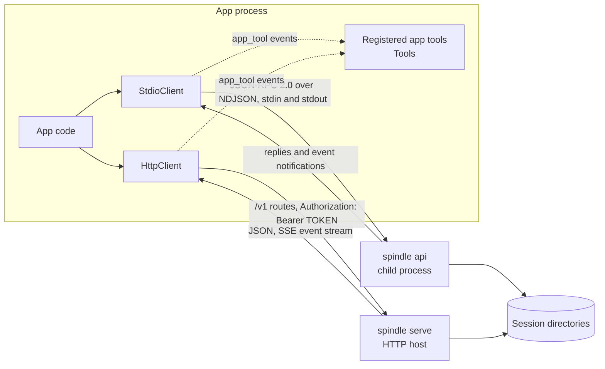
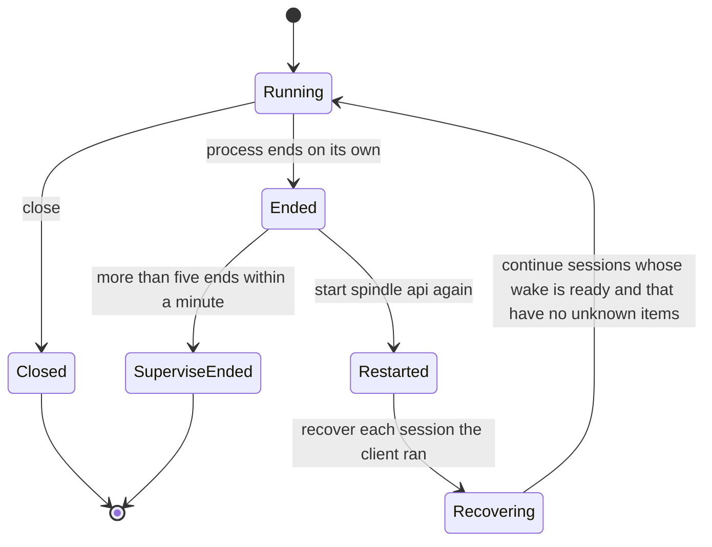

# Node.js and Python clients

Spindle ships two dependency-free API clients: one for Node.js 18 or newer
([`spindle/clients/js/spindle.mjs`](../spindle/clients/js/spindle.mjs)) and one for
Python 3.8 or newer that uses only the standard library
([`spindle/clients/python/spindle_client.py`](../spindle/clients/python/spindle_client.py)).
Each offers the same two transports of the v1 API. `StdioClient` starts `spindle api`
as a subprocess and speaks JSON-RPC 2.0 over newline-delimited JSON on its stdin and
stdout, naming sessions by directory. `HttpClient` calls the `/v1` routes of
`spindle serve` with a bearer token, naming sessions by id. Both clients answer the
app's own tools, and their `StdioClient` can optionally restart a
`spindle api` process that ends unexpectedly and continue the sessions it was running.
This page covers the client code itself. For what each method does, see
[API.md](API.md). For Spindle running inside a JavaScript app with no subprocess, see
[embedded.md](embedded.md).

## Overview



| File | Contents |
| --- | --- |
| [`clients/js/spindle.mjs`](../spindle/clients/js/spindle.mjs) | `StdioClient`, `HttpClient`, `API_VERSION`, and re-exports of `SpindleError`, `Tools`, `answerOf` and `refusedAnswer` |
| [`clients/js/common.mjs`](../spindle/clients/js/common.mjs) | Pieces shared with the embedded client, with no Node imports: `SpindleError`, `Tools`, `answerOf`, `refusedAnswer`, `Emitter` |
| [`clients/js/example.mjs`](../spindle/clients/js/example.mjs) | Runs one prompt in a session directory and prints what happens |
| [`clients/js/smoke_test.mjs`](../spindle/clients/js/smoke_test.mjs) | End-to-end test against a build, using a scripted loopback provider |
| [`clients/python/spindle_client.py`](../spindle/clients/python/spindle_client.py) | `StdioClient`, `HttpClient`, `Tools`, `SpindleError`, `API_VERSION` |
| [`clients/python/example.py`](../spindle/clients/python/example.py) | The Python version of the example |
| [`clients/python/smoke_test.py`](../spindle/clients/python/smoke_test.py) | The Python smoke test |

Neither client needs a package manager: copy `spindle.mjs` together with
`common.mjs`, or `spindle_client.py` on its own, into an app.

## Transports

| | `StdioClient` | `HttpClient` |
| --- | --- | --- |
| Talks to | A `spindle api` child process it starts | A running `spindle serve` host |
| Sessions named by | Directory (`dir`) | Session id |
| Requests | JSON-RPC 2.0 lines (at most 64 MiB each) | HTTP with `Authorization: Bearer TOKEN` |
| Starting a turn | `prompt`, `continue`, `retry`, `rewind` and `task_start` reply when the turn ends | `command(kind, ...)` is admitted and returns a receipt at once; poll `receipt` or read the event stream |
| Events | Notifications on stdout, delivered as they arrive | Server-sent events from `GET /v1/sessions/{id}/events`, resumable with `Last-Event-ID` |
| App tools | Answered automatically from the event notifications | Answered while `answerAppTools` / `answer_app_tools` runs |
| Supervision | Optional (`supervise`) | None in the client |

A token for `HttpClient` comes from `spindle --dir HOST token new NAME` (see
[cli.md](cli.md) and [host.md](host.md)).

## StdioClient

### Constructor

JavaScript, a Node `EventEmitter`:

```js
new StdioClient({ binary, env, stderr, supervise })
```

Python:

```python
StdioClient(binary=None, env=None, on_event=None, stderr=None,
            on_app_tool_error=None, supervise=False, on_supervise=None)
```

| Option | JavaScript default | Python default | Meaning |
| --- | --- | --- | --- |
| `binary` | `$SPINDLE_BIN`, else `spindle` | `$SPINDLE_BIN`, else `spindle` | The executable; the client runs `BINARY api` |
| `env` | `process.env` | `None` (inherit) | The child's environment |
| `stderr` | `'inherit'` | `None` (inherit) | The child's stderr (a `spawn` stdio value, or a `subprocess` value) |
| `supervise` | `false` | `False` | Restart the process when it ends unexpectedly (see [Supervision](#supervision)) |
| `on_event` | (use `on('event')`) | `None` | Python: `on_event(session, request_id, event)`, called on the reader thread |
| `on_app_tool_error` | (use `on('app_tool_error')`) | `None` | Python: `on_app_tool_error(error, session, event)` |
| `on_supervise` | (use the supervision events) | `None` | Python: `on_supervise(kind, dir, event)` |

The process starts in the constructor. If the binary cannot start (for example
`ENOENT`), the JavaScript client closes when the spawn fails, and every call rejects
with kind `closed`. The Python constructor raises the `OSError` from
`subprocess.Popen`.

### Calling

| | JavaScript | Python |
| --- | --- | --- |
| Raw call | `call(method, params)` returns a Promise with a `requestId` property | `call_async(method, **params)` returns a `concurrent.futures.Future` with `request_id`; `call(method, timeout=None, **params)` waits for it |
| Overlapping calls | Yes | Yes; one lock guards writes, and a separate lock guards the pending table (never held while writing) |
| Request too large or not JSON | Rejects with kind `unsendable`; nothing is written | Fails with kind `unsendable`; nothing is written |
| Process ended | Pending and new calls reject with kind `closed` | Pending and new calls fail with kind `closed` |

The request id lets an app match events to the call that caused them. Each event
carries the id of the request it belongs to.

### Methods

Each method sends the API method of the same purpose. Parameters are as in
[API.md](API.md). JavaScript takes options as a trailing object with camelCase names.
Python takes keyword arguments with snake_case names.

| API method | JavaScript | Python |
| --- | --- | --- |
| `info` | `info()` | `info()` |
| `providers` | `providers()` | `providers()` |
| `create` | `create(dir, provider, settings = {})` | `create(dir, provider, **settings)` |
| `open` | `open(dir)` | `open(dir)` |
| `close` | `closeSession(dir)` | `close_session(dir)` |
| `prompt` | `prompt(dir, text, { files, state, expectedHead })` | `prompt(dir, text, files=None, expected_head=None, timeout=None, state=None)` |
| `continue` | `resume(dir, { expectedHead, until })` | `resume(dir, expected_head=None, until=None)` |
| `retry` | `retry(dir, { expectedHead })` | `retry(dir, expected_head=None)` |
| `rewind` | `rewind(dir, revision, { expectedHead })` | `rewind(dir, revision, expected_head=None)` |
| `stop` | `stop(dir)` | `stop(dir)` |
| `steer` | `steer(dir, text)` | `steer(dir, text)` |
| `status` | `status(dir)` | `status(dir)` |
| `history` | `history(dir, revision)` | `history(dir, revision=None)` |
| `targets` | `targets(dir)` returns the `targets` array | `targets(dir)` returns the `targets` list |
| `files` | `files(dir, revision)` | `files(dir, revision=None)` |
| `read` | `read(dir, path, revision)` returns a `Buffer` | `read(dir, path, revision=None)` returns `bytes` |
| `export` | `export(dir, target)` | `export(dir, target)` |
| `export_session` | `exportSession(dir, target, { keep })` | `export_session(dir, target, keep=False)` |
| `import_session` | `importSession(dir, source)` | `import_session(dir, source)` |
| `settings` | `settings(dir, changes = {})` | `settings(dir, **changes)` |
| `usage` | `usage(dir)` | `usage(dir)` |
| `doctor` | `doctor(dir)` | `doctor(dir)` |
| `state` | `state(dir, revision)` | `state(dir, revision=None)` |
| `state_set` | `setState(dir, patch, { expectedHead })` | `set_state(dir, patch, expected_head=None)` |
| `recover` | `recover(dir)` | `recover(dir)` |
| `task_start` | `taskStart(dir, task, prompt, { model, effort, files, settings, report = 'wait', expectedHead })` | `task_start(dir, task, prompt, model=None, effort=None, timeout=None, expected_head=None, report="wait", settings=None, files=None)` |
| `task_wait` | `taskWait(dir, task, timeoutS = 600)` | `task_wait(dir, task, timeout_s=600)` |
| `task_stop` | `taskStop(dir, task)` | `task_stop(dir, task)` |
| `tasks` | `tasks(dir)` | `tasks(dir)` |
| `app_tool_result` | Sent automatically for registered tools; otherwise `call('app_tool_result', ...)` | The same; otherwise `call("app_tool_result", ...)` |

Methods without a wrapper (for example `steer` with `now`) go through `call`. In
Python, `timeout` on `prompt` and `task_start` is how many seconds to wait for the
reply. When it passes, `concurrent.futures.TimeoutError` is raised, and the turn keeps
running.

`create` offers every tool registered with `tool()` as the session's `tools`. In
JavaScript a `tools` key in `settings` replaces them. In Python they are offered only
when `tools` is not among the keyword arguments.

### Events

JavaScript emits:

| Event | Arguments | When |
| --- | --- | --- |
| `event` | `(event, session, requestId)` | Every event notification ([API.md](API.md) lists the event types) |
| `app_tool_error` | `(error, event, session)` | A registered tool's answer could not be delivered |
| `restarted` | none | Supervision started a new process |
| `recovered` | `(dir, report)` | Supervision read a session's `recover` report |
| `recover_error` | `(error, dir)` | Supervision could not read or continue a session |
| `supervise_ended` | none | Supervision gave up (see below) |

If a listener throws, the error is rethrown asynchronously (in a microtask), and
replies keep being delivered.

Python delivers each event notification in two ways. It is put on `client.events`, a
`queue.Queue` of `(session, request_id, event)` tuples, and then passed to
`on_event(session, request_id, event)` if one is given. `on_event` runs on the reader
thread. An exception it raises is printed to stderr, and reading continues.
Supervision notices go on the same queue as `(dir, None, {"type": KIND, ...})`, where
`KIND` is `restarted`, `recovered` (with `report`), `recover_error` (with `error`) or
`supervise_ended` (with `error`). They are also passed to `on_supervise(kind, dir,
event)`.

### Closing

`close()` ends the child's stdin, which asks running turns to stop, and waits for the
process. In JavaScript it resolves with the exit code. In Python, `close(timeout=30)`
returns the exit code. The Python client is also a context manager (`with
StdioClient() as api:`). Closing never triggers a supervised restart. In Python a
`close()` that races a restart in progress waits for the new process and ends it too.

## HttpClient

```js
new HttpClient(baseUrl, token)            // JavaScript, uses global fetch
```

```python
HttpClient(base_url, token, timeout=60)   # Python, urllib; timeout in seconds per request
```

| Route | JavaScript | Python |
| --- | --- | --- |
| `GET /v1` | `info()` | `info()` |
| `GET /v1/sessions` | `sessions()` returns the `sessions` array | `sessions()` |
| `GET /v1/sessions/{id}` | `session(id)` | `session(session)` |
| `POST /v1/commands` | `command(kind, fields = {}, requestId = random)` | `command(kind, request_id=None, **fields)` |
| `GET /v1/receipts/{request_id}` | `receipt(requestId)` | `receipt(request_id)` |
| `GET /v1/sessions/{id}/messages` | `messages(id, revision)` | `messages(session, revision=None)` |
| `GET /v1/sessions/{id}/files` | `files(id, revision)` | `files(session, revision=None)` |
| `GET /v1/sessions/{id}/file?path=` | `read(id, path, revision)` returns a `Buffer` | `read(session, path, revision=None)` returns `bytes` |
| `GET /v1/sessions/{id}/targets` | `targets(id)` returns the `targets` array | `targets(session)` |
| `POST /v1/sessions/{id}/steer` | `steer(id, text)` | `steer(session, text)` |
| `GET /v1/sessions/{id}/state` | `state(id, revision)` | `state(session, revision=None)` |
| `POST /v1/sessions/{id}/state` | `queueState(id, patch)` (only while a turn runs; between turns send a `state` command) | `queue_state(session, patch)` |
| `GET /v1/sessions/{id}/recovery` | `recovery(id)` | `recovery(session)` |
| `GET /v1/sessions/{id}/tasks` | `tasks(id)` | `tasks(session)` |
| `POST /v1/commands` with kind `task_start` | `taskStart(id, task, prompt, options = {}, requestId)` | `task_start(session, task, prompt, report="wait", settings=None, request_id=None, **options)` |
| `POST /v1/sessions/{id}/tasks/{task}/wait` | `taskWait(id, task, timeoutS = 600)` | `task_wait(session, task, timeout_s=600)` |
| `POST /v1/sessions/{id}/tasks/{task}/stop` | `taskStop(id, task)` | `task_stop(session, task)` |
| `GET /v1/sessions/{id}/tasks/{task}/messages` | `taskMessages(id, task, revision)` | `task_messages(session, task, revision=None)` |
| `POST /v1/sessions/{id}/upload` | `upload(id, bytes)` returns `{ digest, size }` | `upload(session, data)` |
| `POST /v1/sessions/{id}/app_tool_result` | `appToolResult(id, call, answer)` | `app_tool_result(session, call, answer)` |
| `GET /v1/sessions/{id}/events` | `events(id, { lastEventId, signal })` | `events(session, last_event_id=None)` |
| Any | `request(method, path, body, { raw })` | (internal `_request`) |

`command` sends `{request_id, kind, ...fields}`, and the host admits it once per
`request_id`. Sending the same `request_id` again returns the existing receipt, so a
command whose reply was lost can be retried safely. The JavaScript client draws a
random id when none is given, and the Python client uses `uuid4().hex`. The Python
`task_start` sends `report: "wait"` unless told otherwise. The JavaScript `taskStart`
sends only the options it is given. A `Uint8Array` body (JavaScript) or `bytes` body
(Python) is sent as `application/octet-stream`, and any other body as JSON. Query
values are percent-encoded, so a space is `%20` and never `+`.

### The event stream

`events` parses server-sent events and yields `{ id, kind, data }` in JavaScript (an
async iterator) or `(id, kind, data)` in Python (a generator). `kind` is `snapshot`
(sent first, naming the session's head and any app tool calls waiting), `event` or
`deleted`, or `failure` (`{error, code}`, after which the stream ends) when the
snapshot cannot be built. To resume after a disconnect, pass the last id seen as
`lastEventId` / `last_event_id`, which is sent as `Last-Event-ID`. A useful pattern, used by the smoke
tests: subscribe first, read the snapshot's `head`, then send a command with
`expected_head` set to it, and read the stream until `command_done`.

## App tools

App tools are tools the app itself implements and offers to the model (see the app
tools section of [API.md](API.md)). Both clients share a `Tools` registry, the same
one the embedded client uses.

```js
api.tool({
  name: 'lookup',
  description: 'Looks notes up.',
  inputSchema: { type: 'object', properties: { q: { type: 'string' } } },
  run: (input, call) => ({ content: `Found ${input.q}.`, files: { write: { 'notes.md': '# Notes\n' } }, state: { looked: input.q } }),
});
```

```python
api.tool("lookup", "Looks notes up.",
         lambda input, call: {"content": "Found %s." % input["q"]},
         input_schema={"type": "object", "properties": {"q": {"type": "string"}}})
```

| Field | JavaScript | Python | Default | Sent as |
| --- | --- | --- | --- | --- |
| Name, description | `name`, `description` | positional | required | `name`, `description` |
| Input schema | `inputSchema` | `input_schema=` | `{type: 'object', properties: {}}` | `input_schema` |
| Re-run policy | `rerun` | `rerun=` | `'no'` (`true`/`false` map to `'safe'`/`'no'`) | `rerun` |
| Timeout | `timeoutS` | `timeout_s=` | unset | `timeout_s` |
| Output cap | `maxOutput` | `max_output=` | unset | `max_output` |
| Handler | `run(input, call)` | `run(input, call)` | required | (not sent) |
| Recovery handler | `again(input, call)` | `again=` | unset | (not sent) |

`tools.definitions()` returns the definitions in the form `create` and `settings`
take. `call` is the `app_tool` event (`call`, `tool_use_id`, `name`, `input`,
`again`, `rerun`, `timeout_s`). Its `call` id stays the same across restarts.

**Shaping the answer.** The handler's return value becomes the answer:

- A string becomes `{content}`.
- `null` or `undefined` (Python `None`) becomes `{content: ''}`.
- An object with any of `content`, `error`, `failed`, `unknown`, `files`, `state` or
  `details` is sent with those keys. When it has neither `content` nor `error` and is
  not `unknown`, `content` is set to `''`.
- Any other value becomes `{content}` holding its JSON text.
- A handler that throws (raises) answers `{error: message}`.
- A tool name with no registered handler answers with an error.

**Calls asked again.** A call cut off by a crash or stop is announced again, on every
continue until it is answered, with `again` true. A tool declared `rerun: 'safe'`
simply runs again. Any other tool calls `again(input, call)` if it was given, so the
app can look up its own record of `call.call` and answer from it. Otherwise it answers
`{unknown: true}`.

**Delivery.** Only registered tools are answered automatically. An app answers other
tools itself with `app_tool_result`.

- `StdioClient` answers each `app_tool` event for a registered tool as it arrives
  (Python does so on a separate thread, so a slow handler never blocks the reader). If
  Spindle refuses the answer as malformed (`bad_request`), or it cannot be sent
  (`unsendable`), the client sends an error answer instead ("the app's answer was
  refused: ..."), so the call fails rather than waiting out its timeout. Any other
  failure, such as a stale call or an ended process, goes to `app_tool_error` /
  `on_app_tool_error`. An answer computed for a process that has since ended is never
  sent to the process that replaced it. The call is announced again there.
- `HttpClient.answerAppTools(id, { signal })` / `answer_app_tools(session, stop=None)`
  reads the session's event stream and answers registered tools' calls until `signal`
  aborts (JavaScript), `stop` is set (Python, a `threading.Event` checked at least on
  every heartbeat), or the session is deleted. It answers the calls waiting in each
  snapshot, then each `app_tool` event. Each announcement is answered once (a snapshot
  and an event can name the same call), and `app_tool_done` clears it. A `400` refusal
  is replaced with an error answer as above. A `409` (the call is no longer waiting)
  is dropped, and the call will be announced again. Any other error ends the loop with
  that error. The host ends a stream every five minutes, and the loop reconnects where
  it left off. For tools to be offered over HTTP, pass
  `tools: client.tools.definitions()` in a `new` or `settings` command.

## Supervision

With `supervise: true` (Python `supervise=True`), a `StdioClient` restarts a
`spindle api` process that ended on its own (killed or crashed) and resumes the work
it knows is safe to resume.



What happens on an unexpected end:

1. Calls pending at that moment reject (fail) with kind `closed`. Supervision does not
   repeat them.
2. The ends within the last 60 seconds are counted. More than five stops supervision:
   `supervise_ended` is reported, and no new process starts.
3. A new process starts, and `restarted` is reported.
4. For each session the client has run and not closed, the client calls `recover` and
   reports `recovered` with the report. When `report.wake.work` is `'ready'` and no item
   whose `next` is not `'none'` has `outcome: 'unknown'` or `unknown: true`, the client
   sends `continue` for that session. A session whose wake is `blocked` waits for the
   app or a person. Supervision continues only known work and never sends a request of
   unknown outcome again, even when the session's settings consent to resending
   (`resend_unknown`). An app tool call that was waiting is announced again, with
   `again` true.
5. A failed `recover` or `continue` is reported as `recover_error`.

The two implementations differ in these details:

| | JavaScript | Python |
| --- | --- | --- |
| When the restart runs | Immediately, on the old process's `close` event | On a new thread, after a 0.1-second pause that a `close()` cuts short |
| Sessions it tracks | Directories passed to `create`, `open`, `prompt`, `resume`, `retry`, `rewind`, `taskStart` and `importSession` (keyed by `path.resolve`); removed by `closeSession` | Directories in calls of the methods `create`, `open`, `prompt`, `continue`, `retry`, `rewind` and `task_start` (keyed by `os.path.realpath`), including raw `call`s; removed by `close` |
| Reports | Emitter events | `events` queue items and `on_supervise` |

Each client remembers the directory spelling it was given and uses it in the calls it
makes while recovering. In Python, a restart whose binary cannot be started is
reported as `supervise_ended` with the `OSError` text.

## Errors

Both transports raise `SpindleError`:

| Field | Meaning |
| --- | --- |
| `kind` | The stable error code: `busy`, `head_moved`, `not_found`, `stopped`, `method_not_found`, `bad_request`, ... Over stdio it is the JSON-RPC error's `data.code` (or `internal`). Over HTTP it is the envelope's `code`, or `http_<status>` when the body has none |
| `status` | The JSON-RPC error code (stdio) or the HTTP status (HTTP) |
| `data` | The rest of the error data (for example `head` on `head_moved`) |
| `message` | JavaScript: `"<kind>: <message>"`. Python: the server's message alone, while `str(error)` is `"<kind>: <message>"` |

The clients add `closed` (the process ended or never started) and `unsendable` (the
request is not JSON or is over 64 MiB).

## Examples

Both examples open a session directory (or create it on `not_found`), run one prompt,
print streamed text, tool calls and results, and list the workspace files:

```sh
node spindle/clients/js/example.mjs DIR PROVIDER "PROMPT"
python3 spindle/clients/python/example.py DIR PROVIDER "PROMPT"
```

They use `spindle` from `PATH` (or `$SPINDLE_BIN`) and the provider logins of the
user running them.

```python
from spindle_client import SpindleError, StdioClient

with StdioClient(on_event=lambda session, request, event: print(event["type"])) as api:
    try:
        api.open("work")
    except SpindleError as error:
        if error.kind != "not_found":
            raise
        api.create("work", "deepseek")
    result = api.prompt("work", "Create hello.txt containing hi")
    print(result["head"], api.read("work", "hello.txt"))
```

```js
import { HttpClient } from './spindle.mjs';

const client = new HttpClient('http://127.0.0.1:PORT', TOKEN);
const created = await client.command('new', { provider: 'deepseek', text: 'Create hello.txt' });
let state;
do {
  await new Promise((resolve) => setTimeout(resolve, 200));
  ({ state } = await client.receipt(created.request_id));
} while (state === 'running');
// Subscribe first: the snapshot names the head the next command expects.
const stream = client.events(created.session);
const { value: snapshot } = await stream.next();
await client.command('say', { session: created.session, text: 'Append a line', expected_head: snapshot.data.head });
for await (const { kind, data } of stream) {
  if (kind === 'event' && data.type === 'command_done') break;
}
```

## Smoke tests

`smoke_test.mjs` and `smoke_test.py` drive a real build with a scripted provider on
loopback (reached through `DEXT_BASE_URL`, with a throwaway Dext home unless
`DEXT_HOME` is set), so no paid calls are made:

```sh
SPINDLE_BIN=target/debug/spindle node clients/js/smoke_test.mjs
SPINDLE_BIN=target/debug/spindle python3 clients/python/smoke_test.py
```

Both cover a stdio turn with a `bash` call, `expected_head` refusals, an app tool with
files and state, an app-started task, supervised restarts (including the rule that
unknown work is never resent, and the loop guard), and an HTTP session with idempotent
commands, uploads and the event stream. The JavaScript test also stops and continues a
stdio turn and answers an app tool over HTTP. The Python test also checks that large
requests and replies in flight together do not deadlock, bundle export and import, and
a `close()` during a supervised restart. See [testing.md](testing.md).
