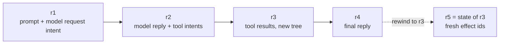
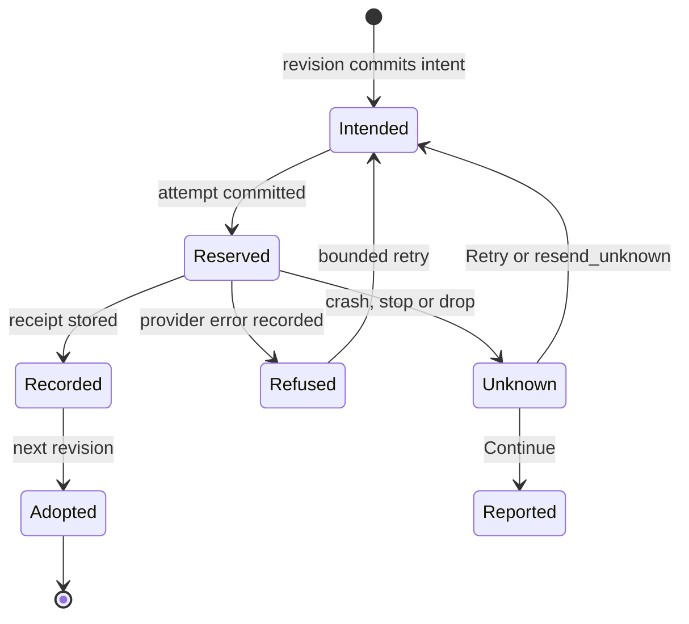

# Concepts

This page defines the vocabulary the rest of the documentation uses: sessions,
revisions, effects and their outcomes, rewind, and the pieces a turn is made of. Each
section links to the document that covers the mechanism in depth.

## Session

A **session** (shown as a *thread* in the web UI and the Chrome extension) is one
conversation with a model over one workspace. It lives in a directory (native and Node)
or under a name in browser storage, and its authoritative state is a single SQLite
store. Everything else in the directory is a mirror (`session.json` for settings), an
accounting cache (`usage.json`) or a child session (`tasks/`). See [store.md](store.md).

Only one process **owns** a session at a time. The owner holds `store/owner.lock` and an
owner epoch; any number of readers can open a read-only view of committed state without
the lock, which is how the web UI and the API answer `history`, `files` and `status`
while a turn runs.

## Revision and head

A **revision** is one committed step. It records, in one transaction:

- the conversation so far (the transcript continuation),
- the workspace tree (a digest naming an immutable tree of content-addressed objects),
- the app state (a JSON object the embedding app can patch),
- the *intents* the step produced (model requests to send, tool calls to run).

The **head** is the newest revision. Revisions only grow; nothing in a committed
revision is edited afterwards. Reading "the session at revision R" always gives the same
answer.

## Effects: intent, attempt, receipt

Anything that leaves the store (a model request, a command, an app tool call, a child
task, a nested code-mode call) is an **effect**, and it moves through three records:

| Record | Written | Means |
| --- | --- | --- |
| **Intent** | in the revision that decided it | "this should happen", with its exact input |
| **Attempt** | before the host performs it | "this is being performed now, by this owner epoch" |
| **Receipt** | after the host has the result, before it is used | "this is what happened" |

The driver adopts a receipt into the next revision. Because the attempt is committed
before dispatch and the receipt before adoption, a process that restarts can always tell
which of three cases it is in: not started (perform it), finished (adopt the receipt),
or **in flight** (outcome unknown). See [driver.md](driver.md).

## Unknown outcomes

An attempt with no receipt after a crash, a stop during streaming, or a dropped
connection is an **unknown outcome**: the provider may have received and billed the
request, or not. Spindle states this instead of guessing.

| Action | What it does with an unknown outcome |
| --- | --- |
| **Continue** (`spindle continue`; API `continue`, client `resume`) | Never resends it on its own. Reports that the outcome is unknown and stops. |
| **Retry** (`spindle retry`; API and client `retry`) | Rewinds to the point before the request, prepares it again under a fresh identity and sends it once. |
| **`resend_unknown` setting** | Opt-in consent: Continue and a dropped send during a turn retry it automatically, up to three times (waiting 1, 2 and 4 seconds), when a rewind target exists. Each resend may be billed. |

A *refusal* (an HTTP error from the provider) is a known outcome, not an unknown one: it is
recorded, and retries follow the provider's `Retry-After` where given.

## Rewind

**Rewind** moves the session back to an earlier **rewind target**: a settled, completed
point of the conversation or an idle point just before a model request
([`rewind.rs`](../spindle/store/src/rewind.rs) has the exact eligibility rules). It commits a *new* revision whose conversation, workspace and app state
equal the target's. Effects after the target are not deleted from history, and a call the
model makes again after a rewind gets a fresh effect id, so an app deduplicating by id
treats it as new work.

Rewind restores what Spindle recorded. It cannot unsend a request, refund a charge, or
undo what a command did outside the workspace (with network, or without isolation).

## Turn

A **turn** starts when a prompt is admitted and ends when the model replies without
asking for tools, the turn is stopped, or an error stops it. Within a turn the driver
alternates model requests and tool rounds. While a turn runs:

- **Steer** queues a message that joins the conversation before the next model request.
- **Stop** ends the turn at the next safe point; an in-flight model request becomes an
  unknown outcome, an in-flight tool call is ended.
- **Compaction** shrinks older history when it outgrows the model's context window:
  `model` mode asks the model for a summary (one extra request, journaled like any
  other), `digest` mode uses a deterministic digest with no extra request.
- **Budgets** (`max_usd`) refuse a request before it is sent if its worst-case price,
  plus what was spent, plus the worst case of every unknown outcome, would pass the
  budget.

## Workspace

The **workspace** is a versioned file tree: regular files (bytes and an executable bit),
symbolic links (stored as text, never followed) and empty directories. Every revision
names a tree by digest; unchanged files share objects. Commands run over a private copy
of the tree and their changes come back as a new tree in the receipt.

## Tools

What the model can call (see [tools.md](tools.md)):

| Kind | Tools | Performed by |
| --- | --- | --- |
| File tools | `read_file`, `write_file`, `edit_file` | the store, in-process |
| Commands | `bash`, `start_job`, `read_job`, `stop_job` | a runner: the sandbox, the browser Linux, the app, or a remote host |
| Output paging | `read_output` | the store, from retained output |
| Host tools | `show`, `settings`, `spindle_source`, `spindle_install` | the host serving the session, in-process |
| App tools | anything the app declares with a JSON schema | the embedding app |
| Tasks | `task` | a child session under `tasks/` |
| Code mode | `run_code` (Python, JavaScript, TypeScript) | a script in the sandbox whose nested `model`/`tool`/`http` calls are journaled |

The `builtin_tools` setting chooses `all`, `files` (`read_file`, `write_file` and
`edit_file` only) or `none`. App tools cannot take a name Spindle reserves (`task`,
`tasks`, `http`, `state`, or any name starting with `spindle_` or `dext`).

## App tools and call ids

An **app tool** is declared by the embedding app (name, description, JSON-schema input).
Every call carries the **effect id** of the model's tool call. The id is the same for as
long as the call exists, across crashes and restarts, and new for a call a rewound
conversation makes again. An app that records calls by *session identity plus call id*
never runs one twice. A call whose owner stopped before an answer was recorded is asked
again with `again` set.

## Tasks

A **task** is a child session the model starts with the `task` tool when the session's
`tasks` setting is on. It has its own store, rewind and recovery in a directory under
`tasks/` named by a hash of the call's effect id, works on a copy of the parent's
workspace, and its answer becomes the tool result. Unless the call says `files: "discard"`, the files it changed land in the
parent's workspace with that result. Its spend counts against the parent. Given as an
object (`max_depth`, `max_running`, `models`), the `tasks` setting bounds depth,
concurrency and which models tasks may use.

## Isolation and runners

`isolation` decides how strictly commands are confined on a native host:

| Value | Behavior |
| --- | --- |
| `auto` (default) | Sandbox where the host supports it; otherwise run on the host and say so. |
| `required` | Refuse the command if the sandbox is unavailable. |
| `off` | Never sandbox (for hosts that isolate Spindle themselves). |

`network` and `toolchain` grant a command internet access or the host Rust toolchain.
An embedded session has no sandbox of its own, so its `runner` setting names who runs
`bash`: `none` (not offered), `app` (the app's own runner) or `remote` (a `spindle serve`
host). See [tools.md](tools.md) and [embedded.md](embedded.md).

## Bundles and moving sessions

A session can **move**: exported to a single-file **bundle** (store images of the session
and every task, plus `session.json` and task identity records, with SHA-256 checks) and
imported by another host. Exporting seals the source (`spindle-moved`) unless `--keep` is
given, so only one copy continues. A Node session directory is also a native session
directory and moves in place. See [store.md](store.md#session-bundles) and
[embedded.md](embedded.md).

## Providers and credentials

Providers and models come from the Dext provider catalog (built-ins, extended by
`~/.dext/providers.json`; `DEXT_HOME` moves that directory). Logins are stored there, not
in sessions; a native host reads credentials per send and never records them. The
embedded package asks the app for credentials each time it needs them. See
[engine.md](engine.md).
