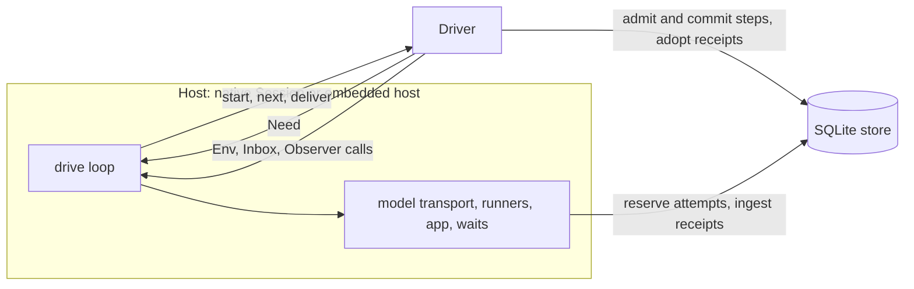
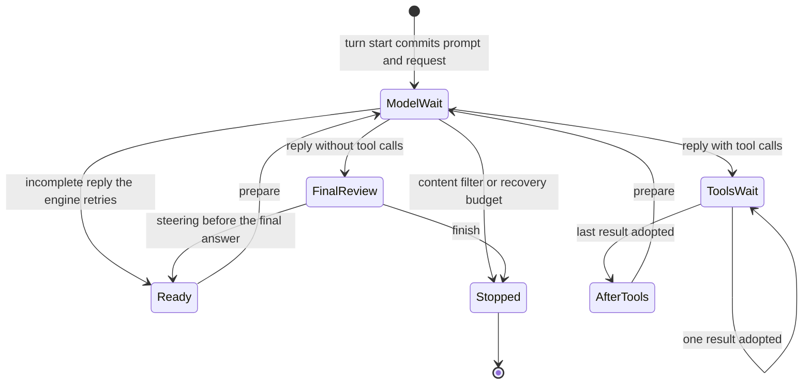
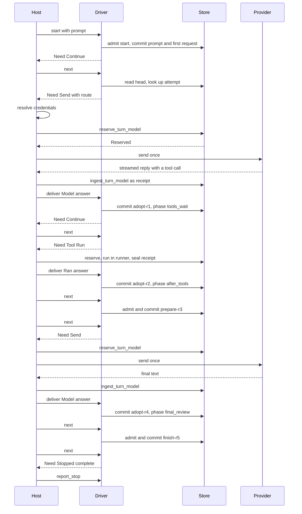
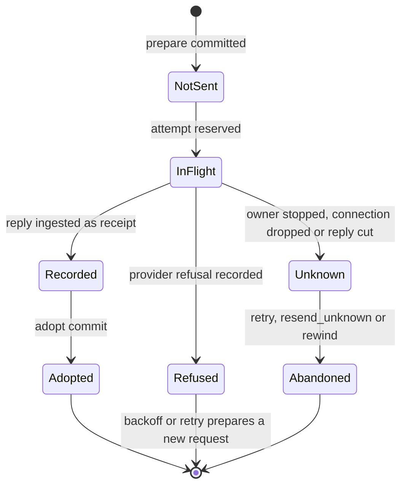

# Turn driver and native session

The turn driver decides what a turn needs next from the committed head of the store,
commits the local transitions it can make on its own (preparing a request, steering,
compaction, finishing), and hands everything else to its host as an owned *need*: send
this model request, run this tool call, ask the app, wait out this backoff. The host
performs the effect, records its result as a receipt, and delivers the answer back; the
driver then adopts the receipt into the conversation with a checked commit. The split
keeps the driver free of I/O, clocks and transports, so the same driver runs in the
native `Session` (CLI, `spindle serve`, `spindle api`) and in the embedded host. Every
model request is reserved before it is sent, so a crash at any point leaves either a
known outcome that is reused or an unknown outcome that is reported, never a silent
second send.

- [Overview](#overview)
- [The driver/host split](#the-driverhost-split)
- [Turn phases](#turn-phases)
- [Steps and their names](#steps-and-their-names)
- [Lifecycle of a model request](#lifecycle-of-a-model-request)
- [Crash and restart](#crash-and-restart)
- [Request outcomes](#request-outcomes)
- [Refusals, drops and backoff](#refusals-drops-and-backoff)
- [Steering and queued input](#steering-and-queued-input)
- [Stop](#stop)
- [Budgets and cost accounting](#budgets-and-cost-accounting)
- [Compaction](#compaction)
- [Request shaping](#request-shaping)
- [The native Session](#the-native-session)
- [Feature boundary](#feature-boundary)

## Overview



| Source | Role |
| --- | --- |
| [`driver.rs`](../spindle/store/src/driver.rs) | Decisions: `next_need`, model and tool needs, adoption, backoff, retry in place, compaction, steering, turn start. |
| [`driver_api.rs`](../spindle/store/src/driver_api.rs) | The host contracts (`Env`, `Observer`), the `Driver` type and its public methods, `Answer` and `Retry`. |
| [`driver_types.rs`](../spindle/store/src/driver_types.rs) | `Event`, `Settings` and the setting enums (`Effort`, `Compaction`, `Isolation`, `Runner`), `Start`, `StartState`. |
| [`driver_summary.rs`](../spindle/store/src/driver_summary.rs) | The model-written compaction summary: its request text, bounds and journal. |
| [`turn.rs`](../spindle/store/src/turn.rs) | The turn engine label `dext-turn-v1`, the `Action` codec, effect intents, and the store's checked commits (`commit_turn_action`, `commit_turn_receipt`, `commit_turn_workspace_receipt`). |
| [`broker.rs`](../spindle/store/src/broker.rs) | The commit-before-dispatch boundary: `DispatchRequest`, reservation, `DispatchOutcome`, model/tool/app dispatch and receipt ingestion. |
| [`completion.rs`](../spindle/store/src/completion.rs) | `Attempt`, attempt reservation, receipts and recorded provider refusals. |
| [`protocol.rs`](../spindle/store/src/protocol.rs) | The JSON-RPC protocol shared by `spindle api` and the embedded package: turn operations, event JSON, phase and stop codes. |
| [`shape.rs`](../spindle/store/src/shape.rs) | Pure request shaping: route, reasoning fields, tools, system prompt, history budget, request body. |
| [`agent.rs`](../spindle/store/src/agent.rs) | The native `Session`: the drive loop, model sends, tool runs, steering, stop, retry. |
| [`agent/cost.rs`](../spindle/store/src/agent/cost.rs) | Spend accounting, the usage ledger and dollar budgets. |

The store's tables, revisions, receipts and rewinds are described in
[store.md](store.md); the engine's turn state (`TurnContinuation`, `TurnControl`,
`ModelWait`) in [engine.md](engine.md); tools and app tools in [tools.md](tools.md); the
public API in [API.md](API.md).

## The driver/host split

A `Driver` owns transient policy state only: whether the next request must compact
first, whether it runs in until-unknown mode, and the automatic retry count. It never
holds a connection, transport or runner; every call borrows the caller's `&mut Store`,
the session's sole authority connection. Errors are plain messages meant for a person
(`Result<T, String>`), except from `reserve_app` and `record_app`, which return store
errors.

The driver may read the store, commit steps, and call three host traits:

| Trait | Contract |
| --- | --- |
| `Env` | Synchronous host facts. It must not perform effects (no model sends, execution, sleeps or user waits), and request-shaping facts must be repeatable for the same admitted state. Methods: `route` (provider, model, endpoint, contract, history budget, reply reserve, output tokens sent), `request` (the prepared model request for a turn state), `refusal` (why a tool call cannot run under the session's offer), `app_dispatch` (whether a call is answered by the app, with its definition digest, rerun flag, timeout and output cap), `tasks_offered`, `task_place`, `budget_refusal`, `counted` (what a recorded call cost), `limit_key`, and pack hooks with no-op defaults (`pack_active`, `pack_round_steer`, `cancel_follow_up`). |
| `Inbox` | The driver's input queue. The host owns synchronization and waking. `next_steer` pops one queued message, `take_state` takes queued app-state patches, `take_steering` and `return_steering` move the whole steering queue, `interrupted` reads the stop flag. Consuming input is explicit, so a host can put it back if a restart fails before it is committed. |
| `Observer` | Receives semantic `Event`s. Streaming previews are host-owned: the host emits `ModelDelta` and `Output` itself. |

### Driver methods

| Method | What it does |
| --- | --- |
| `Driver::new(env, inbox, observer)` | Creates a driver with no store attached. |
| `start(store, prompt, start, state)` | Starts a turn: may compact the prior history first (returning `Need::Summarize`), then admits and commits the prompt with its first model request. |
| `next(store)` | Decides and commits the next local transition, or returns an owned need. |
| `deliver(store, answer)` | Takes the host's answer to a need. The host calls it only after emitting the need's preview events and retaining its receipt. Returns the next need. |
| `resume(store)` | Continues the committed head. A turn stopped at the legacy step limit gets a fresh step count (`Extend`); a turn already stopped, with no task report or pack follow-up waiting, emits `NothingToContinue`. |
| `resume_until_unknown(store)` | As `resume`, but stops with an error at the first unknown outcome instead of acting on it (see [Unknown outcomes](#unknown-outcomes)). |
| `retry(store)` | Re-runs an unresolved model request. Returns `Retry::InPlace(need)`, or `Retry::FreshStore { prompt }` when it was the session's first request and the host must replace the store. |
| `report_stop(store)` | Emits `Stopped` for the committed stop, after the host has applied its between-turn settings. |
| `begin_run()` | Resets the retry policy for a new host-driven run. |
| `set_state(store, patch)` | Commits an app-state merge patch as a step of its own, at a safe boundary. |
| `reserve_app(store, need)` / `record_app(store, need, answer)` | Reserve an app call before asking the app; retain its answer before delivering it. |
| `set_inbox(inbox)` | Rebinds the host's queues after the host replaced the store. |

### Needs and answers

`Need` is what the host does next; `Answer` is how it reports back.

| `Need` | Host action | `Answer` |
| --- | --- | --- |
| `Continue` | Nothing: a step was committed. Call `next` again. | none |
| `Send(ModelNeed)` | Resolve credentials (fresh sends only), reserve, send once, ingest the reply. | `Model { need, sent }` |
| `Wait(Backoff)` | Wait `backoff.wait`, watching for a stop. | `Waited(backoff)` |
| `Tool(ToolNeed::Committed)` | Nothing: a guard or refusal was committed. | none |
| `Tool(ToolNeed::Run(RunCall))` | Run a built-in tool through the broker. | `Ran { need, ran }` |
| `Tool(ToolNeed::Ask / Task / Tasks)` | Reserve and ask the app, or run task sessions. | `App { need, outcome, waiting }` |
| `Summarize(SummaryNeed)` | Ask the model for a compaction summary, or decline. | `Summary { need, summary }` (`None`: the deterministic digest is used) |
| `Start(StartCall)` | Start a turn again with this prompt, workspace start and state (a retry that restarts a turn). | call `start` |
| `TaskWait` | Background tasks are still running; wait. | call `next` |
| `PackIdle` / `FollowUp` | A session pack's idle hook, and its delayed follow-up prompt. | `Pack { idle, end }` / `FollowUp { idle, follow, waited }` |
| `Stopped(Stop)` | The turn stopped: report it. | `Stopped(stop)` |

The native drive loop, simplified from `Session::drive_from` in
[`agent.rs`](../spindle/store/src/agent.rs):

```rust
let mut next = None;
loop {
    let need = match next.take() {
        Some(need) => need,
        None => driver.next(&mut store)?,
    };
    match need {
        Need::Continue => {}
        Need::Send(need) => {
            let sent = send_model(&need)?; // reserve, send once, ingest receipt
            next = Some(driver.deliver(&mut store, Answer::Model { need, sent })?);
        }
        Need::Wait(backoff) => {
            wait_out(&backoff)?; // returns early with an error on a stop
            next = Some(driver.deliver(&mut store, Answer::Waited(backoff))?);
        }
        Need::Tool(need) => fulfill_tool(need)?, // dispatch, then deliver Ran or App
        Need::Stopped(stop) => {
            driver.report_stop(&mut store)?;
            match driver.deliver(&mut store, Answer::Stopped(stop))? {
                Need::Stopped(_) => return Ok(()),
                need => next = Some(need),
            }
        }
        // Summarize and Start are fulfilled before this match; TaskWait,
        // PackIdle and FollowUp are handled as in the table above.
        _ => { /* ... */ }
    }
}
```

## Turn phases

A turn's position is the engine's `Phase`, read from the head's continuation. Its stable
names come from `protocol::phase_name`.

| Phase | Meaning | What `next` does |
| --- | --- | --- |
| `ready` | Between rounds, nothing pending. | Commits an admitted `prepare` if one exists; otherwise commits queued steering or state, compacts if needed, then prepares and commits the next model request. |
| `after_tools` | Every tool result of the round is adopted. | As `ready` (a session pack may add round steering). |
| `model_wait` | One model request is pending. | Returns `Need::Send`. |
| `tools_wait` | Tool calls of the reply are pending. | Commits a guard or refusal for the next call, or returns `Need::Tool`. |
| `final_review` | The reply had no tool calls. | Commits queued steering (which reopens the turn so the model answers it) or queued state first; otherwise commits `Finish`. |
| `preparing` | Exists only inside a transition; never committed. | Error. |
| `stopped` | The turn ended; `stop_code` says why. | For `complete`, delivers a finished background task's report (or returns `TaskWait` while queued tasks run); commits queued state; then returns `Need::Stopped`. Delivering `Answer::Stopped` runs session-pack idle work. |



Stop codes (`protocol::stop_code`) and their sentences (`stop_text`):

| Code | Sentence |
| --- | --- |
| `complete` | done |
| `step_limit` | stopped: step limit reached |
| `budget` | stopped: budget reached (not committed by Spindle: a budget refusal leaves the request prepared and fails the operation with the API error `budget`) |
| `tool_policy` | stopped by tool policy |
| `content_filter` | stopped by the provider's content filter |
| `recovery_budget` | stopped: too many incomplete responses |
| `cancelled` | cancelled |

New turns are created without a step limit. A turn stopped at `step_limit` (an older
session's) is continued by `resume`, which commits `Extend`. A new prompt is accepted
only after a `complete` stop; any other stop needs a rewind first.

## Steps and their names

Every local transition is two records: an *admission* (the exact input, retained before
anything else happens) and a *proposal* committed against it. The store does not trust
the proposed continuation: `commit_turn_action` decodes the admitted `Action`, derives
the transition from the baseline revision itself, and refuses the commit with a conflict
unless the proposal's continuation and new effect intents match. A receipt is adopted
the same way: `commit_turn_receipt` checks that it answers a pending obligation of the
baseline and derives the result. Only effects newly introduced by a transition become
intents; pending ones are never re-published.

| Admission command | `Action` | Committed as | When |
| --- | --- | --- | --- |
| `start` or `turn-r<N>`, with `-<k>` added when an earlier admission there held another prompt | `Start { initial, request }` | `commit-<command>` | A turn starts: the prompt and its first prepared request in one step, with any new workspace and start state. |
| `prepare-r<N>` | `Prepare { request }` | `commit-prepare-r<N>` | The next model request of a turn. |
| `steer-r<N>` | `Steer { text }` | `commit-steer-r<N>` | A queued message is given to the model. |
| `compact-r<N>` | `Compact { transcript }` | `commit-compact-r<N>` | Older history is replaced by a summary. |
| `guard-r<N>` | `Guard { effect }` | `commit-guard-r<N>` | The engine's repeat guard skips a tool call. |
| `refuse-r<N>` | `Refuse { effect, reason }` | `commit-refuse-r<N>` | A tool call the session does not offer, or whose input fails its checks, gets an error result without running. |
| `finish-r<N>` | `Finish` | `commit-finish-r<N>` | A tool-free reply ends the turn. |
| `extend-r<N>` | `Extend` | `commit-extend-r<N>` | Continue after the step limit. |
| `state-r<N>-<digest>` | `State { patch }` | `commit-state-r<N>-<digest>` | An app-state merge patch. |
| `task-report-<task>` | `TaskReport { task, text }` | `commit-task-report-<task>` | A finished background task's answer joins the turn. |
| (none) | (receipt) | `adopt-r<N>` | A model reply or tool result is adopted. |

`<N>` is the head revision the step was decided at. The codec also defines `Budget` and
`Followup`, which the driver does not commit.

A turn's *execution id* is a SHA-256 digest over the scope and the admission command id
(`turn::execution_id`). Effect ids derive from it: `<execution>/m/<n>` for the turn's
n-th model request and `<execution>/m/<n>/t/<position>` for a tool call of that reply.
Attempt ids are `a:<effect>`. A rewind gives the resumed turn a new execution id, so a
request prepared again after a rewind is a new effect with a new identity.

## Lifecycle of a model request

1. **Shaping.** In `ready` or `after_tools`, the driver asks `Env::request` for the
   request (see [Request shaping](#request-shaping)). Its `Identity` names the effect id,
   provider, contract, endpoint, model, credential scope and configuration; the body is
   fixed bytes.
2. **Prepare.** The driver checks that the step fits (the prepared checkpoint plus the
   largest reply it allows must fit in one stored value, `MAX_PAYLOAD`, 32 MiB, and the
   store must have room for more revisions), then admits `prepare-r<N>` and commits it.
   The head is now `model_wait` and the store holds an intent with adapter
   `dext-model-v1` whose input is the waiting request.
3. **Need.** `next` returns `Need::Send(ModelNeed)`. If no attempt is reserved for the
   effect, this is a fresh send: the driver resolves the route, refuses if the
   provider's endpoint changed since the request was prepared, checks the budget, and
   emits `ModelStep`; `ModelNeed.route` is set. If an attempt already exists,
   `route` is `None`: its outcome is settled from the store and it is never sent again.
4. **Reservation.** The host resolves credentials first (so a missing login never
   strands a reserved request), then calls `Store::reserve_turn_model`. In one immediate
   transaction the store re-checks the owner epoch, that the intent and the head's pending
   obligation match the request exactly, that the scope is not cancelled or superseded,
   and inserts the attempt (`implementation` `dext-provider-v1`, `grant_reference`
   `dext-login`). The result is `Reserved(CommittedEffect)` to send now, or
   `Settled(Reused(bytes))` for a reply recorded before, or `Settled(Reconcile)` for a
   reservation that has no receipt.
5. **Send and stream.** The host sends the committed request exactly once. Streamed text
   is a preview (`ModelDelta`, `ModelTextWithdrawn`); it is never adopted.
6. **Receipt.** `Store::ingest_turn_model` records the recorded `ModelWait` checkpoint as
   the attempt's receipt and validates it against the reserved request and attempt.
   When the provider refused the request instead, the driver records the refusal on
   delivery with `record_rejection_with_delay` (HTTP status, the start of the body, and
   any `Retry-After`); the attempt then has a known outcome and no receipt.
7. **Adoption.** The host calls `deliver(Answer::Model { need, sent })`. The driver
   commits `adopt-r<N>` against the receipt, emits `ModelText` and `Usage` (and `Cost`
   for a reply not adopted from the store before), and the turn moves on.

`Store::dispatch_turn_model` does steps 4 to 6 in one call for a host that uses the
native transport; `reserve_turn_model` and `ingest_turn_model` are its two halves for a
host that sends the request itself.

One turn with one tool round:



## Crash and restart

Every open of the store starts a new owner epoch, and the driver re-reads everything it
needs from the committed head. What happens on the next drive depends on where the
previous owner stopped:

| Stopped after | On the next drive |
| --- | --- |
| A turn start was admitted, not committed | The same prompt reuses the admission, with its exact initial state and request bytes; other text drops it and uses a new command id. |
| `prepare-r<N>` was admitted, not committed | The admitted request is committed as admitted, byte for byte, even if the settings changed since. |
| The request was committed, not reserved | `not_sent`: `continue` sends it. |
| The request was reserved, no receipt | `unknown`: reservation returns `Reconcile`; the request is never sent again on its own (see below). |
| A refusal was recorded | `refused`: a known outcome; the refusal policy applies again, waiting the recorded `Retry-After`. |
| The receipt was ingested, not adopted | `recorded`: reservation returns `Reused`; the reply is adopted without sending (`ResponseReused`) and not counted again. |
| A tool call was reserved, no result | The call is sealed as not completed over its unchanged workspace (`ToolInterrupted`); it never runs again. |
| A tool result was sealed, not adopted | The sealed result is adopted (`ToolReused`). |
| An app call was reserved, not answered | The app is asked again with `again: true`; it may answer that it cannot tell whether the call ran. |
| `steer-r<N>` was admitted, not committed | The admitted text is committed, though the in-memory queue that held it is gone. |
| `compact-r<N>` was admitted, not committed | The compaction is committed exactly as admitted, whatever the history size now. |
| A compaction summary was reserved, no reply | The deterministic digest stands in; the summary is never asked for twice. |

A tool call reserved without a result also blocks rewinds (`continue` seals it first);
a model request without a receipt does not, and a rewind leaves it among the
*abandoned* attempts.

Opening a session also completes a rewind that a stopped process began.

## Request outcomes



The recovery report (`api::recovery`, see [API.md](API.md)) names each pending model
request with one of these outcomes:

| Outcome | Meaning | Next |
| --- | --- | --- |
| `not_sent` | Prepared and never reserved. | `continue` sends it. |
| `recorded` | Its reply is saved. | `continue` adopts it without sending. |
| `refused` | The provider refused it before answering. | `continue` applies the [refusal policy](#refusals-drops-and-backoff) again: a transient refusal, an overflow or a stated output limit is sent again as a new request; otherwise the turn stops and `retry` sends it. |
| `unknown` | Sent with no saved reply; it may have been billed. | `retry` sends it again, or rewind. With `resend_unknown` set (and an earlier point to rewind to), `continue` does it by itself. |

Status counts follow the store's reconciliation report: *unresolved* attempts (reserved
in the live history, with neither a receipt nor a recorded refusal), *abandoned*
attempts (left without a receipt in a rewound future; their external outcome stays
unknown) and *rejected* attempts (refused, a known outcome).

### Unknown outcomes

An unknown outcome is a reservation without a receipt and without a recorded refusal.
The driver never guesses it away. When `deliver` gets `Reconcile` for a model request:

1. A refusal recorded before the stop is a known outcome: it goes to the backoff.
2. If the session's `resend_unknown` setting is on, it is treated as a dropped
   connection: re-sent after a bounded backoff, counted as possibly billed.
3. Otherwise the turn stops with an error naming the unknown outcome and pointing at
   `spindle retry`.

The operator resolves it with one of:

| Action | Effect |
| --- | --- |
| `spindle retry` (`Driver::retry`, API `retry`) | Rewinds to the point before the request and prepares it again under a new identity. If the request was the turn's first, the turn restarts from the end of the previous turn with the same prompt, attachments and app state. Only an unresolved model request can be retried. |
| `resend_unknown` setting | Lets `continue` re-send such requests on its own, with the drop backoff. |
| `spindle rewind` to a target (`spindle targets`) | Leaves the request abandoned. |
| `spindle continue --until unknown` (API `continue` with `until: "unknown"`) | Continues known work and stops with `stopped at unknown outcome <id>` at the first model request or app call whose outcome is unknown, without retrying or answering it; drops are not re-sent in this mode. |

The session's first request has no earlier point to rewind to. For it `retry` returns
`Retry::FreshStore`, and the native host moves the store aside to
`store.abandoned-<n>` (keeping its unanswered requests counted in the usage ledger),
opens a fresh store with the same settings, files and app state, and starts the same
prompt (`RetryingFirst`).

## Refusals, drops and backoff

When a send does not produce a reply, `deliver` classifies it:

| Failure | Classified as | Policy |
| --- | --- | --- |
| HTTP 408, 409, 425, 429, 500, 502, 503, 504, 529 | Transient refusal (recorded) | Sent again after `Retry-After`, or `2 << attempt` seconds (4, 8, 16, 32, 64, 64), at most 300 seconds, up to 6 automatic retries. |
| HTTP 400, 413 or 422 whose body says the input is too long | Context overflow (recorded) | Sent again at once after compacting (`compacting: true`). |
| HTTP 400 or 422 that states a lower output-token limit | Output limit (recorded) | The limit is remembered per provider and model in the `output_limits` metadata and the request is sent again at once asking for less. |
| Any other HTTP status | Refusal (recorded) | The turn stops; `spindle retry` sends it again. |
| Connection lost or deadline passed (`ModelFailure::Dropped`) | Unknown outcome | Only with `resend_unknown`, and not in until-unknown mode: sent again after 1, 2 and 4 seconds, up to 3 automatic retries. Otherwise the turn stops. |
| Anything else (`ModelFailure::Failed`: an unparsable stream, an oversized response, a store error) | Not recorded | The turn stops and points at `spindle retry`; a request that was reserved is an unknown outcome on `continue`. |

No automatic retry applies to the session's first request. Each automatic retry emits
`ProviderRetry { status, seconds, attempt, compacting }` (status `0` for a drop); the
host waits (`Need::Wait`), and `deliver(Answer::Waited)` rewinds to the newest rewind
target (`Retrying`, then `Rewound`) and prepares the request again, or, when the request
was the turn's first, returns `Need::Start` to restart the turn with its prompt. A stop
during the wait ends the run with the backoff's `stopped` message. The retry count
resets when a reply is adopted and at the start of every run.

## Steering and queued input

Messages sent while a turn runs wait in the host's queue (`Session::steering_handle`).
The driver commits the next one as a `Steer` step at the turn's next boundary: before
preparing a request (`ready`, `after_tools`) and before finishing (`final_review`, which
reopens the turn so the model answers it). Each is admitted as `steer-r<N>` before it is
committed. Running tool calls are never interrupted by steering; the message follows
their results. Finished background task reports are delivered before steering.

- A steering message is at most 64 KiB (`MAX_STEER`); the native inbox skips empty
  messages and longer ones. The API accepts up to 32 waiting messages, and 32 waiting
  state changes, per running turn (`protocol::MAX_STEERS`).
- In history the message is wrapped in the engine's shared steering text, starting
  `[queued-user-update]`; `steered_text` recovers what the user wrote and
  `annotate_steering` adds it as `steer` on a message's text block for display.
- Messages the turn never reached are returned by `take_steering`, to be sent as the
  next prompt.

**Send now.** Setting `Session::hurry_handle` (API `steer` with `now: true`) asks for the
queued messages to be read immediately. If a fresh model reply is streaming and the step
before it is a rewind target, the native host cuts the send (`ReplyCut`); the driver
rewinds to that point and prepares the request again. If the cut request was the turn's
first, the waiting messages join the prompt and the turn restarts with it; otherwise they
are committed as steering before the new request. When there is no such point (the
session's first request) the reply is not cut (`ReplyNotCut`) and the messages are read
after it. A cut reply may still have been billed and is counted as unknown.

**App state.** App-state merge patches sent while a turn runs
(`Session::state_handle`) are committed as steps of their own at the next step boundary,
in order; one that cannot be kept is dropped with `StateRefused`. `set_state` commits
one directly, but only between steps (`ready`, `after_tools`, `final_review`, `stopped`),
never in the middle of a request or tool call. `state_with_next_prompt` applies a patch
in the same step as the next prompt.

## Stop

The native stop flag is `Session::interrupt_handle`; setting it from any thread stops
the turn at its next safe point:

| Where | What happens |
| --- | --- |
| Before reservation | Reservation refuses (`Cancelled`); nothing is reserved, so `continue` sends it later. |
| Model reply streaming | The send ends. The reserved request has no receipt, so it is an unknown outcome on `continue`. |
| Backoff wait | The wait ends with the backoff's stop message; the refused or dropped request keeps its outcome for `continue`. |
| Tool call running | The command is ended; its candidate workspace is discarded. When the session is opened again, `continue` records the call as not completed; it never runs again. |
| App call | The app receives the flag; an `AppAnswer::Stopped` records nothing and the call is asked again on `continue`. |
| Waiting for tasks | Running tasks are stopped. |

A stop commits no `cancelled` step: the head stays where the work was, and `continue`
resolves it as described in [Crash and restart](#crash-and-restart).

## Budgets and cost accounting

The driver asks its `Env` two questions: whether the budget refuses a request
(`budget_refusal`) and what a recorded call cost (`counted`). The native host answers
them from its spend ledger in [`agent/cost.rs`](../spindle/store/src/agent/cost.rs),
described here; the embedded host's `Env` refuses nothing and counts nothing.

Spend is counted from durable records only: recorded replies (including
ones a rewind abandoned), model-written compaction summaries (each journaled in its own
stage) and nested `model()` calls of `run_code` scripts. Each call is priced when it is
first counted, and that price is kept, so a later catalog change never rewrites
history. The ledger is the store's `usage` metadata, mirrored to `usage.json` in the
session directory.

| Billing | Meaning |
| --- | --- |
| `priced` | Priced from the provider catalog (or a provider-stated cost where one is used). |
| `subscription` | A subscription login: no marginal cost. |
| `unpriced` | Billed, but the catalog has no price for the model. |
| `refused` | Refused before generating anything: not billed. |
| `unknown` | Sent with an unknown outcome: it may have been billed. |

After adopting a fresh reply the driver emits `Usage { input, output }` (input includes
cached tokens) and, through `Env::counted`, `Cost { usd, turn, total, billing }` with
`billing` priced, subscription, unpriced or `mixed`. A reply adopted from the store
reports no new cost.

**Budgets.** `Settings::max_usd` caps a thread's spend. Before every fresh send the
driver calls `Env::budget_refusal`; the native host refuses the request when its worst
case plus what the thread has spent would exceed the budget. What counts as spent is the billed
total plus the worst case of every request whose outcome is unknown. The worst case of a
request is its body's text at three ASCII bytes per token (any other byte one token),
each inline image at 10,000 tokens, billed as fresh input or cache write (whichever is
dearer), plus every output token it allows. With a budget set, a model without a catalog
price is refused; a subscription request costs nothing. The refusal is an error
(`spending limit: ...`), which `spindle api` reports as the `budget` error (`-32007`) and
`/v1` as a `command_done` with `code: "budget"` ([API.md](API.md#errors)); the prepared
request stays `not_sent`, and `continue` sends it
once the budget is raised or cleared (`Session::set_budget`, `spindle continue --max-usd`).
A budget can be changed at any point of a turn.

**Task leases.** When a session with a budget starts a task (a child session), the
task's budget is set to what the parent has left after its own spend and the other
tasks' outstanding leases. While tasks run or are stopped, each lease minus that task's
own spend is reserved against the parent's budget.

The native host checks a compaction summary request the same way: when the budget
cannot cover its worst case, no summary is requested and the digest is used.

## Compaction

History is compacted when it outgrows the route's *history budget*: 80 percent of what
the model's context window leaves beside the largest reply, at three bytes per token,
clamped to 16 KiB to 8 MiB (`shape::history_budget`, which both hosts' `Env::route`
uses; models the catalog does not describe are assumed to have a 200,000-token window).

| Trigger | Recent history kept verbatim |
| --- | --- |
| Before a request, the history checkpoint exceeds the budget | About a quarter of the budget, at least 24 KiB. |
| The provider said the input does not fit (forced) | About a quarter of the history, at most a quarter of the budget, at least 8 KiB. |
| The prepared step would not fit in one stored value (forced) | As forced. |
| Before a new prompt, the prior turn's history exceeds the budget | As the first row; the compaction commits before the prompt. |
| Before a new prompt, the provider said the input did not fit, or twice the history plus the reply reserve exceeds the stored-value limit (forced) | As forced; the compaction commits before the prompt. |

The kept part starts at an assistant message, so tool results always follow their calls.
If the current prompt falls in the dropped part, it is kept verbatim after the summary.
The older part becomes one user message: `[Earlier conversation compacted by spindle to
stay within session limits]`, the summary, and a line saying the workspace files are
current. A compaction happens only when the dropped part is large enough and the result
is at most three quarters of the original, so repeats are bounded; when a forced
compaction cannot shrink the history, the turn stops and asks for a rewind or a new
thread.

For a new compaction the driver returns `Need::Summarize`; what the host answers depends
on `Settings::compaction`:

- `model` (default): the host sends one summary
  request (a fixed system prompt and instruction, up to 768 KiB of source with the
  newest kept, at most 8,192 output tokens; the summary is clipped to 48 KiB). The
  request is journaled in stage `summary-<command>`: reserved before it is sent and its
  reply kept, so it is counted once, reused if the compaction commits after a crash, and
  never sent twice. A failure, an empty reply or a reservation without a reply falls back
  to the digest.
- `digest`: the host declines (`summary: None`), so the driver uses a deterministic
  digest of the dropped prompts, replies and tool calls, keeping the newest entries
  within 8 KiB. No extra request.

Each compaction emits `Compacted { before, after }` (checkpoint bytes).

## Request shaping

Request shaping ([`shape.rs`](../spindle/store/src/shape.rs)) is pure: no credentials,
files or network, so the same settings and transcript always give the same bytes. It
computes the route a provider profile gives for a model, the reasoning fields an effort
level becomes, the tools and system prompt the session's settings offer, and the request
body. The prepared request's `Identity` carries:

| Field | Value |
| --- | --- |
| `effect` | The turn's next model effect id. |
| `provider`, `contract`, `endpoint`, `model` | From the resolved route. |
| `credential_scope` | `dext-login/<provider>`. |
| `configuration` | `spindle-cli-v1/max-output-<answer tokens>`. |

The driver only calls `Env::request` when no `prepare-r<N>` is admitted at the head; a
request that was admitted before a crash is committed from the admission, not shaped
again. Answers are capped at 32,768 tokens and effort levels add a reasoning allowance
on top (`low` 2,048, `medium` 6,144, `high` 16,384, `xhigh` 32,768, `max` 65,536), both
within the model's declared output limit or one learned from a refusal
(`shape::output_tokens`). The *reply reserve* the driver checks before a request is 32
bytes per allowed output token plus 4 MiB (`shape::reply_reserve`).

## The native Session

`agent::Session` is the native host: one session directory with its store in `store/`
and settings in the store's metadata (mirrored to `session.json`). It owns the store, a
`Driver` wired to its own `Env`, `Inbox` and `Observer` implementations, the model
transport, the command runners, and the shared handles below. It is driven on the
caller's thread; a model send blocks on a single-threaded Tokio runtime. The transport's
deadlines are 15 seconds to connect, 180 seconds to the first byte, 180 seconds idle and
600 seconds in total.

| Method | Purpose |
| --- | --- |
| `Session::create(dir, settings, files, observer)` | Creates the directory, saves settings, starts the usage ledger, and stages `files` for the first prompt. |
| `Session::open(dir, observer)` | Opens a session; completes a rewind a stopped process began. |
| `create_with_credentials`, `open_with_credentials` | The same with the embedding host's `Credentials` (route, live headers, auth kind); the default reads the Dext login store. Credentials are resolved for fresh sends only and never saved. |
| `prompt`, `prompt_with_files`, `prompt_with_tree` | Start a turn (files added, or a workspace of exactly these files) and drive it to its next stop. |
| `resume` / `resume_until_unknown` | `continue`, and `continue --until unknown`. |
| `retry(self)` | Re-run an unresolved model request (consumes the session; its handles keep reaching the retried turn). |
| `steering_handle`, `hurry_handle`, `take_steering` | Queue messages, ask for them now, take the ones a finished turn never reached. |
| `interrupt_handle` | The stop flag. |
| `set_state`, `state_handle`, `state_with_next_prompt`, `commit_waiting_state` | App state, as described above. |
| `set_settings`, `set_budget` | Settings change only after a completed turn; the budget at any time. |
| `accepts_prompt` | Whether the last turn completed. |
| `status`, `history`, `targets`, `rewind` | Where the session stands, its conversation, and rewinds (see [store.md](store.md)). |

The native `Observer` extends the driver's with optional hooks: `pack_ui` (where session
packs' UI requests are answered), `host` (the serving host, for host tools) and
`app_tools` (where app tool calls are answered; without one, a turn that reaches an app
tool stops until an app continues it).

The embedded host drives the same `Driver` with its own `Env`, `Inbox` and `Observer`;
see [embedded.md](embedded.md). Both share the JSON-RPC protocol in
[`protocol.rs`](../spindle/store/src/protocol.rs), whose turn operations map onto the
session: `prompt`, `continue` (with optional `until: "unknown"`), `retry`, `rewind` and
`task_start` (see [API.md](API.md)).

## Feature boundary

The driver builds without native execution. Its Cargo features
([`Cargo.toml`](../spindle/store/Cargo.toml)):

| Feature | Adds |
| --- | --- |
| `driver` | `dext-turn`: the engine crates `dext-core` and `dext-transcript`, and `serde_json`. The driver, `protocol`, `broker` and `turn`. No Tokio, reqwest or `dext-native`. |
| `workspace-tools` | The store's in-process workspace tools (no sandbox), portable to wasm. |
| `shape` | Pure request shaping from the provider catalog. |
| `embedded` | The embedded host, on `shape` (no Tokio or reqwest). |
| `agent` | The native `Session`: the provider transport, the strict sandbox, Tokio and reqwest. |

The model-written summary module is compiled only for the hosts that send it (`agent`
or `embedded`). A test, `driver_sources_have_no_native_effect_dependencies` in
[`tests/driver.rs`](../spindle/store/tests/driver.rs), checks that the driver's sources
use no file system, threads, clocks, processes, Tokio, reqwest or `dext_native`.

Tests that exercise this document's behavior (see [testing.md](testing.md)):

| Test file | Covers |
| --- | --- |
| [`tests/driver.rs`](../spindle/store/tests/driver.rs) | The driver against a scripted `Env`: admitted bytes replayed after a settings change, reply reuse after reopen, unknown first sends, retry schedules, `Retry-After` retention, until-unknown mode, app reservations. |
| [`tests/traces.rs`](../spindle/store/tests/traces.rs) and [`tests/fixtures/traces/`](../spindle/store/tests/fixtures/traces) | The native turn loop against a loopback fake provider: request bodies, event streams and store records for plain replies, tools, steering, send-now cuts, refusals, drops, reopened requests and compaction. |
| [`tests/turn.rs`](../spindle/store/tests/turn.rs) | Checked commits, broker reservation and receipts, kills at reservation, execution and sealing. |
| [`tests/model_wait.rs`](../spindle/store/tests/model_wait.rs) | Reply receipts reused after reopen without a second attempt. |
| [`tests/usage.rs`](../spindle/store/tests/usage.rs), [`tests/usage_turns.rs`](../spindle/store/tests/usage_turns.rs) | Spend counted once, budgets, unknown outcomes at their worst case, send-now cuts. |
| [`tests/dext_recovery.rs`](../spindle/store/tests/dext_recovery.rs) | The engine's recovery budget across receipt ingress and restarts. |
