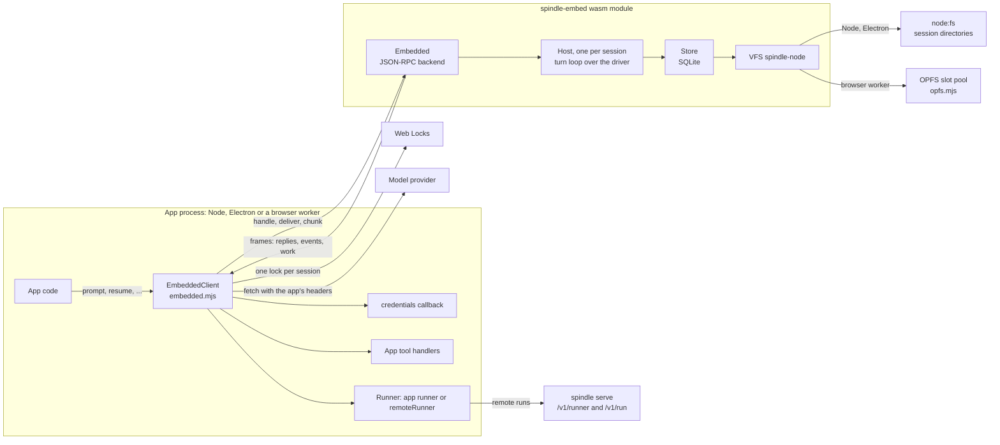
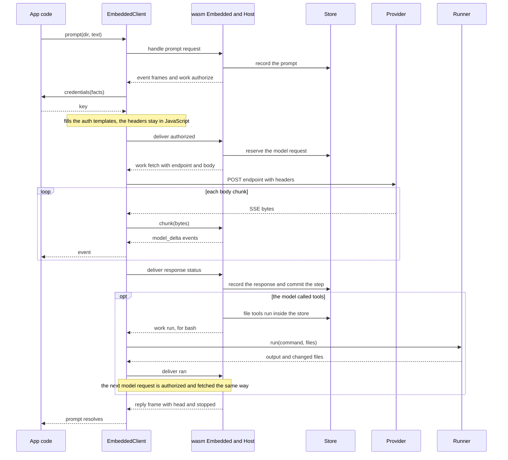

# Spindle inside a JavaScript app

The embedded package (`spindle-embed`) runs Spindle sessions inside a JavaScript or
TypeScript app (Node, Electron, or a browser Dedicated Worker) with no separate
process. It is the `embedded` host of the `spindle-store` crate compiled to
`wasm32-unknown-unknown`, plus a JavaScript client, `EmbeddedClient`, that exposes the
same API methods as the `spindle api` client. The package keeps the session (its
history, workspace files and app state) in a SQLite store and makes every decision a
native host makes. Every effect outside the store is performed by the app: model
requests, app tools, commands and timers. A model request is reserved in the store
before the app sends it, so a crash or stop never leads to the request being sent
again without notice. A session can move between the package and the native `spindle`
command, either as a bundle file or, for Node directories, in place.

- Source: [`spindle/embed/`](../spindle/embed/) (the wasm crate),
  [`spindle/store/src/embedded/`](../spindle/store/src/embedded/) (the host),
  [`spindle/clients/js/embedded.mjs`](../spindle/clients/js/embedded.mjs) (the client).
- Method semantics: [API.md](API.md). Native hosts: [host.md](host.md). The store:
  [store.md](store.md). The turn loop: [driver.md](driver.md).

## Overview



The wasm module never performs I/O itself, apart from the file calls its SQLite VFS
makes through the `fs` object the app installs. Each call into it, whether a request
line, an answer to a work item or a chunk of a response body, runs the session's turn
loop until the loop needs something from outside. The call then returns the frames
written since the previous call. `EmbeddedClient` reads those frames, performs the work
they ask for and calls back in with the result.

| Concern | The package (wasm) | The app (`EmbeddedClient` and app code) |
| --- | --- | --- |
| Session state | Stores history, workspace, app state and settings; the driver decides every step | Opens and closes sessions |
| Model requests | Builds the request, derives non-secret headers and authentication header templates from the catalog, reserves the request, parses the stream, records the outcome | Supplies credentials, sends the request with `fetch`, streams the body back, enforces deadlines |
| File tools (`read_file`, `write_file`, `edit_file`) | Run inside the store | Nothing |
| `bash` | Reserves the call, hands out the workspace, records the result and changed files | Runs the command in its own runner or forwards it to a remote runner |
| App tools | Reserves the call, emits `app_tool`, records the answer | Runs the handler and answers it; enforces the call's timeout |
| Waits (provider retry backoff) | Asks for a wait of a given length | Sets the timer |
| Storage | SQLite and its VFS | Provides `node:fs` or an OPFS pool; holds Web Locks |
| Script calls (code-mode bridge) | Checks and journals each call | Sends model and HTTP requests, runs tool handlers |

## Building the package

The crate [`spindle/embed/Cargo.toml`](../spindle/embed/Cargo.toml) depends on
`spindle-store` with only the `embedded` feature, `rusqlite` (bundled SQLite), and on
wasm targets `wasm-bindgen`, `js-sys`, `sqlite-wasm-rs` (the SQLite build `rusqlite`
uses on `wasm32-unknown-unknown`, which the VFS registers with) and `getrandom` with
its JavaScript backend. `wasm-bindgen` is pinned to an exact version (`=0.2.129`), and
the wasm-bindgen CLI that generates the JavaScript glue must match it exactly.

Requirements: the Rust target `wasm32-unknown-unknown`, clang (which compiles SQLite for that
target), the wasm-bindgen CLI at the pinned version, and Node 20 or newer.

[`embed/kit.sh`](../spindle/embed/kit.sh) (run from the `spindle` directory) checks the
CLI version against the crate's pin, builds the release wasm, generates both glue
targets and assembles a folder:

```sh
embed/kit.sh [WASM_BINDGEN_CLI] [OUT_DIR]   # OUT_DIR defaults to embed/kit
```

| Kit path | Contents |
| --- | --- |
| `node/` | `wasm-bindgen --target nodejs` glue and the wasm (`spindle_embed.js`, `spindle_embed_bg.wasm`) |
| `web/` | `wasm-bindgen --target web` module; call its `init()` before use |
| `clients/` | `common.mjs`, `embedded.mjs`, `embedded-node.mjs`, `embedded.d.mts`, `opfs.mjs`, `spindle.mjs` |
| `examples/` | `try_node.mjs`, `relay.mjs`, `browser/` (page and worker) |
| `TRYING.md` | A hands-on guide |

[`embed/tests/package.sh`](../spindle/embed/tests/package.sh) builds the debug wasm the
same way into a temporary folder, runs every `embed/tests/node_*.mjs` (helpers named
`*_child.mjs` excepted) and then `browser_opfs.mjs`. `SPINDLE_BROWSER` (a Chrome or
Chromium binary) enables the browser test, and `SPINDLE_BIN` (a native `spindle`)
enables the cross-host cases: the remote runner, in-place moves, and a native host
continuing a browser export. See [testing.md](testing.md).

### The wasm-bindgen surface

[`embed/src/js.rs`](../spindle/embed/src/js.rs) exports the following. Errors are
JavaScript `Error`s with a `code`: storage errors use `locked`, `incompatible`,
`invalid`, `conflict` or `failed`, with the file layer's last reason appended to the
message, and API faults use the fault's kind.

| Export | Purpose |
| --- | --- |
| `new Embedded(storage, options, catalog)` | The sessions of one app. `storage` is `memory`, `node` or `opfs`; `options` is JSON `{journal: "wal"\|"delete", note}`; `catalog` is a provider catalog in Dext's format, or `undefined` for the built-in providers |
| `Embedded.handle(line)` | One JSON-RPC request line; returns the frames as a JSON array |
| `Embedded.deliver(session, id, answer)` | The app's answer (JSON) to work item `id`; returns the new frames |
| `Embedded.chunk(session, id, bytes)` | Part of a streamed response body; returns `{frames, streaming}` (`streaming: false` means stop reading) |
| `Embedded.runnerFile(session, id, object)` | The bytes of one workspace file for a pending `run` work item |
| `Embedded.setRunner(identity)` / `setAppRunner(identity)` | Bind the remote runner's or the app runner's sandbox identity (64 hex digits, or `null`) |
| `Embedded.setHttpGrants(json)` | The sites script `http()` calls may reach |
| `Embedded.ownSession(dir, release)` | OPFS: the app holds `dir`'s Web Lock; `release` gives it back |
| `Embedded.exportSession(dir, keep, settings)` / `importSession(dir, bytes)` | Session bundles (see [Moving sessions](#moving-sessions)) |
| `Embedded.catalog()` / `efforts(provider, model)` | The catalog in use (no credentials); the effort levels a route accepts |
| `installNodeFs(fs, platform)` | Gives the VFS its `fs` and registers it (see [Node storage](#node-and-electron-storage)) |
| `nodeLockHolder(database)` | What a store's lock file says about its owner |
| `probe`, `refusedOpen`, `ProbeStore` | Runtime self-checks used by tests and diagnostics |

## Quick start

### Node or Electron

[`embedded-node.mjs`](../spindle/clients/js/embedded-node.mjs) exports `nodeClient`,
which loads the Node glue, installs `node:fs`, resolves each `dir` with
`path.resolve`, and names the owner in lock files as `pid <pid> on <hostname>`.

```js
import { nodeClient } from './clients/embedded-node.mjs';

const spindle = nodeClient({
  glue: '/absolute/path/to/kit/node/spindle_embed.js',
  credentials: async () => ({ key: process.env.PROVIDER_KEY }),
});
spindle.on('event', (event) => {
  if (event.type === 'model_delta') process.stdout.write(event.text);
});
await spindle.create('./session', 'deepseek');
const turn = await spindle.prompt('./session', 'Create hello.txt containing hi');
console.log(turn.head, turn.stopped);
await spindle.close();
```

[`examples/try_node.mjs`](../spindle/embed/examples/try_node.mjs) is a complete
command-line version: it opens or creates a session directory, runs one prompt, and can
import or export a bundle (`--import FILE`, `--export FILE`).

### Browser worker

OPFS synchronous file access exists only in a Dedicated Worker, so the client runs
there and uses the `web/` module:

```js
import init, * as wasm from './web/spindle_embed.js';
import { EmbeddedClient } from './clients/embedded.mjs';
import { openOpfsPool } from './clients/opfs.mjs';

await init({ module_or_path: new URL('./web/spindle_embed_bg.wasm', import.meta.url) });
const client = new EmbeddedClient({
  wasm,
  storage: 'opfs',
  pool: () => openOpfsPool(),
  credentials: async () => ({ key: KEY_OR_RELAY_MARKER }),
});
await client.create('/sessions/one', 'deepseek');
```

A key placed in a page is readable by that page. The kit's
[`examples/relay.mjs`](../spindle/embed/examples/relay.mjs) shows one way to keep it
out. It is a local server that serves the page and its worker from one origin and
forwards POSTs only to the origins of the catalog providers' base URLs. It refuses
requests from other origins.
The page fills authentication headers with a random marker the relay hands out at
`/relay/config`, and the relay replaces the marker with the key. The
[browser example worker](../spindle/embed/examples/browser/worker.mjs) passes a
`fetch` that routes requests through the relay. For Spindle as a browser extension, see
[chrome.md](chrome.md).

## EmbeddedClient

`EmbeddedClient` ([`embedded.mjs`](../spindle/clients/js/embedded.mjs), types in
[`embedded.d.mts`](../spindle/clients/js/embedded.d.mts)) imports nothing from Node and
runs in Node, Electron and browser workers. Most of its methods have the same names
and argument shapes as the stdio client's (see [clients.md](clients.md)).
`exportSession` and `importSession` work with bytes instead of files. Calls may
overlap, and each returns a Promise of its result. `prompt`, `resume`, `retry`,
`rewind` and `taskStart` resolve when the turn ends.

### Options

| Option | Default | Meaning |
| --- | --- | --- |
| `wasm` | required | The wasm-bindgen module: the Node glue, or the web module after `init()` |
| `storage` | `'memory'` | `'memory'`, `'node'` or `'opfs'` (see [Storage](#storage)) |
| `storageOptions` | `{}` | `{ journal: 'wal' \| 'delete', note }`; `note` names this owner in Node lock files. The journal defaults to `wal`, the note to `spindle-embed` |
| `fs`, `platform` | none, `'linux'` | `storage: 'node'`: the `node:fs` module (or an object with the same synchronous methods) and `process.platform` |
| `pool` | none | `storage: 'opfs'`: an async function that opens the slot pool, such as `() => openOpfsPool()` |
| `catalog` | the built-in providers | Providers in Dext's catalog format |
| `credentials` | none | `async (facts) => key \| { key } \| headers`. Called before every new model request, before it is reserved. Throwing refuses the request, and nothing is sent |
| `fetch` | `globalThis.fetch` | Sends model requests and script HTTP requests |
| `runner` | none | Runs `bash`: `{ app, remote }` (each optional), or a single runner. A `remoteRunner(...)` serves `runner: 'remote'` sessions, and any other runner serves `runner: 'app'` sessions |
| `deadlines` | `{ firstByte: 180000, idle: 180000, total: 600000 }` | Milliseconds for model requests: until the response starts, between body chunks, and overall |
| `resolveDir` | identity | Maps a caller's `dir` to the name sessions are stored under (`nodeClient` uses `path.resolve`) |

### Methods

| Method | API method or effect |
| --- | --- |
| `info()`, `providers()` | `info` (reports `transport: 'embedded'` and the feature list), `providers` |
| `create(dir, provider, settings)` | `create`; registered app tools are offered unless `settings.tools` is given |
| `open(dir)`, `status(dir)`, `closeSession(dir)` | `open`, `status`, `close`. `closeSession` also waits for an OPFS session's Web Lock to be released |
| `prompt(dir, text, { files, state, expectedHead })` | `prompt` |
| `resume(dir, { expectedHead, until })` | `continue` |
| `retry(dir, { expectedHead })`, `rewind(dir, revision, { expectedHead })` | `retry`, `rewind` |
| `stop(dir)`, `steer(dir, text, { now })` | `stop`, `steer` (`now` asks for queued messages to be read now, cutting a streaming reply) |
| `history(dir, revision, { from })`, `targets(dir, { limit })` | `history`, `targets` (default limit 48, clamped to 1-8192) |
| `files(dir, revision)`, `read(dir, path, revision)` | `files`; `read` returns a `Uint8Array` |
| `settings(dir, changes)` | `settings` |
| `state(dir, revision)`, `setState(dir, patch, { expectedHead })` | `state`, `state_set` |
| `recover(dir)` | `recover` |
| `taskStart(dir, task, prompt, options)` | `task_start` (only `report: 'wait'`) |
| `exportSession(dir, { keep, settings })` | A session bundle as a `Uint8Array` (see [Moving sessions](#moving-sessions)) |
| `importSession(dir, bytes)` | Continues a bundle as `dir`; resolves with the status plus `imported` |
| `tool(definition)` | Registers an app tool (the same shape as the stdio client's; see [clients.md](clients.md#app-tools)) |
| `connectRunner(kind, runner)` | Connects (or with `null`, disconnects) the `'app'` or `'remote'` runner and binds the sandbox identity it declares |
| `setHttpGrants(grants)` | The sites script `http()` calls may reach |
| `code(dir, request, { signal })` | One request from a script running in the app's runner (see [Script calls](#script-calls-code-mode-bridge)) |
| `catalog()`, `efforts(provider, model)` | The catalog in use; the effort levels a route accepts |
| `call(method, params)` | Any method by name (for example `list`, which has no wrapper) |
| `close()` | Cancels all outstanding work, rejects pending calls with kind `closed`, frees the `Embedded` instance (closing every store), and closes the OPFS pool |
| `ready` | A Promise that settles once the runners given at construction are connected |

The embedded backend ([`backend.rs`](../spindle/store/src/embedded/backend.rs))
answers `info`, `providers`, `list`, `create`, `open`, `status`, `close`, `prompt`,
`continue`, `retry`, `rewind`, `task_start`, `stop`, `steer`, `state`, `state_set`,
`app_tool_result`, `history`, `files`, `read`, `targets`, `settings`, `recover`,
`code_call` and `code_answer`. Any other method (for example `usage`, `doctor`,
`export`, `tasks`, `task_wait`, `task_stop`) fails with `method_not_found`.

### Events and errors

| Event | Arguments | When |
| --- | --- | --- |
| `event` | `(event, session, requestId)` | Every session event, in the same form as `spindle api` emits it ([API.md](API.md)) |
| `app_tool_error` | `(error, event, session)` | An app tool answer could not be delivered |
| `work_error` | `(error, workOrAnswer, session)` | A work item failed in the client, or the package refused an answer |
| `runner_error` | `(error)` | Connecting a runner given at construction failed |

Errors reject with `SpindleError`, whose `kind` is the API's stable error code (for
example `busy`, `head_moved`, `not_found`, `stopped`, `failed`). The client adds its own
kinds: `closed` (the client was closed), `unsendable` (the request is not JSON) and
`locked` (another worker or tab holds an OPFS session).

## The work protocol

`Embedded` writes four kinds of frames. `EmbeddedClient` handles all of them, and an
app that drives the wasm module directly must do the same.

| Frame | Shape | Meaning |
| --- | --- | --- |
| Reply | JSON-RPC `result` or `error` with the request's `id` | A request's answer. A turn's request is answered when the turn ends |
| `event` | `{session, request, event}` | A session event |
| `work` | `{session, id, work}` | Something the app must do for a running operation. `session` is the session's `dir`, or `dir#<task key>` for a task |
| `work_cancel` | `{session, id}` | The operation stopped waiting for that work. The app ends it, and a later answer changes nothing |

| `work.kind` | Fields | The app does | Answer |
| --- | --- | --- | --- |
| `authorize` | `provider, model, endpoint, contract, headers, auth, key_slot, claims` | Calls `credentials(facts)`. A key fills the `auth` templates (`{key}` marks where the key goes, and each of `claims`' slots takes that claim read from the key, a JWT), and any other object is used as headers. The resulting headers stay in JavaScript | `{kind: 'authorized'}` or `{kind: 'unauthorized', error}` |
| `fetch` | `endpoint, gzip, body` (base64) | POSTs the body with the authorized headers, `content-type: application/json`, `accept: text/event-stream` and `content-encoding: gzip` when `gzip` is set. Follows no redirect. Streams each body chunk into `chunk` | `{kind: 'response', status, content_type, retry_after, body}` or `{kind: 'dropped', reason: 'transport' \| 'deadline' \| 'stopped'}` |
| `run` | `runner, command, timeout_s, network, files, links, directories` | Runs `bash` in the session's runner, reading file bytes with `runnerFile` | `{kind: 'ran', output, success, writes, deletes, links, directories, failure}` |
| `wait` | `ms` | Waits (a provider retry backoff) | `{kind: 'waited'}` |
| `app` | `call, timeout_s` | Answers the matching `app_tool` event with `app_tool_result`, or times out | `{kind: 'app_timeout'}` after `timeout_s` |

For a non-2xx response the client sends the status and at most 4096 bytes of the
refusal body, reading for at most 2 seconds. A 2xx response that names a content type
other than `text/event-stream` is reported by status and type and is not read. When `chunk`
returns `streaming: false` (the package stopped waiting, for example after a refusal
streamed in, a cut or a stop), the client stops reading the body. An answer that does
not fit the work item still waiting is refused, and the work item stays pending. An
answer to a cancelled or already answered work item changes nothing.

### One turn



### Unknown outcomes

A model request is reserved in the store before the `fetch` work item is handed out.
Credentials are asked for before that reservation, so a missing key never leaves a
request with an unknown outcome. If the app is killed before a response is recorded,
the store keeps the request as unresolved, and `recover` reports
`wake.work: 'blocked'`. In that case, and after a `stop` that cut a request off,
`resume` sends nothing and fails with kind `failed`. `retry` sends the request again,
once, from the point before it. When the unresolved request is the session's first,
`retry` moves the old store aside (`store.abandoned-<n>` in a Node session directory,
where its unknown request stays on record), opens a fresh store, and restarts the same
prompt over the same files, settings and app state. Every turn-like operation
(`prompt`, `continue`, `retry`, `rewind`, `task_start`) also starts a new owner epoch,
as a fresh native open does, so work an earlier operation left unrecorded is settled
from the store rather than treated as in flight. [concepts.md](concepts.md) and
[store.md](store.md) describe reservations and receipts.

## Storage

Sessions are named by `dir`, as in `spindle api`. What a `dir` is depends on the
storage ([`embed/src/places.rs`](../spindle/embed/src/places.rs)).

| Storage | `dir` | Where the store lives | Exclusion |
| --- | --- | --- | --- |
| `memory` | Any non-empty name without `#` | In memory, for as long as the app keeps the session open | None |
| `node` | An absolute path (`/...`, `C:\...`), without `#` | `<dir>/store/authority.sqlite` through the Node VFS | A lock file per store |
| `opfs` | An absolute OPFS path such as `/sessions/a`: no empty, `.` or `..` part, no trailing `/`, no `#` | The same relative layout inside the OPFS slot pool | The session's Web Lock |

Every store is opened through `Store::from_connection` behind a guard that is released
only after SQLite has closed. The store runs SQLite in exclusive locking mode with a
zero busy timeout, so one connection uses a database at a time.

### Node and Electron storage

[`embed/src/node.rs`](../spindle/embed/src/node.rs) registers a SQLite VFS named
`spindle-node` whose every file operation is a synchronous `node:fs` call
(`openSync`, `readSync`, `writeSync`, `fsyncSync`, `ftruncateSync`, `fstatSync`, and so
on). `installNodeFs(fs, platform)` installs the `fs` the VFS uses and registers the VFS
(once per process). A different `fs` may be installed later only while no file is open
through the VFS.

- **Durability.** Every SQLite `xSync` is an `fsyncSync` of the file. Creating or
  deleting a file also fsyncs its directory, so a new journal or database survives a
  power loss. On Windows Node has no directory fsync, and NTFS's metadata journal is
  relied on instead. Sidecar files are replaced atomically: written to a private
  temporary file, fsynced, renamed over the target, then the directory is fsynced. The
  VFS claims no atomic-write or power-safe-overwrite guarantees and reports a 4096-byte
  sector size.
- **Locks.** No byte-range locks are taken. The store's owner holds
  `<dir>/store/authority.sqlite.lock`, created with `wx` (which fails if the file
  exists). It contains `spindle-embed: <note>`, is fsynced along with its directory,
  and is removed when the store closes after SQLite. A second owner (another client,
  another process or a native host) is refused, and its call fails with "another spindle
  process or connection is using this session's store; ... (held by: <note>)". A lock
  file left
  by a crashed owner is never taken over automatically, because nothing can tell a dead
  app from a live one. The session stays refused until an operator deletes the file.
- **Other details.** Temporary files are not supported (SQLite's `temp_store` stays in
  memory). New directories are created with mode `0700` and files with mode `0600`.
  ENOSPC and EDQUOT map to `SQLITE_FULL`.

A Node session directory has the layout a native host uses, so a native `spindle` can
open it in place (see [In-place moves](#in-place-moves-node)):

| Path | Contents |
| --- | --- |
| `<dir>/store/authority.sqlite` | The session's store (with its `-wal` or `-journal` file while open) |
| `<dir>/store/authority.sqlite.lock` | The owner fence: the package's lock file, a native owner's fence, or a moved session's seal |
| `<dir>/store/owner.lock` | An empty file that a native host flocks; the package creates it |
| `<dir>/session.json` | A mirror of the settings in the store, rewritten when it is missing or differs |
| `<dir>/tasks/<key>/` | A task session: its own `store/`, `session.json` and `task.json` (its identity: the input a later start must repeat). `<key>` is 20 hex digits |
| `<dir>/store.abandoned-<n>/` | A store moved aside by a first-request `retry` |

### Browser storage (OPFS)

SQLite needs synchronous file calls. In OPFS those exist only on sync access handles,
which are opened asynchronously and exclusively.
[`opfs.mjs`](../spindle/clients/js/opfs.mjs) therefore opens a pool of files up front
and presents them as the synchronous `node:fs` calls the VFS makes. The same VFS then
runs over that pool.

- `openOpfsPool({ directory = 'spindle', slots = 48 })` opens or creates
  `slot-<n>` files in that OPFS directory: at least `slots` of them, plus every slot an
  earlier `grow` added. It fails with `EBUSY` while another worker or tab holds the
  pool.
- Each slot holds one file. Its first 4096 bytes are a header with the magic
  `spindle-opfs-slot-v1` and the path the slot holds, and the file's data follows.
  Directories are path prefixes, `mkdirSync` does nothing, and a rename rewrites slot
  headers. A file that replaces another takes the name first, under a newer generation
  (the header's last 8 bytes), and the old slot is emptied after, so a crash between
  leaves the new file under the name and the next open empties the older slot. A
  directory of several files moves under a record of the move, kept in a free slot from
  before its first file moves until after its last; the next open finishes a move a crash
  cut short, so a directory is never split between its two names. `fsyncSync` is the
  handle's `flush()`. When no slot is free, opening a new
  file fails with `ENOSPC`. `free` counts empty slots, and `grow(count)` adds slots
  between operations.
- `lockSession(dir)` takes the exclusive Web Lock `spindle:<dir>` if it is available
  and returns `null` when another worker or tab holds it.

`EmbeddedClient` takes a session's Web Lock before touching any of its files. Every
call with a `dir` (except `close`) acquires the lock first, and a call that cannot get
it fails with kind `locked`. The first acquisition also opens the pool and installs it
as the VFS's `fs`. The lock is handed to the package (`ownSession`), and the package
releases it once every store of the session, including its tasks' stores, has closed.
OPFS stores have no lock file of their own. Inside OPFS a session keeps only its stores
and each task's `task.json`. No `session.json` or `owner.lock` is kept, because each
file takes a pool slot and no native host opens an OPFS directory in place. A session
leaves OPFS only as a bundle.

### Memory storage

A memory session lasts while the app keeps it open. Opening its name after it closed
finds nothing. `importSession` into memory storage opens the bundle's session in
memory.

## Command runners

A session's `runner` setting decides who runs `bash`: `none` (the default, where `bash`
is not offered), `app` or `remote`. With a runner, the session offers `bash` and
`read_output` alongside the file tools. File tools always run inside the store.

### App runner

An app runner is an object with `run(request)` and, optionally, `identity()`:

```js
const runner = {
  async run({ session, command, timeoutS, network, files, links, directories, read, signal }) {
    // files: [{ path, size, executable, object }]; read(object) returns the bytes.
    return { output: '...', success: true, writes: [{ path: 'out.txt', content: 'data' }], deletes: [] };
  },
};
```

`run` receives a copy of the call's workspace description and returns the output and
what changed: `writes` (each with `content` as a string or `Uint8Array`, or `base64`,
plus `executable`), `deletes`, `links`, `directories`, and `failure` when the run could
not start or finish (its changes are then not kept). A runner that throws is recorded
as a failed run. `signal` aborts when the operation stops waiting. If the client has
no app runner, the run fails with "this app has no command runner".

An app runner without `identity()` isolates nothing as far as Spindle can tell. Its
runs are labelled with the host runner's identity, and the session emits an
`unisolated` event (once while it stays open). An app runner that sandboxes its
commands declares the sandbox with `identity()` (64 hex digits). Its runs then count as isolated, and a session with
`isolation: 'required'` accepts them. With `isolation: 'required'` and no declared
sandbox, the turn fails before the command runs. New sessions default to
`isolation: 'auto'`.

### Remote runner on `spindle serve`

`remoteRunner({ url, token, fetch })` (in [`embedded.mjs`](../spindle/clients/js/embedded.mjs))
sends each command to a native Spindle host started with `spindle serve`, authenticated
with a host API token (see [cli.md](cli.md) and [host.md](host.md)). The host runs
the command in its sandbox, over a copy of the workspace sent with the request, and
returns the output and the changed files. The embedded store records them as the
call's result and new workspace, so a rewind still covers what the command did. The
host keeps nothing from a run.

| Route | Request | Response |
| --- | --- | --- |
| `GET /v1/runner` | Bearer token | `{helper, isolated, implementation}`: the sandbox identity (64 hex digits) |
| `POST /v1/run` | `{command, timeout_s, network, files: [{path, base64, executable}], links: [{path, target}], directories}` | `{output, success, writes: [{path, base64, executable}], deletes, links, directories, failure, helper}` |

[`agent/runner.rs`](../spindle/store/src/agent/runner.rs) and
[`serve/v1.rs`](../spindle/store/src/serve/v1.rs) implement the host side:

- The host opens its runner with isolation required. Without a sandbox, both routes
  answer `503` with code `unavailable`, and remote commands never run unisolated.
- Commands run as `bash --noprofile --norc -c COMMAND`. `timeout_s` defaults to 30 and
  must be within 1-1800. The decoded workspace may hold at most 48 MiB, and the request
  body at most 64 MiB plus 64 KiB, read within 120 seconds. Unchanged files are not
  sent back.
- A malformed request is answered with `400` (`bad_request`), and a request without a
  valid token with `401`.
- The host runs the command to its end or its timeout. Aborting the HTTP request does
  not interrupt it there.

`connectRunner('remote', runner)` calls `identity()` (with a 10-second timeout) and
binds that identity to the sessions whose `runner` is `remote`. With no remote runner
bound, such a session's `bash` call fails ("this session's runner is not connected")
rather than going to another runner. A recorded attempt keeps the runner identity it
was labelled with when it is continued.

## Script calls (code-mode bridge)

A script that the app's runner runs can ask for Spindle calls, as a native `run_code`
script does ([tools.md](tools.md)): `model`, `tool`, `http`, `batch`, `search`,
`describe` and `limits`. The app forwards each request from the script to
`client.code(session, request, { signal })`, where `session` is the `session` field of
the run request. The package checks, prepares and journals each child call the way
native code mode does, and the client performs the I/O
([`code.rs`](../spindle/store/src/embedded/code.rs)):

- **Model calls** use the session's provider and model unless the script names
  others, and go out with `credentials` and `fetch` under the `total` deadline.
- **Tool calls** go to the registered app tool handlers. A request that includes a
  tool call runs all its children one at a time.
- **HTTP calls** are allowed only where a grant from `setHttpGrants` covers them
  (URL prefix, methods, timeout, response size). Grants hold no headers, and a grant
  with `headers` is refused. The client sends these requests with `credentials:
  'omit'`, `redirect: 'manual'` and `cache: 'no-store'`. A redirect is answered as an
  error, not followed.
- All children of one request are reserved before any runs. Otherwise model and HTTP
  children run up to 4 at a time. Per command, a script may make at most 128 calls and 32 model
  calls, within a nested-model allowance of 1048576 (input bytes plus requested output
  tokens). A call already journaled is answered from the journal
  without running again. Once the command ends, no further child starts, and those not
  run stay uncertain in the journal.

## Moving sessions

A session can continue in another app, in another storage, or in the native `spindle`
command. It moves either as a bundle file or, for Node directories, in place.

### Session bundles

A bundle ([`bundle.rs`](../spindle/store/src/bundle.rs)) is one file that carries a
session directory's portable files. Each store travels as one image: a self-contained
rollback-journal database that records a clean close. The file layout:

| Part | Contents |
| --- | --- |
| Magic | `spindle-session\n` (16 bytes) |
| Format | u32 little-endian, currently `1` |
| Manifest length | u32 little-endian (at most 1 MiB) |
| Manifest | JSON: `format`, `schema`, the session's `head` and `identity`, and each file's `path`, `size` and `sha256` |
| Files | The files' bytes in manifest order |
| Checksum | SHA-256 of everything before it |

A bundle may carry only paths a session directory has: `store/authority.sqlite`,
`session.json`, and under `tasks/<key>/` (nested at most 16 deep) the same files plus
`task.json`. It holds at most 4096 files, and each sidecar is JSON of at most 4 MiB.
Reading checks the framing, every digest, the manifest, every path and every store
(as a full open would), and the store schema must match this build. Each
`session.json` is rebuilt from its store's own settings. All of this happens before a
host writes any file. Files are ordered deepest task first, with each place's store
after its sidecars and the session's own store last, so an import cut short leaves no
session behind.

`exportSession(dir, { keep, settings })` is refused while an operation runs. It images
the session's store and every task store (opening each, so nothing else runs it
meanwhile) and writes the bundle. Unless `keep` is set, the session then moves: its
place is sealed first (if sealing fails, nothing moves and no bundle is returned), its
tasks' places are sealed on a best-effort basis, and the session closes in this app.
`settings` change only the bundle's copy, for the host it goes to. That includes
settings this package refuses, such as `builtin_tools: 'all'`. The keys must be
session settings, and `provider` and `model` must be named together.

`importSession(dir, bytes)` requires a place with nothing in it (otherwise it fails
with `conflict`). It writes the files in bundle order, opens the session (the same
session, with its identity, history and unknown outcomes), and resolves with its
status plus `imported: {head, identity, files}`.

On the native side, bundles are made and continued with
`spindle --dir DIR export-session FILE [--keep]` and
`spindle --dir NEW import-session FILE`, or with the API methods `export_session` and
`import_session` ([cli.md](cli.md), [API.md](API.md)). Keeping a copy (`keep`) leaves
two usable copies of one session. Continue only one of them.

### In-place moves (Node)

Because a Node session directory has the native layout, a session made by either side
continues in the other once the first has closed it. Each side refuses the directory
while the other holds it. Tasks move along with the session, and a native host finds
a task the package ran (the same task id and input) instead of running it again. A
session started by the native command usually has settings the package cannot honor
(see [Limits](#settings-and-limits)). Its turns are then refused with the reason and
the fix, and nothing is sent, until a `settings` call changes them (for example
`builtin_tools: 'files'`). A `rewind` needs no change.

### Fences

The file `store/authority.sqlite.lock` (`FENCE` in
[`lib.rs`](../spindle/store/src/lib.rs)) fences a store directory from every host. The
package cannot see a native host's flock, so a native owner also holds this file.

| Fence note begins with | Written by | Effect |
| --- | --- | --- |
| `spindle-embed: ` | A package owner (Node) while the store is open | Every other owner is refused. A crashed owner's fence is never taken over, by the package or by a native host |
| `spindle-native ` | A native owner while it holds the store | The package is refused. A native host takes over a fence left by a native owner that is gone (its flock is free) |
| `spindle-moved: ` | An export without `keep` | Every host refuses this copy, saying the session moved and quoting the note. Deleting the fence makes this copy the session again, which is an operator's choice |

In Node the seal replaces the lock note when the store closes. In OPFS, where stores
have no lock file, the seal is written at export time (the session's Web Lock is held,
so no other worker opens it first), and any fence found there refuses the open.

## Credentials

Spindle never receives a key. The `authorize` work item carries only non-secret facts
and header templates, derived from the catalog by building the provider's headers with
two different placeholder keys and comparing them. A header that does not change is
sent as is. A header that contains the key in place becomes a template. A provider
whose headers read a claim of the key gets that header as a template too: the ChatGPT
backend's `chatgpt-account-id` comes from the access token's
`https://api.openai.com/auth`.`chatgpt_account_id` claim, so the package probes with
two tokens carrying different placeholder accounts, marks the header `{account}`, and
lists the claim's path in `claims`. A provider that otherwise transforms the key is
refused ("signs in a way this app cannot ... use a provider that takes an API key").
`info` lists the feature `key_claims` when the package fills claims this way, so an app
can tell before it offers a ChatGPT sign-in.
The client fills in the templates (claims first, read from the key's JWT payload; a
key without the claim is refused before anything is reserved), or adds the headers
`credentials` returned, and keeps the result in JavaScript.

An app that signs its user in to ChatGPT (an OAuth sign-in, as Spindle for Browser does)
returns the access token as the key; refreshing it is the app's, before it answers
`credentials`. Anthropic's subscription sign-in is not supported here: an Anthropic key
goes in `x-api-key`. The package receives only `{kind: 'authorized'}`. For the
`anthropic-messages` contract the client also sends
`anthropic-dangerous-direct-browser-access: true`, which that API requires of requests
that carry an `Origin`. The catalog the package returns holds no credentials, and
script HTTP grants cannot carry headers. The Node session test checks that the key
appears in no file under a session directory.

## Settings and limits

New sessions start with `builtin_tools: 'files'`, `compaction: 'model'` (the session's
model writes the summary, which is another authorized and fetched request; the digest
stands in when it fails), `isolation: 'auto'`, `effort: 'default'` and `runner:
'none'`. `create` and `settings` accept `provider`, `model`, `network`, `isolation`,
`effort`, `compaction`, `tools`, `builtin_tools`, `instructions`, `resend_unknown`,
`tasks` and `runner`, plus `toolchain`, `sources` and `max_usd` only in their cleared
forms (`false`, `[]`, `null`).
`network` is passed to the runner as the session's grant.

`check_settings` in [`host.rs`](../spindle/store/src/embedded/host.rs) refuses the
following, naming each (with its fix where there is one):

| Setting | Why |
| --- | --- |
| `builtin_tools: 'all'` | There is no command sandbox in the app; use `files` or `none`, with `runner` for `bash` |
| `toolchain: true` | Needs a native host |
| `sources` other than `[]` | Names host directories the app does not have |
| `self_edit` | A native host's own setting; the package cannot change it, so such a session runs only on a native host |
| `max_usd` other than `null` | Needs the native host's spend ledger; enforce budgets in the app |

Other limits that follow from the code:

- Background tasks are not supported: a session that waits for them fails. `task_start`
  accepts only `report: 'wait'`. Tasks the model starts run as child sessions inside
  the same package.
- `usage`, `doctor`, `export`, `tasks`, `task_wait` and `task_stop` are not available
  (`method_not_found`). Session packs never become active.
- Providers that sign in by transforming the key are refused (a ChatGPT sign-in's
  account header is filled from the token's claim; see [Credentials](#credentials)).
- The Node VFS has no temporary files, and a lock file left by a crashed owner needs
  an operator to remove it.
- OPFS storage needs a Dedicated Worker. A pool belongs to one worker at a time and
  holds as many files as it has slots. A session leaves OPFS only by bundle.
- Memory sessions do not outlive the client.
- Remote runs need a `spindle serve` host with a sandbox. Their workspaces are limited
  to 48 MiB and their timeouts to 1800 seconds.

## Source map

| File | Role |
| --- | --- |
| [`embedded/mod.rs`](../spindle/store/src/embedded/mod.rs) | Module overview and exports |
| [`embedded/host.rs`](../spindle/store/src/embedded/host.rs) | `Host`: one session's turn loop, parking where a native host would block and handing out `Work` |
| [`embedded/backend.rs`](../spindle/store/src/embedded/backend.rs) | `Embedded`: API methods over the shared JSON-RPC protocol, frames, bundles, runner binding |
| [`embedded/env.rs`](../spindle/store/src/embedded/env.rs) | `Catalog` and the driver's environment (plain data only) |
| [`embedded/storage.rs`](../spindle/store/src/embedded/storage.rs) | The `Storage` trait and memory storage |
| [`embedded/code.rs`](../spindle/store/src/embedded/code.rs) | The code-mode bridge and its limits |
| [`bundle.rs`](../spindle/store/src/bundle.rs) | Session bundle format |
| [`agent/runner.rs`](../spindle/store/src/agent/runner.rs) | The native host's remote runner |
| [`embed/src/lib.rs`](../spindle/embed/src/lib.rs) | Crate root and store self-checks |
| [`embed/src/js.rs`](../spindle/embed/src/js.rs) | wasm-bindgen exports |
| [`embed/src/node.rs`](../spindle/embed/src/node.rs) | The SQLite VFS over `node:fs` and the lock file owner |
| [`embed/src/places.rs`](../spindle/embed/src/places.rs) | Memory, Node and OPFS places |
| [`clients/js/embedded.mjs`](../spindle/clients/js/embedded.mjs) | `EmbeddedClient` and `remoteRunner` |
| [`clients/js/embedded-node.mjs`](../spindle/clients/js/embedded-node.mjs) | `nodeClient` |
| [`clients/js/opfs.mjs`](../spindle/clients/js/opfs.mjs) | The OPFS slot pool and Web Locks |
| [`clients/js/embedded.d.mts`](../spindle/clients/js/embedded.d.mts) | TypeScript types, including every event's form |
