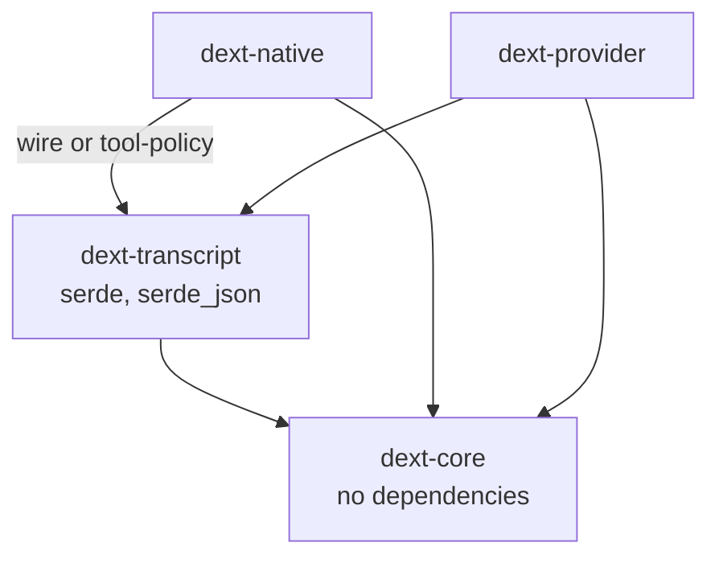
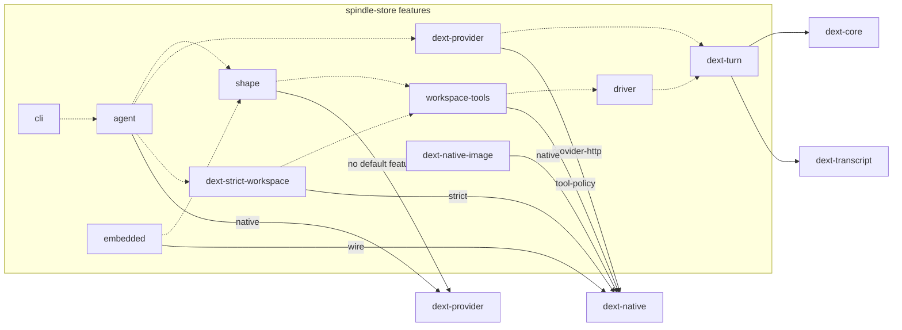
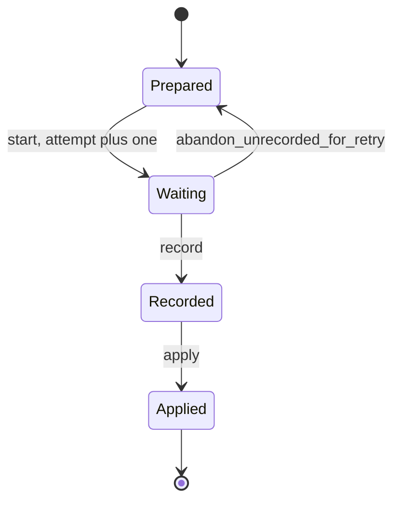
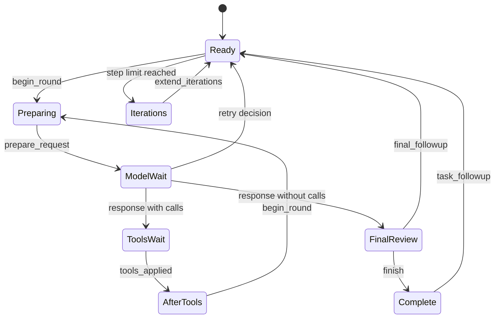
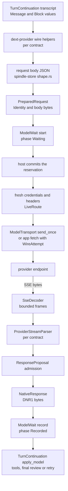

# Engine crates

Spindle builds on four Rust crates in [`dext-engine/`](../dext-engine): `dext-core` holds
pure state machines for one model request, one turn and incomplete-response recovery;
`dext-transcript` holds the conversation values and the checkpoint codecs a turn is
stored as; `dext-native` holds the code that faces the operating system and the wire (the
command runner, process-tree cleanup, the SSE and stream parsers, one HTTP attempt, the
image worker) plus workspace limits and tool argument rules; and `dext-provider` holds the
provider catalog,
credential storage and the shaping of a transcript into each provider's request format.
The crates keep their `dext-*` names because they originate in the Dext project.
`dext-core` and `dext-transcript` are always portable, and `dext-native` and
`dext-provider` split their portable parts from their native parts with Cargo features, so
the same request shaping and stream parsing run in the native CLI and in the wasm32
embedded host.

- [Overview](#overview)
- [Cargo features](#cargo-features)
- [dext-core](#dext-core)
- [dext-transcript](#dext-transcript)
- [dext-native](#dext-native)
- [dext-provider](#dext-provider)
- [From transcript to wire and back](#from-transcript-to-wire-and-back)
- [Platform differences](#platform-differences)

## Overview

| Crate | Path | Purpose | I/O | wasm32 |
|---|---|---|---|---|
| `dext-core` | [`core/`](../dext-engine/core) | Prepared model requests and their wait state, the turn cursor, recovery decisions, response admission, sanitized-JPEG framing check | None; `#![forbid(unsafe_code)]`; no dependencies | Yes |
| `dext-transcript` | [`transcript/`](../dext-engine/transcript) | `Block`/`Message`/`Usage`, checkpoint codecs, response and tool-result continuations, the turn continuation, runtime guards | None | Yes |
| `dext-native` | [`native/`](../dext-engine/native) | Workspace limits, SSE decoding and stream parsing, one provider attempt, strict command runner, process-tree and cgroup cleanup, image worker, tool metadata and argument policy | Only with the `native` feature | `wire` and `tool-policy` only |
| `dext-provider` | [`provider/`](../dext-engine/provider) | Provider catalog, model metadata, request URLs and headers, transcript-to-wire shaping; with `native`, the subscription body transform, credential storage, OAuth login and the `auth` CLI | Only with the `native` feature | Without `native` |

All four crates are edition 2024, MIT licensed and `publish = false`; Spindle uses them as
path dependencies. The workspace manifest is [`dext-engine/Cargo.toml`](../dext-engine/Cargo.toml).



The crates never commit anything themselves. The state types of `dext-core` and
`dext-transcript` are *proposals*: a method returns the next value and leaves the receiver
unchanged, and the host (spindle-store) decides when a value is committed. See [store.md](store.md) and [driver.md](driver.md) for
how Spindle records these values, and [architecture.md](architecture.md) for where the
engine sits in the whole system.

## Cargo features

`dext-core` and `dext-transcript` have no features.

### dext-native

Defined in [`native/Cargo.toml`](../dext-engine/native/Cargo.toml). Default: `native`.

| Feature | Enables | Pulls in | Portable to wasm32 |
|---|---|---|---|
| `native` | `process_tree`, `image`, and `cgroup` (Linux only) | `image` (JPEG, PNG, WebP), `libc`, `sha2`, `windows-sys` (Windows only) | No |
| `wire` | `sse`, `streaming`, `attempt` (the transport-free half of a provider attempt) | `anyhow`, `dext-transcript`, `serde_json` | Yes |
| `tool-policy` | `tool_policy` (tool argument and command risk rules) | `dext-transcript`, `serde`, `serde_json` | Yes |
| `strict` | `strict` (the workspace command runner) | `native` + `tool-policy` | No |
| `tokio-process` | Tokio variants of the process-group helpers | `native`, `tokio` | No |
| `provider-http` | `model_effect` (one HTTP attempt with reqwest) | `native` + `wire`, `futures-util`, `reqwest` (rustls), `tokio` | No |

`limits` and `tool_metadata` are compiled in every configuration.

### dext-provider

Defined in [`provider/Cargo.toml`](../dext-engine/provider/Cargo.toml). Default: `native`.

| Feature | Enables | Pulls in |
|---|---|---|
| (none) | `catalog`, `wire`, `claude_subscription` (portable parts) | `anyhow`, `base64`, `bytes`, `flate2` (pure-Rust backend), `http`, `serde`, `serde_json`, `sha2`, `url` |
| `native` | `host` (state directory, atomic writes, command hooks) and `provider` (credential store, OAuth, `auth` CLI), random request ids, local identity discovery | `reqwest` (blocking, rustls), `libc` (Unix), `getrandom` |
| `test-support` | `native` plus test-only state-directory handling | |

A test in [`provider/tests/portable.rs`](../dext-engine/provider/tests/portable.rs)
(`portable_sources_have_no_ambient_native_dependencies`) fails if `catalog.rs` or `wire.rs`
mentions `std::fs`, `std::env`, `std::process`, `reqwest`, `tokio` or the `host` module.

### How spindle-store features map onto the engine

spindle-store ([`spindle/store/Cargo.toml`](../spindle/store/Cargo.toml)) depends on
`dext-native` and `dext-provider` with default features off (the latter under the
dependency name `dext-provider-catalog`) and turns on exactly what each of its own
features needs.

| spindle-store feature | Implies | Engine crates and features |
|---|---|---|
| `dext-turn` | | `dext-core`, `dext-transcript` |
| `driver` | `dext-turn` | |
| `workspace-tools` | `driver` | `dext-native` + `tool-policy` |
| `dext-strict-workspace` | `workspace-tools` | `dext-native` + `strict` |
| `dext-provider` | `dext-turn` | `dext-native` + `provider-http` |
| `shape` | `workspace-tools` | `dext-provider` (no default features) |
| `embedded` | `shape` | `dext-native` + `wire` |
| `agent` | `driver`, `shape`, `dext-provider`, `dext-strict-workspace` | `dext-provider` + `native` |
| `cli` | `agent` | |
| `dext-image` | | `dext-core` |
| `dext-image-continuation` | `dext-image` | `dext-transcript` |
| `dext-native-image` | `dext-image`, `dext-image-continuation` | `dext-native` + `native` |

The wasm package `spindle-embed` builds spindle-store with `embedded` only, so it compiles
`dext-native` with `wire` and `tool-policy` and `dext-provider` without `native`. The
`spindle` binary needs `cli`, which brings the strict runner, the reqwest transport and the
native credential store. See [embedded.md](embedded.md) and [cli.md](cli.md).



## dext-core

Source: [`core/src/`](../dext-engine/core/src). Every type here is plain data with
validating constructors and a fixed binary checkpoint; nothing performs I/O, holds
credentials or grants permission to run anything.

### Model requests: `model`

[`model.rs`](../dext-engine/core/src/model.rs) describes one model request.

`Identity` names a request with seven non-empty labels (each at most 4096 bytes, no control
characters):

| Field | Meaning |
|---|---|
| `effect` | Effect id of the request (in a turn, `<execution>/m/<ordinal>`) |
| `provider` | Provider profile id |
| `contract` | Wire contract name (`anthropic-messages`, `openai-chat-completions`, `openai-responses`, `chatgpt-responses`) |
| `endpoint` | Request URL |
| `model` | Model id |
| `credential_scope` | An opaque authorization scope chosen by the host, never a token or a hash of one |
| `configuration` | The frozen effective configuration, such as the output cap |

`PreparedRequest<B>` binds an `Identity`, an `Encoding` (`Json` or `Gzip`) and immutable
body bytes (1 byte to 64 MiB, `MAX_BODY`). `ModelWait<B>` tracks one request through four
phases; the response it records is 1 byte to 16 MiB (`MAX_RESPONSE`).



- `start` is a proposal; the host must commit the new attempt number before sending.
- `abandon_unrecorded_for_retry` records willingness to replace an attempt that produced
  no recorded response. The earlier request may still have run or been billed.
- `record` accepts the response only for the exact same identity, encoding, body and
  attempt number. Recording the same bytes again is idempotent; different bytes are a
  `Conflict`.
- `apply` executes nothing; the host commits the assistant message and tool intents in the
  same transaction.
- `checkpoint` / `restore` use a length-prefixed binary framing with magic `DMW1`. Restore
  rejects trailing bytes, an attempt of 0 outside `Prepared`, and a response present in the
  wrong phase.

### Turn cursor: `turn`

[`turn.rs`](../dext-engine/core/src/turn.rs) holds `TurnControl`: the phase of one turn, the
step count (`iterations`) and the logical request ordinal. Rebuilding a failed stream is a
new request ordinal; physical HTTP attempts are counted in `ModelWait`.



Stops are `Complete`, `Iterations`, `Budget`, `ToolPolicy`, `ContentFilter`,
`RecoveryBudget` and `Cancelled`. `Budget` and `Cancelled` are allowed from any running
phase; `ContentFilter` and `RecoveryBudget` are reached only through the recovery decision.
`runtime_control` returns `Preparing` or `ModelWait` to `Ready` after the host confirms the
old stream was abandoned. The checkpoint is 23 bytes with magic `DTU1` (phase tag,
iterations, request ordinal, recovery state); restore rejects combinations a real run
cannot produce.

### Recovery: `recovery`

[`recovery.rs`](../dext-engine/core/src/recovery.rs) classifies how a response ended.

- `Contract` is the four wire contracts. `stream_recovery_reason` returns why a response
  is incomplete: for Responses contracts, the `incomplete:<reason>` stop reason; for
  Anthropic Messages and Chat Completions, `unfinished_tool_call` when a tool call was cut
  off, or `output_token_limit` on `max_tokens` / `length`.
- `RecoveryState` (6-byte checkpoint, magic `DRC1`) allows at most
  `MAX_INCOMPLETE_RESPONSE_RECOVERIES` = 3 automatic continuations of incomplete responses.
  A response with executable tool calls always proceeds; `content_filter` halts
  immediately; the fourth incomplete response halts with `RetryBudget`. Only an explicit
  `Reset` clears a halt.
- `classify_stream_error` turns an error body seen inside a stream into a `RetryPlan`
  (`Auth`, `Transient`, `Schema` or `Permanent`, and whether to retry). Context-length and
  token-limit messages, quota, authentication and invalid-request markers are not retried;
  overload, rate limits, connection resets, gateway errors and similar are. A Responses
  stream that dies inside `response.incomplete`, and an Anthropic stream that ends before
  `message_stop`, are transient.

### Response admission: `response`

[`response.rs`](../dext-engine/core/src/response.rs) defines `ResponseProposal`, built only
from a finalized, parser-validated block list. It refuses incomplete or invalid blocks, a
call without id or name, duplicate call ids, more than 4096 blocks (`MAX_BLOCKS`), more than
256 calls (`MAX_CALLS`) and ids or names over 4096 bytes. `into_calls` returns the tool calls
as inert values.

### Images: `image`

[`image.rs`](../dext-engine/core/src/image.rs) bounds sanitized images: longest side
1568 pixels (`LONGEST_SIDE_CAP`), at most 1500 KiB encoded (`ENCODED_BYTE_CAP`).
`sanitized_jpeg_matches_dimensions` checks the exact JPEG framing the image worker emits
(JFIF header, one baseline 3-component frame of the stated size, quantization and Huffman
tables, one scan, end marker, nothing after) without decoding pixels.

## dext-transcript

Source: [`transcript/src/`](../dext-engine/transcript/src). Depends on `dext-core`,
`serde` and `serde_json` only.

### Conversation values

[`lib.rs`](../dext-engine/transcript/src/lib.rs) defines:

- `Message { role, content: Vec<Block> }`.
- `Block`, serialized with a `type` tag: `text`, `thinking` (text and optional signature),
  `redacted_thinking`, `responses_reasoning` (an opaque OpenAI Responses reasoning item),
  `tool_use` (id, name, JSON object input), `tool_result` (tool use id, content, optional
  `is_error`, optional metadata: status, exit code, duration, artifact),
  `image_reference` (workspace path, media type, width and height, source SHA-256),
  `image_artifact` (a scoped, digest-identified sanitized JPEG) and `partial_stream`.
- `Usage`: token counts normalized into disjoint buckets `input`, `output`,
  `cache_create`, `cache_read`, plus an optional provider-reported `cost_usd`. `parse`
  reads Anthropic-style fields, `parse_openai` reads Chat Completions and Responses fields
  (cached tokens are moved out of `input`), and `parse_openai_timings` reads llama.cpp
  `timings` (`prompt_n`, `cache_n`, `predicted_n`). Without a reported cost,
  `estimated_cost_usd` uses default rates of 1 / 5 / 0.1 / 1.25 USD per million input,
  output, cache-read and cache-write tokens.

### Checkpoint codecs

[`checkpoint.rs`](../dext-engine/transcript/src/checkpoint.rs) encodes values as a 4-byte
magic followed by JSON. Encoding is bounded while it is written (at most 32 MiB,
`MAX_CHECKPOINT_BYTES`; nesting depth 64; 131,072 structural tokens). Decoding checks
the canonical serialization against the input through a comparing writer, without
allocating a second encoded copy. Unknown or duplicate fields, aliases and trailing
data are still rejected. `checkpoint_len` counts encoded bytes with the same bounds
without building them; turn validation uses it for size checks.

| Magic | Type | Contents and checks |
|---|---|---|
| `DNR1` | `NativeResponse` | Parsed response: blocks, stop reason, usage, count of unknown stream events, count of unfinished tool calls. No incomplete or invalid blocks. |
| `DNT1` | `TranscriptCheckpoint` | `route_binding` (non-empty, at most 4096 bytes) and messages: at most 4096 messages and 16,384 blocks; roles `user`, `assistant`, `system`, `tool`; tool results only in `user`/`tool` messages, images only in `user` messages, thinking and tool calls only in `assistant` messages; tool call inputs are JSON objects, with ids unique within a message. |
| `DNC1` | `ResponseContinuation` | A transcript and a `ModelWait` (in `Waiting` or `Applied`). |
| `DTC2` | `ToolResultsContinuation` | An applied response and the results received so far, one slot per call. |
| `DRS1` | `TurnRuntimeState` | The runtime guard state. |
| `DTT1` | `TurnContinuation` | The 23-byte `TurnControl`, a state tag, a header (`DTM1`), the state body and the runtime state. |

spindle-store stores the `DTT1` bytes as the continuation of each turn revision (engine
label `dext-turn-v1`); see [store.md](store.md).

### Response and tool-result continuations

- [`continuation.rs`](../dext-engine/transcript/src/continuation.rs):
  `ResponseContinuation::waiting` pairs a transcript with a `Waiting` model request.
  `apply` takes the recorded `ModelWait`, refuses a different route binding or a different
  request, restores the `DNR1` response, admits it through `ResponseProposal`, appends one
  assistant message and moves the wait to `Applied`. `pending_calls` returns the calls of
  an applied response.
- [`tool_results.rs`](../dext-engine/transcript/src/tool_results.rs):
  `ToolResultsContinuation` collects one result per call. `observe_blocks` requires the
  parent model effect id and attempt, the exact call (id, name and canonically encoded
  input) and a result whose first block is that call's `tool_result`, followed by at most
  eight distinct valid image artifacts. Observing the same result twice is idempotent; a
  different one is refused.
  When every call has a result, the transcript gains exactly one `user` message with the
  results in call order, not arrival order.

### Turn continuation

[`turn.rs`](../dext-engine/transcript/src/turn.rs) composes `TurnControl`, the transcript,
the response and tool-result continuations and the runtime state into `TurnContinuation`,
the value Spindle checkpoints per step. Its header holds a scope label (at most 128 bytes)
and an execution label (at most 64 bytes), both limited to `A-Z a-z 0-9 - _ . : /`, the
contract and an optional step limit. Model effects are named `<execution>/m/<ordinal>` and
tool effects `<execution>/m/<ordinal>/t/<position>`.

| Method | Effect |
|---|---|
| `new` | Starts a turn over a transcript. |
| `next_model_id` | The effect id the next request must carry. |
| `prepare` | Begins a round and wraps a `PreparedRequest` whose effect id and contract match, in a waiting `ResponseContinuation`. At the step limit it stops with `Iterations` instead. |
| `apply_model` | Applies a recorded response, runs the recovery decision and moves to tools, final review, a retry or a stop. |
| `guard_tool` | Runs the runtime pre-dispatch guards for one pending call; a verdict is recorded as that call's result without running it. |
| `refuse_tool` | Records a host refusal (unknown tool, rejected input) as an error result. |
| `apply_tool` | Records the result of a dispatched call. |
| `finish`, `followup`, `task_report`, `steer` | End the turn, add a user message, reopen a completed turn with a task report, inject a queued user update at the point the phase allows. |
| `stop_for_budget` | Stops before a new round when a USD or token cap is reached and appends the denial text. |
| `compact` | Replaces settled history with a host-produced transcript of at most as many messages on the same route binding; it may keep existing images but not add new ones. |
| `fork_settled`, `fork_before_model`, `restart_settled`, `extend_steps`, `cancel` | Fork or restart from a settled cut with a fresh execution label, resume after the step limit, cancel. |
| `pending_effects` | The model or tool effects still owed. |

Every method returns a new value, re-validates it and checks that it checkpoints.
`checkpoint_len` avoids building an encoding where only its size is needed.
`restore` decodes `DTT1`; its JSON components compare canonical output with the
original bytes without retaining another encoding, but the outer composite frame
still re-encodes through `checkpoint()` for its final equality check.
`transcript_ref` borrows an existing transcript in transcript/model states and
builds a copy in a tool batch. `into_transcript` consumes the continuation instead
of copying those states.
Partial batches keep the original transcript; complete ones add exactly one result
message in call order.

### Runtime guards and failure classification

[`runtime.rs`](../dext-engine/transcript/src/runtime.rs) holds `TurnRuntimeState`, the
advisory decisions a turn accumulates: work phase (`probe`, `scale`, `synthesize`), a
cache of external results for deduplication, similar-command detection for `bash`,
per-host authentication failures and blocked hosts, per-tool failure budgets, empty
tool-call streaks and telemetry counters. `preflight` runs the deduplication, similarity,
blocked-host and feasibility guards in that order; `observe_tool_result` records an
outcome. `TurnContinuation::with_runtime` accepts only a successor state
(`is_successor_of`: counters, breakers and caches only grow), so a resumed turn cannot
reset a guard.

The same module classifies transport failures for host retry policy:

| Function | Rule |
|---|---|
| `classify_http_failure` | 401, 403, 407 or an authentication marker in the body: `Auth`, no retry. 400, 404, 405, 410, 411, 413, 414, 415, 422: `Schema`, no retry. 408, 425, 429, 500, 502, 503, 504, 520 to 525, 527: `Transient`, retry. Anything else: `Permanent`. |
| `classify_transport_failure` | Connect or timeout errors are transient. |
| `stream_error_is_context_overflow` | True for bodies that say the prompt no longer fits the context window, which a host can recover from by compacting and resending. |

## dext-native

Source: [`native/src/`](../dext-engine/native/src).

### Workspace limits

[`limits.rs`](../dext-engine/native/src/limits.rs) is shared by the strict runner, the
store's in-process file tools and hosts without a sandbox.

| Constant | Value | Meaning |
|---|---|---|
| `MAX_FILES` | 50,000 | Entries in a workspace tree (files, links, empty directories) |
| `MAX_FILE` | 64 MiB | Largest file |
| `MAX_TREE` | 2 GiB | Sum of file sizes |
| `MAX_PATH` / `MAX_NAME` | 1024 / 255 bytes | Path and component length |
| `MAX_LINK` | 4095 bytes | Symbolic link target |
| `MAX_OUTPUT` | 8 MiB | Output kept per stream; a run that prints more is stopped |
| `MAX_RUN_SECS` | 1800 | Longest run |
| `MAX_JOB_SECS` | 86,400 | Longest background job |
| `JOB_OUTPUT` | 4 MiB | Newest job output kept |

`valid_path` accepts any relative UTF-8 path without empty, `.` or `..` components and
without NUL. On Windows each component must also survive the filesystem as written: no
`<>:"\|?*` or control characters, no trailing dot or space, no device names (`CON`,
`NUL`, `COM1`, ...) and no `~` followed by a digit.

### Stream parsing: `sse`, `streaming`

- [`sse.rs`](../dext-engine/native/src/sse.rs): `SseDecoder` splits a byte stream into
  `event:`/`data:` frames, accepting LF and CRLF delimiters split across chunks, and fails
  with `stream protocol error [sse/frame]` when one event exceeds its cap or is not UTF-8.
- [`streaming.rs`](../dext-engine/native/src/streaming.rs): `ProviderStreamParser` turns
  frames into blocks for one contract. `sse_event_cap` is 4 MiB for Anthropic Messages and
  both Responses contracts (a thinking signature or a terminal snapshot arrives in one
  event) and 256,000 bytes for Chat Completions. Tool arguments are buffered up to
  256,000 bytes per call and reasoning up to 4 MiB.

| Contract | Parser state | Finish requires | Output blocks |
|---|---|---|---|
| Anthropic Messages | Indexed content blocks from `message_start`, `content_block_start/delta/stop`, `message_delta`, `message_stop` (`text_delta`, `thinking_delta`, `signature_delta`, `input_json_delta`, redacted thinking) | `message_start` and `message_stop` seen, every block stopped | Text, thinking with signature, redacted thinking, tool calls |
| Chat Completions | One text and one reasoning buffer, tool calls by index | A `finish_reason` or `[DONE]`; nothing after `[DONE]` | Thinking (when reasoning capture is on), text, tool calls |
| OpenAI Responses, ChatGPT | Output items, text, reasoning summaries, function calls by item id, from `response.*` events | A terminal `response.completed`, `response.done` or `response.incomplete` event, or `[DONE]`; function calls require the terminal event and must reconcile with its output | Reasoning items (OpenAI Responses only), thinking from reasoning summaries, text, tool calls |

Tool call arguments must parse as a JSON object. When the output-token limit cut a call
off mid-JSON (`max_tokens` or `length`), the call is counted in `unfinished_tool_calls`
instead of failing the stream; an Anthropic tool block that was never explicitly stopped
is never executable. Unrecognized events are counted in `unknown_events`. `finish` admits
the blocks through `dext_core::response::ResponseProposal` and returns a
`NativeResponse`. While parsing, `push_frame` returns `StreamUpdate` previews (text and
thinking deltas); previews are never adopted, only the finished response is.

### One provider attempt: `attempt`, `model_effect`

[`attempt.rs`](../dext-engine/native/src/attempt.rs) (`wire` feature) is the response half
of one attempt with no transport, so a host that does its own HTTP (an app's `fetch`) and
the native transport record the same bytes for the same stream.

- `WireAttempt::new` takes a `Waiting` `ModelWait` and picks the decoder cap and parser
  from the identity's contract. `push` feeds body chunks (at most 16 MiB in total,
  `MAX_WIRE_RESPONSE`); `finish` parses the remainder and returns the `ModelWait` with the
  `DNR1` response recorded.
- An error the provider streams before any output (Anthropic `error`, Responses `error` or
  `response.failed`, a Chat Completions error chunk) is reported as `AttemptError::Http`
  with the status the same refusal would have had before the stream (529 overloaded, 429
  rate limit, 400 invalid request or context length, 504 timeout, otherwise 500).
  `take_rejection` returns the status, `Retry-After` and up to 4096 bytes of body.
- `endpoint_allowed` accepts HTTPS, or HTTP to a literal loopback address, with no user
  info or fragment. `event_stream` accepts a missing `Content-Type` (the ChatGPT backend
  sends none) and refuses any declared type other than `text/event-stream`.

[`model_effect.rs`](../dext-engine/native/src/model_effect.rs) (`provider-http` feature)
sends one attempt with reqwest.

- `LiveRoute` carries the identity and the request headers. It refuses more than 32
  headers, any header over 16 KiB, and the headers the transport owns (`host`,
  `content-length`, `transfer-encoding`, `connection`, `content-encoding`,
  `content-type`, `accept`), and marks every value sensitive. It is never serialized.
- `ModelTransport::new` builds a client with no proxy discovery, no redirects and no
  automatic retries. `Deadlines` default to 10 s connect, 60 s to first byte, 60 s idle
  between chunks and 300 s total; each must be between zero and 600 s and none above the
  total.
- `send_once` requires a `Waiting` request whose identity equals the route's, checks the
  endpoint as above, posts the body with `content-type: application/json`,
  `accept: text/event-stream` and `content-encoding: gzip` for gzip bodies, and polls an
  interrupt flag every 10 ms. A non-2xx status is read for at most 2 s and kept as the
  rejection. `send_once_observed` also passes each `StreamUpdate` preview to a callback.
  No failure implies the request was not executed or billed.

### Strict command runner: `strict`

[`strict.rs`](../dext-engine/native/src/strict.rs) (`strict` feature) runs a command over a
private copy of a workspace and seals the resulting tree back. `StrictExecutor` comes in
two forms:

| Runner | Constructor | Implementation label | Isolation |
|---|---|---|---|
| Isolated | `StrictExecutor::open(helper, approved_sha256)` | `dext-strict-bash-v1-<digest>` | bubblewrap namespaces and a seccomp filter (Linux only) |
| Host | `StrictExecutor::host()` | `dext-host-bash-v1-<digest>` | None: the command sees the real filesystem and network |

The label goes into each attempt's receipt so a result always says how it was produced.
`probe` runs a trivial command to prove the runner works on this host.

**Isolated runner.** `open` reads the helper (a reviewed bubblewrap 0.11 or later, at most
8 MiB, opened without following links), checks its SHA-256 against the approved digest,
copies it into a sealed memory file (mode 0500; write, grow, shrink and further seals
forbidden) and executes it from there, so replacing the file on disk cannot change what
runs. Each run gets:

- New user, PID, IPC, UTS and cgroup namespaces, and a new network namespace unless the
  run has `network`; nested user namespaces disabled; all capabilities dropped; a new
  session; the helper dies with its parent.
- A cleared environment with only `PATH=/usr/bin:/bin`, `HOME=/tmp` and `TMPDIR=/tmp`
  (plus `SPINDLE_RPC_FDS` for brokered runs and the toolchain variables below).
- `/usr` read-only with `/bin`, `/lib`, `/lib64` as links into it, `/etc/alternatives`
  read-only when present, fresh `/proc` and `/dev`, a 1 GiB tmpfs at `/tmp`
  (`SANDBOX_TMP`), and the candidate workspace bound at `/workspace` (the working
  directory). No other host path is visible. With `network`, the host's resolver and
  certificate files under `/etc` are bound read-only.
- A seccomp program (x86_64, aarch64 or riscv64; other architectures refuse) that kills a
  process using a foreign syscall ABI and limits `socket()` by address family: with
  `network`, `AF_INET`/`AF_INET6` only; without it, also `AF_UNIX` and route netlink,
  which reach only the run's own loopback. Socket pairs always work. It refuses with
  `EPERM`: io_uring, `pidfd_getfd`, `ptrace`, `process_vm_readv/writev`, the old and new
  mount APIs, `unshare`, `setns`, `bpf`, kernel keyrings, `perf_event_open` and
  `userfaultfd`.
- bubblewrap's JSON status descriptor: a run whose status never reports an exit code
  failed in sandbox setup and is reported as such, not as a failing command.

**Every run** (both runners):

- Waits for one of 4 sandbox slots per effective user (`MAX_CONCURRENT`), held as locked
  files in a private per-user directory; the wait counts against the run's deadline.
- Refuses to start unless host scratch space holds the input plus 256 MiB
  (`SCRATCH_HEADROOM`). The candidate may grow to twice the tree limit, never into that
  headroom; a monitor stops the run when it grows past that or free space falls below
  half the headroom.
- Materializes input in a private candidate directory: `execute`/`execute_with`
  take files in memory; `execute_tree` streams them from a `RunHost`. With
  `keep_workspaces(true)` and `RunHost::place`, an isolated run can start from the
  last run's candidate for that place. Files are reused only when content ids and
  stamps agree; changed inputs, links, modes and leftovers are reconciled first.
  Keeping is off by default, process-local, bounded to 4 places and 256 MiB;
  `forget_workspace(place)` drops one. The native serving host enables it.
  argv is 1 to 128 elements, each at most 80 KiB with no NUL,
  and `argv[0]` must be absolute; the timeout is non-zero and at most 1800 s.
- Sets, before exec on Linux: parent-death `SIGKILL`, a check that the parent did not
  already change, `no_new_privs`, and close-on-exec on every descriptor except the ones
  the run needs.
- Sets resource limits on Unix (each lowered to the inherited limit if that is smaller):
  no core files; file size 1 GiB (4 GiB with a toolchain); CPU time equal to the timeout
  on every core plus 10 s; address space 256 GiB and private data 4 GiB (16 GiB with a
  toolchain), both required on Linux; and on Linux, without a pids-capped cgroup, a
  process limit of the user's current thread count plus 1024 (4096 with a toolchain).
- Joins its own cgroup when the host declares a delegated cgroup (see
  [process trees and cgroups](#process-trees-and-cgroups)). When the `pids` and `memory`
  controllers can be enabled, the cgroup caps processes and threads at 1024 (4096 with a
  toolchain), and all runs share a memory cap of three quarters of physical memory with
  swap off.
- Is stopped when it exceeds its deadline, prints more than 8 MiB on a stream, outgrows
  its disk allowance, or the interrupt flag is set. At the end the whole tree is killed:
  the process group of a host run, every member of the run's cgroup, or the namespace.
- Is sealed: regular files (hard links become plain files), symbolic links (never
  followed; target at most 4095 bytes) and empty directories are kept. A file whose inode,
  size, times and mode equal the input can be `Unchanged`. On Linux an inotify
  watcher also records input files opened for writing: shared-mapping writes can
  leave timestamps unchanged on tmpfs. Those files are read back; if watching fails
  or its event queue overflows, every input file is treated as possibly changed.
  Other platforms rely on stamps alone. Sockets, pipes and devices are left out
  and named in stderr. Non-UTF-8 names,
  invalid paths, or too many entries or bytes make the run fail with the reason.

A run that ends without a sealed tree returns an `io::Error` carrying a `RunFailure`
(`run_failure` extracts it) with the reason and the output printed so far; its kind is
`TimedOut`, `FileTooLarge`, `OutOfMemory`, `InvalidData` (changes that cannot be sealed)
or `Other` (setup failures, which say that nothing ran), and nothing the run changed is
kept. `sweep_abandoned_candidates` removes candidates (`spindle-candidate-<hex>` in the
scratch root) whose owner lock is free, which only frees disk. The reuse and
shared-mapping cases are checked by
[`strict_reuse.rs`](../dext-engine/native/tests/strict_reuse.rs) and
[`strict.rs`](../dext-engine/native/tests/strict.rs).

**Host runner.** The command runs directly over the private copy with a cleared
environment: only `PATH`, `LANG` (default `C.UTF-8`) and, on Windows, the system variables
programs need to start are kept, and `HOME`, `USERPROFILE`, `TMPDIR`, `TEMP` and `TMP`
point to private directories beside the workspace. Provider credentials are never passed.
The run leads its own session on Unix and sits in a kill-on-close job object on Windows,
so ending the run ends its tree; a process that starts its own session can outlive a Unix
host run unless a delegated cgroup is in use. The network cannot be withheld.

**Options.** `RunOptions` has:

| Field | Effect |
|---|---|
| `network` | Share the host network namespace (isolated runs). Effects outside cannot be undone by a rewind. |
| `observe` | Callback that receives raw output chunks with their stream (1 stdout, 2 stderr) as a preview. |
| `toolchain` | Host Rust toolchain: rustup home read-only at `/opt/rustup`, cargo binaries read-only at `/opt/cargo/bin`, a private persistent cache at `/cache` (`CARGO_TARGET_DIR=/cache/target`), a fresh tmpfs `CARGO_HOME` per run with git checkouts from the cache and the host registry as a copy-on-write overlay, read-only `sources` mounted at `/<name>`, and `CARGO_NET_OFFLINE=true` unless `network`. |
| `local_ipc` | Kept for compatibility; socket pairs are allowed in every run. |

**Brokered runs.** `execute_brokered` and `execute_tree` with `brokered` give the command
a request/reply channel to the host: on Unix two dedicated pipes named by
`SPINDLE_RPC_FDS=<reply-read>,<request-write>`, one JSON request per line answered by one
reply line; on Windows request lines start with byte 0x1E on stdout and replies arrive on
stdin. A request line is at most 64 MiB and a reply at most 2 MiB. Requests are untrusted
input; the host's `RunHost::request` decides what to answer.

**Background jobs.** `start_job` starts a command confined like a run over a private
copy, for at most 24 hours. At most 16 jobs run per owner process (`MAX_JOBS`); jobs do
not hold a run slot. A job keeps the newest 4 MiB of interleaved output (`Job::read`
returns a window with stream offsets), reports `Running`, `Exited(code)` or
`Ended(reason)`, and is never sealed: what it changes is discarded when it ends.

`program` resolves interpreters: inside the sandbox `/bin/bash`, `/usr/bin/python3` and
`/usr/bin/node`; for host runs `host_program` uses `SPINDLE_BASH`, `SPINDLE_PYTHON` or
`SPINDLE_NODE`, then Git for Windows' bash on Windows, then `PATH` (Windows App Execution
Alias stubs are skipped). See [tools.md](tools.md) for how Spindle's tools use the runner.

### Process trees and cgroups

[`process_tree.rs`](../dext-engine/native/src/process_tree.rs) (`native`):
`configure_std_process_group` starts a child in a new session (falling back to a new
process group) on Unix so nothing it spawns can use the controlling terminal, and
suspended on Windows. `ChildProcessTree` then owns the tree: on Unix it signals the process
group with `SIGTERM` then `SIGKILL` (also on drop while armed); on Windows it assigns the
suspended child to a job object with kill-on-close and optional `TreeCaps` (total
committed memory, live processes, per-process CPU time) before resuming it, and
`memory_exhausted` reports whether the memory cap made an allocation fail.

[`cgroup.rs`](../dext-engine/native/src/cgroup.rs) (`native`, Linux only) gives kernel
evidence that a tree is gone. `delegated_root` returns the process's own cgroup v2 only
when `DEXT_CGROUP_DELEGATED=1` is set (for example under
`systemd-run --user --scope -p Delegate=yes`) and the cgroup is writable with
`cgroup.kill` and `cgroup.events`. `OwnedCgroup::create` makes a fresh child and never
adopts an existing directory; `enter_hook` moves a child into it before exec;
`terminate` writes `cgroup.kill` and returns `Emptied` only when `cgroup.events` reports
`populated 0`, otherwise `Unknown`. `run_cgroup` creates one cgroup per strict run under
`<delegated>/spindle-runs`, moving the delegated cgroup's own members into a
`spindle-host` leaf first when that is needed to enable the `memory` and `pids`
controllers. Without enabled controllers runs are kill-only.

### Image worker: `image`

[`image.rs`](../dext-engine/native/src/image.rs) (`native`) decodes untrusted images in a
separate process. The worker (started with `--dext-image-worker`, empty environment)
reads at most 20 MiB from stdin, accepts PNG, JPEG and WebP (animated PNG and WebP are
refused) with at most 40,000,000 decoded pixels, composites transparency onto a neutral
background, resizes so the longest side is at most 1568 pixels, and re-encodes a baseline
JPEG of at most 1500 KiB. It limits itself to 768 MiB of memory (address space on Unix
except macOS, a job object on Windows) and 10 s of CPU, without core files on Unix; the
supervisor allows 15 s and one worker at a time, joins the worker to its own cgroup when
one is delegated, and on macOS samples resident memory. `PinnedWorker::open` (Linux only)
snapshots an approved worker executable, checked against its SHA-256, into a sealed memory
file; `sanitize_file_report` returns an `ImageExecution` whose `RootCleanup` is `NotStarted`,
`Reaped`, `TreeEmptied` (the worker's cgroup was proven empty) or `Unknown`. The worker's output
framing is checked before it is accepted.

### Tool metadata and policy

- [`tool_metadata.rs`](../dext-engine/native/src/tool_metadata.rs) (always compiled) lists
  the built-in tool names with their required fields and flags: needs permission,
  parallel-safe, replay-safe, external process, sensitive read, default profile.
- [`tool_policy.rs`](../dext-engine/native/src/tool_policy.rs) (`tool-policy`) validates
  tool arguments (`validate_tool_input`: required fields present and non-blank, argument
  shapes per tool), classifies command risk (`classify_command_risk`: `read`, `write` or
  `danger`; for example `http` and `git_commit` are `danger`, as are `fd`/`rg` calls with
  flags that can execute commands) and applies `bash` guardrails:
  `apply_bash_guardrails` prefixes `set -o pipefail` and refuses
  `--break-system-packages` unless explicitly allowed. Classification never grants
  permission. Spindle's broker calls `validate_tool_input` and `apply_bash_guardrails`.

## dext-provider

Source: [`provider/src/`](../dext-engine/provider/src).

### Provider catalog

[`catalog.rs`](../dext-engine/provider/src/catalog.rs) defines `ProviderCatalog`
(`version`, `active_provider`, `providers`) and `ProviderProfile`. The native host reads the
catalog from `providers.json` in the state directory; the embedded host takes the same
JSON from the app (`Catalog::from_json` in spindle-store). Either way it passes through
`normalize_provider_catalog`.

| `ProviderProfile` field | Required | Meaning |
|---|---|---|
| `id` | yes | Provider id, canonicalized (see aliases below) |
| `display_name` | no | Defaults to the id |
| `api_provider` | yes | `anthropic`, `openai` or `chatgpt` (aliases such as `openai-compatible`, `local`, `deepseek` map to `openai`; anything unknown maps to `anthropic`). Replaced by the contract's provider when `request_contract` is set. |
| `request_contract` | no | `anthropic-messages`, `openai-chat-completions`, `openai-responses` or `chatgpt-responses` (aliases `anthropic`, `openai`, `openai-compatible`, `responses`, `chatgpt`, `codex`); defaults from `api_provider` |
| `base_url` | yes | Endpoint base; a trailing slash is dropped |
| `default_model` | yes | Normalized and added to `models` if missing |
| `models` | no | Curated model list |
| `model_aliases` | no | Alias to model id |
| `model_defaults`, `model_specs` | no | `ModelSpec` for all models and per model (keys normalized and lowercased) |
| `env_vars` | no | Environment variables that may hold the API key, in order |
| `requires_api_key` | no | Default `true` |
| `login_url`, `oauth_flow`, `notes` | no | Where to get a key; OAuth endpoints, client id, scope, redirect URI, callback host, protocol (`generic` or `anthropic-claude`) |
| `context_window`, `model_context_windows`, `model_effort_levels` | no | Older per-profile and per-model overrides |

`ModelSpec` has `context_window`, `max_output_tokens`, `effort_levels`, `reasoning_modes`,
`capabilities` (`tools`, `reasoning`, `image_input`, `prompt_cache`) and `pricing`
(`input_usd_per_mtok`, `output_usd_per_mtok`, `cache_read_usd_per_mtok`,
`cache_create_usd_per_mtok`; all four required, finite and non-negative).
`resolve_model_spec` resolves a model in this order: the model's own spec, the per-model
override maps, the profile's `model_defaults`, the profile's `context_window`; missing
capabilities default to tools and reasoning on, image input off, and prompt caching on
only for the Responses contracts.

**Built-in providers** (`built_in_provider_profiles`, in this order; the default active
provider is `glm`):

| id | Display name | Contract | Default model | Credentials |
|---|---|---|---|---|
| `glm` | ZAI GLM | `anthropic-messages` | `glm-5.2[1m]` | API key, `ZAI_API_KEY` |
| `chatgpt` | ChatGPT | `chatgpt-responses` | `gpt-6.1-sol` | OAuth (PKCE), or `CHATGPT_ACCESS_TOKEN` |
| `openai` | OpenAI API | `openai-chat-completions`; `openai-responses` for the gpt-5.6 and gpt-6 models on the official API host | `gpt-5` | API key, `OPENAI_API_KEY` |
| `anthropic` | Anthropic | `anthropic-messages` | `claude-sonnet-4-6` | API key (`ANTHROPIC_API_KEY`) or subscription OAuth |
| `kimi` | Kimi Code | `anthropic-messages` | `k3` | API key, `KIMI_API_KEY` (stored OAuth entries are ignored) |
| `deepseek` | DeepSeek | `openai-chat-completions` | `deepseek-flash` | API key, `DEEPSEEK_API_KEY` |
| `local` | Local llama.cpp | `openai-chat-completions` | `qwen3.6-35b-a3b-mtp-ud-q5_k_m` | None; base URL `http://127.0.0.1:8080` |

Built-in profiles also carry curated models, context windows, effort levels and pricing
(`hydrate_builtin_model_specs`, `builtin_model_pricing`, `openai_responses_model_specs`).

**Ids and aliases** (`canonical_provider_id`): `zai`, `bigmodel`, `bigmodel-cn` → `glm`;
`openai-codex`, `codex-openai`, `codex`, `chatgpt-plus`, `chatgpt-pro` → `chatgpt`;
`claude` → `anthropic`; `kimi-code`, `kimi-coding`, `kimi-membership` → `kimi`; `llama`,
`llama.cpp`, `llamacpp`, `qwen` → `local`. A custom profile may not use a `kimi` id.

**Normalization** (`normalize_provider_catalog`):

- The version must be 1 to 4 (current: 4). A bare JSON array is read as a version 1 list
  of profiles. Version 1 profiles lose their contract, aliases and model specs.
- Each built-in is merged with a stored profile of the same id: the stored default model,
  contract, aliases, model defaults and specs, context windows, effort levels and extra
  models apply; the built-in's base URL, credentials settings, OAuth flow and display name
  are kept. Base URLs of built-ins are changed with environment overrides instead (below).
- Custom profiles follow the built-ins in the order they were first written. The retired
  bundled ids `openrouter` and `ollama` are dropped.
- An `active_provider` that names no profile falls back to `glm`, else the first profile.

A minimal `providers.json` adding one OpenAI-compatible endpoint (built-ins are added on
load and written back on save):

```json
{
  "version": 4,
  "active_provider": "my-gateway",
  "providers": [
    {
      "id": "my-gateway",
      "display_name": "My gateway",
      "api_provider": "openai",
      "request_contract": "openai-chat-completions",
      "base_url": "https://llm.example.com/v1",
      "default_model": "my-model",
      "env_vars": ["MY_GATEWAY_KEY"],
      "model_specs": {
        "my-model": {
          "context_window": 128000,
          "max_output_tokens": 16384,
          "effort_levels": ["low", "medium", "high"],
          "capabilities": { "tools": true, "reasoning": true, "image_input": false }
        }
      }
    }
  ]
}
```

### Credential storage

The native state directory is `$DEXT_HOME`, or `.dext` in the home directory (`USERPROFILE`
or `HOME`) when it is unset ([`host.rs`](../dext-engine/provider/src/host.rs),
`dext_state_dir`). Spindle shares it with Dext, so a login made with either tool is seen
by both.

| File | Written by | Contents |
|---|---|---|
| `providers.json` | `save_provider_catalog`, provider and default-model changes | The normalized catalog |
| `auth.json` | `save_auth_store` | Credentials, owner-only |
| `pending_oauth.json` | `run_oauth_login` | PKCE verifier, state and redirect URI of a login in progress, owner-only |
| `kimi_device_id` | Kimi header shaping | A generated device id sent to the official Kimi endpoint |
| `~/.dext/external-auth.json` | (read only) | Credentials to import with `login ... import`; located from the home directory, or `DEXT_EXTERNAL_AUTH_FILE`, not from `DEXT_HOME` |

`auth.json` ([`provider.rs`](../dext-engine/provider/src/provider.rs), `AuthStore`):

```json
{
  "version": 1,
  "providers": {
    "openai": { "type": "api_key", "key": "OPENAI_API_KEY" },
    "chatgpt": {
      "type": "o_auth",
      "access_token": "...",
      "refresh_token": "...",
      "expires_at": 1700000000
    }
  }
}
```

An `api_key` value is resolved by `resolve_secret_reference`: `!command` runs the command
through the host's secret hook (results, including failures, are cached until the next
login); a value made only of `A-Z`, `0-9` and `_` is read from that environment variable
when it is set; anything else is the key itself. An `o_auth` access token is unusable once
`expires_at` (epoch seconds) has passed. A file without `version` is read in the older
form, a map from provider id to a key string or credential object.

File handling: state files are read only if they are regular files (not links), at most
1 MiB, owned by the current user (Unix) and opened without following links. `auth.json`
with group or other permission bits is repaired to mode 0600 when read; `providers.json`
that is group- or world-writable is refused. Writes go to a temporary file that is synced
and renamed into place, then the directory is synced; `auth.json` is created with mode 0600
and its mode is checked again after saving.

**Resolution** (`resolve_runtime_provider`, native):

1. Provider: the explicit selection, else `DEXT_PROVIDER`, `DEXT_PROFILE`,
   `DEXT_API_PROVIDER`, else the catalog's `active_provider`. Without an explicit
   selection, a resolved model that the active built-in provider does not list moves the
   request to the one other built-in provider that lists it and has credentials (if
   exactly one does).
2. Model: `DEXT_MODEL_<ID>` (for example `DEXT_MODEL_OPENAI`), else `DEXT_MODEL` when the
   profile lists it or lists no models (or `DEXT_MODEL_FORCE` is set, or the endpoint is a
   keyless local server), else
   the profile's default model.
3. Base URL: `DEXT_BASE_URL`, else `OPENAI_BASE_URL` (OpenAI contracts) or
   `ANTHROPIC_BASE_URL` (Anthropic Messages), else the profile's base URL.
4. Credential: `DEXT_API_KEY`; else a stored OAuth credential, refreshed with its refresh
   token when it expires within 60 s (the refreshed token is written back unless another
   process changed the credential meanwhile); else the stored credential for the profile
   id or its canonical id; else the first set variable in `env_vars`. A provider with
   `requires_api_key: false` needs none. Anthropic subscription OAuth is refused unless
   the base URL is the official Anthropic API.

Spindle resolves credentials this way for every model request, so a credential changed on
disk takes effect on the next request. The embedded host never reads these files: the app
supplies the catalog and the key, and headers are built with
`provider_headers_with_context`. Headers that place the key, and the `chatgpt` account id read
from its OAuth token's claim, become templates the app fills in; a provider whose headers
otherwise derive from the key is refused there ([embedded.md](embedded.md#credentials)).

### Logins

`handle_auth_cli` implements `auth status | providers | provider | models | login |
logout` (`--json` on the listing commands); Spindle exposes it as `spindle auth`,
`spindle login` and `spindle logout` ([cli.md](cli.md)). `login <provider> <key>` stores an
API key and makes the provider active; when stdin is not a terminal and no key is given,
the first line of stdin is read so the key never appears in argv. A pasted callback URL or
authorization code in place of the key completes a pending OAuth login.
`login <provider> web` runs OAuth with PKCE (S256): a
loopback listener (default redirect `http://localhost:1455/auth/callback`, callback host
`127.0.0.1` or `DEXT_OAUTH_CALLBACK_HOST`, which must be loopback), the pending state
saved owner-only, and the browser opened through the host's launcher hook.
`login <provider> import` reads `external-auth.json`.

The provider crate never spawns processes itself: the embedding program installs a secret
hook and a launcher hook with `host::install`. Spindle's secret hook runs `!command` with
`bash --noprofile --norc -c` (or `cmd /d /c` on Windows without bash), no stdin, a 5 s
deadline and at most 16 KiB of output. Spindle installs no browser launcher (its hook
refuses with a message pointing to `dext login`), so a web login started from Spindle
prints the authorize URL instead of opening a browser.

### Routing: contract, URL and headers

`effective_request_contract(profile, base_url, model)` is the profile's contract, except
that the built-in `openai` profile on the official OpenAI API host uses
`openai-responses` for the gpt-5.6 and gpt-6 models. `provider_request_url` appends the
contract's path, without doubling a `/v1` or `/codex` suffix already in the base URL:

| Contract | Path appended to the base URL |
|---|---|
| `anthropic-messages` | `/v1/messages` |
| `openai-chat-completions` | `/v1/chat/completions` |
| `openai-responses` | `/v1/responses` |
| `chatgpt-responses` | `/codex/responses` |

`provider_headers_with_context` builds the authentication and client headers; secret
values are marked sensitive.

| API provider | Headers |
|---|---|
| OpenAI (both OpenAI contracts) | `authorization: Bearer <key>` when a key is set |
| ChatGPT | `authorization: Bearer <token>`, `chatgpt-account-id` (read from the token's claims), `originator`, `user-agent`, `openai-beta`, and `session_id` / `x-client-request-id` from the session |
| Anthropic, API key | `anthropic-version` (`ANTHROPIC_API_VERSION`), `x-api-key`, an optional extended-cache beta; for the official Kimi endpoint also a `dext/<version>` user agent and `x-msh-*` device headers |
| Anthropic, subscription OAuth | `anthropic-version`, `authorization: Bearer <token>`, the subscription beta flags, a fixed client user agent, `x-app`, a per-request `x-client-request-id` and a session id header |

### Shaping a transcript into each wire format

[`wire.rs`](../dext-engine/provider/src/wire.rs) converts `Message` values into each
contract's message list. The caller supplies an image callback that returns either inline
base64 data or replacement text; managed `image_artifact` blocks always become a fixed
placeholder text.

| Function | Contract | Behavior |
|---|---|---|
| `sanitize_anthropic_messages` | Anthropic Messages | Keeps thinking only from the current turn (the last fresh user prompt on) and only with a signature, drops tool-result metadata and Responses reasoning items; a failed tool result with no text is sent as `(failed with no output)` (the API refuses an empty one) |
| `anthropic_messages` | Anthropic Messages | Blocks serialized as Anthropic content; each image becomes its own following `user` message |
| `chat_messages` | Chat Completions | A leading `system` message; user text joined; each tool result a `tool` message (results whose call is not in the transcript are dropped; a failed one marked, below); assistant tool calls with JSON-string arguments; optional `reasoning_content` replay from a given message index |
| `responses_input` | OpenAI Responses, ChatGPT | `message` items (`input_text` / `output_text`), `function_call` and `function_call_output` items keyed by `call_id` (a failed result marked, below); reasoning items replayed for the current turn when requested and well-formed |
| `chat_tools`, `responses_tools` | | Tool definitions in each format |

Chat Completions and Responses have no failure flag for a tool result, so
`flagless_tool_result` writes it into the text: a failed result starts with a `(failed)`
line, and one with no text is `(failed with no output)`. A command that exits non-zero thus
never reads as a success. The transcript keeps the result as recorded.

`is_fresh_user_prompt_message` treats user messages starting with `[runtime-note]`,
`[queued-update]`, `[queued-user-update]` or `[prior conversation,` as injected notes, not
prompts.

The catalog module also has complete body builders (`build_chatgpt_request`,
`build_openai_responses_request`, `build_chatgpt_summary_request`) and
`ProviderRequestBody::encode`, which gzips a ChatGPT body over 1 MiB and refuses one that
still exceeds 1 MiB compressed. Spindle builds its turn bodies itself in
[`shape.rs`](../spindle/store/src/shape.rs) (`request_body_for`) from the `wire` helpers and
encodes them as plain JSON (`Encoding::Json`); for turn requests its image callback
replaces image references with a text placeholder.

**Claude subscription.** When the Anthropic login is OAuth,
[`claude_subscription.rs`](../dext-engine/provider/src/claude_subscription.rs)
`transform_body` (native) rewrites the serialized body: the `system` array gains two leading text
blocks (a billing line derived from the first user prompt, and a fixed agent system
prompt), `metadata.user_id` is added when an identity is known, and `patch_cch` replaces
a placeholder in the billing line with a hash of the body. `discover_identity` (native) reads a device id
and account UUID from `.claude.json` in `CLAUDE_CONFIG_DIR` or the home directory (a
regular file of at most 1 MiB). Spindle derives the session id from the execution label,
so a request rebuilt after a crash has identical bytes.

### Effort levels

`ThinkingEffort` has seven levels, `off`, `minimal`, `low`, `medium` (default), `high`,
`xhigh`, `max`; `parse` also accepts aliases such as `none`, `min`, `med`, `x-high`,
`maximum`. A model's `effort_levels` and `reasoning_modes` in its spec list what the
provider accepts. `chatgpt_reasoning_effort` maps a level onto the ChatGPT and OpenAI
Responses values per model family (for example, gpt-5.6 models send `none` for `off` and
`xhigh` for `max`; other models have no off value).

Spindle chooses the wire fields for an effort in `shape::reasoning`
([`shape.rs`](../spindle/store/src/shape.rs)):

| Route | Fields sent for a level |
|---|---|
| Anthropic Messages, Claude models with adaptive thinking | `thinking: {type: adaptive}`, `output_config.effort`, `max_tokens` raised by the level's reasoning allowance; `off` sends `thinking: {type: disabled}`, or effort `low` for models that always think |
| Anthropic Messages, other models | `thinking: {type: enabled, budget_tokens}` (at least 1024) with `max_tokens` = answer + budget; `off` disables thinking; GLM's default is thinking off |
| Chat Completions, DeepSeek | `thinking: {type: enabled}`, `reasoning_effort` (`low`, `high` or `max`) and `max_tokens`; default and `off` disable thinking |
| Chat Completions, others | `reasoning_effort` at the nearest level the model declares (at most `high` when it declares none); local llama.cpp servers also get `chat_template_kwargs.enable_thinking`, which is how `off` works there; elsewhere `off` is refused |
| OpenAI Responses, ChatGPT | `reasoning.effort`; OpenAI Responses also sets `max_output_tokens`, while ChatGPT requests never carry an output cap |

## From transcript to wire and back



1. The turn's transcript is a `TranscriptCheckpoint` inside the `TurnContinuation`.
   `next_model_id` gives the effect id the request must carry.
2. The host resolves the route: profile, model, base URL, then
   `effective_request_contract` and `provider_request_url`.
3. The `wire` helpers turn the messages into the contract's list; the host adds the system
   prompt, tools, output cap and effort fields and serializes the body (applying the
   subscription transform when the Anthropic login is OAuth).
4. The body and its `Identity` become a `PreparedRequest`. `TurnContinuation::prepare`
   checks the effect id and contract and wraps it in a `Waiting` `ModelWait`, which the
   host commits before anything is sent.
5. The host builds headers from freshly resolved credentials, wraps them with the identity
   in a `LiveRoute`, and sends once through `ModelTransport` (native) or its own HTTP stack
   feeding a `WireAttempt` (embedded).
6. Response chunks pass through `SseDecoder` and `ProviderStreamParser`; previews may be
   shown, but only the finished response counts. The parser's blocks are admitted by
   `ResponseProposal`, encoded as `NativeResponse` (`DNR1`) and recorded into the
   `ModelWait` for the exact request and attempt.
7. `TurnContinuation::apply_model` appends the assistant message, runs the recovery
   decision on the stop reason, and moves the turn to tool calls, final review or a
   retry. Tool results come back through `guard_tool`, `refuse_tool` and `apply_tool`.

An HTTP refusal, a refusal streamed before output, a timeout or a protocol error produces
no recorded response; the host decides whether to retry using `classify_http_failure`,
`classify_stream_error` and the rejection's `Retry-After`. See [driver.md](driver.md).

## Platform differences

| | Linux | macOS | Windows | wasm32 |
|---|---|---|---|---|
| Available crates and features | All | All; `cgroup` absent | All; `cgroup` absent | `dext-core`, `dext-transcript`, `dext-native` with `wire`/`tool-policy`, `dext-provider` without `native` |
| Isolated runner (`StrictExecutor::open`) | Yes, with bubblewrap; seccomp on x86_64, aarch64, riscv64 | Refused | Refused | No |
| Host runner (`StrictExecutor::host`) | Yes | Yes | Yes | No |
| Tree teardown | Sandboxed runs: the PID namespace. Host runs: the process group. `cgroup.kill` when delegated | Process group | Job object, kill on close | |
| Resource caps for runs | rlimits (core, file size, CPU, address space, data, processes) and, when delegated, cgroup `pids.max` and a shared `memory.max` | rlimits for core, file size and CPU; address space and data applied when possible; no process limit | Job object: committed memory at three quarters of physical memory, live processes, per-process CPU time | |
| Out-of-memory report | From the run's cgroup `memory.events` | Not detected | From the job's memory-limit notification | |
| Scratch root and slots | `/tmp`, slots in a 0700 per-user directory | `/tmp`, slots in a 0700 per-user directory | The per-user temporary directory | |
| Symbolic links in run input | Created | Created | Refused | |
| Path rules | `valid_path` | `valid_path` | `valid_path` plus Windows name rules | `valid_path` |
| Brokered channel | Two pipes, `SPINDLE_RPC_FDS` | Two pipes | Lines prefixed with 0x1E on stdout, replies on stdin | |
| Image worker | Pinned (sealed memory file) or current executable; address-space limit; owned cgroup when delegated | Current executable; resident-memory sampling | Current executable; job object limits | No |
| Credential files | Regular-file, size, ownership and mode checks | Regular-file, size, ownership and mode checks | Regular-file and size checks; ACLs are not evaluated | Not used |
