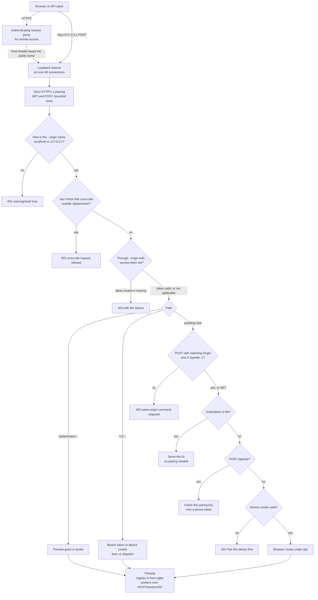
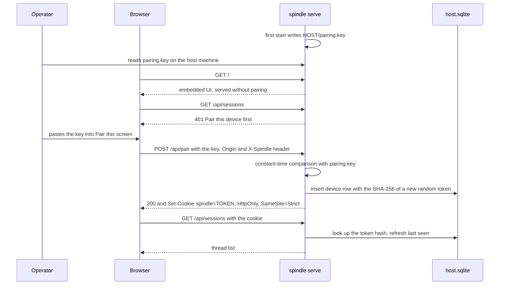
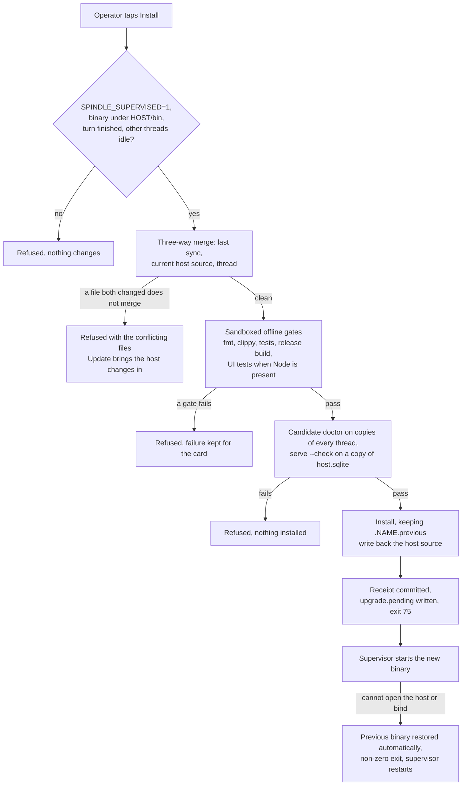

# The browser host: `spindle serve`

`spindle serve` runs many Spindle sessions ("threads") from one private host directory
and serves a phone-friendly browser UI and an HTTP API for them. It listens on
`127.0.0.1` only. A browser gets in by pairing once with a key that the host keeps on
disk, which is exchanged for a revocable per-device token in an HTTP-only cookie; remote
access goes through an authenticating HTTPS reverse proxy, optionally with Cloudflare
Access tokens verified by the host itself. Workspace HTML renders as sandboxed previews
authorized by short-lived tokens. With `--dev-source`, a thread can change Spindle's own
source, and the operator can install the result as a new host binary after the host
merges, gates, builds and verifies it. The implementation is the
[`serve`](../spindle/store/src/serve/) module of `spindle-store`, the embedded UI in
[`spindle/store/ui/`](../spindle/store/ui/), and [`upgrade.rs`](../spindle/store/src/upgrade.rs).
The `/v1` HTTP API that the host also serves is specified in [API.md](API.md); command-line
flags are in [cli.md](cli.md#serve).

- [Running the host](#running-the-host)
- [Request path](#request-path)
- [Listener and HTTP handling](#listener-and-http-handling)
- [Request checks](#request-checks)
- [Pairing and device tokens](#pairing-and-device-tokens)
- [Remote access through a reverse proxy](#remote-access-through-a-reverse-proxy)
- [Threads, commands and event streams](#threads-commands-and-event-streams)
- [The browser UI](#the-browser-ui)
- [Previews](#previews)
- [Host skin](#host-skin)
- [Shelf and operator attention](#shelf-and-operator-attention)
- [Self-edit and candidate promotion](#self-edit-and-candidate-promotion)
- [Operations](#operations)
- [Host directory layout](#host-directory-layout)
- [Browser routes](#browser-routes)
- [Source map](#source-map)

## Running the host

```sh
# HOST is a private directory, separate from source checkouts and single sessions.
spindle --dir HOST serve --port 8790
```

On start the host prints `Spindle listening on http://127.0.0.1:PORT; pairing key in
HOST/pairing.key`. The host requires a Unix system.

| Option | Default | Meaning |
| --- | --- | --- |
| `--port N` | `8790` | Loopback port. |
| `--origin https://NAME` | none | Public HTTPS origin of the reverse proxy ([remote access](#remote-access-through-a-reverse-proxy)). |
| `--access-team TEAM.cloudflareaccess.com` | none | Cloudflare Access team whose tokens are required on requests through `--origin`. Needs `--origin` and `--access-aud`. |
| `--access-aud AUD` | none | The Access application's AUD tag, 64 hex characters. |
| `--dev-source DIR` | none | Spindle's source for [self-edit](#self-edit-and-candidate-promotion). |
| `--resume known\|none` | `none` | After a restart, continue interrupted threads that can be resumed without re-sending anything of unknown outcome. |

What the host does at start, in order (`run` and `Host::open` in
[`mod.rs`](../spindle/store/src/serve/mod.rs)):

1. Creates `HOST` and `HOST/sessions` with mode 700, or refuses an existing one that is a
   symlink or grants group or other permissions.
2. Takes an exclusive lock on `HOST/serve.lock`; a second `serve` on the same directory
   fails with `another spindle serve owns this directory`.
3. Reads `HOST/pairing.key`, or writes a new random one (64 hex characters, mode 0600)
   if it is absent. A key that is not 64 hex characters stops the start.
4. Opens `HOST/host.sqlite` (mode 0600, WAL, full synchronous writes) and marks every
   command that was still running as interrupted: *Host restarted. Outcome may be
   committed; inspect the session. This command will not be re-dispatched.*
5. Prunes old command receipts, restores a registered thread whose directory was left
   in `HOST/trash`, migrates any thread store that an older schema wrote (the
   pre-migration copy is kept as `store/authority.vNN.sqlite`), and removes
   unregistered leftovers from the trash in the background. Schema 20 packs workspace
   objects; older stores, including schema 19, migrate in place.
6. With `--access-team`, loads the team's signing keys; then binds the listener.

## Request path



## Listener and HTTP handling

The listener binds `127.0.0.1:PORT` and nothing else. Each connection runs on its own
thread and carries one request (`Connection: close`). A panic while handling a request
is caught, so it never takes the host down.

| Limit | Value | Source |
| --- | --- | --- |
| Concurrent connections | 48; the next gets `429 {"error":"connection limit","code":"rate_limited"}` | `run` in [`mod.rs`](../spindle/store/src/serve/mod.rs) |
| Request line | `GET` or `POST`, `HTTP/1.1`, absolute path | [`http.rs`](../spindle/store/src/serve/http.rs) |
| Request head | 16 KiB; a `Host` header is required; duplicate headers, duplicate query keys, `Transfer-Encoding` and `Expect` are refused | `http.rs` |
| Request body | 64 KiB; 8 MiB for attachment uploads and `/v1` app data; 64 MiB plus 64 KiB for `/v1/run`; none on `GET` | `http.rs` |
| Timeouts | 10 s overall for the request head; after authorization, 10 s overall for the body, or 2 minutes for uploads and `/v1/run`; each read and write at most 10 s | `http.rs` |

A request body is read only after the request has been authorized, so an unpaired
client cannot make the host buffer an 8 MiB upload.

Every response carries `Cache-Control: no-store`, `X-Content-Type-Options: nosniff`,
`Referrer-Policy: no-referrer`, a `Cross-Origin-Resource-Policy` and a
`Content-Security-Policy`. The UI's own policy allows only its own scripts, styles,
images, connections, manifest and worker, frames only from itself, and no framing of
the UI by anyone (`frame-ancestors 'none'`).

## Request checks

Every request passes these checks in order (`route` in [`mod.rs`](../spindle/store/src/serve/mod.rs)):

1. **Host.** The request is *public* when its `Host` header equals `--origin` without
   its `https://` prefix, and *local* when the `Host` name is `localhost` or `127.0.0.1` (any
   port). Anything else gets `403 unrecognized host`. The expected origin is
   `--origin` for public requests and `http://` plus the `Host` header for local ones.
2. **Cross-site fetches.** A request with `Sec-Fetch-Site: cross-site` is refused,
   except on preview paths, whose sandboxed documents browsers report as cross-site.
3. **Cloudflare Access.** For a public request, when `--access-team` is set, the Access
   token is verified ([below](#cloudflare-access-verification)). Local requests are not
   checked against Access.
4. **Previews** (`/api/preview/...`) are handled next, authorized only by the token in
   the path; the containment check is token-free ([Previews](#previews)).
5. **`/v1`** requests go to the HTTP API, which accepts `Authorization: Bearer TOKEN` (a
   device token or a named API token) or the device cookie. With the cookie, a `POST`
   needs the same Origin and `X-Spindle: 1` header as `/api`. The pairing key is never
   accepted as a bearer token or as a `/v1` cookie. A token minted with
   `spindle --dir HOST token new NAME --runner` reaches only `GET /v1`,
   `/v1/runner`, `/v1/run` and a named run's status and stop; everything else is
   `403 forbidden`, including `/api` with that token as a cookie. `token list`
   marks it `(runner)`. See [API.md](API.md).
6. **Same-origin commands.** Every other `POST` must carry `Origin` equal to the expected
   origin and the custom header `X-Spindle: 1`.
7. **Embedded UI files** are served without pairing.
8. **Pairing.** Apart from previews, `POST /api/pair` is the only `/api` route that
   needs no device.
9. **Device.** Every other route needs a valid device cookie, or gets
   `401 Pair this device first`.

## Pairing and device tokens

The pairing key is never a session credential. Pairing exchanges it for a random
per-device token; the cookie carries only that token; `host.sqlite` keeps only the
token's SHA-256 with a label and created, last-seen and issued times
([`auth.rs`](../spindle/store/src/serve/auth.rs)).



| Property | Value |
| --- | --- |
| Pairing key | 256 random bits as 64 hex characters in `HOST/pairing.key` (mode 0600). Compared in constant time. Deleting the file makes the next start generate a new key; screens already paired keep their tokens. |
| Device token | 256 random bits per device; only its SHA-256 is stored. |
| Cookie | `spindle=TOKEN; HttpOnly; SameSite=Strict; Path=/; Max-Age=2592000` (30 days), plus `Secure` when the request came through `--origin`. |
| Renewal | While a device is in use, its cookie is sent again once a day, so it does not lapse. Last-seen is written at most once a minute. |
| Label | Derived from the User-Agent, such as `iPhone · Safari`. |
| Capacity | 32 paired browsers; pairing another removes the least recently seen. Named API tokens are never removed this way. |
| Revocation | Settings > Screens lists every device and API token with Revoke. Forget pairing on this screen (`POST /api/unpair`) revokes the current device on the host and clears the cookie. An open event stream of a revoked device ends at its next heartbeat (within 10 seconds). |
| Older cookies | A cookie that holds the pairing key itself (from before device tokens) is accepted on `/api` only to mint that screen's own device token, labelled `(migrated)`, which the reply sets in its place. |

Named API tokens for non-browser clients are device rows whose id starts with `api:`;
they are created with `spindle --dir HOST token new NAME` ([cli.md](cli.md#token)).

## Remote access through a reverse proxy

The listener never leaves loopback. Remote access needs a reverse proxy that terminates
HTTPS, authenticates the user, and forwards to `127.0.0.1:PORT`, with `--origin` set to
the proxy's public origin. The host recognizes public requests by the `Host` header, so
the proxy must forward the public host name unchanged: a request that arrives with
`Host: localhost` or `127.0.0.1` is treated as local and is not checked against Access.
Through `--origin`, the cookie is marked `Secure` and commands must come from that
origin. Device pairing still applies to every request either way.

### Cloudflare Access verification

With `--access-team` and `--access-aud`, every public request must carry a Cloudflare
Access token, either the `Cf-Access-Jwt-Assertion` header or the `CF_Authorization`
cookie ([`access.rs`](../spindle/store/src/serve/access.rs)). It is a second lock beside
pairing: a stolen device cookie alone does not get through the proxy, and if the Access
application is removed or the hostname is routed to the host without it, nothing is
served.

| Check | Rule |
| --- | --- |
| Format | A JWT of at most 8192 bytes, `alg` `RS256`, with a `kid`. |
| Signature | By a key the team currently lists. |
| Issuer | `iss` is `https://TEAM`. |
| Audience | `aud` (string or list) contains the AUD tag. |
| Time | Not expired and not issued in the future, with 300 seconds of clock leeway. |

The team's keys come from `https://TEAM/cdn-cgi/access/certs`, are kept in
`HOST/access-keys.json` so that a restart does not depend on reaching Cloudflare, and are
refreshed hourly and whenever a token names an unknown key (at most once a minute).
A successful refresh replaces the set immediately, so a key the team dropped is
refused on that lookup too; a failed refresh retains the known keys. If
no keys can be loaded at start, the host still starts and logs it; public requests are
refused until keys are available. A refused request is logged to standard error with
its method, path (preview tokens redacted) and reason. When the Access sign-in expires,
the UI shows a banner offering to sign in again.

## Threads, commands and event streams

The registry in `host.sqlite` names each thread; its session directory is
`HOST/sessions/ID`, an ordinary Spindle session ([store.md](store.md)). Threads the host
creates always use isolation `required`: their commands never run outside the sandbox.
Thread ids are 1–80 letters, digits, `-` or `_`.

Work enters as commands (`POST /api/commands`, or `/v1/commands` per [API.md](API.md)).
Each carries a client-chosen `request_id`. The host stores the command, its payload
digest and its submission before starting it, and answers with a receipt (`202`).
Sending the same `request_id` again returns that receipt instead of running anything
again; reusing it with a different payload is refused. A refusal below status 500 means
nothing was admitted; 500 means the outcome is unknown and the receipt should be read
(`GET /api/receipts/ID`). The UI keeps an unconfirmed submission in the browser and
checks its receipt before accepting more work.

| Limit | Value |
| --- | --- |
| Threads per host | 64 |
| Threads running at once | 4; a fifth run is refused with `four sessions are already running` |
| Prompt and steering message size | 1–16384 bytes |
| Messages waiting for a running turn | 32 |
| Attachment upload | 8 MiB each, 32 per message, at most 64 MiB of a thread's uploads from the last day waiting to be attached (`HOST/sessions/ID/uploads`, removed after a day) |
| Receipts | kept a week (a deleted thread's for an hour), at most 8192 |

Command kinds on `/api` are those of `/v1` plus the self-edit kinds `promote`,
`rollback`, `update` and `dismiss_install`. A command that acts on a thread's head must
name the `expected_revision` it was composed against. A settings change sent while a
turn runs is queued for the turn's end. Deleting a thread stops its background jobs and
tasks, moves its directory to `HOST/trash`, removes the registry row, and removes the
files in the background.

**Event streams.** `GET /api/sessions/ID/events` is a server-sent event stream. It starts
with a `snapshot` event of the thread (or a `failure` event that ends the stream when the
thread cannot be read), then sends `preview` events from a bounded ring
(1024 events or 512 KiB) as the run produces them, `job` events when a background job
starts or ends, and a heartbeat comment every 10 seconds. Event ids are `BOOT:SEQ`, where
`BOOT` changes on every host start; a client that reconnects with `Last-Event-ID` (or
`?after=`) from the same boot gets only what it missed, and otherwise a fresh snapshot.
A client that connects during a run receives the run's retained events again. A stream
lasts at most 300 seconds and ends when the thread is deleted; clients reconnect.
Command output chunks travel base64-encoded.

**Resuming after a restart.** Commands that were running when the host stopped are
marked interrupted and are never re-dispatched. With `--resume known`, the host
inspects the recovery report of each such thread and submits a `continue` for those
whose remaining work is ready and has no unknown outcome; when four threads are already
running it waits up to 30 minutes for room. Every other thread waits for a person.

Like every native entry point, the host refuses an embedded-owned or moved store
and writes no metadata into it, including while the package closes SQLite to
replace a compacted store. The fence is checked by
[`meta.rs`](../spindle/store/src/meta.rs).

The host reuses a session's last isolated command workspace where content ids and
file stamps still match, rather than writing every input again; links, changed
files and leftovers are reconciled against the committed tree first. This is only
a process-local optimization, not another authority. See
[`strict.rs`](../dext-engine/native/src/strict.rs) and
[`agent.rs`](../spindle/store/src/agent.rs).

Remote commands (`/v1/run`) may carry a client-chosen `run` id. `GET /v1/run/ID`
reports it and `POST /v1/run/ID/stop` stops it, scoped to the starting token;
[API.md](API.md#routes) gives the retention, bounds and early-stop behavior.
Native stdio `capabilities` reports what this host can run; embedded `fit` describes
settings changes for a moved session, without applying them. Neither is a new
HTTP route. Session JSON includes stable `activity` codes (`model`, `tools`,
`waiting_app`, `stopping`, `running`, `blocked`, `resumable`, `idle`) rather than
requiring clients to parse a status sentence; see [API.md](API.md#status-object).

## The browser UI

The UI is plain HTML, CSS and ES modules in
[`spindle/store/ui/`](../spindle/store/ui/), compiled into the binary with
`include_bytes!` and `include_str!`; there is no frontend build step or package manager. `/style.css` is
served wrapped in a CSS `base` layer so a [skin](#host-skin) layer can sit over it.

| File | Role |
| --- | --- |
| [`index.html`](../spindle/store/ui/index.html) | The page and all dialogs. |
| [`app.js`](../spindle/store/ui/app.js) | Application logic: thread list, thread view, event stream, commands, dialogs. |
| [`commands.js`](../spindle/store/ui/commands.js) | Typed commands recognized in the composer. |
| [`terminal.js`](../spindle/store/ui/terminal.js) | Bounded ANSI renderer for live command output. |
| [`text.js`](../spindle/store/ui/text.js) | Search, line diff, Markdown export and labels. |
| [`theme.js`](../spindle/store/ui/theme.js) | Paper, Light, Dark or System theme (System is Light or Dark as the device is) and textured or plain background, remembered per screen. |
| [`sw.js`](../spindle/store/ui/sw.js) | Service worker that only shows run notifications; no fetch handler, nothing cached, no push server. |
| [`manifest.webmanifest`](../spindle/store/ui/manifest.webmanifest), [`icon.svg`](../spindle/store/ui/icon.svg) | Home-screen installation. |

Screens and features:

| Area | What it offers |
| --- | --- |
| Thread list | Running, Needs you, Today and Earlier groups, state shapes as well as colours, activity, spend and search; a composer starts a thread. Delete hides it immediately with Undo before the delete is sent. Refreshed every 20 seconds while visible. |
| Thread view | A header with back, name, model and spend, and a budget hairline. Consecutive tool calls fold into a “Ran N steps” row with failures counted; steering is a right-hand bubble, checked when read, with long text folded until tapped. Streamed text and command output remain uncommitted previews. |
| Dock | One composer box: revision, activity, model button and the action that applies now above the message. With a turn running and no text written, Stop takes Send's place. Continue, Retry, Recover and Sign in appear when needed. |
| Model picker | Provider and model search, effort with the model's own default outlined and named when none is chosen, Network and Rust toolchain switches labelled On or Off, and for a new thread its name, compaction mode and budget. |
| Thread menu | Rename, spend and budget, compaction, the Spindle change card, Files, History, Find, Note for next turn, Download workspace (`.tar`), Export transcript (`.md`), Delete. |
| Files and viewer | A workspace tree whose folders stay shut until tapped, changes marked on files and their folders, per-file diffs, Markdown, images, sandboxed HTML, Open in a tab, Run scripts where needed, GitHub access, and Shelf. |
| History | Every committed step, with Rewind here and Return to live. |
| Settings (gear) | Appearance and host skin, Sign-ins (Dext's flows; credentials go to the host's credential store, never to the browser), Screens, Notifications, Shelf, Code tools (a read-only summary of the code policy), Usage, and Spindle: version, build, schema, engine, uptime, disk use, Roll back binary, Restart host. |

Settings, Files and History open as full pages on a phone, with a way back rather
than a small floating sheet. Light is neutral rather than tinted; Paper, Dark and
System remain available. The page's `theme-color` follows the header background.
The layout and interactions are in [`app.js`](../spindle/store/ui/app.js),
[`style.css`](../spindle/store/ui/style.css) and
[`theme.js`](../spindle/store/ui/theme.js).

Typed commands in the composer ([`commands.js`](../spindle/store/ui/commands.js)) run UI
actions instead of messaging the model when they match exactly: for example `stop`,
`continue`, `retry`, `files`, `history`, `/find TEXT`, `rewind to r12`,
`rename to NAME`, `network on`, `toolchain off`, `budget $5`, `use MODEL high`,
`/install` and `/update`. Anything else is an ordinary message.

## Previews

Workspace HTML renders as a site through `GET /api/preview/TOKEN/PATH`, so a page's
relative stylesheets, scripts, images, fonts and fetches of sibling files come from the
same thread revision ([`preview.rs`](../spindle/store/src/serve/preview.rs)). A preview
document must never act with the host's authority.

**Grants.** A paired device mints a token with a same-origin
`POST /api/sessions/ID/preview` naming a revision (or through `/v1`). A token is 256
random bits, bound to one thread and revision, read-only, valid for 30 minutes, kept
only as its SHA-256 in host memory, and at most 32 are outstanding (minting another
retires the oldest). A restart or the thread's deletion revokes them all. A preview
request reads no cookie: the token is its whole authority, and an unknown, expired or
forged token reads nothing.

**Scripts and containment.** A grant's `scripts` is false (the default), true for
all pages, or one page's workspace path. Without permission a page loses its
scripts and storage shim, shows its `<noscript>` fallback, and has `sandbox` and
`script-src 'none'`. A page named by a grant cannot grant scripts to another page
it links to or frames.

CSP cannot prevent every outgoing connection a script can cause, notably WebRTC
and name lookups for navigation. Every preview response therefore also carries
`Connection-Allowlist: ("ORIGIN/api/preview/TOKEN/*")`, adding GitHub's API and
avatar origins for a GitHub grant; without a live token it is `()`. In a browser
that enforces it (Chrome 152 and later), no other connection is made for the page,
its frames or its workers. The UI checks `GET /api/preview/check`, a token-free
page that posts `{spindleContained: true}` to its parent when protected and false
otherwise.
It requests `{scripts: true, contained: true}` only when that succeeds. Each HTML
page of a contained grant checks again before its content runs; on a browser
without protection it treats the remaining page as text and says why.

Otherwise the viewer offers **Run scripts**. That mints a grant for this page and
remembers the choice on this device for its version: the page, the scripts it
loads and the files it or they name. A change asks again; inline cards follow the
choice. Explicitly running scripts without containment can disclose page data
outside the browser despite CSP. Features `preview_scripts` and
`preview_contained` advertise these behaviors in `/v1`.

**Isolation.** A response allowed to run scripts carries this policy, where `OWN` is
`ORIGIN/api/preview/TOKEN/` and `ORIGIN` the host page's origin:

```text
sandbox allow-scripts allow-forms allow-modals; default-src 'none';
script-src OWN 'unsafe-inline'; style-src OWN 'unsafe-inline';
img-src OWN data: blob:; font-src OWN data:; media-src OWN data: blob:;
connect-src OWN; frame-src OWN; child-src OWN; worker-src 'none';
manifest-src 'none'; object-src 'none'; base-uri 'none'; form-action 'none';
frame-ancestors ORIGIN
```

The sandbox never includes `allow-same-origin`, so the page runs in an opaque origin
without the host's cookies, storage, service worker or API, and cannot navigate or frame
the host. CSP restricts loads to the token's own prefix (root-relative URLs leave it
and do not load), and forms submit nowhere. Before serving HTML the host removes
meta refreshes, DNS-prefetch switches and resource hints (`preconnect`,
`dns-prefetch`, `prefetch`, `prerender`, `preload`, `modulepreload`); every response
also has `X-DNS-Prefetch-Control: off`. The UI's preview frame is itself sandboxed
the same way with `referrerpolicy="no-referrer"`. Responses allow any origin to read
them (`Access-Control-Allow-Origin: *`) because a sandboxed document's module scripts,
fonts and fetches are CORS requests from the `null` origin. Paths are checked like every
workspace path, a directory serves its `index.html` (with a redirect to add the trailing
slash), only `GET` is allowed, and content types follow the file extension with unknown
types served as `application/octet-stream`.

**GitHub grant.** A preview minted with `network: "github"` (the viewer's GitHub access,
after a confirmation) additionally allows connections to GitHub's API origin and images
from GitHub's avatar origin, for that token only. This can disclose page data to GitHub.
No host path is ever granted. A GitHub grant permits scripts too: on the page named
by `scripts`, or every page when none is named (even with `scripts: false`).

**Whole pages.** An HTML page is served with its own stylesheets, classic scripts and
images from the same revision inlined (at most 16 MiB in total and 4 MiB per file), so it
renders even when a proxy withholds cookies from the sandboxed page's subrequests.
Stylesheet URLs are rewritten to the token's prefix. A shim placed first in a
page allowed to run scripts gives it in-memory `localStorage`, `sessionStorage`
and `document.cookie`, which an opaque origin cannot use, so apps that save state
still start. What cannot be inlined
(modules, absolute or missing URLs, files over the caps) is left for the browser to load
under the policy above. Behind Cloudflare Access, preview requests still pass the Access
check; a sandboxed page's own subrequests reach the host only if the browser sends the
`CF_Authorization` cookie from an opaque origin, which it does when that cookie is
`SameSite=None`.

**Single files.** `GET /api/sessions/ID/file?revision=N&path=P` serves raster images by
type and every other file, SVG and HTML included, as `text/plain`. With `&render=1`,
HTML is scrubbed and served without scripts or network under the single-file
sandbox; other types, including SVG, are served as their own type rather than HTML.

## Host skin

An operator can layer CSS over the embedded UI from Settings > Appearance > Host skin
([`skin.rs`](../spindle/store/src/serve/skin.rs)). The CSS is staged, previewed
(`/?preview`), applied by its digest, and kept as one of the last 12 versions, which can
be restored; Turn off clears it. A thread can propose one as `.spindle/skin.css` in its
workspace (Stage from thread).

The sanitizer allows only listed properties, so a skin changes paint and modest sizes
but cannot move, hide, overlay or stack controls: no positioning, z-index, opacity,
transforms, display or visibility changes, pointer events, clipping, masks, filters or
generated content; bounded lengths, font sizes, line heights and shadows; no fetching
functions such as `url()` or `image-set()`, no `attr()`, no `!important`, and only
`@media`, `@supports` and `@container` at-rules. A skin is at most 32 KiB. It is served
as `@layer skin { @scope (body) to (dialog, #toast) { ... } }`, so dialogs and the alert
toast keep the built-in look. `/?safe` serves the page without any skin.

## Shelf and operator attention

**Shelf.** `HOST/shelf` holds up to 64 operator notes of at most 256 KiB, named with 1–64
letters, digits, spaces, dots, dashes or underscores (not starting with a dot). Notes are
written in Settings > Shelf, or copied from a thread's head workspace with the viewer's
Shelf button. When the shelf is not empty, it is mounted read-only at `/shelf` in the
commands of threads that have the toolchain, and the model is told to read it and never
change it.

**Attention** ([`attention.rs`](../spindle/store/src/serve/attention.rs)). The UI posts
which files and cards the operator opens and closes in a thread, and notes written with
Note for next turn (at most 4, 512 characters each). When the next `new` or `say`
command starts, the host appends one paragraph to the prompt itself, visible in the
thread: the notes, files held open for at least 5 seconds, and what is open now, as
context, not a command. It is kept only in memory and only once.

## Self-edit and candidate promotion

With `--dev-source DIR`, threads can change Spindle itself
([`selfedit.rs`](../spindle/store/src/serve/selfedit.rs),
[`sync.rs`](../spindle/store/src/serve/sync.rs)). `DIR` is the host's Spindle source: the
`spindle/` workspace of a checkout, with `dext-engine/` as its sibling.

1. **Checkout.** The model's `spindle_source` tool with action `checkout` copies the host
   source, without `.git`, `target` and `node_modules`, into `spindle/` in the thread's
   workspace. The copy is recorded as a *sync* (`host-sync/ROOT` beside the thread's
   store), and the thread's later commands get the Rust toolchain and the `dext-engine`
   sources mounted read-only. The model builds and tests inside `spindle/`.
2. **Install request.** The model's `spindle_install` tool records the request with a
   summary (`install-request.json` beside the store); nothing is installed. The UI shows
   a Spindle change card with the changed files and Install, Update and Dismiss.
3. **Update from host source** (`update` command, or the tool's `update` action) merges
   the current host source into the thread three-way, against its last sync, and records
   the new sync durably before the merged workspace is committed. The command starts a
   turn that is told what changed and which conflicts to resolve; the tool action tells
   the running turn the same in its result. Nothing is built or installed.
4. **Install** (`promote` command, after the operator confirms) composes, gates, builds,
   verifies and installs, as below.



Promotion in detail (`Host::upgrade` in [`mod.rs`](../spindle/store/src/serve/mod.rs)):

- **Preconditions.** `SPINDLE_SUPERVISED=1`, the running binary inside `HOST/bin/`, the
  thread holding Spindle's source at its head with its last turn finished, the
  `expected_revision` equal to the head, and every other thread idle.
- **Composition.** Per file, against the source the thread last synced with: a file only
  the thread changed takes the thread's version, a file only the host changed keeps the
  host's, and text both changed goes through `git merge-file`. Any conflict, binary
  conflict, or change against a deletion refuses the whole promotion and lists the files;
  a stale thread can never silently revert host changes. Git metadata is always the
  host's. Build output (`target`, `node_modules`) is never promoted, and in a legacy
  whole-workspace self-edit thread only paths under the source's own top-level names are.
- **Gates.** The composed tree is written under `HOST/promotions/REQUEST/` and each gate
  runs in the bubblewrap sandbox without network, with the host's Rust toolchain, a build
  cache shared by all promotions (`HOST/promotions/cache`) and 10 minutes per gate:
  `cargo fmt --all -- --check`, `cargo clippy --workspace --all-targets --all-features
  --locked -- -D warnings`, `cargo test --release --locked --workspace --all-features
  --lib --bins`, `cargo build --release --locked -p spindle-store --features cli --bin
  spindle`, and, when the host has Node, the UI tests `store/tests/ui.mjs` and
  `store/tests/ui_app.mjs`. Output streams to the thread; a failure keeps the command
  and the end of its output on the change card so the model can be asked to fix it.
- **Verification.** The candidate runs `doctor` on copies of every thread's store, as
  `spindle upgrade` does ([cli.md](cli.md#upgrade)), then `serve --check` against a
  private copy of `host.sqlite` (made with `VACUUM INTO`) and the pairing key, which must
  open it and bind a loopback port within 60 seconds.
- **Install.** Stop is honoured between phases and always before installation; once the
  binary is installed, Stop is refused. The install keeps the replaced binary as
  `.NAME.previous` beside it. The host source is then updated with the composed tree,
  unless the operator changed it during the promotion (reported as a warning), and the
  sync is recorded so the next promotion merges from here.
- **Restart.** The receipt is committed, `HOST/upgrade.pending` records the new binary's
  fingerprint, and the host exits with status 75.

The promotion's first notice in the thread states that installation authorizes the
candidate as trusted host code. Gates and verification show that it builds, passes its
tests and can open existing state, not that it is safe; review the change before
installing it.

## Operations

**Supervision.** Restart, promotion and rollback from the browser require
`SPINDLE_SUPERVISED=1` in the host's environment and an OS supervisor that starts
`spindle --dir HOST serve ...` again whenever it exits. The host exits with status 75
when it wants to be restarted. Promotion and browser rollback also require the running
binary to live in `HOST/bin/`. With the binary at `HOST/bin/spindle`, the default
code-mode policy path resolves to `HOST/code-policy.json` ([cli.md](cli.md#global-option-and-environment)).

| Action | How | Conditions | Effect |
| --- | --- | --- | --- |
| Restart | Settings > Spindle > Restart host (`POST /api/restart`) | Supervised, no thread running, no upgrade in progress | Replies `202`, exits with status 75 half a second later. Screens reconnect by themselves. |
| Roll back | Settings > Spindle > Roll back binary (`rollback` command, not tied to a thread) | Supervised, binary in `HOST/bin/`, every thread idle | Verifies the kept previous binary like a candidate, swaps it with the current one (refused if it reads an older schema), then restarts. Thread data is not rewound. |
| Install a change | Spindle change card > Install (`promote`) | See [promotion](#self-edit-and-candidate-promotion) | Installs the gated candidate and restarts. |
| Upgrade from the shell | `spindle upgrade --from SRC --to HOST/bin/spindle --session HOST/sessions/ID ...` | | Verifies and installs a candidate ([cli.md](cli.md#upgrade)); restart the host to run it. |
| Roll back from the shell | `spindle rollback --to HOST/bin/spindle [--force]` | | Swaps the binaries ([cli.md](cli.md#rollback)). |

**Automatic rollback.** After a promotion or browser rollback installs a binary,
`HOST/upgrade.pending` holds that binary's fingerprint. If the next start cannot open the
host directory or bind the port (for any reason other than another `serve` holding the
directory) and the running binary is the one recorded, it restores the kept previous
binary (with the same schema check as `spindle rollback`), says so in its error, and
exits non-zero so the supervisor starts the restored binary. The first such failed start
consumes the marker, and a successful start removes it.

**While an upgrade or restart is pending,** new commands are refused with
`an upgrade or restart is in progress`; Stop is still accepted until the binary is
installed.

**Disk.** Settings > Spindle shows the space used by `sessions` and `trash` and the free
space of the file system (cached for 30 seconds). Removing trees opens up directories
that a sandbox left without owner permissions; whatever cannot be removed is logged and
left for the operator ([`disk.rs`](../spindle/store/src/serve/disk.rs)).

**Logs.** The startup line and successful store migrations go to standard output;
failed accepts, Access refusals, resume decisions, failed migrations and cleanup
failures go to standard error.

## Host directory layout

| Path in `HOST` | Contents |
| --- | --- |
| `pairing.key` | The pairing key, 64 hex characters, mode 0600. |
| `serve.lock` | Locked by the running `serve`; one host per directory. |
| `host.sqlite` (with `-wal`, `-shm`) | Mode 0600. Tables `sessions` (thread id, name, legacy self-edit flag), `commands` (request id, thread, payload digest, state, error), `submissions` (payloads), `command_times`, and `devices` (device and API-token hashes, labels, times). |
| `sessions/ID/` | One session directory per thread: `store/` and settings ([store.md](store.md)), plus `uploads/`, `install-request.json` and `host-sync/` when used. |
| `trash/ID/` | A deleted thread's directory until it is removed. |
| `skin/` | `active.css`, `staged.css` and `versions/`. |
| `shelf/` | Operator notes. |
| `access-keys.json` | Cached Cloudflare Access signing keys. |
| `promotions/` | Per-request export trees, scratch for updates and candidate checks, and `cache/`, the shared build cache whose `target/release/spindle` is the candidate. |
| `bin/` | Where the supervised binary must live for promotion and browser rollback; after an install the replaced binary is kept beside it (`.spindle.previous` for `bin/spindle`). |
| `upgrade.pending` | Fingerprint of a just-installed binary until a start succeeds. |
| `code-policy.json` | The code-mode policy, when the binary is `HOST/bin/spindle` and `SPINDLE_CODE_POLICY` is unset. |

## Browser routes

The UI's own routes; all `POST`s need the same-origin header, and all but the UI files,
`/api/pair` and previews need a paired device. The `/v1` API is documented in
[API.md](API.md).

| Method | Path | Purpose |
| --- | --- | --- |
| GET | `/`, `/style.css`, `/app.js`, `/commands.js`, `/terminal.js`, `/text.js`, `/theme.js`, `/sw.js`, `/icon.svg`, `/manifest.webmanifest` | Embedded UI. `/?safe` without skin, `/?preview` with the staged skin. |
| POST | `/api/pair` | Exchange the pairing key for a device cookie. |
| POST | `/api/unpair` | Revoke this device and clear its cookie. |
| GET, POST | `/api/devices` | List paired devices and API tokens; revoke one. |
| GET | `/api/sessions` | Threads with status and spend, ready providers, whether self-edit is configured, and the boot id. |
| GET | `/api/ping` | Boot id and binary fingerprint, to notice a restart or a new build. |
| GET | `/api/host` | Version, build, schema, engine, origin, Access team, thread counts, uptime, supervision, disk use and a code-policy summary. |
| GET | `/api/usage?tz=MINUTES` | Spend of every thread today, over 30 days and in total. |
| POST | `/api/restart` | Supervised restart. |
| GET | `/skin.css`, `/api/skin` | Skin stylesheet and state. |
| POST | `/api/skin` | `stage`, `apply`, `discard`, `restore`, `off`. |
| POST | `/api/commands` | Submit a command; returns its receipt. |
| GET | `/api/receipts/ID` | A command's receipt. |
| GET | `/api/models`, `/api/logins` | Model catalog and sign-in state. |
| POST | `/api/login`, `/api/logout` | Dext sign-in. A credential goes to Dext's credential store; it is never logged or recorded with commands. |
| GET | `/api/sessions/ID/snapshot`, `/files`, `/file`, `/archive`, `/events` | Thread state, a revision's files, one file, a ustar archive of a revision (`workspace/` plus `state.json`), the event stream. |
| POST | `/api/sessions/ID/steer` | A message for the running turn, or `now` to have waiting messages read at once. |
| POST | `/api/sessions/ID/upload` | One attachment (raw bytes), stored by digest. |
| POST | `/api/sessions/ID/preview` | Mint a revision grant with `network`, `scripts` and `contained` (see [Previews](#previews)). |
| POST | `/api/sessions/ID/pack-ui` | Answer a session pack's pending question. |
| POST | `/api/sessions/ID/attention` | Report what the operator opened or wrote. |
| POST | `/api/sessions/ID/shelf` | Copy a head file to the shelf. |
| GET | `/api/shelf`, `/api/shelf/file?name=NAME` | List the shelf notes; read one. |
| POST | `/api/shelf` | Write a note, or delete one (`action: "delete"`). |
| GET | `/api/preview/check` | Token-free containment check; posts `{spindleContained: boolean}` to its parent. |
| GET | `/api/preview/TOKEN/PATH` | Token-authorized preview. |

## Source map

| File | Responsibility |
| --- | --- |
| [`serve/mod.rs`](../spindle/store/src/serve/mod.rs) | Startup, listener, routing, thread registry, command admission and workers, event streams, promotion, restart, archive. |
| [`serve/http.rs`](../spindle/store/src/serve/http.rs) | Bounded HTTP/1.1 parsing and response headers, including the UI and preview policies. |
| [`serve/auth.rs`](../spindle/store/src/serve/auth.rs) | Pairing, device tokens, cookies, revocation. |
| [`serve/access.rs`](../spindle/store/src/serve/access.rs) | Cloudflare Access JWT verification and key cache. |
| [`serve/v1.rs`](../spindle/store/src/serve/v1.rs) | The `/v1` HTTP API and `spindle token`. |
| [`serve/preview.rs`](../spindle/store/src/serve/preview.rs) | Preview grants, policy and page bundling. |
| [`serve/selfedit.rs`](../spindle/store/src/serve/selfedit.rs) | Checkout, install requests and the self-edit part of snapshots. |
| [`serve/sync.rs`](../spindle/store/src/serve/sync.rs) | Sync records and three-way merges with the host source. |
| [`serve/skin.rs`](../spindle/store/src/serve/skin.rs) | Skin sanitizer and versions. |
| [`serve/attention.rs`](../spindle/store/src/serve/attention.rs) | Operator attention for the next turn. |
| [`serve/pack_ui.rs`](../spindle/store/src/serve/pack_ui.rs) | Session-pack questions answered in the browser, one at a time. |
| [`serve/app_tool.rs`](../spindle/store/src/serve/app_tool.rs) | App tool calls answered over `/v1` ([API.md](API.md)). |
| [`serve/disk.rs`](../spindle/store/src/serve/disk.rs) | Tree removal and disk-use figures. |
| [`serve/tar.rs`](../spindle/store/src/serve/tar.rs) | ustar writer for workspace downloads. |
| [`upgrade.rs`](../spindle/store/src/upgrade.rs) | Candidate verification, install and rollback, shared with the CLI. |
