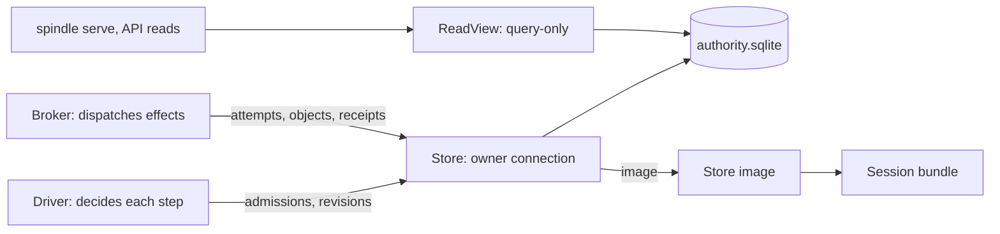
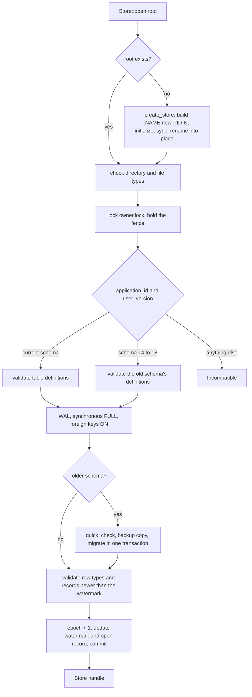
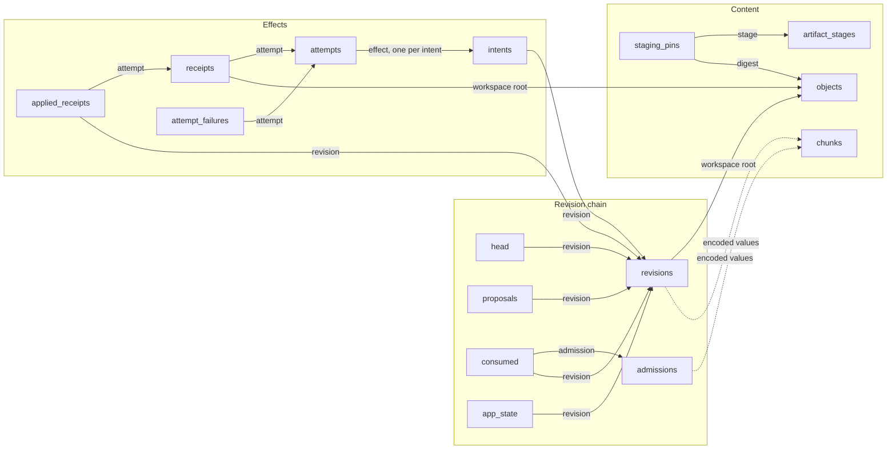
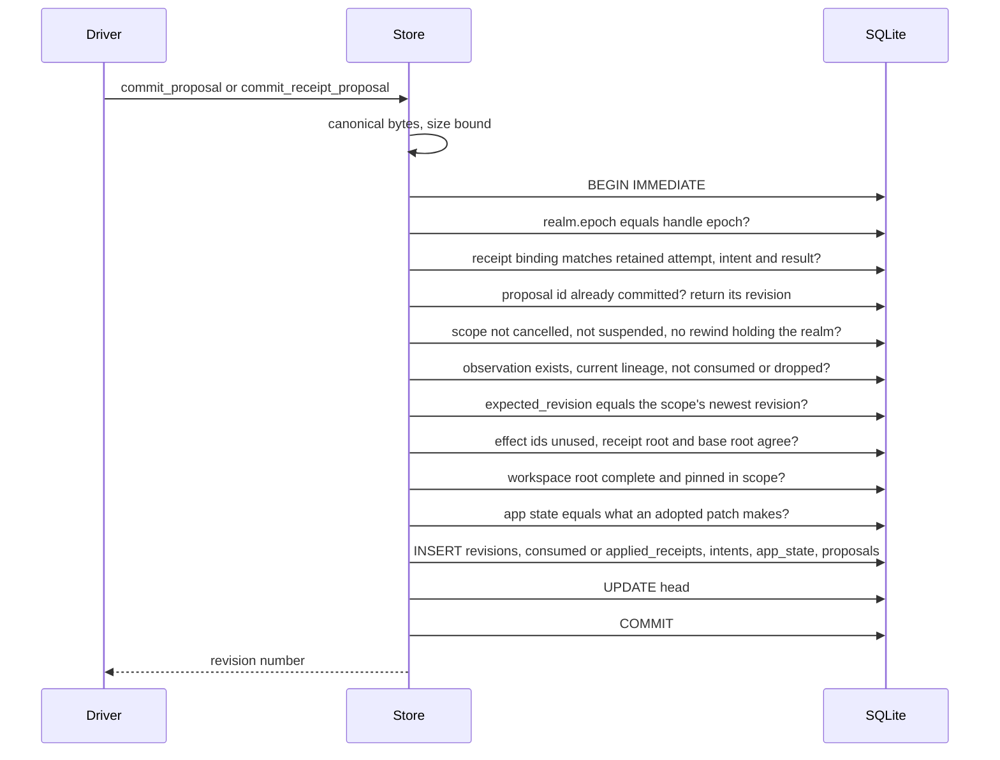
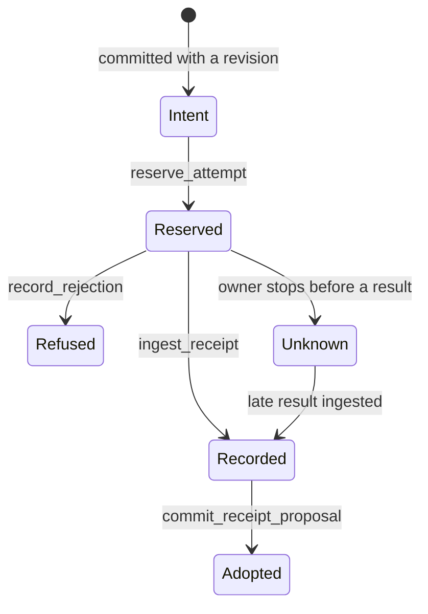
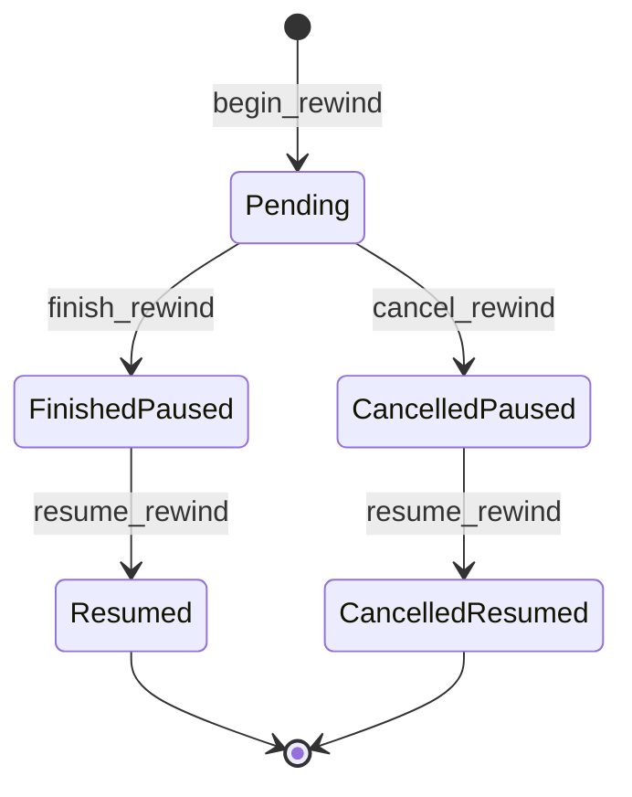

# The store

Every Spindle session keeps its durable state in one SQLite database, `store/authority.sqlite`,
owned by exactly one process at a time. The crate [`spindle-store`](../spindle/store/src/lib.rs)
defines it: an append-only chain of revisions, each committing a conversation continuation, a
workspace tree root and app state together; the admitted commands each revision consumed; the
effects a revision proposes (intents) with their reservations (attempts) and results (receipts);
and a content-addressed object store for workspace files. Large values are compressed
deterministically and deduplicated into shared chunks. Every write is one `IMMEDIATE`
transaction fenced by an owner epoch, every chunk and object read is checked against its
digest, and an open validates the records added since the last open before it accepts work.
This page describes what is on disk, the schema, how a revision commits, how content is
addressed and encoded, rewind, crash safety, store images and session bundles, and the
dependency-free reference model that states the lifecycle rules.

Related pages: [concepts.md](concepts.md) for the vocabulary, [driver.md](driver.md) for the
turn logic that decides what to commit, [cli.md](cli.md) for the commands that operate on a
store, [embedded.md](embedded.md) for stores in the browser and Node package, and
[testing.md](testing.md) for running the test suites.

## Contents

- [Overview](#overview)
- [On disk](#on-disk)
- [Opening a store](#opening-a-store)
- [Schema](#schema)
- [Revisions](#revisions)
- [Effects as stored](#effects-as-stored)
- [Content addressing and the codec](#content-addressing-and-the-codec)
- [Workspace trees and objects](#workspace-trees-and-objects)
- [Rewind](#rewind)
- [Scopes, cancellation and takeover](#scopes-cancellation-and-takeover)
- [Reading without owning](#reading-without-owning)
- [Crash safety](#crash-safety)
- [Schema migration and binary upgrade](#schema-migration-and-binary-upgrade)
- [Store images and session bundles](#store-images-and-session-bundles)
- [The reference model](#the-reference-model)
- [Limits](#limits)
- [Errors](#errors)

## Overview



- **[`Store`](../spindle/store/src/lib.rs)** is the owner handle. It holds the SQLite
  connection, the owner lock and the current owner epoch. All mutations go through it.
- **[`transition.rs`](../spindle/store/src/transition.rs)** commits revisions (proposals).
- **[`completion.rs`](../spindle/store/src/completion.rs)** records attempts, receipts,
  refusals and cancellations.
- **[`artifact.rs`](../spindle/store/src/artifact.rs)** and
  **[`workspace.rs`](../spindle/store/src/workspace.rs)** store objects and workspace trees.
- **[`codec.rs`](../spindle/store/src/codec.rs)** encodes large values.
- **[`rewind.rs`](../spindle/store/src/rewind.rs)** and
  **[`ownership.rs`](../spindle/store/src/ownership.rs)** handle rewinds and owned scopes.
- **[`meta.rs`](../spindle/store/src/meta.rs)** keeps session metadata outside the revision chain.
- **[`view.rs`](../spindle/store/src/view.rs)** and **[`reads.rs`](../spindle/store/src/reads.rs)**
  read committed state without taking ownership.
- **[`bundle.rs`](../spindle/store/src/bundle.rs)** moves sessions;
  **[`upgrade.rs`](../spindle/store/src/upgrade.rs)** replaces the binary.
- **[`durable.rs`](../spindle/store/src/durable.rs)** writes the files kept outside SQLite.

A Spindle session runs in a single scope, `operator` (`view::SCOPE`). The store itself
supports several scopes in one database, each with its own revision chain; owned task and
service scopes use that (see [Scopes](#scopes-cancellation-and-takeover)).

## On disk

### Session directory

The native host lays out a session directory as follows. Only `store/` is the store; the
other files belong to the host and are listed here because bundles and upgrades carry or
check them.

```text
<session>/
  session.json               mirror of the settings metadata
  pending-settings.json      mirror of a queued settings change
  output-limits.json         older file, read only to seed metadata
  usage.json  usage.lock     spend ledger and its cross-process lock
  cache/                     build cache and task-slot locks (never bundled)
  store/
    authority.sqlite         the store
    authority.sqlite-wal     SQLite write-ahead log (while open, or after a crash)
    authority.sqlite-shm     SQLite WAL index
    owner.lock               file the owner holds an exclusive lock on
    authority.sqlite.lock    the fence file (present while owned, or once sealed)
    authority.vN.sqlite      copy kept from before a schema migration from schema N
  store.abandoned-N/         a store set aside when a first request is retried fresh
  tasks/<key>/               a task session: the same layout plus task.json
```

| Path | Written by | Role |
| --- | --- | --- |
| `store/authority.sqlite` | `Store` | All durable session state. |
| `store/owner.lock` | `Store::open` | The native owner holds an OS file lock on it for the handle's lifetime. Readers probe it to tell whether an owner is alive. |
| `store/authority.sqlite.lock` | `Store::open`, the embedded package, `Store::seal_moved` | The fence. Its first line names the holder (see [Owner lock and fence](#owner-lock-and-fence)). |
| `store/authority.vN.sqlite` | schema migration | The store exactly as schema `N` left it, for a build that reads only that schema. `spindle doctor` lists it. |
| `session.json` | host settings code | A mirror of the store's `settings` metadata. The store's copy is authoritative; a bundle rewrites the mirror from it. |
| `pending-settings.json` | `settings` tool | A mirror of the `pending_settings` metadata, removed when nothing is queued. |
| `output-limits.json` | older builds | Read only to seed the `output_limits` metadata. |
| `usage.json`, `usage.lock` | spend accounting | The spend ledger. When the store holds `usage` metadata, readers use that. |
| `tasks/<key>/` | task tool | A task's own session directory. `<key>` is the first 10 bytes of the SHA-256 of the task key, as 20 lowercase hex digits ([`agent/tasks.rs`](../spindle/store/src/agent/tasks.rs)). It holds `task.json`, the task's identity record. |
| `store.abandoned-N/` | retry | When the very first request of a session must be retried, the whole store is renamed aside (its unknown request stays on record there) and a fresh store starts the same prompt. |

When the native host opens a session, `meta::seed` copies `session.json`,
`pending-settings.json`, `output-limits.json` and `usage.json` into the matching metadata keys
the store does not have yet, so sessions written before the store kept metadata keep their
settings and spend.

On Unix the store directory is created `0700`, and `owner.lock` and the fence `0600`;
`durable::write` creates the host's files `0600`. `Store::open` refuses a store
directory that is a symbolic link or (on Unix) grants any group or other permission bits, and any of
`owner.lock`, the fence, `authority.sqlite` or its `-wal`, `-shm` or `-journal` files that is
not a regular file, is a symbolic link, or (on Unix) has more than one hard link.

### Owner lock and fence

Exclusion has two parts, because the embedded package cannot see a native file lock:

1. **`owner.lock`**: the native owner takes an exclusive lock on it with
   `File::try_lock`, retrying ten times at 10 ms intervals (`take_owner_lock`) so a reader
   probing the lock for an instant does not refuse a real owner. A second owner gets
   `Error::Locked`.
2. **The fence, `authority.sqlite.lock`**: a native owner also creates this file
   (exclusively, `0600`, never following a link) with the note `spindle-native pid <pid>`,
   synced along with its directory. The embedded package creates it for its own owners with a
   note beginning `spindle-embed: `.

| Fence note begins with | Meaning | Native `Store::open` |
| --- | --- | --- |
| (no fence) | No owner. | Creates its own fence. |
| `spindle-native ` | A native owner. Since this opener already holds the flock, that owner is gone. | Takes it over: the new note is written over the old one, cut to length and synced. |
| `spindle-embed: ` | An embedded owner, which nothing can prove dead. | `Locked`. |
| `spindle-moved: ` | The session was exported and continues elsewhere. | `Locked`. |
| anything else, or empty | Unknown. | `Locked`. |

A fence is never truncated before it is rewritten, so a crash leaves the old note or the
start of the new one, never an empty file. When a native owner closes, its fence is removed
(and the directory synced) while it still holds the flock, then the flock is released
explicitly: closing alone would leave the lock held by a concurrent fork's copy of the
descriptor. Removing a stale `spindle-embed:` or `spindle-moved:` fence by hand is an
operator decision; after that the directory opens again.

Hosts that bring their own SQLite connection (the embedded package) pass an
`OwnerExclusion` guard to `Store::from_connection`. The guard asserts that no other
connection can use the database until it is dropped, and it is dropped only after SQLite
closes. See [embedded.md](embedded.md).

## Opening a store



[`Store::open`](../spindle/store/src/lib.rs) (native only; the wasm build returns
`Unsupported`) does the following:

1. **Creates the store if the directory is missing.** `create_store` builds a complete store
   in a staging directory `.NAME.new-PID-N` beside it (owner lock, database initialized in
   one transaction, closed so the WAL folds into the file, everything synced) and renames the
   directory into place, then syncs the parent. A crash leaves no store or a whole one.
   Staging directories left by a crash are removed by the next creation once their lock is
   free. Another process creating the same store first is not an error.
2. **Checks paths** as described in [Session directory](#session-directory), then takes the
   owner lock and holds the fence.
3. **Identifies the database.** `PRAGMA application_id` must be `0x53504e44` (ASCII `SPND`)
   and `PRAGMA user_version` the schema, `19` in this build. An empty database is refused
   unless this open just created it. Schemas 14 to 18 are migrated (see
   [Schema migration](#schema-migration-and-binary-upgrade)); any other value is
   `Incompatible`, and the file is left untouched.
4. **Validates the table definitions.** Every row of `sqlite_schema` must equal what this
   build creates, compared against a fresh in-memory reference (for an older schema, the
   reference without the tables later schemas added). At most 128 schema records of at most
   8 KiB each are read, so a hostile file cannot make the check allocate without bound.
   `trusted_schema` is off.
5. **Sets connection pragmas.** `journal_mode=WAL`, `synchronous=FULL`, `foreign_keys=ON`,
   a 250 ms busy timeout, and on macOS `fullfsync` and `checkpoint_fullfsync`. If SQLite does
   not confirm WAL, FULL and foreign keys, the open fails with `Unsupported`.
6. **Takes over** (`take_over`): checks the SQLite type and label syntax of each checked
   column in every row, checks that admissions have no gaps (count, maximum sequence and the
   `AUTOINCREMENT` watermark agree), and validates every record newer than the `validated`
   watermark (see
   [Validation](#validation)). Then, in one transaction, it increments `realm.epoch`, moves
   the watermark to the current head and newest receipt, and updates the open record.

### Epochs and lineage

The single `realm` row holds two counters.

- **`epoch`** identifies the current owner. It increases on every open, on
  `Store::renew_epoch` (the embedded package calls it before each turn-like operation on a
  store it keeps open), and when a rewind begins. Mutating transactions first check that
  `realm.epoch` still equals the handle's epoch and fail with `Stale` otherwise; recording
  a provider refusal (`record_rejection`) is the one write that skips this check.
  Attempts, stages and cancellations record the epoch they were made in, so a reservation
  left by an earlier epoch is an earlier owner's: the driver seals it or asks about it again
  instead of treating it as in flight.
- **`lineage`** increases each time a rewind finishes. New admissions must carry the current
  lineage, and a revision can consume only an admission of the current lineage.

### The open record and crash counting

The `opens` row records the epoch an owner opened at, the head it found, whether that owner
closed cleanly, and a crash count. On open, if the head has moved since the previous open the
count resets to 0; if the head is the same and the previous owner did not close, the count
goes up by one. Dropping a `Store` sets `closed=1`, except when the handle is fenced or the
thread is unwinding from a panic. `Store::crashes()` returns the count: a count that keeps
growing at one head means whatever runs next there keeps stopping its owner.
`ReadView::open_record` exposes the same record to observers.

### The fenced handle

Any SQLite, I/O, lock or validation failure (`Sql`, `Io`, `Locked`, `Incompatible`) during a
mutation or read marks the handle paused: every later call returns `Error::Paused`, and the
owner must reopen. A failed commit does not prove that nothing was written (SQLite can report
a full disk after the commit record reached the log), so the caller reopens and repeats the
step with the same identity. Admissions, proposals, attempts, receipts, stages and
cancellations are all idempotent by identity, which makes the repeat safe: the same identity
with the same content returns the original result, and the same identity with different
content is a `Conflict`.

## Schema

The schema is created by `initialize_realm` in [`lib.rs`](../spindle/store/src/lib.rs) together
with the `initialize` functions of [`transition.rs`](../spindle/store/src/transition.rs),
[`artifact.rs`](../spindle/store/src/artifact.rs),
[`ownership.rs`](../spindle/store/src/ownership.rs),
[`rewind.rs`](../spindle/store/src/rewind.rs) and [`meta.rs`](../spindle/store/src/meta.rs).
Singleton tables have `id INTEGER PRIMARY KEY CHECK(id=1)`. Columns marked *encoded* hold
values in the [codec](#value-encoding) form; all identifiers (scopes, command ids, kinds,
effect ids, adapters, attempt ids) are labels of 1 to 128 bytes of `A-Z a-z 0-9 - _ . : /`.



Arrows are foreign keys (dotted: a chunked value lists chunk digests inside its bytes, which
SQLite does not enforce). The tables below list every table this build creates.

### Realm and lifecycle

| Table | Columns | Holds |
| --- | --- | --- |
| `realm` | `id`, `epoch`, `lineage` | The current owner epoch and rewind lineage. |
| `head` | `id`, `revision` → `revisions` | The newest revision in the store. |
| `opens` | `id`, `epoch`, `head`, `closed`, `crashes` | The open record (see [above](#the-open-record-and-crash-counting)). |
| `validated` | `id`, `revision`, `receipt` | The validation watermark: the head and newest receipt row the last open checked. |
| `instance` | `id`, `identity` (16 bytes) | A random identity chosen when the store is created or migrated. It names external calls (`<hex identity>/<effect>`, `Store::call_id`) and stays the same when a session moves. |
| `meta` | `key`, `value` | Session metadata outside the revision chain: `settings`, `pending_settings`, `output_limits` and `usage` only. Values are compressed with `codec::pack` and never chunked. Rewind does not change them. |

### Revision chain

| Table | Columns | Holds |
| --- | --- | --- |
| `admissions` | `sequence` (autoincrement), `scope`, `command_id`, `lineage`, `kind`, `payload` (encoded), `admitted_epoch`; unique `(scope, command_id)` | Every admitted command, for example a prompt, a task report or a rewind request. Admission records that a command was accepted, not that anything ran. |
| `revisions` | `revision`, `scope`, `engine`, `continuation` (encoded), `workspace` → `objects` | One row per committed step. Row 0 is the fixed genesis row (`scope ''`, engine `uninitialized`, empty continuation, no workspace). Turn revisions use engine `dext-turn-v1`. |
| `proposals` | `id`, `canonical` (encoded), `revision` (unique) | The canonical bytes of the proposal that made each revision, by proposal id (for example `commit-start` or `adopt-r5`). |
| `consumed` | `admission` → `admissions`, `revision` (unique) | Which admission a revision consumed. |
| `app_state` | `revision`, `value` (encoded) | The scope's app state (a JSON object of at most 1 MiB) from that revision on, only for revisions that set it. |

### Effects

| Table | Columns | Holds |
| --- | --- | --- |
| `intents` | `id`, `revision`, `position`, `adapter`, `input` (encoded); unique `(revision, position)` | Effects a revision proposes, at most 8 per revision. Model requests use adapter `dext-model-v1`; tools use their tool name. Intents are inert records: nothing runs because one exists. |
| `attempts` | `id`, `effect` (unique) → `intents`, `owner_epoch`, `implementation`, `grant_reference` | The one reservation made for an intent, before it is dispatched. |
| `receipts` | `attempt` → `attempts`, `result` (encoded), `workspace` → `objects` | A recorded result, with the workspace root it produced when it changed files. |
| `applied_receipts` | `attempt` → `receipts`, `revision` (unique) | Which revision adopted a receipt. |
| `attempt_failures` | `attempt` → `attempts`, `status` (100 to 599), `detail` (at most 4096 bytes) | A provider's refusal before it produced anything: a known outcome, not an unknown one. Never coexists with a receipt. |
| `retry_delays` | `attempt` → `attempt_failures`, `millis` | The delay a refusal asked for before a retry. |
| `strict_receipts` | `attempt` → `receipts`, `base`, `root` → `objects`, `helper` | For workspace-changing tool runs (strict and host bash) and app tools: the base root the run started from, the root it produced (equal to the receipt's) and the 64-hex helper digest that also ends the attempt's implementation label (`dext-strict-bash-v1-`, `dext-host-bash-v1-` or `spindle-app-tool-v1-`). |
| `image_executions` | `attempt` → `attempts`, `worker`, `state` | Cleanup evidence for an image worker: 0 unknown, 1 not started, 2 root reaped, 3 process tree emptied. |
| `app_patches` | `attempt` → `receipts`, `patch` (encoded) | The JSON merge patch an app tool's answer applies to app state. |
| `app_details` | `attempt` → `receipts`, `value` (encoded) | Private details an app tool returned with its answer. |
| `cancellations` | `scope`, `command_id`, `epoch` | Scopes closed to new work, by the command that cancelled them. |

### Content

| Table | Columns | Holds |
| --- | --- | --- |
| `objects` | `digest` (64 hex), `bytes` | Immutable objects: workspace files, workspace manifests, output artifacts, images and journal records. Stored as-is, at most 64 MiB each. |
| `artifact_stages` | `id`, `scope`, `owner_epoch` | Named groups of pins, each bound to a scope and the epoch that began it. |
| `staging_pins` | `stage` → `artifact_stages`, `digest` → `objects` | Which stage keeps which object. Every object must be pinned by at least one stage. |
| `image_provenance` | `scope`, `digest`, `worker`, `source`, `width`, `height`, `owner_epoch` | Where a sanitized image object came from. |
| `chunks` | `digest` (32-byte SHA-256), `bytes` | Shared chunks of encoded values over 16 KiB. |

### Scopes, rewind and tasks

| Table | Columns | Holds |
| --- | --- | --- |
| `owned_scopes` | `scope`, `parent` → `owned_scopes`, `kind` (0 task, 1 service), `state` (0 active, 1 cancelling, 2 settled, 3 suspended), `admission` (unique) | The tree of owned scopes. |
| `owned_waits` | `waiter`, `target` → `owned_scopes` | Joins between scopes of one tree. |
| `service_confirmations` | `scope`, `epoch` | The epoch in which each live service was last confirmed. |
| `dropped_admissions` | `admission`, `command`, `epoch` | Queued admissions a later owner declined. A dropped admission can never be consumed. |
| `rewinds` | `scope`, `command`, `admission` (unique), `target`, `old_revision`, `old_lineage`, `epoch`, `state` (0 to 4), `revision` (unique) | Rewind plans and their outcome (see [Rewind](#rewind)). |
| `execution_cuts` | `scope`, `revision`, `admission`, `epoch`, `manifest` | Captured settled cuts of an owned task tree (`SEC1` manifests). |
| `rewound_tasks` | `scope`, `source_scope`, `rewind_command`, `source_revision`, `admission` (unique), `workspace` | New task scopes started from a resumed rewind. |
| `task_runs` | `task`, `origin`, `input`, `base` → `objects`, `revision`, `queued`, `state`, `answer`, `delivered`, `lease` | Background tasks of the session: their input (at most 128 KiB), base workspace root, state (`running`, `stopped`, `finished`, `abandoned`), answer, and the revision that delivered the answer. At most 4096. |

Indexes: `revisions_workspace`, `staging_pins_digest`, `artifact_stages_scope`.

Nothing deletes rows from the history tables (`admissions`, `revisions`, `proposals`,
`consumed`, `intents`, `attempts`, `receipts`, `applied_receipts`) or from `chunks`.
Garbage collection removes only stages, pins and objects (see
[Garbage collection](#garbage-collection)).

### Validation

`validate_all` checks the stored records against each other. A normal open checks
proposals and receipts in full only above the `validated` watermark; counts and bounds,
every object against its digest, the metadata values and the ownership and rewind
records are checked on every open. `Store::check_integrity` (what `spindle doctor` runs), every migration and every
store image check is full: `PRAGMA quick_check` over every page, every chunk against its
digest, and every admission and receipt value decoded. Among the checks:

- one `head` row, pointing at the highest revision; revisions = proposals + 1; proposals =
  consumed + applied receipts; attempts ≤ intents, receipts ≤ attempts, applied ≤ receipts;
  `PRAGMA foreign_key_check` clean;
- every proposal above the watermark decodes, re-encodes to the same canonical bytes, and
  matches its revision row, its consumed admission or applied receipt, its intents, its
  workspace root and its app state; its expected revision is the scope's previous revision;
- every workspace root a revision or receipt names is complete (see
  [Workspace trees](#workspace-trees-and-objects));
- every object matches its digest; every stage belongs to an admitted scope; epochs are not
  in the future;
- the owned-scope tree is acyclic and consistent with cancellations; every rewind row matches
  its admission and, once finished, its target is re-derived and compared.

A store that fails validation is refused with `Incompatible`.

## Revisions

A revision is one atomic step. The caller (the [driver](driver.md)) computes a
[`Proposal`](../spindle/store/src/transition.rs) without I/O; the store checks it and commits
it in one transaction.

| Proposal field | Meaning |
| --- | --- |
| `id` | Proposal identity. Committing the same id again with the same canonical bytes returns the same revision; different bytes are a `Conflict`. |
| `scope` | The scope whose chain this revision extends. |
| `observation` | What the step consumes: `Admission(sequence)` or `Receipt(attempt)`. Exactly one. |
| `expected_revision` | The scope's previous revision (not the global head). Anything else is `Stale`. |
| `owner_epoch` | Must be the handle's epoch. |
| `engine` | The engine label, `dext-turn-v1` for turns. |
| `continuation` | The engine's checkpoint bytes, at most 32 MiB. |
| `workspace` | A new workspace root, or `None` to keep the scope's prior root. |
| `effects` | Up to 8 `EffectIntent { id, adapter, input }`; ids must be new to the store. |
| `state` | New app state, or `None` to keep the prior one. Set only by turn paths, adopted app-tool answers and rewinds; `commit_proposal` refuses it. |

### What a commit checks and writes



`proposal_transaction` in [`transition.rs`](../spindle/store/src/transition.rs) writes, in
one transaction:

1. a `revisions` row numbered `head + 1` (revision numbers are global across scopes) with the
   scope, engine, encoded continuation and workspace root (the proposal's, or the scope's
   prior root);
2. a `consumed` row for an admission observation, or an `applied_receipts` row for a receipt
   observation;
3. one `intents` row per proposed effect, numbered by position;
4. an `app_state` row when the proposal sets state;
5. the `proposals` row with the encoded canonical bytes;
6. `head` moved to the new revision;
7. for a task report, `task_runs.delivered` set to the new revision.

Workspace objects are written before the commit, in their own transactions (see
[Workspace trees](#workspace-trees-and-objects)); the commit only refers to a root and checks
that the root's manifest and every file it lists are present, pinned in the scope and match
their digests. A refused root leaves the admission unconsumed and the head where it was.

Adopting a receipt has more checks (`commit_receipt_proposal` with a `ReceiptBinding`): the
attempt's effect, epoch, implementation and grant reference, the intent's revision, adapter
and input, and the exact result bytes must all equal what the store retained, and the
proposal's workspace must be the root the receipt sealed. If the receipt's run started from a
base root (the strict receipt's `base`, else the intent revision's root), that base must still
be the scope's current root, or the adoption is `Stale`. An old epoch's receipt stays
adoptable by the current owner; cancellation and the head check still apply.
`commit_artifact_receipt_proposal` additionally decodes a `SAR1` artifact receipt and checks
each object it references.

### Canonical proposal bytes

`transition::canonical` encodes a proposal as `spindle-proposal-v4\0` followed by
length-prefixed fields (`u32` big-endian lengths, `u64` big-endian numbers): id, scope,
observation tag and value, expected revision, owner epoch, engine, continuation, optional
workspace root, effect count and each effect's id, adapter and input, then the app state only
when one is set (so proposals without state keep the bytes earlier builds wrote). The decoder
accepts only this exact encoding. Validation re-derives these bytes from the stored rows, so
the `proposals` table is a cross-check of everything a revision committed.

### Reading revisions

`Store::snapshot` reads the head; `snapshot_scope` a scope's newest revision (revision 0,
engine `uninitialized`, when the scope has none); `snapshot_at` a given revision of a scope,
never a newer one. `Store::intents(revision)` lists a revision's intents for inspection only.
`Store::app_state(scope, revision)` returns the state set by the newest revision at or before
`revision` in that scope, or `{}`.

## Effects as stored

An effect goes through four records, each written in its own transaction. The rules for when
the driver reserves, sends, adopts or reports an effect are in [driver.md](driver.md); this
section covers what the store keeps and enforces.



| Record | Method | Enforced |
| --- | --- | --- |
| Intent | committed by `commit_proposal` | At most 8 per revision; ids unique in the store. |
| Attempt | `Store::reserve_attempt` | One attempt per intent; current epoch; refused for a cancelled, suspended or unconfirmed scope and for an intent a finished rewind abandoned. Repeating the same reservation is a no-op. |
| Receipt | `ingest_receipt`, `ingest_workspace_receipt` | The attempt exists and has no recorded refusal; a workspace root must be complete in the intent's scope. Recording the same result again is a no-op; a different one is `Conflict`. Receipts are accepted for cancelled scopes and for attempts an earlier owner reserved: late results are kept as history. |
| Refusal | `record_rejection`, `record_rejection_with_delay` | Only for a reserved attempt without a receipt; status 100 to 599; detail cut to 4096 bytes. |
| Adoption | `commit_receipt_proposal` | See [Revisions](#what-a-commit-checks-and-writes). |

An attempt with neither a receipt nor a refusal has an unknown outcome: the effect may or may
not have happened. The store never retries such an attempt; `Store::reconciliation` lists
them (see [Takeover](#scopes-cancellation-and-takeover)), and the session reports them.

## Content addressing and the codec

### Digests

| What | Digest | Stored as |
| --- | --- | --- |
| Object (file, manifest, artifact) | SHA-256 over `spindle-object-v1\0`, the length as `u64` big-endian, then the bytes (`artifact::object_digest`) | 64 lowercase hex characters, `objects.digest` |
| Workspace tree root | The object digest of its canonical manifest (`workspace::tree_digest`) | as above |
| Chunk | SHA-256 of the chunk's logical bytes | 32 raw bytes, `chunks.digest` |
| Bundle file and bundle | SHA-256 of the bytes | hex in the manifest; 32 raw bytes at the end |

Equal object digests mean equal bytes, so storing an object that already exists writes only
a pin. Every read of an object (`read_object`, `ReadView::object`) recomputes its digest, and
root validation hashes each object once per connection; a mismatch is `Incompatible`.

### Value encoding

[`codec.rs`](../spindle/store/src/codec.rs) stores the large values: admission payloads,
continuations, canonical proposals, intent inputs, receipt results, app state, app patches
and app details. Callers only ever see logical bytes, and every comparison (idempotent
retries, re-derived proposals, receipt bindings) is on logical bytes; the stored form is
still a pure function of the input, so the same value is stored identically every time and in
every store.

| First byte | Form | Used for |
| --- | --- | --- |
| (empty) | empty value | empty values |
| `0x00` | `0x00` + the bytes | values up to 16 KiB, and chunks, that compression does not shrink |
| `0x01` | `0x01` + logical length (`u32` BE) + raw deflate of the token stream | values up to 16 KiB, and chunks, that it does |
| `0x02` | `0x02` + logical length (`u64` BE) + one 32-byte digest per chunk | values over 16 KiB |

- **Compression** (`pack`): a long-range pass indexes 64-byte blocks and replaces repeats of
  128 bytes or more, at any distance, with copy tokens (a waiting step holds its history
  twice, once in the transcript and once in the request), then `miniz_oxide` deflate at level
  6 compresses the tokens. Tokens are `0x00 varint(len) bytes` (literal) and
  `0x01 varint(distance) varint(len)` (copy). A packed value is never more than one byte
  longer than its logical bytes.
- **Chunking** (`store`): a value over 16 KiB is cut at content-defined boundaries with a
  gear hash (fixed table, part of the format): chunks are 4 KiB to 64 KiB, cut where the top
  13 bits of the hash are zero. Each chunk is stored once in `chunks`, packed. Consecutive
  steps repeat almost all their history, so a step adds only the chunks that changed.
- **Loading** (`load`): the declared length is bounded by the caller and by the chunk count
  before anything is allocated; each chunk is inflated with a size limit and checked against
  its digest; the total must equal the declared length. Malformed input is `Incompatible`.
- **Recent chunks**: the process keeps up to 32 MiB of recently stored or read chunks by
  digest, with the packed form their row held. A read whose row holds exactly that packed
  form reuses the checked logical bytes instead of inflating and hashing again; a row that
  differs is checked in full.

`meta` values use `pack` only. `objects`, `task_runs` and execution-cut manifests are stored
uncompressed.

## Workspace trees and objects

A workspace tree ([`workspace.rs`](../spindle/store/src/workspace.rs)) is an explicit list,
not a filesystem snapshot: regular files (an object digest and an executable bit), symbolic
links (the target kept as text, never followed by the store) and empty directories. Other
directories are implicit; owners, permissions other than the executable bit, ACLs and
timestamps are not kept.

**Paths** are relative UTF-8 with no empty, `.` or `..` components, no NUL, at most 255 bytes
per component and 1024 in all. A tree holds at most 50,000 entries, no two with the same
path and none inside a file, link or empty directory.

**Manifests** are canonical. Entries are sorted by path; each starts with the path length
(`u16` BE) and the path.

| Format | Prefix | Used when | Entry body |
| --- | --- | --- | --- |
| v1 | `spindle-file-map-v1\0` | Only regular files, at most 256, with portable ASCII paths (at most 240 bytes, components of at most 100 bytes of `A-Z a-z 0-9 - _ .` not ending in `.`, no `.git`, no Windows device names, no two paths differing only by case) | 64-hex digest, executable byte |
| v2 | `spindle-file-map-v2\0` | Any other tree | kind byte `0` file or `1` executable file + 64-hex digest; `2` link + `u16` length + target; `3` empty directory |

A tree that fits v1 is always written as v1, so existing roots keep their digests. The decoder
accepts only the exact bytes the encoder produces. The manifest is itself an object, at most
64 MiB.

### Stages and pins

Objects enter the store through a stage, which ties them to a scope and an epoch:

1. `Store::begin_stage(Stage { id, scope, owner_epoch })` creates the stage. The scope must
   have an admission and must not be cancelled; the epoch must be the handle's. Ids beginning
   `rewound-task-` are reserved.
2. `put_object` stores bytes (if new) and pins them in the stage, in one transaction.
   `put_workspace_object` does not add a second pin when any stage of the same scope already
   pins the object, so pins grow with changed files only.
3. `stage_tree` / `stage_file_map` encodes a tree whose files are already pinned in the scope
   and stores the manifest; the returned digest is the root to propose.

Reads are scope-bound: `read_object(scope, digest)` returns an object only if a stage of
that scope pins it. `tree_map(scope, root)`, `file_map` and `read_versioned_file` read exactly
the given immutable root. Root validation hashes each object once per connection and
remembers it in temporary tables, so a step only hashes what it newly reaches.

### Garbage collection

`Store::collect_garbage` removes, in one transaction, what nothing can reach. Kept: every
object reachable from a workspace root named by a revision, receipt, strict receipt (base and
result), rewound task or task run; every stage that is not the own stage of a resolved bash or
app tool attempt (host, image, import and rewind stages, and unresolved attempts); the output
artifact a resolved bash or app tool receipt names; and the child journals of `run_code`
attempts. Journals of resolved scripts are collected too once any cap is more than half used,
after each nested model call's outcome and usage is kept in a spend stage so spend accounting
still counts it. Objects whose last pin went are deleted. Space is reused by later writes; it
is not returned to the filesystem.

`spindle doctor` runs a collection, and the store collects before a write when usage is above
three quarters of a cap (or the write would not fit), at most once per noticeable growth.
`Store::capacity` reports usage against the caps.

## Rewind

A rewind continues a scope from an earlier revision. It never deletes history: it commits a
**new** revision whose continuation is forked from the target, whose workspace root is the
target's, and whose app state is the target's. The revisions between the target and the old
head stay in the store, readable by number, but leave the selected line
(`ReadView::line` follows each finished rewind back to its target).

### Targets

| Kind | A revision is this kind when | Restores |
| --- | --- | --- |
| `Settled` | Its turn stopped complete with no pending effect. | Conversation, files and app state at the end of that turn. |
| `BeforeModel` | Its turn is idle with a model request next (`Ready` or `AfterTools`), and the realm has no owned scopes. | The point just before that request; the request runs again as a fresh effect. |

A target must have a workspace root; every reserved attempt at or before it must have been
adopted by a revision at or before it, and every tool attempt at or before it must have sealed
evidence (a strict receipt, or an image cleanup record past "unknown"). The head being left
must have no queued admission, no tool attempt without a receipt and no tool attempt without
sealed evidence; model attempts of unknown outcome and undispatched intents are allowed,
because a model call has no external effect and the fork re-runs it under a fresh identity.
No other scope may have
queued or live work, and the scope must not be cancelled. In a realm with owned scopes, both
target and head must be settled cuts captured with `capture_owned_cut`.

`Store::rewind_targets(scope)` lists eligible revisions among the scope's newest 256, newest
first; `ReadView::targets` does the same cheaply from each revision's control header for
observers. Neither kind restores processes, grants or metadata.

### Phases



| Step | Writes |
| --- | --- |
| `begin_rewind(scope, command, target, expected, lineage)` | Checks the head and target, admits a `spindle-rewind-v1` command whose payload is `SRW1` + target + expected head + lineage (`u64` BE each), inserts the `rewinds` row (state 0) and increments the epoch. |
| `finish_rewind` | Forks the target continuation under a fresh execution identity (SHA-256 over `spindle-rewind-execution-v1\0`, scope and command), commits revision `head + 1` with the target's root and, if it differs, the target's app state, consuming the rewind admission; increments the lineage; sets state 1 with the new revision; marks task runs between the target and the old head `abandoned`. |
| `resume_rewind` | State 2 (or 4 after a cancel). Releases the realm only; it starts nothing. |
| `cancel_rewind` | From Pending only: state 3. The old head stays. |

While any rewind is in state 0, 1 or 3 the realm is held: new admissions, reservations,
stages and ownership changes return `Paused`. Every step is idempotent by `(scope, command)`,
so a crash part way is completed by repeating it; the native session finishes and resumes an
unfinished rewind when it opens (`Store::unfinished_rewind`). After a finished rewind,
intents in the abandoned range can never be reserved, and attempts there without a receipt
are reported as abandoned rather than unresolved: their results can never be adopted.

## Scopes, cancellation and takeover

[`ownership.rs`](../spindle/store/src/ownership.rs) keeps a bounded tree of owned scopes
(at most 256, depth 32, 8 joins per waiter): tasks and long-lived services, each created
atomically with its first admission. States are active, cancelling, settled and suspended.

- `cancel_scope` inserts a `cancellations` row for the scope and every unsettled descendant
  and marks owned ones cancelling. It does not stop processes or undo effects; receipts for
  the scope are still recorded.
- `suspend_owned` / `resume_owned` stop and restart new work for a subtree; in-flight
  receipts still record and adopt after resume.
- `settle_owned` succeeds only when children, joins, intents and queued admissions are
  resolved.
- Each live service must be re-confirmed (`confirm_service`) in every new epoch before new
  work is admitted under it.
- `drop_admission` lets a new owner decline a queued admission the old owner accepted.

`Store::reconciliation` is the read-only report a new owner acts on:

| Field | Contents |
| --- | --- |
| `live_services` | Active or suspended services. |
| `unconfirmed_services` | Those not confirmed in the current epoch. |
| `cancelling` | Scopes still cancelling. |
| `queued` | Admissions neither consumed nor dropped. |
| `unresolved_attempts` | Attempts on live intents with no receipt and no refusal: unknown outcomes. |
| `abandoned_attempts` | Attempts without a receipt left in a finished rewind's abandoned range. |
| `rejected_attempts` | Attempts with a recorded refusal. |
| `truncated` | More than 256 entries in some list; never evidence that the rest is resolved. |

## Reading without owning

[`ReadView`](../spindle/store/src/view.rs) reads committed state while another process owns
the session.

- `View::open(store_dir)` opens `authority.sqlite` read-only with `query_only`, no owner
  lock and a 500 ms busy timeout. `ReadView::read` runs several reads inside one transaction,
  so they see one consistent snapshot, and reads the schema version inside it, so a migration
  by the owner is seen before or after, never half-way. Views read schemas 14 to 19; tables a
  schema lacks read as empty.
- `ReadView::from_store(&store)` borrows the owner's connection without changing its pragmas
  or transactions (the embedded host reads this way).
- `owner_alive` probes `owner.lock`, taking it for an instant when it is free.
- `meta::read` and `meta::update` read or change one metadata key in a narrow transaction
  (5 s busy timeout) without becoming the owner or changing the epoch. They return nothing for
  a store not yet migrated to schema 18, so a host can fall back to its older sidecar file.

[`reads.rs`](../spindle/store/src/reads.rs) turns view reads into the stable JSON forms the
API returns (head, messages, app state, files, one file's bytes, rewind targets); see
[API.md](API.md).

## Crash safety

### What makes a step atomic

- **One transaction per mutation.** Every write begins `IMMEDIATE`, checks the epoch
  (except recording a provider refusal), and either commits whole or leaves the store as
  it was. `execute_one` treats a statement that
  changed other than exactly one row as `Incompatible`, so a trigger or fault that silently
  ignores a write is never acknowledged.
- **WAL with `synchronous=FULL`** natively: a commit returns only after its log frames are
  flushed. On macOS SQLite is also told to use `F_FULLFSYNC` for commits and checkpoints
  (`durable::full_flushes`). Closing the last connection checkpoints the log into the
  database file.
- **Fenced handles and idempotent identities** (see [The fenced handle](#the-fenced-handle)):
  an ambiguous failure is resolved by reopening and repeating the step with the same ids.
- **Store creation** is staged in a directory and renamed into place.
- **Migration** writes its backup to a staged name, syncs it, renames it and syncs the
  directory before the migration transaction starts; the migration itself is one transaction
  validated before it commits.

### Files outside SQLite

[`durable.rs`](../spindle/store/src/durable.rs) gives the host's own files the same
guarantee. `durable::write` writes to a unique temporary name beside the target (`0600`),
syncs it, renames it over the target and syncs the directory, so after a power cut the name
holds the old or the new content, never a torn or empty file. `durable::create_dir` creates
missing directories (`0700`) and syncs each new entry into its parent. Rust's `sync_all` is
`fsync` on Linux and `F_FULLFSYNC` on Apple targets. Windows cannot sync a directory; NTFS
journals the rename. `Error::is_disk_full` recognizes `SQLITE_FULL`, `ENOSPC` and `EDQUOT`;
like any storage error it fences the handle and is ambiguous.

### Power-loss testing

[`store/tests/power_loss.rs`](../spindle/store/tests/power_loss.rs) (Linux) runs the real
store code over a crash-simulating SQLite VFS,
[`support/crash_vfs.rs`](../spindle/store/tests/support/crash_vfs.rs), that the test binary
registers as the process default, so production code has no test hook.

- **Events** are the writes, truncations and syncs of SQLite's files under the simulated
  root, and every `fsync`/`fdatasync` Rust code makes there (observed by interposing those
  libc calls in the test binary). Power is cut at event *n*: that event and every later I/O
  fail.
- **Contents**: a file is durable as of its last sync. Each later write or truncation is
  kept, dropped, or torn at 512-byte sector granularity, never touching bytes outside the
  write. **Names**: a directory's entries are durable as of its last sync.
- **Images per cut**: every unsynced write and name change kept (as after a process kill),
  none kept (only what was synced survives), and seeded random mixes that keep, drop or tear
  each one independently.
- **Checks**: each image must open, pass `check_integrity`, keep the store identity, hold
  exactly the logical state after the acknowledged operations (or after the one in flight
  too, never anything partial), and accept new work that survives a clean reopen.

The sweeps cover store creation; a workload of admissions, proposals with chunked
continuations, reservations, receipts, adoptions, staged objects and a file map, workspace
publication, garbage collection, a recorded refusal and reopens; migration from schema 15
together with its backup; a full disk (`SQLITE_FULL`) and a failing disk
(`SQLITE_IOERR_WRITE`) at write budgets; and, with the agent feature, whole sessions. A
negative control simulates a drive that acknowledges flushes it did not make and requires the
checks to catch the lost work. `SPINDLE_POWER_LOSS=all` checks every crash point;
`SPINDLE_POWER_LOSS_SEED` changes the sample; `SPINDLE_POWER_LOSS_POINTS=n,m` replays chosen
points; `SPINDLE_POWER_LOSS_KEEP` keeps the images; `SPINDLE_POWER_LOSS_TRACE` prints the
events.

Not modelled: the WAL index beyond keeping or dropping the `-shm` file, reordering across
files beyond what syncs allow, writes landing outside their range, and drives that lie about
flushes (the negative control shows such loss is detected, not that it cannot happen).

## Schema migration and binary upgrade

### Schema history

| Schema | Added |
| --- | --- |
| 14 | Values stored uncompressed. |
| 15 | Each value compressed on its own. |
| 16 | Shared `chunks`, the `validated` watermark, `attempt_failures`, three indexes. |
| 17 | `app_state`, `opens`, `app_patches`. |
| 18 | `meta`. |
| 19 | `instance`, `app_details`, `retry_delays`, `task_runs`. |

### Migration on open

`Store::open` migrates a store at schema 14 to 18 in place (`migrate_legacy`). `legacy_store`
tells whether the next open will.

1. Check every page (`quick_check`) and the old schema's exact table definitions.
2. `VACUUM INTO` a staged copy, sync it, rename it to `authority.vN.sqlite` and sync the
   directory.
3. In one `IMMEDIATE` transaction: create the tables each later schema added, give the store
   a random identity, re-encode every large value when coming from schema 14 or 15 (values
   are only re-encoded, never changed), set `user_version` to 19, then validate every row and
   record in full and set the watermark.
4. Commit. When values were re-encoded, `VACUUM` once to return the space (best effort).

If validation fails the transaction rolls back and the store stays at its old schema, still
readable by the build that wrote it. Other versions are refused with `Incompatible` and left
untouched. `Store::from_connection` and `Store::from_image` accept only the current schema:
migration is a native operation.

### Replacing the binary

[`upgrade.rs`](../spindle/store/src/upgrade.rs) backs `spindle upgrade` and
`spindle rollback` ([cli.md](cli.md)):

- **Verify**: the candidate must answer `version` with a line starting `spindle `, then run
  `doctor` on a private copy of each given session and each of its tasks. Copies are taken
  with SQLite's online backup API from a read-only connection (a raw copy of the database and
  WAL could miss committed frames), so the real sessions are never touched. Each run has a
  deadline and a 1 MiB output limit, and its process tree is stopped afterwards.
- **Install**: the candidate is copied to `.NAME.new`, the current binary is kept as
  `.NAME.previous`, and the new one is renamed into place, so a crash leaves a whole binary.
- **Rollback** swaps the two. Because stores migrate forward on open, it refuses a kept
  binary that reports an older schema (or none) unless forced, and names the
  `store/authority.vN.sqlite` copy to put back for each migrated session.

## Store images and session bundles

### Store images

`Store::image()` serializes the whole database through the owner's connection: one SQLite file
with every committed page, including WAL frames not yet checkpointed. The header's file-format
bytes are set to rollback-journal mode, and the copy's open record is marked closed so whoever
opens it counts no crash for the exporting owner. `image_with(metadata)` replaces metadata keys
in the copy only. It is refused inside a transaction.

`check_image(bytes)` accepts an image only if it is an unencrypted rollback-journal SQLite file
with this build's application id and schema, exact table definitions, every page valid, every
record valid under the full check, and a non-zero identity. It returns `ImageFacts { head,
identity, settings }`. `Store::from_image` opens a checked image as a memory store; written as
`store/authority.sqlite` beside an `owner.lock`, an image also opens with `Store::open` or
through a host connection.

### Session bundles

A bundle ([`bundle.rs`](../spindle/store/src/bundle.rs)) is one file carrying a session
directory's portable files, so a session can move where no directory is shared.

| Part | Bytes |
| --- | --- |
| Magic | `spindle-session\n` (16 bytes) |
| Format | `u32` little-endian, `1` |
| Manifest length | `u32` little-endian, at most 1 MiB |
| Manifest | JSON: `format`, `schema`, `head`, `identity`, and `files`, each `{path, size, sha256}` |
| Files | Their bytes, in manifest order |
| Checksum | SHA-256 of everything before it |

- **Paths**: `(tasks/<20 hex>/)*` (at most 16 levels) followed by `store/authority.sqlite`,
  `session.json`, or, inside a task, `task.json`. At most 4096 files. Nothing else is
  carried: no WAL files, no `cache/`, no usage ledger.
- **Checks on write and read**: every path valid and unique; every store passes
  `check_image`; the session's own store is present; sidecars are JSON of at most 4 MiB
  (`task.json` an object), each beside a store; each place's `session.json` is filled in or
  corrected from its store's `settings` metadata when the store has any. Reading also
  verifies the framing, the format and schema, every file's size and digest, and that the
  manifest's head and identity match the session store. Nothing is written until all of it
  passes.
- **Order**: deepest tasks first, each place's store after its sidecars, the session's own
  store last.

### Moving a session

`spindle export-session FILE` (`Session::export_session`) opens every task's store (so no
other owner runs it meanwhile), refuses while a background task is running, images every
store, and writes the bundle (`0600`, synced). Unless `--keep` is given, the session then
**moves**: `Store::seal_moved` rewrites this copy's fence to
`spindle-moved: exported at head N to PATH` and leaves it in place when the store closes, and
the handle refuses further work. Task copies are sealed too. If this copy cannot be sealed,
the bundle is removed and nothing moves. With `--keep`, both copies remain usable and only one
should continue.

`spindle import-session FILE` (`agent::import_bundle`) writes into an absent or empty
directory: every file goes through `durable::write` into a private staging directory
`.NAME.importing-PID`, an `owner.lock` is created beside each store, the directories are
synced, and the staging directory is renamed into place, so the target holds the whole session
or nothing. The store is then opened natively, which checks it again. The session keeps its
identity: it is the same session, moved. The embedded package imports bundles into its own
storage places; see [embedded.md](embedded.md).

## The reference model

The root crate of the `spindle/` workspace, `spindle-reference`
([`spindle/src/lib.rs`](../spindle/src/lib.rs)), has no dependencies and is not linked into
the store. It is a bounded, in-memory model of the lifecycle the store implements, used to
state and test the rules without I/O:

- `Authority::commit(id, expected_seq, operation, fault)` applies one `Operation` as one
  atomic transaction: `Admit`, `Apply` (make an intent with a `Recovery` contract:
  `Workspace`, `KeyedExternal` or `OpaqueExternal`), `Authorize` (an attempt), `ConfirmStopped`,
  `Ingest` (a receipt), `Publish` (adopt it), `Cancel`, `Takeover`, `RecoverIntent`,
  `SettleCut`, `PrepareRewind`, `FinishRewind`, `CancelRewind` and `Resume`.
- Commits are idempotent by id, ordered by an expected sequence, and bounded (at most 8
  records of each kind and 16 commits). `Fault::BeforeCommit` models a write that never
  happened; `Fault::LostAcknowledgement` a commit whose acknowledgement was lost, after which
  the model refuses work until `recover_store`.
- `State::check_invariants` states what must always hold: reference closure, a gap-free
  commit sequence, a head that is a retained revision, a pending rewind always fencing
  scheduling, a settled head having no unresolved work, receipts bound to sealed attempts,
  winners having a receipt and a settled submission.
- [`replay.rs`](../spindle/src/replay.rs) `reconstruct` rebuilds a state from its commit log
  and refuses a different schema or runtime pin, gaps, reordering, rejected commits, broken
  invariants or a result that differs from the expected state. It returns inspection data
  only, never a live authority. Self-consistency is all it checks: it detects a truncated
  log against a trusted expected state, not a rollback to a different, internally valid
  history.

Its tests ([`spindle/tests/`](../spindle/tests)) explore every sequence of up to five
operations from a fixed alphabet of 13 operations (every kind but `ConfirmStopped`), under
each fault; check that
rejected operations change nothing and that a recovered fault reaches the same state as a
clean run; run an independent publication oracle that checks admissions, receipts, winners
and revision roots never change once recorded; and replay traces against tampered logs.

## Limits

| Limit | Value | Where |
| --- | --- | --- |
| One stored value (payload, continuation, intent input, result, metadata) | 32 MiB | `MAX_PAYLOAD` |
| Revisions, admissions | 2^20 each | `MAX_ADMISSIONS` |
| Intents per revision | 8 | `transition::MAX_EFFECTS` |
| App state | 1 MiB JSON object | `transition::MAX_STATE` |
| One object | 64 MiB | `artifact::MAX_OBJECT` |
| Object bytes in all | 16 GiB | `artifact::MAX_OBJECT_BYTES` |
| Objects, stages | 2^20 each | `MAX_OBJECTS`, `MAX_STAGES` |
| Pins | 2^22 | `MAX_PINS` |
| Objects referenced by one artifact receipt | 8 | `MAX_RECEIPT_OBJECTS` |
| Workspace entries | 50,000 | `workspace::MAX_FILES` |
| Path / component / link target | 1024 / 255 / 4095 bytes | `MAX_PATH`, `MAX_NAME`, `MAX_LINK` |
| Owned scopes / depth / joins per waiter | 256 / 32 / 8 | `ownership` |
| Task runs | 4096 | `meta.rs` |
| Labels | 1 to 128 bytes of `A-Z a-z 0-9 - _ . : /` | `valid_label` |

## Errors

[`Error`](../spindle/store/src/lib.rs) variants as the store uses them:

| Variant | Meaning |
| --- | --- |
| `Locked` | Another owner holds the lock or fence, or SQLite reported the database busy. |
| `Unsupported` | The platform or connection cannot give the required guarantees (WAL, FULL sync, foreign keys, exclusive locking), or the operation does not apply here. |
| `Incompatible` | Foreign or unknown schema, or stored records that fail validation. Fences the handle. |
| `Invalid` | Malformed input, or a reference to something that does not exist. |
| `TooLarge { size, limit }` | A value over `MAX_PAYLOAD`. |
| `Conflict` | The same identity with different content, or something already consumed, dropped or reserved. |
| `Stale` | The epoch, lineage or expected revision is no longer current. |
| `Exhausted` | A cap is reached. |
| `Paused` | The handle is fenced after a storage error (reopen), or a rewind holds the realm. |
| `Cancelled` | The scope is cancelled. |
| `Suspended`, `Unconfirmed` | An owning scope is suspended, or a live service is not confirmed in this epoch. |
