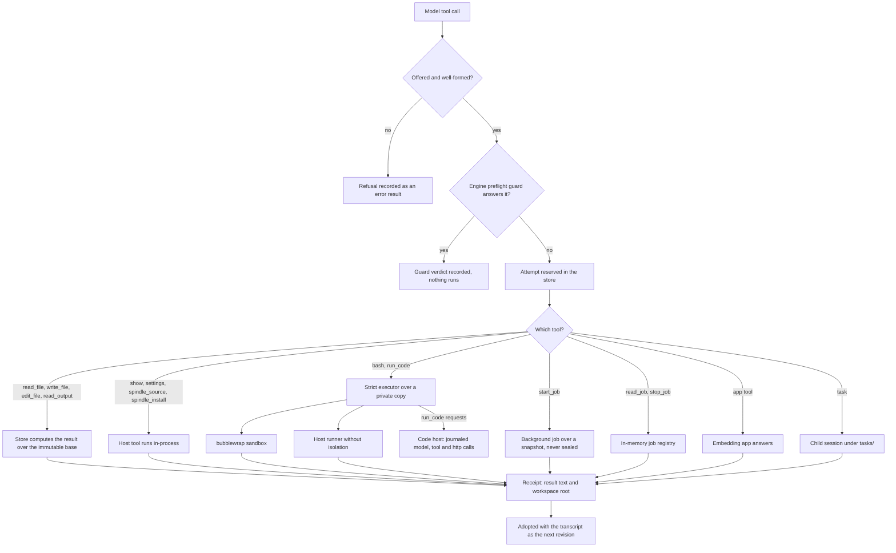
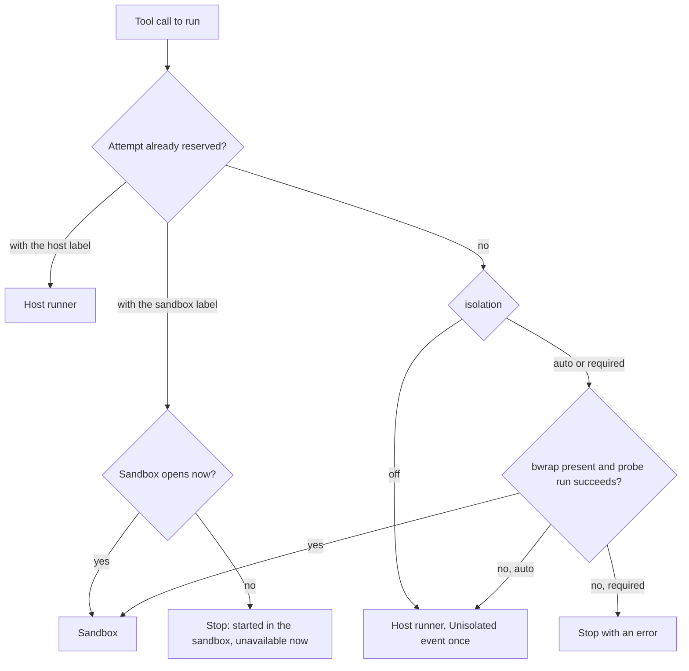
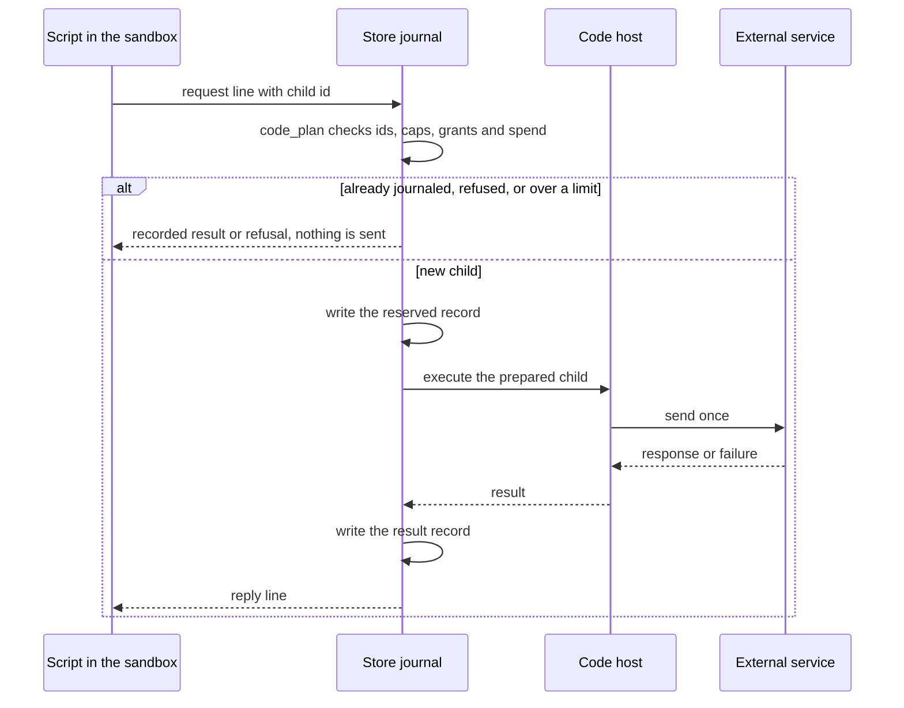

# Tools

A Spindle model works through tools. Some of them are built in: shell commands,
scripts, file tools, background jobs, and a few host tools. Others come from the
embedding app, and two more can be enabled: child task sessions and code mode's nested
calls. Every call follows the store's rule for effects. The call is reserved before
anything runs and runs at most once. Its result is recorded as a receipt, and the
driver adopts that receipt, together with any new workspace, as the next revision of
the conversation. File tools run inside the store. Commands run over a private copy of
the workspace, either in a bubblewrap sandbox or directly on the host, and only the
copy they leave behind is sealed back. App tools are answered by the app, and task
calls by a child session. Code-mode scripts reach models, tools and HTTP endpoints
through a journal that records each nested call before it is sent. This page describes
each path, its inputs and limits, and how commands are isolated on each platform.

For the revision, receipt and rewind model these tools rely on, see
[store.md](store.md) and [driver.md](driver.md). For the transports that deliver app
tool calls and events, see [API.md](API.md), [clients.md](clients.md) and
[embedded.md](embedded.md).

## Overview



Before anything is dispatched, the driver checks a pending call against the session's
offer ([`offered_refusal`](../spindle/store/src/shape.rs) and
[`strict_tool_refusal`](../spindle/store/src/broker.rs)). A call to an unknown tool, or
one whose input fails validation, is not dispatched. It is recorded as an error result
that names the problem, for example `bash: unknown field ...` or `timeout must be
1-1800 seconds`, so the model can correct the call. The engine's preflight guards
(duplicate calls, near-identical command retries, blocked hosts) can also answer a call
without running it (`Action::Guard`; see [engine.md](engine.md)).

When several calls arrive in one model step, they run in order. Each one runs over the
workspace the previous call left, because the broker always runs a call over the
scope's current head ([`strict_base`](../spindle/store/src/broker.rs)). Foreground
`task` calls in the same step are the exception: they share the step's original tree
and run concurrently ([Task sessions](#task-sessions)).

Every call is dispatched through one of the following paths. Each path labels its
attempt with an identifier, so a receipt always records how the call was run.

| Path | Tools | Where it runs | Attempt label |
|---|---|---|---|
| In-process file tools | `read_file`, `write_file`, `edit_file`, `read_output` | the store, over the stored tree | the runner's label |
| Host tools | `show`, `settings`, `spindle_source`, `spindle_install` | the host serving the session | the runner's label |
| Strict executor | `bash`, `run_code`, `start_job` | private copy, sandboxed or on the host | `dext-strict-bash-v1-<helper digest>` or `dext-host-bash-v1-<digest>` |
| Job registry | `read_job`, `stop_job` | the owner process's memory | the runner's label |
| App tools | any tool the app declares | the app (`AppTools::call`) | `spindle-app-tool-v1-<definition digest>` |
| Tasks | `task` | a child session | `spindle-app-tool-v1-<definition digest>` |
| Code-mode children | nested `model`, `tool`, `http` calls of a script | the code host, outside the sandbox | journal stages `code-...` under the script's attempt |
| Remote and app runners | `bash` of embedded sessions | another Spindle host, or the app | the runner's identity |

## What a session offers

A session's settings decide which tools a request offers. The settings are described in
[`Settings`](../spindle/store/src/driver_types.rs), and the offer is built by
[`Offer`](../spindle/store/src/shape.rs).

| Setting | Values | Effect |
|---|---|---|
| `builtin_tools` | `all` (default), `files`, `none` | `all` offers every built-in tool. `files` offers `read_file`, `write_file` and `edit_file` only. `none` offers no built-in tools. |
| `runner` | `none` (default), `remote`, `app` | With `builtin_tools: files`, a runner adds `bash` and `read_output`. This setting is used by embedded hosts. |
| `tasks` | `false` (default), `true`, or `{max_depth, max_running, models}` | Offers `task` while the session's task depth is below `max_depth`. |
| `tools` | up to 64 app tool definitions | Offered after the built-in tools, in the order given. |
| `instructions` | text up to 32 KiB | Appended to the system prompt. |
| `network`, `toolchain` | booleans | Change the system prompt and the command tools' descriptions, and the grants that `bash`, `run_code` and `start_job` runs receive. |

Tools appear in the request in this order: the built-in tools, then `task`, then the
app's tools. With `builtin_tools: all`, the system prompt is Spindle's coding prompt.
With any other choice, the prompt names only the tools that are offered. When app tools
are offered, the prompt also tells the model that a result saying the app could not
confirm a call means the call's effect must be checked before it is repeated.

## Built-in tools

The schemas the model sees are built by
[`tool_specs`](../spindle/store/src/shape.rs) and
[`host_specs`](../spindle/store/src/shape.rs). The broker checks each input again
before it runs anything ([`strict_tool`](../spindle/store/src/broker.rs)).

| Tool | Input fields | Defaults and limits | Runs in |
|---|---|---|---|
| `bash` | `command`, `timeout`, `max_output` | Command 1 byte to 16 KiB, no NUL. Timeout 1-1800 s, default 30. Result window 8 KiB, with `max_output` clamped to 4096-32768 bytes. | strict executor |
| `run_code` | `language` (`python`, `javascript`, `typescript`), `code`, `timeout`, `max_output` | Script up to 64 KiB (16 KiB on Windows), not blank, no NUL. Timeout default 60 s, max 1800. Result window as for `bash`. | strict executor, brokered |
| `read_output` | `artifact`, `offset`, `limit` | Byte offset (default 0), `limit` 1 byte to 256 KiB (default 8 KiB). Not charged to the turn budget. | store |
| `read_file` | `path`, `offset`, `limit`, `max_output` | First line `offset` (1-based, default 1), `limit` lines (default 2000). Window default 8 KiB, max 256 KiB. UTF-8 text only. | store |
| `write_file` | `path`, `content` | Content up to 1 MiB. Parent directories are implied. | store |
| `edit_file` | `path`, `old_string`, `new_string`, `replace_all` | `old_string` must not be empty and must occur exactly once, unless `replace_all` is true. Each string is limited to 1 MiB. | store |
| `start_job` | `command`, `timeout` | Command up to 16 KiB. Lifetime default 3600 s, max 86400 s. | strict executor, background |
| `read_job` | `job`, `offset`, `limit`, `wait` | `limit` 1 byte to 64 KiB (default 8 KiB). `wait` 0-600 s. Without `job`, lists the session's jobs. | job registry |
| `stop_job` | `job` | A job id from `start_job`, at most 64 bytes. | job registry |
| `show` | `paths`, `title` | 1-8 workspace paths. Title up to 2000 bytes. | host, in-process |
| `settings` | `provider`, `model`, `effort`, `network`, `toolchain`, `compaction`, `max_usd`, `name` | All fields optional. Text values up to 2000 bytes, and `name` 1-80 characters. | host, in-process |
| `spindle_source` | `action`: `checkout` or `update` | Available only when the serving host offers Spindle's source. | host |
| `spindle_install` | `summary` | Up to 2000 bytes. Available only when the serving host offers Spindle's source. | host |
| `task` | `prompt`, `model`, `effort`, `files`, `background`, `settings` | Prompt 1-65536 bytes ([Task sessions](#task-sessions)). | child session |

A tool input with a field the tool does not define is refused.

### Results, the turn's output budget and `read_output`

A command produces stdout, then stderr. The model reads that output in a bounded window
built by [`record_sealed`](../spindle/store/src/broker.rs) and
[`fit_result`](../spindle/store/src/broker.rs):

- The window is 8 KiB by default (`MAX_TOOL_TEXT`). A call can choose a different size
  with `max_output`, which is clamped to 4096-32768 bytes.
- The `bash` and `run_code` results of one turn share a budget of 256 KiB
  (`TURN_OUTPUT_BUDGET`). Other results that are not paging or host tools count toward
  the same total. Each window is cut down to whatever the budget has left.
- Output that does not fit is cut in the middle (`[... N bytes omitted ...]`) and kept
  whole as a store object. The result then ends with
  `[retained output: read_output artifact=<digest> offset=0]`. The pointer and the
  result's closing line are kept however little budget remains. If the budget is used
  up, the text itself becomes
  `[turn output budget used up; page the retained output with read_output]`.
- `read_output` returns a byte window of retained output and does not run anything
  again. The store serves a digest only when a recorded tool result in the same scope
  names it as its artifact ([`retained_output`](../spindle/store/src/broker.rs)). A
  page ends with `[output bytes A..B/TOTAL; next offset=B]`.
- `read_file`, `read_output`, `read_job` and the host tools are not charged to the
  budget, because they page through data the store or the job already holds.

The executor keeps at most 8 MiB per stream (`MAX_OUTPUT` in
[`limits.rs`](../dext-engine/native/src/limits.rs)). A run that prints more is stopped.

A failed run ends with a closing line that says what was kept:

| Closing line | When |
|---|---|
| `the command was killed and its changes discarded` (`KILLED_RUN`) | The run passed its deadline, its output or disk bound, or ran out of memory. |
| `none of its workspace changes were kept` (`UNSEALED_RUN`) | The run could not start (for example, a sandbox that would not set up), or its tree could not be sealed. A missing interpreter is reported without this line ([The host runner](#the-host-runner)). |
| `the script failed, so none of its workspace changes were kept` (`DISCARDED_SCRIPT`) | A `run_code` script exited unsuccessfully. |
| `The session store is full, so this tool call was not run...` (`STORE_FULL`) | The store could not reserve room for the step. Nothing ran. |
| `The tool call did not complete: the runner stopped before its result was saved...` | The owner process stopped during the run. The attempt is sealed as interrupted on resume and is never run again. |

## File tools and workspace revisions

The file tools never start a process. [`apply_file_tool`](../spindle/store/src/broker.rs)
computes their result over the call's immutable base tree, reading only the file the
call names. A successful `write_file` or `edit_file` stages two objects: the new file,
and a new tree manifest. The receipt records that manifest's digest as the call's
workspace root, and the driver commits the root with the transcript as the next
revision. Reads stage nothing. A failed edit is an error result over the unchanged base.
Rewinding to an earlier revision restores that revision's workspace (see
[store.md](store.md)).

Paths are relative to the workspace. `name`, `./name` and `/workspace/name` are all
accepted. Path components must not be empty, `.` or `..`. A component is at most 255
bytes and a path at most 1024 bytes ([`valid_path`](../dext-engine/native/src/limits.rs)).
On Windows, each name must also be one the filesystem keeps as written: no reserved
characters, no device names, no trailing dot or space, and no `~` followed by a digit.

| Rule | Detail |
|---|---|
| Workspace size | At most 50,000 entries (files, symbolic links and empty directories), 64 MiB per file, and 2 GiB in all. |
| `read_file` | Returns line-numbered text, stopped at a line boundary inside the window, with `[N more lines; pass offset=K to continue]`. Non-UTF-8 files and symbolic links are refused, with a hint to use `bash`. |
| `write_file` | Overwriting keeps the file's executable bit. A path that names a symbolic link or a directory is refused. |
| `edit_file` | Zero matches, or more than one match without `replace_all`, is an error that gives the count. The result is refused if it would exceed 64 MiB. |
| Misspelled paths | A case-insensitive match is suggested: `did you mean ...?` |

## Shell commands

The broker runs `bash` as `bash --noprofile --norc -c <command>` over the call's
workspace ([`dispatch_code_workspace`](../spindle/store/src/broker.rs)). Before it runs,
[`apply_bash_guardrails`](../dext-engine/native/src/tool_policy.rs) prepends
`set -o pipefail` to the command and refuses commands that contain
`--break-system-packages`.

Each run goes through the [`StrictExecutor`](../dext-engine/native/src/strict.rs):

1. It takes one of four run slots per user. The slots are lock files shared by every
   owner process, and time spent waiting for one counts against the call's timeout.
2. It checks the input tree. The scratch volume must hold the materialized input plus
   256 MiB of headroom, or the call fails with "the host's scratch space is full ...;
   nothing ran". Scratch space is `/tmp` on Unix and the per-user temp directory on
   Windows.
3. It materializes a private workspace. The serving host may reuse that session's
   last sandbox candidate where content ids and stamps match, reconciling changed
   files and removing leftovers first. Otherwise files are created new, never
   through a link, with symbolic links last. See [engine.md](engine.md#strict-command-runner-strict).
4. It launches the command in the sandbox or on the host ([Isolation](#isolation)). The
   command's working directory is the copy.
5. It watches the deadline, the output size, and the copy's growth. The copy may grow to
   twice the tree limit, but never into the scratch headroom.
6. It seals the result. A file whose inode, size, times and mode are unchanged can
   be reported unchanged. On Linux, inotify also tracks input files opened for
   writing, catching shared-mapping writes that leave tmpfs stamps unchanged; a
   failed watch or overflow makes every input file suspect. New and changed regular files, symbolic links
   (never followed) and empty directories make up the new tree. Sockets, pipes and
   devices are not kept, and the output says so. Hard links are sealed as plain files.
   If the tree exceeds the workspace limits, none of the changes are kept.

[`seal_tree`](../spindle/store/src/broker.rs) then stores only the changed files and the
manifest. Unchanged files keep their existing objects.

Output appears live through observer events while the command runs. That preview is
not authoritative: only the sealed receipt is adopted. If a run is interrupted, for
example when the session is stopped, its process is ended and its copy discarded. On
resume, the call is recorded as not completed and is never run again
([`seal_interrupted_strict`](../spindle/store/src/broker.rs)).

## Isolation

The session setting `isolation` ([`Isolation`](../spindle/store/src/driver_types.rs))
decides how commands (`bash`, `run_code`, `start_job`) run:

| Mode | Behavior |
|---|---|
| `auto` (default) | Commands run in the bubblewrap sandbox when this host supports it. Otherwise they run directly on the host, and the session emits an `Unisolated` event, once per session, before the first such command. |
| `required` | Commands run only in the sandbox. If the sandbox is unavailable, the session stops with "isolation is required for this session but unavailable: ..." instead of running the tool. |
| `off` | Commands always run on the host, for setups where the embedding host provides isolation itself. The `Unisolated` event is emitted as for `auto`. |

### How the runner is chosen

[`Session::pick_runner`](../spindle/store/src/agent.rs) decides which runner each call
uses:



The sandbox is available when `/usr/bin/bwrap` exists and a trivial run succeeds. That
probe proves the kernel lets bubblewrap create its namespaces
([`open_isolated`](../spindle/store/src/agent.rs)). The attempt's `grant_reference`
records the grant used for the run: `spindle-cli-sandbox`,
`spindle-cli-sandbox-network` or `spindle-cli-host-unisolated`. `spindle doctor`
reports the isolation state and reclaims scratch directories that dead runs left behind
([`sweep_abandoned_candidates`](../dext-engine/native/src/strict.rs)).

Some hosts fix the mode:

- `spindle serve` creates its threads with `isolation: required`
  ([`new_settings`](../spindle/store/src/serve/mod.rs)).
- The remote runner (`/v1/run`) opens only the sandbox, so it is unavailable on a host
  without one ([`runner`](../spindle/store/src/serve/v1.rs)).
- Embedded sessions default to `auto`. There, the app's runner counts as unisolated
  unless the app declares a sandbox identity, and `required` refuses an unisolated
  runner ([embedded.md](embedded.md)).

### The Linux sandbox

[`StrictExecutor::open`](../dext-engine/native/src/strict.rs) copies the bubblewrap
binary into a sealed, read-only memfd. It accepts the binary only if the copy's SHA-256
matches the approved digest, and every run executes that sealed copy. In Spindle's
host, the approved digest is the hash of `/usr/bin/bwrap` as installed. The digest
becomes the attempt label `dext-strict-bash-v1-<digest>`.

[`isolated_command`](../dext-engine/native/src/strict.rs) builds the invocation:

| Aspect | Setting |
|---|---|
| Namespaces | New user, PID, IPC, UTS and cgroup namespaces, plus a network namespace unless the run has `network`. Also `--disable-userns`, `--die-with-parent`, `--new-session` and `--cap-drop ALL`. |
| Filesystem | `/usr` read-only, with `/bin`, `/lib` and `/lib64` as links into it. `/etc/alternatives` read-only when present. Fresh `/proc` and `/dev`. A 1 GiB tmpfs at `/tmp`. The private copy bound at `/workspace`, which is the working directory. |
| Environment | Cleared, then `PATH=/usr/bin:/bin`, `HOME=/tmp` and `TMPDIR=/tmp`. No provider credentials. |
| Interpreters | `/bin/bash`, `/usr/bin/python3` and `/usr/bin/node`, from the host's `/usr`. |
| seccomp | Wrong-architecture and x32 calls kill the process. `socket()` is limited by address family (see the network row). io_uring, ptrace, process_vm, pidfd_getfd, every mount API, unshare, setns, bpf, the kernel keyring calls, perf_event_open and userfaultfd fail with EPERM ([`network_filter`](../dext-engine/native/src/strict.rs)). |
| Network off | A private network namespace with only its own loopback. AF_INET and AF_INET6 sockets work, and so do AF_UNIX and route-netlink sockets. Nothing outside the namespace is reachable. |
| Network on | The host's network namespace, AF_INET and AF_INET6 sockets only. Host AF_UNIX, abstract and netlink sockets stay unreachable. `/etc/resolv.conf`, `hosts`, `nsswitch.conf`, `gai.conf`, `/etc/ssl` and `/etc/ca-certificates` are mounted read-only. |
| Process setup | Parent-death signal SIGKILL, a check that the parent is still the owner, `no_new_privs`, and every inherited descriptor closed except those the run needs ([`confine`](../dext-engine/native/src/strict.rs)). |
| rlimits | No core files. File size 1 GiB (4 GiB with the toolchain). CPU time: the timeout times the number of cores, plus 10 s, per process. Address space 256 GiB. Data 4 GiB (16 GiB with the toolchain). Processes: the user's current count plus 1024 (4096 with the toolchain), unless a cgroup caps them. |
| cgroup | Used only when the host declares its cgroup delegated with `DEXT_CGROUP_DELEGATED=1`. Each run then gets its own cgroup under `spindle-runs`, with `pids.max` set to 1024 (4096 with the toolchain) and `memory.oom.group` set. When the `memory` controller can be enabled, all runs share a `memory.max` of three quarters of physical memory, with swap off. The end of a run kills every member, including descendants that left the process group, and an out-of-memory kill is reported as such ([`cgroup.rs`](../dext-engine/native/src/cgroup.rs)). |

A bubblewrap run that never reports the command's exit code is treated as a sandbox
that could not be set up. The call is recorded as "strict isolation setup refused" and
nothing is kept.

### Network

`network` is a session setting. The grant is passed fresh for each run and is never
read back from a saved attempt label. Without it, the tool descriptions tell the model
not to use the network, and sandboxed runs have no route out. With it, a command can
reach the internet, and whatever it does outside the workspace cannot be rewound. On
the host runner, network access cannot be withheld.

### Toolchain and source mounts

With `toolchain` on and a host Rust toolchain installed (`RUSTUP_HOME` and
`CARGO_HOME`, or `~/.rustup` and `~/.cargo`), command runs get a
[`Toolchain`](../dext-engine/native/src/strict.rs):

| Inside the sandbox | Source |
|---|---|
| `/opt/rustup` (read-only) | the host's rustup home |
| `/opt/cargo/bin` (read-only) | the host's cargo binaries |
| `/cache` (read-write) | `<session>/cache`: a private, persistent build cache outside the workspace |
| `/opt/cargo-home` | A fresh tmpfs for each run. `git` is bound from the cache, and `registry` is an overlay of the host registry with downloads written to the cache. |
| `/NAME` (read-only) | Each `--source DIR` and the operator's shelf (`/shelf`), when one exists |

The environment adds `CARGO_TARGET_DIR=/cache/target` and `TMPDIR=/cache/tmp`, and puts
the cargo binaries on `PATH`. Without `network`, it also sets `CARGO_NET_OFFLINE=true`.
Configuration or credentials a run writes to `CARGO_HOME` never reach a later run. A
source directory's mount point is `/` plus its final path component. That name must not
be a reserved root (`bin`, `cache`, `dev`, `etc`, `lib`, `lib64`, `opt`, `proc`, `sys`,
`tmp`, `usr` or `workspace`), and two sources cannot share a name. Sources are mounted only in
toolchain runs, so the CLI refuses `--source` for a thread without the toolchain.

### The host runner

[`StrictExecutor::host`](../dext-engine/native/src/strict.rs) runs commands over the
same private copy, with the same limits and deadlines, but nothing is isolated. Commands
can read and change anything the user can, and they can use the network.
[`host_command`](../dext-engine/native/src/strict.rs) still gives each run a clean
environment:

- Only these variables are kept: `PATH`, `PATHEXT`, `SystemRoot`, `SystemDrive`,
  `windir`, `ComSpec`, `NUMBER_OF_PROCESSORS`, `PROCESSOR_ARCHITECTURE`, `OS` and
  `LANG` (`LANG` defaults to `C.UTF-8`).
- `HOME`/`USERPROFILE` and `TMPDIR`/`TEMP`/`TMP` point to private directories inside
  the run's scratch.
- With the toolchain, the host's own rustup and cargo homes are used, so downloads land
  in the host registry. Sources are linked beside the workspace (`../NAME`) instead of
  mounted. On Windows, creating those links needs Developer Mode.

Interpreters are found through `SPINDLE_BASH`, `SPINDLE_PYTHON` and `SPINDLE_NODE`
first. On Windows, Git for Windows' `bash.exe` comes next. Then the host `PATH` is
searched. Windows Store alias stubs under `WindowsApps` are never used
([`host_program`](../dext-engine/native/src/strict.rs)). If an interpreter is missing,
the result is an ordinary failed call over the unchanged workspace, and nothing ran.

On Unix, a host run leads its own session, and the whole process group is killed when
the run ends. A process that starts its own session can outlive the run unless a
delegated cgroup contains it.

### Platform differences

| | Linux | macOS | Windows |
|---|---|---|---|
| Sandbox | bubblewrap, when installed and permitted | none | none |
| `auto` without a sandbox | host runner, with a notice | host runner, with a notice | host runner, with a notice |
| `required` without a sandbox | the session stops | the session stops | the session stops |
| Ending a run | Sandbox: PID namespace and `--die-with-parent`. Host runs: process group and parent-death signal. Delegated cgroup: `cgroup.kill`. | Process group | A kill-on-close job object. The process starts suspended until the job holds it. |
| Resource caps | rlimits (core, file size, CPU, address space, data, processes), and cgroup `pids.max` and a shared `memory.max` when delegated | Core, file size and CPU are required. Address space and data are best effort. No process cap. | Job object: committed memory capped at three quarters of physical memory, a process count, and CPU time per process |
| Out-of-memory report | through a delegated cgroup | not detected | job memory cap |
| Network off | enforced in the sandbox | not enforceable | not enforceable |
| `run_code` request channel | two pipes named by `SPINDLE_RPC_FDS` | two pipes | lines on stdout prefixed with `0x1E`, replies on stdin |
| `run_code` script size | 64 KiB | 64 KiB | 16 KiB (command-line limit) |
| Workspace names | any valid path | any valid path | Windows-safe names only. Paths that differ only in case are refused, and symbolic links cannot be materialized. |
| Scratch space | `/tmp` | `/tmp` | per-user temp directory |

## Background jobs

`start_job` starts `bash` in the background over a snapshot of the current workspace,
using the same sandbox, network choice, toolchain mounts and rlimits as a run, with CPU
time based on the job's lifetime ([`StrictExecutor::start_job`](../dext-engine/native/src/strict.rs)).
The call waits up to one second, then returns the job id and its first output. A
command that fails at once (command not found, a syntax error) is reported then.

| Property | Value |
|---|---|
| Job id | `job-` plus the first 8 hex digits of the SHA-256 of the `start_job` effect's id ([`job_id`](../spindle/store/src/jobs.rs)), so a replayed receipt names the same id as the live job |
| Lifetime | default 3600 s, max 86400 s |
| Concurrency | at most 16 running jobs per owner process. Jobs do not hold a run slot. |
| Output | stdout and stderr interleaved. The newest 4 MiB are kept, and older bytes are counted and dropped. |
| Remembered jobs | 32 per session. The oldest finished job is forgotten first. |
| Workspace | Never sealed. Files the job changes are discarded, and later workspace changes are not visible to it. |
| End | The command exits, `stop_job` is called, the lifetime or disk allowance runs out, the session is rewound, or the owner process exits |

`read_job` without `offset` waits up to `wait` seconds for the job to end, then returns
its newest `limit` bytes. With `offset`, it waits up to `wait` seconds for output past
that offset. Each page ends with
`[<id> <state> after N s; output bytes A..B of TOTAL; next offset=B]`. Without a `job`
field, `read_job` lists the session's jobs. `stop_job` ends the job and everything it
started, and returns the newest 4 KiB of its output.

Jobs exist only in the owner process ([`jobs.rs`](../spindle/store/src/jobs.rs)). The
receipts of `start_job`, `read_job` and `stop_job` record only what the model saw.
After a restart, a job id from history names nothing, and reading it says so. Recovery
reports such a job as lost and never restarts it. Without `network`, each sandboxed job
has its own private network, so a later `bash` call cannot reach a server the job
started.

## Host tools

The host serving a session runs these tools in-process, under the same reservation and
receipts as the workspace tools ([`host_tools.rs`](../spindle/store/src/agent/host_tools.rs)
and [`dispatch_host_workspace`](../spindle/store/src/broker.rs)). A reserved host call
whose owner died is sealed as interrupted and is never run again.

- **`show`** puts workspace files in the chat as cards. Each path must name a workspace
  file. A directory stands for its `index.html`, and a near-miss path gets a suggestion.
  The card's kind comes from the file extension: `html`, `image` (png, jpg, jpeg, gif,
  webp, avif, bmp, ico), `svg`, `markdown` or `pdf`. Any other file up to 1 MiB that is
  valid UTF-8 without NUL bytes is `text`, and everything else is `file`. The result
  text ends with a `display:` line: a JSON array of `{path, kind, title, size,
  revision}` objects, which hosts attach to the result as `display`. A single `title`
  given for several files becomes `title: name` on each card.
- **`settings`** without arguments returns the current settings and the catalog's
  providers, models and efforts ([`catalog.rs`](../spindle/store/src/agent/catalog.rs)).
  With fields, it checks the change against the current settings plus anything already
  queued. Checks include known providers, models and efforts, sign-in for a new
  provider, a toolchain present on the host, and `max_usd` being non-negative or null.
  It then queues the change. The change is applied when the turn ends
  ([`apply_pending`](../spindle/store/src/agent/host_tools.rs)), never mid-turn, and is
  checked again at that point. `name` renames the thread and needs a host that keeps
  thread names.
- **`spindle_source`** and **`spindle_install`** are offered with `builtin_tools: all`,
  but they work only when the serving host offers Spindle's own source
  (`spindle serve --dev-source`). They check out or update the source under `spindle/`
  in the workspace, and record an install request that a person confirms. Without such
  a host, they reply that they are unavailable. See [host.md](host.md).

## App tools

An embedding app declares tools in the session settings
([`app_tools.rs`](../spindle/store/src/agent/app_tools.rs)). The model sees them after
the built-in tools. When it calls one, the call is reserved in the store before the app
is asked, and recorded with the app's answer. The answer is then adopted like any
workspace result, so a rewind also undoes the files the answer wrote.

### Declaration

| Field | Meaning | Default and limits |
|---|---|---|
| `name` | What the model calls the tool | 1-64 ASCII letters, digits, `_` or `-`. It must not be a built-in tool's name, `task`, `tasks`, `http`, `state` or `dext-model-v1`, and must not start with `spindle_` or `dext`. Names are unique. |
| `description` | What the tool does, as the model reads it | 1-4096 bytes |
| `input_schema` | JSON Schema of the input | Must have `"type": "object"` and be at most 64 KiB. Default `{"type":"object","properties":{}}`. |
| `rerun` | Whether running a call twice is harmless | `"safe"` or `"no"` (booleans are also accepted). Default `"no"`. |
| `timeout_s` | How long a call waits for the answer | 1-86400 s, default 600 |
| `max_output` | Bytes of answer text the model reads | 1 byte to 1 MiB, default 64 KiB. Longer text is kept whole as a retained artifact. |

A session can offer at most 64 app tools. The definition's digest covers the name,
description, schema, `rerun`, `timeout_s` and `max_output`, and it labels the call's
attempt (`spindle-app-tool-v1-<digest>`). A recorded answer is therefore bound to the
definition that was offered. A call that is already reserved stays bound to the digest
its label names.

### Calls, identifiers and answers

Each call the app is asked to answer
([`AppCall`](../spindle/store/src/agent/app_tools.rs)) carries:

- `call`: the call's identifier, `<store instance id>/<effect id>`
  ([`call_id`](../spindle/store/src/meta.rs)). It stays the same for as long as the
  call exists, across crashes and restarts. A call the model makes again after a rewind
  gets a new identifier. An app that keeps its own record by this identifier never runs
  a call twice.
- `tool_use_id`, `name` and `input`.
- `again`: true when an earlier owner reserved this call and stopped before an answer
  was recorded, so the app may already have run it.
- `rerun` and `timeout`, from the tool's definition. Spindle passes `rerun` on so a
  client can decide whether an `again` call can simply run again.

The app answers with one of these forms ([`AppAnswer::from_json`](../spindle/store/src/agent/app_tools.rs)):

| Answer | What is recorded |
|---|---|
| `{content, failed?, files?, state?, details?}` | The content (up to 4 MiB) as the result text, failed or not. `files` can hold `write` (path to text), `write_base64` (path to base64), `executable` (paths among those written) and `delete` (paths, where a directory's path removes everything under it). `state` is a JSON merge patch (an object) for the app state. `details` is up to 1 MiB of JSON kept for the app and its UI, never shown to the model. |
| `{error}` | A failed result with that text |
| `{unknown: true, content?}` | "The app could not confirm whether this call ran: it was asked again after an interruption. Check its effect before repeating it." |
| no answer within `timeout_s` | "No answer from the app within N s; the call may still have run." |
| stopped while waiting | Nothing. The call stays reserved and is asked again, with `again` set, when the session continues. |

[`record_app_answer`](../spindle/store/src/broker.rs) stages the answer's file changes
over the call's base as the call's new workspace root. It records the state patch and
the details beside the receipt, all in one transaction. When the driver adopts the
result, the files, the app state and the conversation advance together as one revision.
If an answer's changes cannot be kept, it is still recorded, with a note in the result
text, so the step is never refused over and over:

- A state patch that is not an object, or that would make the app state larger than
  1 MiB, is dropped with `[spindle: the app's state change was not kept: ...]`.
- File changes that are invalid, or that do not fit in a full store, are dropped with
  `[spindle: the file changes were not kept: ...]`.

When a rewind takes back answered calls, the app is told their identifiers
([`answered_app_calls`](../spindle/store/src/broker.rs), event `app_calls_rewound`). A
turn that reaches an app tool with no app attached stops until an app continues it. The
API events and methods (`app_tool`, `app_tool_result`, `app_tool_done`,
`app_tool_details`) are described in [API.md](API.md).

## Task sessions

When `tasks` is on, the model can call `task` to start another agent: a full Spindle
session of its own, with its own store, rewind and recovery
([`tasks.rs`](../spindle/store/src/agent/tasks.rs) and
[`task_tool.rs`](../spindle/store/src/task_tool.rs)). A task call is reserved and
answered through the app-tool path, and a child session gives the answer.

### Input

| Field | Meaning |
|---|---|
| `prompt` | A self-contained instruction of 1-65536 bytes. The child sees none of the parent conversation. |
| `model` | Another model of the same provider. The default is the session's model. |
| `effort` | `default`, `off`, `low`, `medium`, `high`, `xhigh` or `max` |
| `files` | `keep` (default) or `discard`: whether the task's file changes come back with its answer |
| `background` | When true, the call returns at once and the answer arrives later as a queued update |
| `settings` | Can only narrow `model`, `effort` and `max_usd` |

### Identity, inheritance and depth

- **Directory.** A task lives in `<session>/tasks/<id>/`, where `<id>` is 20 hex digits
  of the SHA-256 of its key. The key is the call's effect id. A call cut off by a crash
  therefore finds its task again and continues it instead of starting over. Inside the
  task, a model request still goes out at most once.
- **Identity.** `task.json` records the inputs that decide what the task does (prompt,
  model, effort, files, background and settings). A later start under the same key must
  repeat them exactly.
- **Settings.** The child copies the parent's settings, then applies the call's model
  and effort, and runs with self-edit off. Its tool calls appear in the parent as nested
  events. Its app tool calls go to the parent's app, under identifiers of the form
  `tasks/<id>/<call>`. It has no serving host, so `spindle_source` and
  `spindle_install` are unavailable in it, and `settings` acts on the task's own
  session.
- **Depth.** `task` is offered only while the session's depth is below
  `tasks.max_depth` (default 2, range 1-16). The depth is the number of `tasks/`
  directories above the session. With the default, a task's task is the deepest level,
  and it is not offered `task`.
- **Model policy.** `tasks.models`, when not empty, lists the only models a task may
  use. Other models are refused before anything starts.

### Running, merging and conflicts

`tasks.max_running` (default 4, range 1-16) limits how many tasks run at once. It is
enforced with slot files under the session's `cache/task-slots`. Several foreground
`task` calls in one model step all start from the step's original tree and run
concurrently, in chunks of `max_running`. Their results are recorded in call order
([`run_task_batch`](../spindle/store/src/agent.rs)).

When a task's turn ends, its answer is the child's last reply. If the child stopped on
its own before finishing, for example on its budget, the answer starts with "The task
stopped before it finished (...)" and is marked failed. Unless the call said
`files: "discard"`, the task's changes come back with the result: changed or new files,
deleted paths, links and empty directories, computed against the base the task started
from. They land in the parent's workspace as the call's new root, so rewinding the
parent past the call undoes them. Before recording,
[`refuse_conflicts`](../spindle/store/src/task_tool.rs) compares each task's changes
with what has changed in the parent since the base, including earlier tasks of the same
step. If any path overlaps, none of the task's changes are adopted, the answer gains
`[task file conflict: ...]`, and it is marked failed.

A background task's call is answered at once, saying the task started and will
report as a queued update. Its files stay in the child session.
When it ends, its retained answer, or a stopped report with the reason when it
could not go on, is delivered to the parent's running or next turn. Delivery is
committed once per lineage; a rewind before it makes the report readable again.
Tasks created after a rewind's target become abandoned but remain in the store.

### Budget leases

When the native parent has `max_usd`, each task gets a lease. At registration, the lease is
the parent's cap, minus what the parent has spent, minus what other running tasks still
hold, divided by `max_running`. Each time the task runs, its `max_usd` is set again to
the smaller of that lease and what the parent has left, leaving out the task's own
spend. A `settings.max_usd` in the call can lower it further
([`lease`](../spindle/store/src/agent/tasks.rs)). The task's spend counts against the
parent's usage report. Embedded tasks instead share their open task tree's spend
and in-flight worst cases against the inherited or narrowed budget; embedded
`usage` reports only the session itself. See
[embedded.md](embedded.md#settings-and-limits).

### Cancellation and recovery

A watcher in each task sets the child's interrupt when the parent's interrupt is set,
or when the task is marked stopped or abandoned. Stopping the parent session therefore
interrupts its running tasks. Nothing is recorded for an interrupted task call, and the
parent's next `continue` finds the same task and resumes it. A task stopped on its own,
by marking it stopped, stays stopped until it is explicitly restarted. Sometimes a task
cannot go on by itself, for example because a request in it has an unknown outcome. Its
call is then left unanswered, with a message to settle the task in its own session
before continuing the parent. This unanswered-call rule applies to foreground
tasks. A background child that stops without an answer, including a provider failure,
unknown send or worker crash, retains a stopped report so the parent goes on; its
`answer` row may hold `{content, failed: true}` as the reason. Explicitly starting
the same id again resumes it, and a new end reports again. An app can also start,
wait for and stop tasks directly (`task_start`, `task_wait`, `task_stop`; see
[API.md](API.md)). The embedded host also supports queued tasks; stopping a parent
that only waits for them ends the wait while leaving the tasks running.

## Code mode

`run_code` runs one Python, JavaScript or TypeScript script as a single step, through
the same runner as `bash`.
Inside the script, helpers do file work in-process. Calls out of the sandbox (models,
granted tools, granted HTTP endpoints, the app's tools) go to the host through a
channel, and the host journals each one before it runs.

### Languages and runtime

The broker starts the interpreter with a prelude that defines the helpers, and passes
the script as the next argument ([`CodeLanguage::argv`](../spindle/store/src/broker.rs)):

| Language | How it runs |
|---|---|
| `python` | `python3 -I -c <prelude> <script>`. The script runs under `exec`. `.spindle/helpers/` comes first on `sys.path` and the workspace root last, so a workspace file named like a standard module does not shadow it. No bytecode is written. |
| `javascript` | `node --max-old-space-size=128 --jitless --no-expose-wasm -e <prelude> <script>`. The script is the body of an async function, so `await` works. `require` is available, and modules resolve from `.spindle/helpers/` and `node_modules`. |
| `typescript` | As JavaScript, after `transpileModule` (target ES2022) with a reviewed `typescript` package. The package comes from `SPINDLE_TYPESCRIPT_DIR`, or `code-runtime/node_modules/typescript` beside the installed binary's directory, and is mounted read-only in the sandbox. Code is transpiled without type checking. Top-level `import` and `export` are not supported. |

A script's workspace changes are all-or-nothing. If it exits unsuccessfully, they are
discarded. External calls are never rolled back.

### Helper API

The helpers are globals, and are also available to helper modules as the `spindle`
module (Python `import spindle`) or `globalThis.spindle` (JavaScript and TypeScript).

| Helper | What it does |
|---|---|
| `read(path)` | Returns the file's text. |
| `write(path, text)` | Writes the file, creating parent directories. |
| `edit(path, old, new, count=1)` | Replaces text. `count=0` replaces every occurrence. Raises if the text is not found, or occurs more than once with `count=1`. Returns the number of replacements. |
| `ls(pattern='**/*')` | Returns the matching files, sorted. |
| `sh(command, check=True)` | Runs `bash --noprofile --norc -o pipefail -c` and returns stdout and stderr together. Raises on a non-zero exit when `check` is true. |
| `image(path)` | Returns `{media_type, data}` for a PNG, JPEG, GIF or WebP file, detected by its magic bytes. |
| `model(prompt, options)` | Makes a nested model request with no tools or history. Returns `{text, usage, provider, model}`. Options: `provider`, `model`, `max_tokens` (default 4096, max 131072), `system`, `effort`, `images`. Unknown options are refused. Python takes the options as keywords. |
| `models(prompts, options)` | Fans out `model` calls through `batch`. Each item is the call's result, or `{error, may_have_run}`. |
| `tool(name, args)` | Calls a granted tool or an app tool. `tools.call` is an alias. |
| `tools.search(query)`, `tools.describe(name)` | Discovery: up to 20 matches with their risk, or one tool's schema. Nothing runs. |
| `http(url, {method, headers, body or json, timeout})` | Sends a request through an operator HTTP grant. Returns `{status, url, headers, truncated, redirects, json or body}`. |
| `batch(calls)` | Takes `(method, input)` pairs in Python or `{method, input}` objects in JavaScript, with `model`, `tool` or `http` as the method. Reserves every call first, then runs them up to the parallel limit. Returns `{ok, data or error}` for each call, in order. |
| `limits()` | Returns the effective limits. |
| `ui.skin(css)` | Writes a host UI skin proposal to `.spindle/skin.css`, which the operator stages and previews before applying. |

A failed nested call raises an error. Its message ends with `[may_have_run]` when the
call may have taken effect.

### The request channel

On Unix, requests and replies use two dedicated pipes. Their descriptors are passed in
`SPINDLE_RPC_FDS`, which the prelude removes from the environment, so ordinary output
can never be mistaken for a request. On Windows, requests are lines on stdout that
begin with the byte `0x1E`, and replies arrive on stdin
([`execute_tree`](../dext-engine/native/src/strict.rs)). Each request is one JSON line,
`{seq, id, method, input}`, sent one at a time. `seq` must come back on the reply. A
request can be up to 64 MiB, and a reply is limited to 1000 KiB.

The script numbers its external calls. `model`, `tool` and `http` each take the next
child id, and a `batch` takes one id per call. Discovery and `limits()` take none. The
child id and the parent attempt name the journal stage
([`child_stage`](../spindle/store/src/artifact.rs)).

### The journal: reserved before it runs, recorded when it ends



[`code_mode.rs`](../spindle/store/src/code_mode.rs) keeps one journal per script
attempt:

- **Before anything runs.** [`code_plan`](../spindle/store/src/code_mode.rs) checks the
  child ids, the call caps, the model budget, the grants (through the host's `prepare`)
  and the dollar caps. Then [`code_reserve`](../spindle/store/src/code_mode.rs) durably
  writes a `reserved` record holding the request and the prepared child. Only after
  that can the host send or spawn it. After a crash, that child is uncertain. It is
  never sent again by itself.
- **When it ends.** [`code_record`](../spindle/store/src/code_mode.rs) writes a
  `result` record. When batch children run in parallel, each one is recorded as soon as
  it finishes, so a crash leaves only the children still running uncertain.
- **Replays.** A request under a child id that already has a result gets the recorded
  result back, and nothing runs again. The same id with a different input is refused
  ("child id reused with different input"). An id that was reserved but never recorded
  returns `may_have_run: true` ("child outcome unknown; inspect effects before an
  explicit new attempt").
- **Uncertainty blocks.** While any child of the script is reserved without a known
  result, every new external call is refused with `may_have_run: true`. The same applies
  when a child's own result records an unknown outcome, such as a helper that was
  stopped or an HTTP failure after the request may have left.
- **Batches.** A batch reserves each chunk just before it runs. A replay that finds a
  batch only partly reserved is refused. Session-pack and app-tool calls always run one
  at a time.
- **Storage.** Journal strings longer than 4096 bytes are kept as a SHA-256 and a
  length, so prompts and images do not fill the store, and a replay can still prove it
  asks for the same thing. An oversized batch reply drops its largest results from the
  reply, marking them omitted and kept in the journal, rather than failing the batch.
- **Failures.** If the journal itself fails, the store pauses, and the script is told
  whether a child may already have run.

The `run_code` call itself is never re-run either. If its owner stops mid-script, the
call is sealed as interrupted with a note to inspect the journal. `spindle
code-receipts` prints the journal ([`code_receipts`](../spindle/store/src/code_mode.rs)).

### Limits

The limits come from the code policy's `limits` object. They are clamped to fixed
ceilings ([`Limits`](../spindle/store/src/code_mode.rs)):

| Limit | Meaning | Default | Ceiling |
|---|---|---|---|
| `calls` | External calls per script | 32 | 1024 |
| `model_calls` | Nested model calls per script | 8 | 256 |
| `model_budget` | Allowance per script: prompt and system bytes, plus `max_tokens`, plus the reasoning allowance, plus 1024 per image, summed over its model calls | 32768 | 16 MiB |
| `parallel` | Children of one batch that run at once | 1 | 16 |
| `max_usd` | Dollar cap per script, checked against the worst-case cost of new model calls before they are reserved | none | n/a |

A batch holds 1-128 calls. A prepared child is limited to 24 MiB. A nested prompt or
system text is limited to 1 MiB. A model call can carry at most 16 images, with at most
20 MiB of base64 in total. The session's own `max_usd` also applies to nested calls
([`admit_nested_spend`](../spindle/store/src/agent/cost.rs)). When a cap is set, a model
with no catalog price is refused.

Embedded sessions run scripts through the app's runner, with fixed limits of 128 calls,
32 model calls, a 1 MiB budget and 4 in parallel
([`embedded/code.rs`](../spindle/store/src/embedded/code.rs)).

### Grants: the code policy

The sandbox never receives the policy, any credentials, or the authority to choose an
executable. The host ([`CodeHost`](../spindle/store/src/code_host.rs)) reads the policy
from `SPINDLE_CODE_POLICY`, or from `code-policy.json` in the parent of the installed
binary's directory. Without a policy, nothing is granted: no models, no tools, and no
HTTP endpoints. The policy must be a regular JSON file under 256 KiB:

```json
{
  "version": 1,
  "models": [{"provider": "local", "model": "*"}],
  "tools": [],
  "http": [],
  "limits": {"calls": 32, "model_calls": 8, "model_budget": 32768, "parallel": 1}
}
```

**Models.** Each entry grants a provider, or every provider with `"provider": "*"`, and
optionally one model. A missing model or `"*"` grants every model of that provider.
Without an explicit provider, a script uses the thread's own route if it is granted,
and otherwise the first explicitly granted provider. A refusal lists the grants. The
request is shaped like a session request with one user message and no tools, sent with
live credentials resolved on the host, and recorded with its usage.

**Tools** (up to 128). Each entry names a reviewed executable and how to call it:

| Field | Meaning |
|---|---|
| `name`, `description`, `input_schema` | How scripts discover and call the tool. Inputs are validated against the schema, and unsupported schema keywords fail closed. |
| `command`, `sha256`, `args` | An absolute executable path, its digest, and up to 64 arguments. A changed executable is refused until the operator reviews it. |
| `files` | Up to 16 dependency pins, `{path, sha256}`, checked before each call |
| `risk` | Required: `read`, `write` or `danger` |
| `protocol` | `json` (default): the arguments go to stdin and one JSON value comes back. `pack-v1`: a pack helper. |
| `lifecycle`, `pack`, `tool`, `manifest`, `max_dynamic_risk` | Pack bindings ([Session packs](#session-packs)) |
| `cwd`, `timeout_seconds` | Working directory (default: the session directory) and timeout (default 30 s for one-shot calls and 120 s for session-pack calls, at most 1800 s) |

External tools run **on the host, outside the sandbox**, with the user's authority.
Each runs with a clean environment (`PATH`, `HOME` and `LANG`, the Windows system
variables, and on Unix the user's runtime directory and session bus address). It gets its own process tree,
which is killed on timeout or interrupt. Stdout is limited to 1000 KiB and stderr to
16 KiB. A helper that never started ran nothing. A helper stopped by a timeout, an
interrupt or an output flood has an unknown outcome. `spindle code-packs [RUNTIME.json]`
lists installed packs and exports binding candidates for the operator to review. It
grants nothing.

**App tools in scripts.** `tool(name, args)` also reaches the session's app tools,
unless a policy entry has the same name. The app is asked with identifier
`code-<instance>/<journal stage>`. The answer text comes back to the script, and its
`details` are kept privately in the journal and emitted to the app's UI. The app's file
and state changes are not applied, and the script is warned that they are kept only
when the model calls the tool itself.

### HTTP grants

[`code_http.rs`](../spindle/store/src/code_http.rs) checks every request a script
makes. The host sends it, so the script needs no network of its own and never sees a
grant's credentials. The policy can hold up to 64 grants:

| Grant field | Meaning |
|---|---|
| `name` | A token of 1-64 characters |
| `url` | An http or https prefix. No user information and no query. A request must match the scheme, host and port exactly, and its path must start with the prefix at a segment boundary. |
| `methods` | Drawn from `GET`, `HEAD`, `POST`, `PUT`, `PATCH`, `DELETE` and `OPTIONS`. Default `GET`. |
| `headers` | Up to 32 headers. Each is fixed text, or `{"env": VAR}` or `{"credential": PROVIDER}` with an optional `prefix`. Secrets are resolved only when the request is sent. |
| `risk` | Required: `read`, `write` or `danger` |
| `timeout_seconds` | 1-600, default 30 |
| `max_response_bytes` | 1 byte to 640 KiB, default 256 KiB |

The script supplies `url`, `method`, `headers`, `body` (text) or `json`, and `timeout`
(capped at the grant's). Some requests are refused:

- headers that the host owns, that override the method, or that the grant supplies
  itself;
- paths that encode `.`, `/`, `\` or NUL, or that hide `;` after a dot segment;
- bodies over 1 MiB.

Redirects are followed only within the same grant, at most 5 times, and no proxy is
used. Any echo of a secret in a response or error is replaced with `[redacted]`. This
covers the secret as is, JSON-escaped, percent-encoded and base64 forms. A JSON
response body comes back parsed as `json`, and anything that does not fit is cut and
marked `truncated`. A failure before anything left the host is a known refusal. A
failure after the request may have reached the server is an unknown outcome, which
blocks further external calls in that script.

### Session packs

A policy tool with `"protocol": "pack-v1"` binds a pack helper. The helper and its
`runtime.json` manifest are pinned by digest, and the policy's command and arguments
must match the manifest ([`CodeHost::binding`](../spindle/store/src/code_host.rs)). A
`one-shot` binding runs the helper for each call and refuses any state or effects it
returns. A `session` binding keeps pack state held by the host between calls
([`pack_runtime.rs`](../spindle/store/src/pack_runtime.rs)):

| Pack response part | What Spindle does |
|---|---|
| `state` | Kept as a ledger snapshot, at most 64 KiB. The helper sees it on its next call, and a script never reads or writes it directly. |
| `steer` effect | Delivered once, after the tool round, as a queued update: `[pack-runtime steer] <pack>` followed by the text ([`round_steer`](../spindle/store/src/agent/pack_turn.rs)). |
| `continue` effect | Queued. When the turn completes, every active pack gets an `idle` event, and one follow-up turn starts after the requested delay (at most 30 s). A stop during the delay cancels it for good. |
| `view` effect | Sent to observers as a `PackView` event (a title and Markdown). |
| `tools` effect | Promotes tools as `pack/tool`. They can be discovered and called from scripts, up to the pack's risk ceiling, which is the highest granted risk, lowered by `max_dynamic_risk`. |
| `ui_request` | Shown to a person through the host's pack UI (`confirm`, `form`, `input`, `progress` or `select`). Up to 16 rounds per call, each waiting at most 30 minutes. |

Every accepted response becomes a ledger anchor tied to the revision where it happened.
The pack state at a revision is the newest anchor on that revision's ancestry, so a
rewind restores the pack state and promoted tools of the target revision. Abandoned
branches drop out. Idle events and follow-ups are keyed by the turn's execution id: a
restart reuses an idle that finished, does not run one again whose outcome is unknown,
and delivers a decided follow-up once. If a pack's grant is revoked or its policy
becomes unreadable, its queued continuations are dropped with a note.

## Images

The built-in Spindle agent does not attach images to its own model requests. Request
shaping describes any image reference in the transcript as text
(`[image not available in spindle]`, [`no_images`](../spindle/store/src/shape.rs)).
Images reach models in two ways:

- **Nested model calls.** A script passes `images: [image(path), ...]` to `model()`.
  The image formats are PNG, JPEG, GIF and WebP. The model must accept image input,
  and a refusal lists the models that do.
- **The `read_image` store profile.** This is an optional store feature
  (`dext-native-image`), not one of the built-in agent tools. A host dispatches a
  `read_image` call through
  [`dispatch_read_image`](../spindle/store/src/broker.rs). The attempt label names the
  pinned worker executable, `spindle-image-worker` built from
  [`image_worker.rs`](../spindle/store/src/image_worker.rs). The host opens the source
  file itself and approves its digest. The worker reads at most 20 MiB on stdin, under
  its own memory and CPU limits and a 15 s timeout, and returns a sanitized JPEG with a
  longest side of at most 1568 pixels. [`image.rs`](../spindle/store/src/image.rs)
  stores the bytes, the stage pin and a provenance row (worker digest, source digest
  and dimensions) in one transaction. The receipt (`SIJ1` metadata) lists the image
  artifacts, and neither paths nor grants persist. Sending an image to a provider needs
  a separate, current disclosure approval. That approval is bound to the scope, the
  route, the turn, the policy generation and the approved worker. It is held only in
  memory and is revoked by any change of that context or by reopening the store.

## Remote and app runners

Embedded sessions have no sandbox of their own. With `builtin_tools: files` and a
`runner`, their `bash` runs elsewhere:

- The store reserves the call ([`reserve_runner_call`](../spindle/store/src/broker.rs)),
  checking the command as the sandbox does, and hands over the command, its timeout and
  the call's tree.
- The runner runs the command and reports its output, its success, and the files it
  wrote or deleted.
- [`record_runner_result`](../spindle/store/src/broker.rs) stages those changes as the
  call's new root. A failed run keeps no changes.

The other file tools and `read_output` are computed by the embedded store itself
([`dispatch_file_workspace`](../spindle/store/src/broker.rs)).

- **`runner: remote`.** A Spindle host runs the command in its sandbox.
  `GET /v1/runner` returns the host's identity (`helper`, `isolated`,
  `implementation`). `POST /v1/run` takes `{command, timeout_s, network, files:
  [{path, base64, executable}], links, directories, run?}`, with at most 48 MiB of file
  bytes. It returns `{output, success, writes, deletes, links, directories, failure,
  helper}`, with changes measured against the files sent
  ([`runner.rs`](../spindle/store/src/agent/runner.rs)). Nothing a run leaves stays on
  that host. Both routes are authenticated like the rest of `/v1`, and they answer 503
  on a host without a sandbox. Prefer `token new NAME --runner`: it reaches only
  discovery and runner routes, not sessions. `remoteRunner` names each run and
  posts `/v1/run/ID/stop` when aborted; `GET /v1/run/ID` reports its state only to
  the token that started it. Stop does not undo external effects. See
  [API.md](API.md#routes).
- **`runner: app`.** The app runs the command itself. Its runs count as unisolated
  unless the app declares a sandbox identity.

See [embedded.md](embedded.md) and [clients.md](clients.md) for the client side.

## Source map

| Area | Files |
|---|---|
| Tool names, offer and schemas | [`turn.rs`](../spindle/store/src/turn.rs), [`shape.rs`](../spindle/store/src/shape.rs) |
| Dispatch, file tools, results, jobs and runners | [`broker.rs`](../spindle/store/src/broker.rs), [`jobs.rs`](../spindle/store/src/jobs.rs) |
| Choosing a runner and running built-in tools | [`agent.rs`](../spindle/store/src/agent.rs) |
| Host tools and the model catalog | [`agent/host_tools.rs`](../spindle/store/src/agent/host_tools.rs), [`agent/catalog.rs`](../spindle/store/src/agent/catalog.rs) |
| App tools | [`agent/app_tools.rs`](../spindle/store/src/agent/app_tools.rs) |
| Tasks | [`agent/tasks.rs`](../spindle/store/src/agent/tasks.rs), [`task_tool.rs`](../spindle/store/src/task_tool.rs) |
| Remote runner | [`agent/runner.rs`](../spindle/store/src/agent/runner.rs) |
| Code mode | [`code_mode.rs`](../spindle/store/src/code_mode.rs), [`code_host.rs`](../spindle/store/src/code_host.rs), [`code_http.rs`](../spindle/store/src/code_http.rs) |
| Session packs | [`pack_runtime.rs`](../spindle/store/src/pack_runtime.rs), [`agent/pack_turn.rs`](../spindle/store/src/agent/pack_turn.rs) |
| Images | [`image.rs`](../spindle/store/src/image.rs), [`image_worker.rs`](../spindle/store/src/image_worker.rs) |
| Sandbox and host runner | [`strict.rs`](../dext-engine/native/src/strict.rs), [`cgroup.rs`](../dext-engine/native/src/cgroup.rs), [`process_tree.rs`](../dext-engine/native/src/process_tree.rs), [`limits.rs`](../dext-engine/native/src/limits.rs), [`tool_policy.rs`](../dext-engine/native/src/tool_policy.rs) |
| Tests | [`host_tools.rs`](../spindle/store/tests/host_tools.rs), [`api.rs`](../spindle/store/tests/api.rs) (app tools, tasks, jobs), [`pack_session.rs`](../spindle/store/tests/pack_session.rs), [`image.rs`](../spindle/store/tests/image.rs), [`worker_lifecycle.rs`](../spindle/store/tests/worker_lifecycle.rs), [`artifact.rs`](../spindle/store/tests/artifact.rs) |
